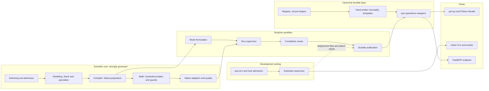

# Integrated system account

**Interface-checked unless marked · 2026-10-24 · source `cbf45ccc933b66192bd7ed5b2a77176e39d46c2e`.**

The [collection README](README.md) gives the baseline, standard and evidence limits. This page
is the audit's architectural account:
- how the system is actually organized;
- how well it serves the simulator's functional target;
- where alignment with the design principles is strong;
- where structural causes interact in ways a local inspection misses.

The primary findings live on the topic pages, with stable identities. This page selects no
remedy, priority or work package.

## The system as built

The arrows show owners and dependencies, not call order.

Governance follows a **gradient from the center outward.**

**The scientific core is well governed.**
- `pse-quantity` owns complete physical types.
- Domain guards are captured before Symbolica rewriting and materialized after it.
- Derivative availability is owned by the libraries and refuses rather than falls back.
- Conservation is derived from declared contributions.
- Adding a unit model on existing physics is a package-only change (PSE-S01).
- Run-level outcome interpretation has one pure, typed owner (`workflow/numerics.rs`), which
  study and durable summaries consume. The automatic residual-LM fit route is the exception
  ([DA-038](semantic-model-and-authority.md#da-038)).
- One run supervisor serves every analysis kind.
- The study policy is one pure function, executed natively and inside SurrealDB.
- Library containment is clean:
  - the SurrealDB SDK lives only in `pse-operations`;
  - Salsa only in `pse-compiler`;
  - Symbolica only in `pse-math`;
  - result reads are DataFusion providers with pruning.

**Toward the rim, governance weakens.** The rim is:
- the canonical store layer;
- the exchange and host surfaces;
- the tooling layer.

This is also where Plans 50–53 added most of their code. The registry declares record *shapes*
there, while contracts, protocol and meaning are written by hand per owner, per host and per
language. A wrong current output is rare, because most mismatches fail closed. What suffers is
extension locality, authority and execution fit.

**The runtime crate sits between the two.** It is the declared owner of scientific workflow
(§3.2, ADR-0175), not a thin composition root, and that ownership is legitimate. Two problems
remain:
- its internals have no boundaries against each other
  ([DA-021](local-reasoning-and-assurance.md#da-021));
- its mode formulation and some routes re-derive or fill in meaning that the core publishes
  incompletely ([DA-006](semantic-model-and-authority.md#da-006), DA-038).

## How the system serves its functional target

The profile names five workloads and two result qualities.

**Edit → re-solve.**
- Preparation is shared: Salsa preparation and value rebind without rebuilding structure. That is
  a strength.
- The default runtime is durable, and a solve's public wait ends only after publication is
  acknowledged.
- Each relation, chunk and progress flush is published as its own sealed file
  ([DA-034](execution-fit.md#da-034)).
- *Measured* under earlier conditions (Plan 48f I30): a test build, a small KINSOL case, before
  the SurrealMX move. Native work took a median of about 1.5 ms, and publication through
  acknowledgement about 0.85 s.
- So the interactive loop's critical path is dominated by a fixed publication cost that does not
  depend on model size. The explicit ephemeral runtime avoids it.

**Studies.**
- The middle of a value-only sweep is sound: lane-parallel, structure-reusing, with drained
  cancellation.
- Its population ends are loops of item operations ([DA-035](execution-fit.md#da-035)):
  - creation runs under a fixed 90 s clock;
  - finalization writes one file per four rows;
  - analysis is capped at 128 occurrences.
- Nothing is physically collected ([DA-025](execution-fit.md#da-025)).

**Recycles** (bounded sample at this refresh). The recycle design is library-owned and
explicit:
- a causal sweep is a KINSOL map, with "no recycle iteration algorithm" in project code
  (`pse-backend-native/src/recycle.rs`);
- tears are selected by an exact HiGHS MILP or an explicit greedy route, each checked
  independently for acyclicity by petgraph (§17.4);
- units evaluate on immutable original-case overlays;
- raw-map evidence and restarts preserve the original caps.

Two points remain:
- Recycle strategies are nondurable by maintainer decision.
- KINSOL is selected by name for declared roots ([DA-017](boundaries-and-composition.md#da-017)).

PS-08's convergence-history and policy questions were not examined beyond §17.4 and the headers.

**Dynamics.**
- The same model definitions serve dynamics, and independent original checks run at trajectory
  samples.
- Dynamic formulation builds its own target inventory and drops nominal hints that fall outside
  it (DA-006).
- Horizon decisions sit inside a large async driver (DA-038).
- Each horizon step publishes every relation (DA-034).

**Extension.**
- A unit or property model is package-only.
- A new solver implementation is mostly adapter-local; the exceptions are DA-017.
- A new analysis kind touches about 19 files ([DA-009](structure-and-invariants.md#da-009)).
- A new durable owner or project capability crosses the registry, hand SurrealQL, wrappers, four
  hosts and Python tooling (cause 1).

**Physically meaningful results.** Rust checks complete physical meaning, but no public reader
can resolve units, bases or reference states ([DA-005](semantic-model-and-authority.md#da-005)).

**Diagnosable failures.** Solver outcomes are typed and truthful. Outside them:
- most workflow and math failures are classed as invalid models by the constructor, not by
  their meaning;
- durable lazy admission persists timeouts and internal defects as scientific refusals;
- the solve path's well-posedness refusal names only the first missing input
  ([DA-039](structure-and-invariants.md#da-039)).

## Five integrated causes

Each cause explains a group of findings and why repairing one site would leave the boundary
deficient.

### 1. Contracts beyond record shapes are hand-authored per owner, host and language

The registry generates table definitions, codecs, some field enumerations and payload documents.
Every other contract that decides behavior is written again where it is consumed:
- **Store meaning** ([DA-007](structure-and-invariants.md#da-007)):
  - identity kinds encoded in key prefixes and recovered by parsing, and bare `str` keys at the
    public boundary;
  - owner, command, artifact and run vocabularies as literals in templates, Rust, exchange
    documents and Python;
  - field rules split between registry constants and generator branches;
  - lifecycle projections that are partial or live in the code generator.
- **Protocol** ([DA-033](boundaries-and-composition.md#da-033)): about ten acknowledgement and
  settlement schemes, already divergent between execution, projects and research. The physical
  file protocol exists in Rust and again in Python.
- **Host operations** ([DA-015](boundaries-and-composition.md#da-015)): about 50 Plan 51
  operations hand-projected into pse-py, the Python facade, the `pse-project` CLI and FastMCP,
  each with its own defaults.
- **Deployment** ([DA-019](boundaries-and-composition.md#da-019)): the execution profile is
  mirrored between a Python writer and three Rust readers and joined by untyped stdout JSON. The
  restore comparison's owner set is hand-listed.
- **Resource profiles** ([DA-036](development-tooling.md#da-036)): the same budgets live in toml,
  supervisor literals, a test manifest, Rust validators, the worker and MCP defaults.

**Why it matters.** Plan 51 is the demonstrated change scenario. Its new namespaces account for
39 of the 55 server functions added since the previous baseline, and the canonical tables grew
by a net 17. Each new owner brought its own vocabulary, envelope, guard text and host
projections. Typing only the Rust layer (key newtypes, say) would leave the SurrealQL templates,
exchange documents, hosts and Python supervisor written by hand. Unifying one owner's settlement
would leave the others divergent. The mechanism to declare once and lower already exists here,
in registry substitution into templates and generated enum `TYPE` literals, but it is applied
to a handful of cases only.

### 2. Durability is realized per semantic unit rather than per workload

The maintainer premises are honoured:
- no native work runs inside a transaction;
- recovery is per attempt;
- terminal admission is truthful;
- cancellation drains;
- 16 lanes overlap publication with compute.

The execution-fit problems come from the physical unit chosen for durable effects:
- Every relation, chunk, progress flush, live batch, horizon step and four-row summary page
  becomes its own sealed file with the full intent protocol ([DA-034](execution-fit.md#da-034)).
- Population intents are loops of item operations under fixed clocks and descriptor-sized pages
  ([DA-035](execution-fit.md#da-035)).
- Physical collection has no production route ([DA-025](execution-fit.md#da-025)).

These compound. Per-unit files multiply by occurrences, and none is ever collected. Study
finalization turns its page into a file unit. Coarsening only the empty-set declaration, or only
raising `LIMIT 4`, leaves every other unit in place.

The per-problem creator guard and the hand size models were considered here and left as
maintainer decisions (I01, I16). See [execution fit](execution-fit.md#considered-and-not-raised).

### 3. Product and tooling responsibilities are placed by machinery location

**Production depends on tooling.**
- Durable execution passes through a 10.7k-line Python supervisor that the runtime spawns.
- The worker binary is built in the tooling package under a fixture feature name.
- The supervisor runs from frozen copies of the whole development `scripts/` tree.
- The production pool size comes from a test campaign's manifest.

The contracts involved belong to cause 1. Here the point is placement.

**Tooling lives in the product.** Development evidence and knowledge families are declared in
the product registry, generated into the foundation crate and product Python contracts, and
compiled into the store client. `xtask` is their only consumer. Product import validates IPC
through review-pack tooling ([DA-020](boundaries-and-composition.md#da-020)).

**Inside the tooling:**
- ownership primitives are re-authored with drift in one cyclic import web that joins the
  production supervisor, host admission, test resources and the MCP endpoint
  ([DA-037](development-tooling.md#da-037));
- about 11k lines of strict producer-provenance tooling qualify a reuse route with no production
  consumer ([DA-024](local-reasoning-and-assurance.md#da-024)).

**Why it matters.** A tooling change, such as a new knowledge-corpus format, rebuilds the product
from its foundation crate up. A production-path change runs through Python modules that also
serve tests and agents.

### 4. Analysis operations lack an owned contract, and workflow internals lack boundaries

Plan 49 made request/result pairing structural, and one run supervisor serves every kind. That
consolidation worked. The *questions* each analysis kind must answer are still answered by every
consumer:
- sources, identity frames, replay constructors, native reports, warm starts and memory extents
  are re-projected in about 19 files, some by wildcard;
- declared procedures are dispatched three times with different subsets.

([DA-009](structure-and-invariants.md#da-009).)

The flat workflow namespace and domain values that carry the runtime are what permit these
reach-ins ([DA-021](local-reasoning-and-assurance.md#da-021)).

**Why it matters.** PSE-S03, a new analysis, is a named extension scenario. Wildcard arms let a
new kind compile while silently lacking warm-start, report or qualification handling.

### 5. Consumers re-derive or lose decisions the core already makes

The core makes and publishes several decisions. Consumers re-derive them, fill them in
differently, or lose them at the boundary:
- **Classification and identity.** Steady formulation reclassifies targets the compiler already
  classified, and dynamic formulation supplies a mode inventory no owner publishes. Symbols are
  found by synthesized name, failing open on a mismatch. Derived ids are minted twice
  ([DA-006](semantic-model-and-authority.md#da-006), with the selected-source residue in
  [DA-003](semantic-model-and-authority.md#da-003)).
- **Permission.** Aggregate usability is restated with different conjuncts. The default LM fit
  route bypasses the incumbent policy. Composite analyses write their own inner acceptance
  ([DA-038](semantic-model-and-authority.md#da-038)).
- **Capability.** Published capability is the static record, not the settings-dependent
  capability that admission uses. The runtime still names backends
  ([DA-017](boundaries-and-composition.md#da-017)).
- **Failure meaning.** The constructor, not the meaning, classes about 2,000 workflow and 650
  math failure sites as invalid models ([DA-039](structure-and-invariants.md#da-039)).
- **Physical meaning.** Meaning that Rust checks becomes opaque ids at the public boundary
  ([DA-005](semantic-model-and-authority.md#da-005)).

**Why it matters.** The model-first contract (Core §1, AP-04) is met where meaning is
established and then partly lost where it is consumed. That loss shows up in route-dependent
fit permission, silently dropped dynamic annotations, mislabeled failures in durable studies and
the agent view, and unreadable units.

## A bounded authority finding

The architecture sections hold 268 decision blocks and about 405 plan references. Ninety ADRs are
`proposed` and editable. ADR-0214 replaces ADR-0164's engine and transport outcome without a
supersession link. Amendments stack on older contract text instead of replacing it: §7.1 announces
a resolved semantic product above a table that says no intermediate IR exists. Named drift from
the prior account persists ([DA-023](local-reasoning-and-assurance.md#da-023)).

This matters most for agents following the binding to the authority for a role (PSE-S06). It is
bounded: the recurrence of causes 1–5 is explained by the structural attractors below, not by ADR
status words. Changing how decision status is recorded is a rule impact for the maintainer, not a
code defect.

## Cross-cutting pattern: moved causes and structural attractors

**1. Several Plan 49 remedies introduced the authoritative product without forcing consumers
through it.** The old consumer-side interpretation survived beside the new owner:
- DA-001 and DA-029: name-based identity and whole-model scans moved from the compiler into runtime
  case formulation;
- DA-002: re-minting moved into one runtime module;
- DA-017: a settings-dependent capability was added, but publication was not derived from it;
- DA-006: lowering became compiler-owned, while steady classification stayed per mode.

This conflicts with the repository's rule to delete replaced paths (DP-16, AGENTS.md) and with
DP-01.

**2. The retained causes grew with each later plan.** New capability landed in the same
generative loci:

| Locus | Previous baseline | Now |
|---|---|---|
| `ModelingPackage` impl files | 31 | 36 |
| Workflow modules | 74 | 98 |
| Decision blocks | 239 | 268 |
| Canonical tables | 62 | 79 |
| Server functions | 116 | 171 |
| Supervisor (lines) | 8.9k | 10.7k |

In addition, two development stores entered product crates.

**The implication.** Site repairs do not stop recurrence. The useful targets are the mechanisms
that generate the sites:
- declare-once-and-lower for contracts beyond shapes;
- one operation envelope;
- an owned per-kind contract;
- composable core decisions;
- deliberate product/tooling placement.

## Hypotheses contradicted by the evidence

These are plausible leads that source refuted. They bound later remedies.

- **"pse-runtime re-interprets compiler and modeling meaning throughout."** At sampled sites,
  runtime science consumes compiler and backend products. The exceptions are the formulation and
  route seams in DA-006 and DA-038.
- **"Each route assembles its own acceptance."** Every run-level route except the residual-LM fit
  composes `numerics.rs`.
- **"The run lifecycle is copied per kind" (old DA-012).** One supervisor, with the horizon under
  it.
- **"Physical side inputs are bare floats" (old DA-005).** Starts, stages, samples, tolerances,
  horizon inputs and covariance are typed, quantity-keyed rows.
- **"Persistence machinery is sized beyond its participants" (old DA-025).** The participants are
  real under the premises. The defects are the unit of publication and per-owner re-authoring.
- **"The per-problem guard is excess exclusion."** Decision I01 measured 16-lane mixed work and
  kept it, and range-read alternatives are unsound under SurrealMX `FOR UPDATE` semantics.
- **"Backup misses Plan 51 tables."** Backup copies and byte-verifies the whole database. Only
  the logical owner comparison omits tables (DA-019).
- **"Wrappers recreate SurrealDB transactions or retries."** Transactions are native, and
  reply-loss settlement fills a real gap.
- **"FastMCP rebuilds framework features."** Visibility, transforms, middleware and the client
  are used natively. Native schemas are read from the generated catalogue.
- **"Value-only sweeps rebuild structure or serialize lanes."** Lanes retain the source package
  and declared admission. Fresh points take no per-point protection.
- **"Profile pins silently extrapolate."** The applicability gate refuses unpermitted envelope
  violations at evaluation. Only qualifier propagation is lost (DA-038).
- **"Recycles hand-roll convergence."** A causal sweep is a KINSOL map, and tears come from a
  MILP or greedy route with an independent acyclicity witness.

## Representative change and failure scenarios

| Scenario | Integrated judgment |
|---|---|
| Edit → re-solve on the default runtime | Preparation and rebind are reused. The interactive wait includes per-relation publication. Measured at about 0.85 s against about 1.5 ms of native work under I30's earlier conditions (DA-034). |
| PSE-S01: add a unit or property model on existing physics | Package-only. A strength to preserve. |
| PSE-S02: add or replace a solver | Algebraic routes are local to the adapter and its record. A third dynamics library would be silently recorded as Diffsol, and a second recovery-ladder backend needs runtime edits. Published capability can disagree with admission (DA-017). The LM fit route's permission depends on the route (DA-038). |
| PSE-S03: add an analysis kind runnable in studies, or a composite analysis | About 45–50 per-kind arms in about 19 files, two persisted documents, four vocabularies and host methods. Wildcards can hide omissions, and there is no composable inner acceptance (DA-009, DA-038). |
| PSE-S04: change result storage or transport | Readers sit behind DataFusion, which is a strength. Payload layout crosses Rust and Python. Exchange documents freeze string vocabularies. Unit meaning is lost outside Rust (DA-033, DA-007, DA-005). |
| PSE-S05: exercise policy independently | Study policy, run completion and LM eligibility are pure. Formulation classification, horizon moves and profile chains need the full runtime and native stack (DA-021, DA-038). |
| PSE-S06: upgrade SurrealDB | The SDK is only in pse-operations, but SurrealQL lives in about 4k lines of hand templates, inline wrappers and the Python supervisor. The vendored SDK transport patch and the source-built server patches must be rebased. The ADRs on transport conflict (DA-033, DA-023). |
| PSE-S07: grow case count or interrupt | Execution is lane-parallel and structure-reusing, with drained cancellation. Creation is clock-bound, finalization emits a file per four rows, analysis is capped at 128, the per-unit publication cost is fixed and nothing is collected (DA-034, DA-035, DA-025). |
| Add a Plan 51 project or exchange capability | Registry, hand SurrealQL, a wrapper with its own settlement, runtime, four hosts, and the supervisor's restore comparison (DA-007, DA-033, DA-015, DA-019). |
| Move to a different host or resize the 16-lane pool | Toml, the conformance manifest, supervisor literals, Rust validators, the worker and MCP defaults (DA-036). |
| A timeout or internal defect during lazy study admission | Persisted as a scientific admission refusal and never retried (DA-039). |

## The development tooling layer

The tooling is a second system of comparable weight. It serves one maintainer and their agents
on one machine:
- about 76k lines of scripts, plus 86k lines of script tests;
- the FastMCP endpoint;
- about 20k lines of `xtask`;
- 23k lines of runtime tooling.

Its internal composition is often library-first and respects owners:
- FastMCP session visibility, transforms and middleware;
- systemd for enforcement;
- `pyo3-introspection` for stubs;
- generated schemas read rather than mirrored.

Agents get one environment boundary (`scripts/pse-env`) with documented precedence and effects
explained before they happen.

The material causes are the placement inversions of cause 3 and the contract duplication of
cause 1, plus two causes inside the tooling:
- resource meaning has no authority ([DA-036](development-tooling.md#da-036));
- process-ownership primitives are re-authored inside an import cycle that reaches production
  ([DA-037](development-tooling.md#da-037)).

Each routine agent action pays a full admission lifecycle unless it is marked light. That is a
proportionality question this audit leaves unmeasured. The protected and generated path sets are
restated six times and still name a crate retired at `06302af77`. That is a symptom of DA-023.

## Improvement directions

These are properties a better-aligned design would have. They are not selected remedies. A
solution review compares realizations, keeps the strengths listed in the README, and names the
decisions it would reopen.

1. **Contracts declared once and lowered.** Canonical entity kinds, vocabularies, relationships,
   field rules and table classifications are declared once and lowered into SurrealQL, Rust,
   exchange documents, restore comparison and Python. Durable owners share one idempotent
   operation envelope and differ only in domain predicates. Hosts project a runtime-owned
   operation catalogue. The deployment contract and execution profiles have one product owner.
2. **Durable units fit workloads.** Physical units for publication, creation, finalization and
   analysis are chosen by flush economics, recovery needs and population intent. An interactive
   caller's critical path holds only what its result requires. Collection is routed, or it is
   explicitly excluded from the contract.
   - Rule impact: ADR-0187's packing rule. Adjacent decision: I28.
3. **Deliberate placement.** Production operator roots and the supervisor's product role sit in
   a product location. Tooling families are partitioned out of product types and builds. One
   ownership primitive sits in an acyclic layering.
   - Adjacent decision: I21.
4. **Owned operation contracts.** Each analysis kind answers its lifecycle questions once.
   Workflow owners have narrow internal interfaces.
5. **Composable core decisions.** Formulation consumes resolved identities and a published
   per-mode inventory. The completion owner publishes aggregate permission and a composable
   inner acceptance, and library routes feed it. Published capability is derived from admitted
   capability. Failure class follows meaning. Existing physical owners are projected to readers.
   - Adjacent decision: I20.
6. **Truthful design authority.** There is one writable statement per design fact. Sections
   state current contracts. Decision status says what is in force.

## Limits of this account

- Apart from the I30 figure, which keeps its original conditions, every execution-fit
  consequence is structural. No current-engine latency, file count, contention or capacity was
  measured.
- These areas were sampled or not re-examined:
  - scientific and numerical correctness;
  - property envelopes beyond the evaluation-time gate;
  - recycle convergence history (PS-08 beyond §17.4);
  - adapter internals;
  - compiler and Salsa reuse internals beyond the resolved sites;
  - backup v4 and merge internals;
  - most of the FastMCP inventory.
- This page is not a statement that unlisted areas are aligned.
