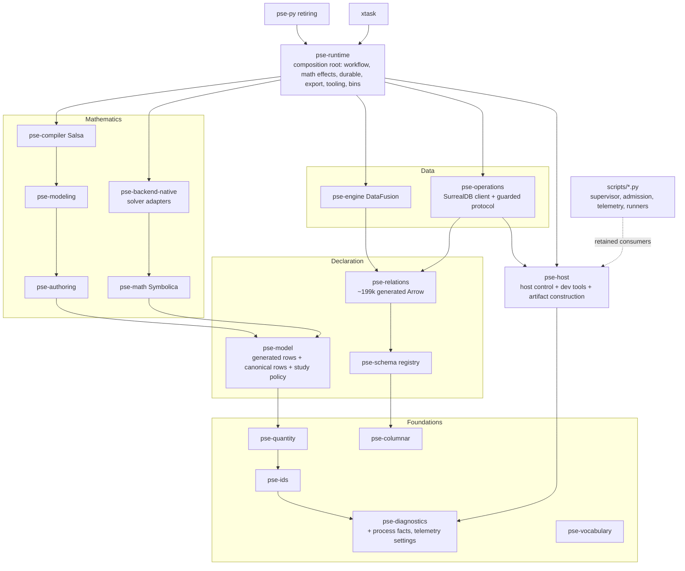

# Integrated system account

**Interface-checked. Refreshed 2026-10-29 at source `f83bac039` plus the working tree.** The
[README](README.md) records the baseline, method, coverage and limits. This page is the synthesis
a reviewer should read first. Primary findings live on the topic pages.

## Judgment on the preceding account

The account at source `682fc3830` (2026-10-25) was never refreshed after Plan56. Plan56 claimed
every DA-003…DA-045 resolved, closed by decision or superseded, and current source confirms most
of those claims:
- compiler-owned mode targets;
- projected physical context;
- the covariance permission chain;
- shared exact settlement;
- typed solver capability;
- streamed project closure;
- checkpointed backup verification;
- enum-keyed metrics.

Plan58 then deleted or replaced the mechanisms behind several others: the Python MCP, the per-call
native worker, Python-spawned supervision and build observation.

The old account's five integrated causes are therefore not the current picture. Two were largely
resolved: fixed lifecycle work at incidental boundaries, and inconsistent consumption of producer
decisions. The other three moved:
- product/tooling placement moved into the new host root;
- declared shapes not owning meaning moved onto hand SurrealQL and transition seams;
- the flat workflow ownership space grew.

Fresh unanchored streams then found causes the old account did not frame:
- a fine-grained durable protocol per study point;
- derived-product permission outside fit statistics;
- per-mode composition of native execution;
- the cutover pattern itself.

## The system as built

The diagram makes four points:
- **The mathematics layer stays clean.** It has no Arrow, DataFusion, SurrealDB or PyO3 edges
  (`cargo tree` probe), and solvers are opt-in features.
- **`pse-runtime` composes everything.** It holds scientific methods, numerical qualification,
  durable workers, export, telemetry exporters, review tooling and three operator binaries.
- **`pse-host` sits beside it.** It is lean in dependencies (no Arrow, Python or database), but
  `pse-runtime`, and through it `pse-py`, links all of it. `pse-operations` reaches it only in
  service and test builds.
- **Python persists behind retained consumers.** About 86 of 141 top-level scripts remain
  reachable from recipes. The 11.6k-line store supervisor is still the operator path for the
  canonical service, backup and restore.

**Representative journeys:**

| Journey | Route at this baseline |
|---|---|
| Author → solve → result | Text → `pse-authoring` → admission/selection (runtime `SourceIndex`) → `pse-modeling` check/specialize → `pse-compiler` Salsa → typed math → per-mode routing composition (runtime) → `pse-backend-native` adapter → original-space qualification → completion → retained IPC |
| Fit → covariance → publication | Fit oracle and LM or NLP in runtime → `Completion.products` (fit statistics only) → covariance reuse gated by product permission → parameter publication gated by `estimate_qualified` → re-admitted DSL |
| Durable study | Store-side progression (one action per RPC) → prepared claim (shared per-problem guard) → `DurableAttempt` → about a dozen guarded commits → `observe` (study-module hash unbound) |
| Retained read/export | Protected IPC snapshot → direct DataFusion `TableProvider`s; canonical header rows rebuilt through Arrow for `pse-py` |
| Developer command | `scripts/pse-env` → `pse-host boundary` (composes environment, capacity, tool digests) → foreground scope; retained recipes go to Python supervisors |

## How the system serves its functional target

The governing scientific mechanisms are strong, and the causes below sit around them:
- **Typed outcomes.** Native termination, candidate availability, independent original-space
  quality and certificates stay separate (`pse-backend-native/src/solve.rs`).
- **Library-first numerics.** pounce-sens/FERAL KKT, HiGHS tears, KINSOL recycle, pounce-presolve,
  IBEX, the Levenberg–Marquardt crate, Diffsol/IDAS, Symbolica.
- **One typed construction path into mathematics** that takes no source syntax.
- **Preserved domain obligations.** Original guards are kept before simplification, and
  derivative contracts carry provenance.
- **Value/structure separation.** `PreparedCase::rebind` keeps values out of Salsa.
- **Completion computed once at join.** Covariance reuse is permission-gated.
- **Store-side guarded progression** with schema-epoch fencing, and quiescent migration that
  still settles original attempts.
- **One study policy in three placements.**
- **Shared exact settlement and immutable receipts.**
- **Honest DataFusion providers** over protected IPC snapshots.
- **Native host ownership** that is typed and fails closed.

## Six integrated causes

### 1. Scientific permission is owned for only part of what the system derives

[DA-048](semantic-model-and-authority.md#da-048), [DA-049](semantic-model-and-authority.md#da-049).

The completion owns product permission for fit covariance and intervals only. Every other
derived product gets its verdict from the consumer that projects it:
- sensitivities, reduced Hessians and propagated covariance;
- fitted-parameter publication;
- study aggregates, review packs and project bundles.

No relational projection of the governing permission exists. Consumers reconstruct conjunctions
(`run.rs`), keep their own relation tables (`result_inspection.rs`), collapse qualifiers into
`usable` (`ScientificFacts`), or pass a caller-supplied state that validation skips
(`pack_selection`). DA-038's correction for covariance shows the mechanism works where it is
owned. The gap is coverage and projection.

### 2. The composition root interprets what lower owners determine, and composes their protocols by convention

[DA-006](semantic-model-and-authority.md#da-006), [DA-003](semantic-model-and-authority.md#da-003),
[DA-053](boundaries-and-composition.md#da-053), [DA-054](boundaries-and-composition.md#da-054),
[DA-021](local-reasoning-and-assurance.md#da-021).

Three manifestations:
- **Preparation.** The runtime lowers accuracy, scale, closure and conservation obligations from
  the raw `SpecializedModel`, separately for steady and dynamic modes. It parses fixture policy at
  use and keeps its own copy of the lookup rule.
- **Numerical execution.** Routing requirements and admission are composed at twelve sites: seven
  inside `MathService` and five in workflow modes that bypass it. Modes build their own
  `Execution` and thread lanes. Execution control rides on thread-locals that proceed when no
  owner is installed.
- **Studies.** Two executors orchestrate the same occurrence semantics.

Underneath all three is a crate whose modules import one another in both directions and expose
hundreds of crate-visible items. That makes it cheap to re-implement a lower owner's rule inline
and hard to notice that it was done. AP-03's test, "orchestration without independently
interpreting their rules", fails at each of these seams. The legitimate core stays: value
binding needs case observations, and native callbacks need ambient context.

### 3. Declared vocabularies, identities and transitions are applied by convention at consumers

[DA-051](structure-and-invariants.md#da-051), [DA-007](structure-and-invariants.md#da-007),
[DA-050](structure-and-invariants.md#da-050), [DA-039](structure-and-invariants.md#da-039),
[DA-052](boundaries-and-composition.md#da-052).

The central owners are good, and generation stops short of the consumers in each case:
- **Registry.** It owns enumerations, but hand SurrealQL re-spells subsets 25+ times. 155
  guarded functions are invoked through hand positional strings, and about 300 hand statements
  decode positional field lists. `observe` does not bind the study-module hash that claims bind.
  The writer-trust boundary itself is decided by ADR-0164.
- **Frame catalog.** It owns hash contexts, but identities are minted inline through uncatalogued
  tags, and attempt lineage is derived twice.
- **Diagnostic vocabulary.** It is well typed, but a `contract()` helper with about 2,390 call
  sites, and blanket canonical and host mappings, decide the class.
- **Boundary documents.** The typed regime covers exported documents only; durable completions
  and the service `config.json` are versioned and read by hand.

Each instance is small. Together they mean that a declared meaning does not reach the place where
behavior depends on it, so drift surfaces only at runtime or in prose.

### 4. Durable work pays a generic, fine-grained protocol per unit of scientific work

[DA-055](execution-fit.md#da-055), [DA-056](execution-fit.md#da-056),
[DA-034](execution-fit.md#da-034), [DA-035](execution-fit.md#da-035).

Under the canonical-store premise, each study point:
- runs the full run/attempt/result/seal/observe lifecycle as roughly a dozen guarded commits;
- pays a fixed prologue on each one: capture gate, schema admission, history registration,
  receipt, and a client-side `config.json` read;
- contends on a per-problem creator guard shared by all lanes.

Retention safety adds about 18 protection tables with distinct fences. The cohort analysis bound
(10k) is a tenth of the study bound (100k); both are declared limits.

The granularity is owner-selected: Plan58 O01 routes it to 58d D03 (bounded progression; in
progress), and the capture gate is §19.3's deliberate SSI fix. This cause therefore challenges a
live owner's chosen unit rather than reporting an unnoticed defect. The premise itself
(SurrealDB coordination, no daemon, 16 lanes) is not in question. The question is whether the unit of guarded commit fits a
many-cheap-case workload. Nothing is measured.

### 5. Placement follows build reach and generator reach, and mechanisms outlive their consumers

[DA-020](boundaries-and-composition.md#da-020), [DA-059](boundaries-and-composition.md#da-059),
[DA-060](boundaries-and-composition.md#da-060).

- **The host root.** It collects whatever must build cold: host control, developer tools and
  artifact construction. `pse-runtime` links all of it. Revision 311 keeps "heavy developer
  composition" under xtask, and whether the doctor and service operators count as heavy is open.
- **Foundations.** `pse-model` carries about 8k lines of canonical rows beneath the mathematics
  layer, which consumes none of them. `pse-diagnostics`
  carries process supervision and telemetry beneath everything.
- **The generator** emits every projection for every relation family. Only about seven of 90
  canonical Arrow modules are referenced by production code, all for `pse-py`. Canonical tables
  get a placeholder snapshot class.
- **Data-layer machinery from earlier eras persists:**
  - about 260 declared invariants, executed only for fixtures;
  - a catalog resolver whose crate is gone;
  - DML, schema-transform and migration machinery that §20.5 disowns;
  - an engine provider framework that the live providers bypass.

The common pattern is that a crate boundary or a generator loop decides where code lives and how
much of it exists, rather than the responsibility and its consumers.

### 6. The cutover moves entrypoints, not responsibilities

[DA-057](development-tooling.md#da-057), [DA-058](development-tooling.md#da-058),
[DA-023](local-reasoning-and-assurance.md#da-023);
retiring-path records: [DA-019](boundaries-and-composition.md#da-019),
[DA-024](local-reasoning-and-assurance.md#da-024), [DA-046](study-execution-and-database-boundary.md#da-046).
Test-side counterpart: [DTA-063](../test-audit/test-execution-system.md#dta-063)/[DTA-064](../test-audit/test-execution-system.md#dta-064).

Plan58 slices replace frontdoors: environment, hooks, doctor, telemetry service, worker roots. The
retained Python consumers keep the full Python policy graph. Each host policy therefore has a
second writable authority, or a duplicate interpreter of one declaration:
- server pin;
- admission ledger;
- capacity profile;
- telemetry selection and state directory;
- compiler-cache rule;
- doctor;
- force-validation resolver;
- service `config.json`.

The compatibility seams native code builds to interoperate are further declarations to retire:
reading the Python ledger, reproducing Python JSON spelling, importing Python-built releases.
Plan58's own I01 rule ("no bridge") names exactly these seams. Meanwhile the §1.1 and §3.2
inventories omit the `pse-host` crate, although §21.7 describes a Proposed host root. The agent
instructions also name a retired hook and overstate the settings deny list. This is a declared transition. The diagnosis is about its unit and the length
of the period with two authorities, not about its existence.

## Bounded findings outside the six causes

- [DA-043](development-tooling.md#da-043): native entrypoints revalidate the same inputs on every
  invocation. Examples are system-tool digests per `pse-env` crossing, and a digest of the whole
  executable on every project CLI call, with two hash schemes for one kind of fact. It is a fixed
  per-call cost, the shape of the earlier "fixed work at incidental boundaries" cause, in native
  code.
- [DA-047](study-execution-and-database-boundary.md#da-047): poll-only attribution scoping.
- [DA-025](execution-fit.md#da-025): a scope record. Physical collection has no built-in
  composition.

## Interactions

| Interaction | Effect |
|---|---|
| 2 ↔ 3 | Broad crate visibility (DA-021) makes inline identity minting (DA-050) and stringly classification (DA-039) the path of least resistance |
| 1 ↔ 2 | Derived-product verdicts are computed in projection code (DA-048) because the runtime owns both projection and product |
| 3 ↔ 4 | Hand invocation strings (DA-051) and the shared creator guard both sit on the per-point protocol path (DA-055). Generating typed bindings would not reduce commits |
| 3 ↔ 6 | Hand-read `config.json` (DA-052) is also a two-writer, two-language contract (DA-057) |
| 5 ↔ 6 | The host root grows because it is the only cold-buildable place, and native replacements land there one consumer at a time |
| 2 ↔ 4 | Two study executors (DA-054) mean durable studies forgo staged native reuse, which concentrates cost in the per-point protocol |
| 5 ↔ 2 | `pse-runtime`'s unconditional tooling and host edges (DA-020) widen the compile unit that cause 2 already entangles |

Repairing one finding at a seam can leave the boundary deficient. For example, centralizing
`Requirements` construction (DA-053) without an owned execution-control contract would leave
fail-open ambient scopes in place.

## Moved causes

| Earlier cause (2026-10-25) | Where it is now |
|---|---|
| Declared shapes don't own boundary meaning | Narrowed; moved to hand SurrealQL, transition seams and unregistered documents (cause 3) |
| Fixed lifecycle work at incidental boundaries | Largely resolved. New native instances: per-invocation digests (DA-043) and the per-point protocol (cause 4) |
| Product/tooling placement follows reach | Relocated to `pse-host` and foundations (cause 5) |
| Consumers re-answer kind-specific lifecycle questions | Kind half resolved (DA-009). The visibility half persists (DA-021, cause 2) |
| Producer decisions not consistently consumed | Resolved for targets, lexical binding, capability, physical context and covariance. Failure classification persists (DA-039), and derived-product permission is a new scope (DA-048) |

## Hypotheses contradicted by the evidence

- **"The mathematics layer has leaked data or persistence dependencies."** Not so: there are no
  Arrow, DataFusion, SurrealDB or PyO3 edges in its normal closure.
- **"Solver outcomes are inferred from strings."** No production use-point parses status strings.
- **"Python still performs mathematics or reinterprets results."** `python/pse/_runs.py` defers to
  native completion. Python product code is now mostly generated contracts.
- **"Preparation reuse is stale or keyed unsafely."** Several premise and key mechanisms exist
  beside Salsa, but no stale reuse was found. DA-030's decision stands.
- **"The host crate imports heavy product dependencies."** Its normal closure is diagnostics and
  buildinfo only. The problem is the reverse edge (cause 5).

## Representative change and failure scenarios

| Scenario | Causes exercised | What happens structurally |
|---|---|---|
| Add a new derived analysis product, such as a second-order sensitivity | 1, 2 | No product permission entry. Each consumer (run summary, inspection, analysis graph, review pack) decides usability itself |
| Add a terminal outcome or attempt phase | 3 | Registry, about 25 hand SurrealQL literals across 13 files, the hand inverse projection and Rust choreography need coordinated edits that only live-store tests catch |
| Run a 50k-point cheap-case durable study on 16 lanes | 4 | About a dozen guarded commits per point, contention on one creator guard, and a cohort analysis capped at 10k |
| Add a routing input, such as a new budget | 2 | Twelve hand-built `Requirements` literals (five outside `MathService`) and per-mode `Execution` assembly |
| Change the SurrealDB patch list or a capacity profile | 6 | Two writable declarations, Rust and Python, with native code reproducing Python spelling |
| Change a canonical-only table field | 5 | Regenerates and recompiles `pse-relations`/`pse-model` Arrow projections that have no consumer, plus the hydration image |
| Edit the agent edit guard | 5, 6 | Rebuilds `pse-runtime`, `pse-py` and runtime dependents. Unprepared worktrees run without the guard |
| A canonical timeout or payload limit reaches a user | 3 | Reported as infrastructure, not as timeout or resource limit, so a consumer must parse prose |

## How each foundation was investigated

- **AP-01, separation.** Investigated through crate and module dependency direction, runtime
  breadth, host contents and the placement of foundation rows. Gaps: causes 2 and 5.
- **AP-02, contracts.** Investigated through backend-seam imports, the open `pack_selection`, the
  SurrealQL invocation seam and hand-read documents. Gaps: causes 1–3.
- **AP-03, composition.** Investigated through per-mode routing, obligation lowering and the two
  study executors. Gap: cause 2. The host boundary composition was found aligned.
- **AP-04, domain model and authority.** Investigated through the authoring → result chain,
  permission and the lookup rule. The core chain is aligned. Gaps: causes 1–3.
- **AP-05, explicit structure.** Investigated through ambient fail-open scopes, unenforced
  vocabularies, the edit guard and declared-but-unexecuted invariants. Gaps: causes 2, 3, 5 and 6.
- **AP-06, local reasoning.** Investigated through module cycles, visibility and ambient task
  locals. Gap: cause 2. Typed cancellation and effect predicates are strengths.
- **AP-07, execution fit.** Investigated qualitatively through the per-point protocol, build
  units, per-invocation digests and uniform emission. Gaps: causes 4 and 5. Nothing was measured.
- **Profile (PS-01…PS-13).** Each principle was assessed by at least one stream; see the
  [README coverage statement](README.md#principle-coverage).

## Improvement directions

These are properties for a later solution review, not adopted designs or priorities:
- Every derived scientific product, including propagated and published ones, carries an owned
  permission, and that permission is relationally readable.
- Analysis modes consume one owned composition of routing, admission and execution control, and
  a missing owner refuses.
- Obligation lowering and fixture-policy typing live with the model and compiler products.
- Canonical transitions are invoked through generated typed bindings, and the store decides the
  facts it can decide.
- Identity derivations and failure classes are owned where they are minted.
- The unit of guarded commit fits many-cheap-case studies under the existing coordination
  premise.
- Crate placement follows responsibility. Generator emission follows declared consumers, and
  machinery without consumers retires.
- Each cutover moves a responsibility with all its consumers, and the architecture sections name
  the host layer.

## Limits of this account

This is static architectural diagnosis. No tests, solver runs, services, fault injection or
measurements ran. Counts come from grep and regex searches and are lower bounds or approximations
where noted. An area without a finding is not thereby aligned. The [README](README.md#scope-coverage-and-limits)
lists the uninspected owners.
