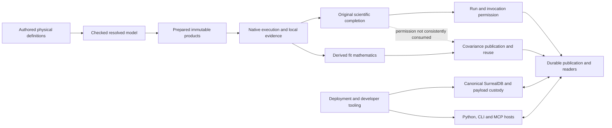

# Integrated system account

**Interface-checked unless explicitly marked · 2026-10-25 followup · source
`682fc3830f8a370f0995544af5adf821e4be9ab9`.**

The [collection README](README.md) owns the baseline, method and coverage limits. The preceding
account is preserved at `c02f68670`, against source `b5bdac9da`. Its broad architectural
observations are evidence to challenge, not boundaries on this followup.

## Judgment on the preceding audit

The previous audit identified consequential structural problems. Its treatment of mode
formulation, operation ownership, store/host semantics, physical publication units and tooling
coupling goes beyond isolated tidy-ups. Those diagnoses mostly survive independent discovery
and source revalidation.

Its strongest simplification—"the scientific core is well governed; governance weakens toward
the rim"—was too reassuring at the level of a complete scientific operation. Independent
inspection found a fit-to-covariance-to-propagation path whose permission disagrees with original
completion and invocation evidence ([DA-038](semantic-model-and-authority.md#da-038)). The
component owners and their local checks are real strengths. Their existence does not settle
which downstream products may claim qualified scientific provenance.

The followup also found an unexamined aggregate materialization boundary in executable project
exchange ([DA-045](execution-fit.md#da-045)). That has a different physical cause from the
previous per-file publication findings. Its practical severity remains unmeasured.

Conversely, several earlier claims treated different responsibilities as one fact, or moved too
quickly from a valid diagnosis to universal machinery. Correcting those overstatements matters:
more generation, one envelope or one alive/dead policy is not automatically better alignment.
The improvement points below are justified properties of the implemented system; solution
selection and adoption priority remain separate.

## The system as built

This is an ownership/meaning picture, not a complete call graph. Canonical SurrealDB, durable
cross-process work and the selected concurrency/host premises remain fixed.

- The core owns physical meaning, resolved syntax, guards, selected dependencies, library
  preparation and original assessment. Sampled domain models govern behavior rather than merely
  describing result schemas.
- Runtime owns scientific workflow legitimately; it is not required to be a thin composition
  root. Some internal responsibilities nevertheless have broad visibility and runtime closure
  dependencies ([DA-021](local-reasoning-and-assurance.md#da-021)).
- Canonical operations own guarded state, exact effects and protected payloads. Those guarantees
  are distinct from the physical units and repeated work used to realize them.
- Multiple public hosts are legitimate. They should preserve consumed meaning without
  independently reconstructing operation defaults, admission or scientific permission.
- Tooling and product responsibilities cross in both directions: production deployment uses
  tooling owners, while evidence/knowledge and diagnostic contracts propagate through product
  and foundation builds ([DA-019](boundaries-and-composition.md#da-019),
  [DA-020](boundaries-and-composition.md#da-020)).

## How the system serves its functional target

**Edit → re-solve.** Complete immutable preparation and value rebinding are strengths. Durable
publication is intentionally part of ordinary runtime behavior. Its current packing pays the
full file-intent protocol per relation/chunk/flush ([DA-034](execution-fit.md#da-034)). This is
a concrete structural opportunity on the caller's critical path, without a claim that a
historical timing ratio still holds on the current engine.

**Same model, multiple analyses.** Definitions and immutable overlays serve solve, dynamics,
fitting and initialization. Runtime still reconstructs some mode-specific target meaning and
can skip a dynamic nominal hint ([DA-006](semantic-model-and-authority.md#da-006)). Fit
derived-product permission does not consistently follow original completion. These are
cross-mode/consumer gaps inside an otherwise meaningful model architecture.

**Studies and retained history.** Lane execution and shared study policy are well composed.
Creation, descriptor paging, summary finalization and cohort reading retain item-sized physical
operations ([DA-035](execution-fit.md#da-035)). Indexed bounded history compaction is positive
counterevidence to a claim that all history management is unstructured. Built-in logical
retirement does not compose physical collection; the public Rust primitive does exist
([DA-025](execution-fit.md#da-025)). Backup consequently sees retained payloads unless an external
caller collects them; it verifies the inventory under a fixed clock
([DA-044](execution-fit.md#da-044)).

**Recycles and dynamics.** Prior library-owned recycle and adapter-status evidence remains
bounded positive evidence. The followup sampled immutable initialization overlays, original
initial-coordinate checks and cumulative inventory/flux closure. It did not requalify numerical
libraries or every sensitivity/event behavior. Correct native completion does not authorize
unqualified downstream scientific claims.

**Project exchange.** Exact selected source/result/artifact closure, protections and manifest-last
publication are strengths. Executable closure resolves and retains all selected source encodings
before sequential copying; executable explanation incurs the same materialization. Descriptive-only
metadata already has a narrow route. DA-045 concerns avoidable simultaneous live encoding, not
removal of admission or turning executable explanation into an unchecked metadata read.

**Agent/developer loop.** Generated inspection documents, exact protected selections, byte-bound
pages and a derived CLI are improvements. Every native call still pays a new child lifecycle and
extension currency reconstruction ([DA-043](development-tooling.md#da-043)). Physical result
meaning lacks a direct reader projection despite recoverable authored context in executable bundles ([DA-005](semantic-model-and-authority.md#da-005)), while the
failure constructor can hide whether the needed response is an input correction, resource
recovery or infrastructure repair ([DA-039](structure-and-invariants.md#da-039)).

## Five integrated causes

These explanations connect concrete findings. They do not establish that every member needs the
same abstraction, registry, lifecycle or placement. A common cause must survive the distinction
between different semantic scopes and genuine shared facts.

### 1. Declared shapes do not own all the behaviorally significant meaning crossing a boundary

Generated schemas and documents have one shape owner. Closed vocabularies, bounds, key kinds,
metric identities and some operation defaults are still authored independently around them
([DA-007](structure-and-invariants.md#da-007), [DA-040](structure-and-invariants.md#da-040),
[DA-015](boundaries-and-composition.md#da-015)). Deployment/profile mirrors extend this
mechanism across Python and Rust (DA-019, [DA-036](development-tooling.md#da-036)).

The consequence is repeated semantic decisions when a supported capability changes, not merely
similar-looking code. Ordinary study membership is explicitly represented; only specific
admission/variant associations were found reconstructed by prefix. Several enforcement points
are legitimate when they realize the same rule.

Settlement illustrates the boundary: common request/effect semantics diverge between project
and research operations ([DA-033](boundaries-and-composition.md#da-033)), but long-lived attempts,
staged imports and finite creation windows have genuinely different atomicity obligations.
A shared semantic contract is needed where meaning coincides; one universal envelope has not
been justified.

### 2. Fixed lifecycle work is paid at incidental semantic or call boundaries

Every scientific relation, opaque chunk or progress flush can acquire a complete physical file
protocol (DA-034). Study population operations repeat item operations and descriptor-heavy pages
(DA-035). Agent pages repeat process/currency/import preparation (DA-043). Backup makes repeated
whole-inventory passes under a fixed verifier clock (DA-044).

These compound: per-item publication enlarges retained inventory, which built-in retirement does
not physically collect, and backup re-examines it. Bounded responses and honest timeout refusal
do not establish a fit physical route for ordinary growth. Conversely, the largest admission
constant does not establish a supported capacity SLA or prove a timeout.

DA-045 adds a separate live-state problem: the export boundary retains aggregate encoded source
payload before an otherwise sequential copy. It is related execution-fit reasoning, not the
same per-file mechanism. Required full source admission, independent verification and immutable
protection must survive any more economical realization.

### 3. Product/tooling placement follows existing generation and hosting reach

Scientific deployment depends on supervisor/configuration formats located in development tools,
while disposable evidence/knowledge contracts and analytics reach product/foundation builds
(DA-019/020). The previous unused-producer argument over-attributed mandatory startup work to the optional
strict route. Public portable composition and native-child exploration have legitimate roles;
[DA-024](local-reasoning-and-assurance.md#da-024) now records that bounded correction, rather than
an established purposelessness finding.

This matters when changing a developer corpus or executor role propagates through unrelated
product owners, and when modifying production lifecycle behavior requires test-resource and
agent tooling context. A specific crate split is not the diagnosis. Product observability is a
real product responsibility even when its current module is named `tooling`.

### 4. Consumers repeatedly answer kind-specific lifecycle questions across broad workflow internals

One typed `RunOutcome` and one run supervisor are strengths. Sources, provenance, replay,
report extent, warm starts and host access still depend on kind matches in multiple owners,
including omission-permitting wildcards ([DA-009](structure-and-invariants.md#da-009)).
Broad workflow visibility makes these reach-ins easy (DA-021).

An ordinary extension must therefore understand several consumers' interpretations rather than
add its owned answers at an established seam. A genuinely new domain concept may legitimately
change core contracts; file count or exhaustive enums alone do not establish a violation.
The kind-agnostic inspection/comparison contracts show that some new consumers can avoid this
propagation entirely.

### 5. A producer's decision is not consistently consumed through scientific and public interpretation

Compiler classification is not fully consumed by formulation (DA-006); expression-role rules
are restated ([DA-003](semantic-model-and-authority.md#da-003)); published adapter capability
can differ from admission ([DA-017](boundaries-and-composition.md#da-017)); physical context
and scientific permission do not reach every reader (DA-005/038); failure meaning follows the
constructor rather than the condition (DA-039).

The missed covariance chain makes the consequence concrete. Original checks reject a fit;
invocation evidence withholds its derived products; result rows and covariance constructors use
successful local mathematics as certification; downstream propagation publishes qualified-fit
origin without the original refusal. Authentic content and PSD are necessary but answer a
different question. An explicitly weaker conditional covariance interpretation could be valid,
but every consumer must represent that scope consistently.

This pattern cannot be corrected by adding another result field while leaving consumers free to
reconstruct or ignore the governing decision.

## Bounded findings outside the five causes

- **Current-contract navigation** ([DA-023](local-reasoning-and-assurance.md#da-023)) retains
  actual obsolete semantic-lowering/rebind descriptions and duplicated mutable role settings.
  Proposed ADR status, Tested evidence and ADR-0214's explicit transport supplement are
  legitimate. They no longer serve as grounds for a general authority failure.
- **Vendored source records** ([DA-041](local-reasoning-and-assurance.md#da-041)) contradict
  actual source edits. The IDAS numerical correction is declared and has existing tests;
  re-vendoring/rebase records are incomplete. Archive hunk counts remain earlier evidence.
- **Telemetry export policy** ([DA-042](execution-fit.md#da-042)) uses a target-prefix convention
  and omits available SDK internal loss reporting. Required per-request continuity, permitted
  loss and truthful unavailable observations remain counterevidence. Science is unaffected.

Their bounded nature does not make them worthless. They should not displace the scientific
permission and whole-operation questions above.

## Cross-cutting pattern: moved causes and structural attractors

Introducing an owner does not force every consumer to use its meaning. Selected compiler
products, adapter capabilities and completion decisions coexist with older interpretations at
some runtime/public seams. The missed covariance path is a further example of a local authority
whose scope was not followed through publication and reuse.

The preceding account's historical Plan 49/52–55 counts suggested where change propagated. They
were not re-counted here and are not evidence of intrinsic architectural severity. Direct source
counterexamples matter more: generated document shapes, a derived CLI, kind-agnostic inspection,
shared study policy and library-owned mathematics already keep some changes local.

The correction target is the mechanism that permits repeat interpretation or unnecessary work,
not an exhaustive conversion of strings to enums or protocols to one generic framework. A
better abstraction must preserve genuinely different lifecycle, assurance and scientific scopes.

## Hypotheses contradicted by the evidence

- **The old audit was only local.** Its major ownership and execution-fit findings are systemic
  and mostly survive independent revalidation.
- **Local scientific checks establish coherent end-to-end scientific permission.** DA-038's
  missed covariance chain contradicts this stronger conclusion.
- **Rejected original checks make every covariance calculation mathematically invalid.** Not
  established. Point-estimate eligibility and covariance qualification are deliberately distinct;
  inconsistent scope and lost refusal are the finding.
- **Physical collection has no production implementation.** A public Rust collector exists.
  No built-in retirement/operator composition invokes it in the inspected repository, and returned
  disk space is explicitly outside selected scope. No active violation is established by that fact.
- **All lifecycle owners should differ only in domain predicates.** Different atomicity and
  recovery obligations make this an unproved remedy.
- **No in-repository replay consumer makes all producer machinery purposeless and mandatory at
  startup.** Public portable composition has a role; strict receipts are optional; consumed outer
  attestation and local receiving admission are distinct. A specific avoidable startup step
  requires its own evidence (DA-024).
- **Physical context is unrecoverable from any exported bundle.** Executable project bundles
  include original physical source documents. The direct Python/MCP readable-result projection
  is the established usability gap (DA-005).
- **Different zombie answers prove an error.** Launcher, manager and descendant-drain policies
  answer different questions. Repeated authenticated observations and cyclic coupling remain.
- **Proposed plus Tested is contradictory, or two transport decisions are both active.** Formal
  acceptance differs from implementation evidence, and ADR-0214 explicitly supplements the older
  decision. Current mechanism-text drift is narrower.
- **Executable closure may skip scientific admission because explanation returns only metadata.**
  That changes the contract. DA-045 concerns simultaneous encoding retention while keeping
  admission and source protection.
- **Backup timeout should automatically reopen admission.** Safety of that recovery policy was
  not established. The requirement is explicit, actionable and ownership-preserving recovery.

## Representative change and failure scenarios

| Scenario | What the source establishes | Improvement question |
|---|---|---|
| Fit converges numerically but fails an original authored check; another analysis consumes its covariance | Invocation says unavailable; local/persisted covariance and propagation omit original refusal (DA-038) | Which owned permission, or explicit conditional qualification, governs every consumer? |
| Change nominal/accuracy target meaning across steady and dynamic modes | Runtime reconstructs targets and can skip unsupported dynamic nominal hints (DA-006) | Can modes consume one declared inventory and explicit differences? |
| Add an analysis within the supported operation family | Lifecycle consumers re-project per-kind facts despite a shared supervisor (DA-009/021) | Can each kind own its answers without a universal plugin framework? |
| Grow a value-only study or retained project history | Item creation/finalization, retained files and fixed backup verifier compose amplification (DA-034/035/025/044) | Which physical units remove work while preserving exact recovery and publication? |
| Explain/export several exact source revisions | All source encodings remain live before sequential copy or explanation (DA-045) | Can exact identity/admission be retained without aggregate encoded-byte residency? |
| Page native results after an edit | Repeated currency/process/import work, opaque physical context and coarse failure remedies (DA-043/005/039) | Can the requested read preserve currency and scientific meaning with proportionate preparation? |
| Change settlement behavior or execution-profile meaning | Similar shared facts are redefined across owners/languages (DA-033/036/019) | Which semantics are actually shared, and which lifecycle rules must remain distinct? |

## The development tooling layer

The tooling is a full audit subject, not a secondary exception to the principles. It has real
product participants and responsibilities: durable deployment, supervised resources, agent
reads, evidence and developer feedback. It also has legitimate library composition, isolation,
source fencing and generated schemas.

The consequential gaps are product/tooling change propagation (DA-019/020), finite-profile
restatement and authority direction (DA-036), cyclic lifecycle coupling (DA-037), and per-call
preparation/currency (DA-043). The existence of many scripts, services or ledger files is not
itself a violation. Shared process observations can support different owner policies, and an
uncapped maintainer-selected host mode is not a defect.

## Improvement directions

These are correction properties and observable boundaries, not selected alternatives or an
implementation backlog. The order explains consequence; it is not an adoption decision.

1. **Make scientific permission compose through derived products and reuse.** Follow the existing
   rejected-fit fixture through invocation, exported validity, local and persisted covariance,
   own-prediction and downstream propagation. Every result must either consume the governing
   original permission or carry its explicit weaker conditional scope and refusal. Retain
   diagnostic computation without silently upgrading its scientific authority (DA-038).
2. **Make operation meaning govern all its representations.** Author shared vocabularies,
   identity relations, bounds and admission/effect semantics once at an appropriate owner;
   mechanically derive projections where useful. Preserve legitimate host/environment checks and
   different lifecycle obligations. Changing one shared rule should not require rediscovering its
   independent interpretations (DA-003/006/007/015/017/019/033/036/039/040).
3. **Localize ordinary extensions and independently understandable policy.** Give kinds owned
   lifecycle facts, narrow workflow interfaces and explicit policy inputs. Preserve the shared
   supervisor, typed pairs and pure policies. Verify locality with an ordinary supported
   extension, distinguishing a genuinely new core concept (DA-009/021/038).
4. **Choose physical work and live-state units for complete operations.** Separate per-relation
   meaning from physical publication packing, population intent from descriptor-sized pages,
   exact closure from aggregate encoding, and a read page from a full process/build-preparation
   lifecycle. Retain crash safety, original checks, immutable source premises and drain. A
   structural simplification does not establish a measured speed or capacity gain
   (DA-034/035/043/044/045).
5. **Give product and tooling dependencies deliberate direction.** Keep shared contracts under
   their actual consumers; ensure declared feature partitions hold; distinguish product
   observability from development review and optional producer roles from consumed outer lineage. Share authenticated process observations while keeping
   distinct launcher/manager/drain policies and reducing cyclic knowledge (DA-019/020/037; DA-024 bounds the optional-producer question).
6. **Make supported operational limits and evidence truthful.** Keep logical retention distinct
   from physical collection, expose actionable backup failure/recovery state, reconcile stale
   current mechanism text, and describe edited dependency sources accurately. Preserve formal
   decision status separately from implementation evidence (DA-025/044/023/041/042).

## Limits of this account

This followup establishes source-level architectural consequences and their correction
properties. It does not execute scientific, backup, export, cancellation or scale journeys.
No timing, memory, throughput or capacity benefit was measured. Previous measurement and
upstream-diff records retain their exact original conditions.

Sampled PS-02 validity envelopes and PS-13 shared conformance machinery support positive bounded
judgments. Complete independent numerical/reference coverage, all native patch semantics, server
CPU work and the remaining telemetry/specialist internals remain outside demonstrated coverage.
Neither strong components nor absence of additional findings establishes complete alignment.
