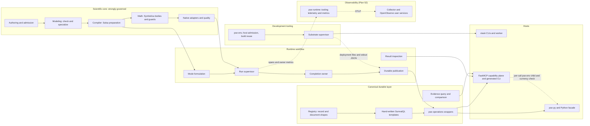

# Integrated system account

**Interface-checked unless marked · 2026-10-25 · source `b5bdac9da763bf1a70f20b0599de0edad8a955f9`
(prior account at `cbf45ccc9`, 2026-10-24).**

The [collection README](README.md) gives the baseline, standard and evidence limits. This page
is the audit's architectural account:
- how the system is actually organized;
- how well it serves the simulator's functional target;
- where alignment with the design principles is strong;
- where structural causes interact in ways a local inspection misses.

The primary findings live on the topic pages, with stable identities. This page selects no
remedy, priority or work package.

## The system as built

The arrows show owners and dependencies, not call order.

**What changed since `cbf45ccc9`.** The product's structural loci did not move. The counts below
are identical at both baselines:
- canonical `DEFINE TABLE` and `DEFINE FUNCTION` occurrences;
- non-test workflow files;
- `impl ModelingPackage` files;
- per-kind arms.

Plans 52, 54 and 55 added observability, native inspection, evidence comparison, an agent
capability plane and build reuse:
- non-test scripts grew from about 76k to 91k lines;
- the capability plane grew from 27 to 57 modules;
- runtime tooling grew from about 23k to 27k lines.

Governance still follows a **gradient from the center outward.**

**The scientific core is well governed.**
- `pse-quantity` owns complete physical types.
- Domain guards are captured before Symbolica rewriting and materialized after it.
- Derivative availability is owned by the libraries and refuses rather than falls back.
- Conservation is derived from declared contributions.
- Adding a unit model on existing physics is a package-only change (PSE-S01).
- Run-level outcome interpretation has one pure, typed owner (`workflow/numerics.rs`), which
  study and durable summaries consume. The automatic residual-LM fit route is the exception
  ([DA-038](semantic-model-and-authority.md#da-038)).
- One run supervisor serves every analysis kind.
- The study policy is one pure function, executed natively and inside SurrealDB.
- Library containment is clean:
  - the SurrealDB SDK lives only in `pse-operations`;
  - Salsa only in `pse-compiler`;
  - Symbolica only in `pse-math`;
  - result reads are DataFusion providers with pruning.
- **New at this refresh: the solver adapters are well aligned** (a prior coverage gap):
  - The status maps are exhaustive against the pinned versions of SCIP, HiGHS, Clarabel, IDAS,
    PETSc and Uno.
  - Assurance is re-granted only from original-space evidence (`quality.rs`).
  - Callbacks are contained, and derivatives are analytic.
  - PETSc cannot be switched to matrix-free finite differences by environment.
- **The compiler's Salsa reuse is sound** (a prior coverage gap):
  - interned identities are complete;
  - transient refusals are never memoized;
  - setters fire only on change;
  - inputs are granular per declaration;
  - durabilities are declared.

**Toward the rim, governance weakens.** The rim is:
- the canonical store layer;
- the exchange and host surfaces;
- observability;
- the tooling layer.

This is where Plans 50–55 added most of their code. The registry and the boundary-document
catalogue declare *shapes* there, now including every new cross-language document. The
vocabularies, bounds, protocols and placement inside and around those shapes are still written by
hand per owner, per host and per language. A wrong current output is rare, because most
mismatches fail closed. What suffers is extension locality, authority, execution fit and, at the
agent boundary, diagnosability.

**The runtime crate sits between the two.** It is the declared owner of scientific workflow
(§3.2, ADR-0175), not a thin composition root, and that ownership is legitimate. Two problems
remain:
- its internals have no boundaries against each other
  ([DA-021](local-reasoning-and-assurance.md#da-021));
- its mode formulation and some routes re-derive or fill in meaning that the core publishes
  incompletely ([DA-006](semantic-model-and-authority.md#da-006), DA-038).

The runtime now also hosts product observability inside its development-tooling module
([DA-020](boundaries-and-composition.md#da-020)).

## How the system serves its functional target

The profile names five workloads and two result qualities. This refresh adds the agent loop:
inspect results and models and compare evidence through the capability plane. Plans 52–55 were
built for that loop.

**Edit → re-solve.**
- Preparation is shared: Salsa preparation and value rebind without rebuilding structure. That is
  a strength, re-verified at the compiler level in this refresh.
- The default runtime is durable, and a solve's public wait ends only after publication is
  acknowledged.
- Each relation, chunk and progress flush is published as its own sealed file
  ([DA-034](execution-fit.md#da-034)).
- *Measured* under earlier conditions (Plan 48f I30): a test build, a small KINSOL case, before
  the SurrealMX move. Native work took a median of about 1.5 ms, and publication through
  acknowledgement about 0.85 s.
- So the interactive loop's critical path is dominated by a fixed publication cost that does not
  depend on model size. The explicit ephemeral runtime avoids it. With telemetry selected, each
  of those round trips also emits client spans ([DA-042](execution-fit.md#da-042)).

**Inspect, compare and diagnose through the agent interface** (new at this refresh).
- The native result inspection and evidence comparison are owned, kind-agnostic contracts:
  - exact selection;
  - bound cursors and byte budgets;
  - explicit denominators;
  - unmatched and ambiguous subjects;
  - typed refusals.

  Hosts pass them through without reinterpreting them. That is a strength.
- Each call, and each page, pays:
  - a fresh `pse-env` child;
  - a whole-tree and whole-binary currency hash;
  - two extension imports;
  - runtime construction.

  The Plan 52n LIFE04 target explicitly ruled this out. Any edit under `crates/` makes reads
  refuse until a rebuild, including supplied-only evidence comparison
  ([DA-043](development-tooling.md#da-043)).
- The results it shows carry units and bases only as hex ids, and permission as `Unknown`
  ([DA-005](semantic-model-and-authority.md#da-005), DA-038).
- Failures reach the agent as `workflow.input` with an input remedy, whatever their meaning
  ([DA-039](structure-and-invariants.md#da-039)).

**Studies.**
- The middle of a value-only sweep is sound: lane-parallel, structure-reusing, with drained
  cancellation.
- Its population ends are loops of item operations ([DA-035](execution-fit.md#da-035)):
  - creation runs under a fixed 90 s clock;
  - finalization writes one file per four rows;
  - analysis is capped at 128 occurrences.
- Nothing is physically collected ([DA-025](execution-fit.md#da-025)).
- Backup of a long-lived store re-reads that whole growing inventory under a fixed 120 s
  verifier clock ([DA-044](execution-fit.md#da-044)).

**Recycles** (examined in depth at this refresh). The recycle design is library-owned and
explicit:
- a causal sweep is a KINSOL map, with "no recycle iteration algorithm" in project code
  (`pse-backend-native/src/recycle.rs`);
- tears are selected by an exact HiGHS MILP or an explicit greedy route, each checked
  independently for acyclicity by petgraph (§17.4);
- the convergence policy (Anderson depth and delay, damping) is part of the profile identity;
- tear scaling is projected from model numerics onto port quantities;
- restarts are bounded within the original clock and caps;
- bounded raw-map history is published;
- each map runs in a fresh session and never becomes an automatic seed.

Two points remain:
- Recycle strategies are nondurable by maintainer decision.
- KINSOL is selected by name for declared roots and causal suppliers
  ([DA-017](boundaries-and-composition.md#da-017)).

**Dynamics.**
- The same model definitions serve dynamics, and independent original checks run at trajectory
  samples. A structural index-1 check runs before integration.
- Dynamic formulation builds its own target inventory and drops nominal hints that fall outside
  it (DA-006).
- Horizon decisions sit inside a large async driver (DA-038).
- Each horizon step publishes every relation (DA-034).
- The vendored IDAS carries a quadrature-history correction, declared in §13 and pinned by
  tests. Its vendoring record claims the numerical sources are untouched
  ([DA-041](local-reasoning-and-assurance.md#da-041)).

**Extension.**
- A unit or property model is package-only.
- A new solver implementation is mostly adapter-local. The exceptions are DA-017.
- A new analysis kind touches about 19 files ([DA-009](structure-and-invariants.md#da-009)).
- A new durable owner or project capability crosses the registry, hand SurrealQL, wrappers, four
  hosts and Python tooling (cause 1).
- A new agent native operation touches the Rust documents, pse-py, the facade, a hand `Binding`
  and a worker branch ([DA-015](boundaries-and-composition.md#da-015)).

**Physically meaningful results.** Rust checks complete physical meaning, but no public reader
can resolve units, bases or reference states (DA-005). Plan 55c set out to inline them in
inspection. Its outcome records usability unknown, metadata deferred and no complete-context
claim.

**Diagnosable failures.** Solver outcomes are typed and truthful, as re-verified per adapter.
Outside them:
- most workflow and math failures are classed as invalid models by the constructor, not by
  their meaning;
- durable lazy admission persists timeouts and internal defects as scientific refusals;
- the solve path's well-posedness refusal names only the first missing input;
- telemetry exports the constructor-chosen code at WARN, and the agent host attaches an input
  remedy to every failure (DA-039);
- the SDK's own span-drop count is compiled away, so queue loss cannot be told from other absence
  (DA-042).

## Five integrated causes

Each cause explains a group of findings and why repairing one site would leave the boundary
deficient. Causes 1 and 2 are restated more broadly at this refresh, because new evidence showed
the same mechanism beyond the boundary first described. Cause 3 keeps its title.

### 1. Contracts are declared as shapes; their meaning, vocabularies and protocols are hand-authored per owner, host and language

The registry and the boundary-document catalogue generate:
- table definitions;
- codecs;
- some field enumerations;
- every cross-language document shape. Plans 52 and 55 used this route for all of their new
  documents and for the telemetry settings wire.

Every other contract that decides behavior is written again where it is consumed:
- **Store meaning** ([DA-007](structure-and-invariants.md#da-007)):
  - identity kinds encoded in key prefixes;
  - vocabularies as literals across templates, Rust, exchange documents and Python;
  - field rules with two homes;
  - partial lifecycle projections.
- **Vocabularies, bounds and instrument semantics inside generated shapes**
  ([DA-040](structure-and-invariants.md#da-040), new):
  - settings bounds and sampler names restated in Python;
  - evidence classifications as `String`, with an enum-keyed map published as a plain object;
  - metric events joined by array position;
  - query operations that ignore the declared instrument kind.
- **Protocol** ([DA-033](boundaries-and-composition.md#da-033)): about ten acknowledgement and
  settlement schemes. The physical file protocol exists in Rust and again in Python.
- **Host operations** ([DA-015](boundaries-and-composition.md#da-015)):
  - Plan 51 operations hand-projected into four hosts;
  - 19 agent native bindings with hand dispatch and restated defaults.

  Below FastMCP, the CLI is now derived.
- **Deployment** ([DA-019](boundaries-and-composition.md#da-019)):
  - execution profiles mirrored between Python and Rust;
  - a frozen closure that is a glob and silently omits `scripts/generated/`.
- **Resource profiles** ([DA-036](development-tooling.md#da-036)): the same budgets in toml,
  supervisor literals, a test manifest, Rust validators, the worker and MCP defaults, plus a new
  48 = 16 + 32 coupling.

**Why it matters.** Two change scenarios demonstrate the cause:
- *Plan 51.* Each new owner brought its own vocabulary, envelope, guard text and host
  projections.
- *Plans 52 and 55.* Each new document was generated once, which is a genuine improvement. Its
  closed vocabularies and limits were then restated in Python, and each new agent operation was
  bound by hand.

The mechanism to declare once and lower exists. Examples are registry substitution into
templates, generated enum `TYPE` literals, the emitter's `minimum`/`maximum`/`enum` lowering and
the typed `KnowledgeQuery` enums. It is applied to shapes, and to vocabularies only in a few
cases.

### 2. Fixed protocol cost is paid per semantic unit rather than per workload

Previously: "Durability is realized per semantic unit rather than per workload."

The maintainer premises are honoured:
- no native work runs inside a transaction;
- recovery is per attempt;
- terminal admission is truthful;
- cancellation drains;
- 16 lanes overlap publication with compute.

The execution-fit problems come from the unit at which a fixed protocol is paid:
- **Publication.** Every relation, chunk, progress flush, live batch, horizon step and four-row
  summary page becomes its own sealed file with the full intent protocol
  ([DA-034](execution-fit.md#da-034)).
- **Populations.** Population intents are loops of item operations under fixed clocks and
  descriptor-sized pages ([DA-035](execution-fit.md#da-035)).
- **Collection.** Physical collection has no production route ([DA-025](execution-fit.md#da-025)).
- **Backup.** Backup verification is one fixed clock over the whole growing inventory, with
  repeated content passes ([DA-044](execution-fit.md#da-044), new).
- **Agent calls.** Every agent native call, and every page, pays environment admission,
  whole-tree and whole-binary currency hashing, two imports and runtime construction
  ([DA-043](development-tooling.md#da-043), new). DA-043's currency half is a different cause, a
  bespoke reuse key, and is not counted here.

These compound. Per-unit files multiply by occurrences, and none is ever collected. Backup then
re-reads all of them about six times under a clock that does not scale. With traces selected,
the declared per-request SDK spans multiply the same round trips by up to three. Coarsening only
the empty-set declaration, only raising `LIMIT 4`, or only lengthening the verifier timeout
leaves every other unit in place.

DA-044's durability asymmetry and DA-042 are not instances of this cause.

The per-problem creator guard and the hand size models were considered here and left as
maintainer decisions (I01, I16). See [execution fit](execution-fit.md#considered-and-not-raised).

### 3. Product and tooling responsibilities are placed by machinery location

The title is unchanged. A draft restatement as "machinery reach" was evidenced only by DA-020,
so it stays a refinement of that finding (challenge C15). In DA-020, where a type lands is decided
by which generator or host can reach it.

**Production depends on tooling.**
- Durable execution passes through a 10.7k-line Python supervisor that the runtime spawns. That
  file holds several distinct owners: backup, storage lifecycle, native placement, payload
  custody, observation, locks and generations.
- The worker binary is built in the tooling package under a fixture feature name.
- The supervisor runs from frozen copies of `scripts/*.py`, a glob that already misses a Plan 52
  import.
- The production pool size comes from a test campaign's manifest.

**Tooling lives in the product** ([DA-020](boundaries-and-composition.md#da-020), widened):
- Development evidence and knowledge families are declared in the product registry, generated
  into the foundation crate and product Python contracts, and compiled into the store client.
- **New: `pse-runtime` and `pse-py` select the `evidence-query` feature.** Under workspace
  unification, every build compiles DataFusion SQL analytics over test-evidence rows into the
  store client, contrary to §3.2.
- **New: telemetry dimensions are declared in the root crate `pse-diagnostics`.**
- **New: knowledge documents generate product Python classes that nothing uses.**
- Product observability itself sits in `pse-runtime::tooling`, beside review packs and taskdump.

**Inside the tooling:**
- Ownership primitives are re-authored with drift in one cyclic import web of 27 modules that
  joins the production supervisor, host admission, test resources and the MCP endpoint. There
  are now three separately authored systemd-service owners
  ([DA-037](development-tooling.md#da-037)).
- About 10k lines of strict producer-provenance tooling qualify a reuse route with no production
  consumer ([DA-024](local-reasoning-and-assurance.md#da-024)).

**Why it matters.**
- A tooling change rebuilds the product from its foundation crates:
  - a new knowledge-corpus format rebuilds from `pse-model`;
  - a new executor role rebuilds from `pse-diagnostics`.
- A production-path change runs through Python modules that also serve tests and agents.
- DA-020's earlier remedy line, the `tooling` module against the product, is no longer the right
  cut. That module now holds product observability. Recorded decision I21 names the
  runtime/catalogue seam that now carries development contracts into product builds.

### 4. Analysis operations lack an owned contract, and workflow internals lack boundaries

Plan 49 made request/result pairing structural, and one run supervisor serves every kind. That
consolidation worked. The *questions* each analysis kind must answer are still answered by every
consumer:
- sources, identity frames, replay constructors, native reports, warm starts and memory extents
  are re-projected in about 19 files, some by wildcard;
- declared procedures are dispatched three times with different subsets.

([DA-009](structure-and-invariants.md#da-009), unchanged at 323 arms in 38 files.)

The flat workflow namespace and domain values that carry the runtime are what permit these
reach-ins ([DA-021](local-reasoning-and-assurance.md#da-021), unchanged).

**Counterevidence from this refresh.** Result inspection and evidence comparison were built behind
kind-agnostic contracts and added no per-kind arms. That is evidence for this cause's improvement
direction, not against the cause.

**Why it matters.** PSE-S03, a new analysis, is a named extension scenario. Wildcard arms let a
new kind compile while silently lacking warm-start, report or qualification handling.

### 5. Consumers re-derive or lose decisions the core already makes

The core makes and publishes several decisions. Consumers re-derive them, fill them in
differently, or lose them at the boundary:
- **Classification and identity.**
  - Steady formulation reclassifies targets the compiler already classified.
  - Dynamic formulation supplies a mode inventory no owner publishes.
  - Symbols are found by synthesized name, failing open on a mismatch.
  - Derived ids are minted twice.

  See [DA-006](semantic-model-and-authority.md#da-006), with the selected-source residue in
  [DA-003](semantic-model-and-authority.md#da-003).
- **Permission.**
  - Aggregate usability is restated with different conjuncts.
  - The default LM fit route bypasses the incumbent policy.
  - Composite analyses write their own inner acceptance.
  - Native inspection reports permission as `Unknown`.

  See [DA-038](semantic-model-and-authority.md#da-038).
- **Capability.** Published capability is the static record, not the settings-dependent
  capability that admission uses. The runtime still names backends
  ([DA-017](boundaries-and-composition.md#da-017)).
- **Failure meaning.**
  - The constructor, not the meaning, classes about 2,000 workflow and 650 math failure sites as
    invalid models.
  - The new inspection owner doubled its share.
  - Telemetry and the agent host carry the constructor-chosen class forward.

  See [DA-039](structure-and-invariants.md#da-039).
- **Physical meaning.** Meaning that Rust checks becomes opaque ids at the public boundary
  ([DA-005](semantic-model-and-authority.md#da-005)).

**Why it matters.** The model-first contract (Core §1, AP-04) is met where meaning is established
and then partly lost where it is consumed. That loss shows up in:
- route-dependent fit permission;
- silently dropped dynamic annotations;
- mislabeled failures in durable studies and the agent view;
- unreadable units.

The agent interface added by Plans 52–55 consumes exactly these lossy projections.

## Bounded findings outside the five causes

**Design intent** ([DA-023](local-reasoning-and-assurance.md#da-023)).
- The architecture sections hold 268 decision blocks. 91 ADRs are `proposed` and editable.
- ADR-0214 replaces ADR-0164's engine and transport outcome without a supersession link.
- Amendments stack on older contract text instead of replacing it. Two examples: §7.1 announces a
  resolved semantic product above a table that says no intermediate IR exists, and §24.2 now
  carries dated per-plan qualification narrative.
- ADR-0224 was amended in place after implementation and carries `evidence: Tested` while
  `proposed`.
- The protected-path sets are restated in six files with three different semantics, and still
  name a retired crate.

**Vendored-code provenance** ([DA-041](local-reasoning-and-assurance.md#da-041), new).
- The edited vendored SDK, engine API and SUNDIALS trees have prose records that are stale or
  missing hunks.
- The SUNDIALS record claims untouched numerical sources. §13 declares, and tests pin, the
  quadrature-history correction those same bytes carry.
- The repository's patch-series form and R-41 already provide the truthful mechanism.

**Telemetry granularity** ([DA-042](execution-fit.md#da-042), new, narrowed).
- The "coarse owner stages" promise is held by a crate-prefix export filter.
- The SDK's drop count is compiled away.
- Per-request spans and possible loss are declared contract and are not part of the finding.

The two authority findings matter most for agents following the binding to the authority for a
role (PSE-S06) and for library upgrades. All three are bounded:
- the recurrence of causes 1–5 is explained by the structural attractors below, not by ADR status
  words;
- changing how decision status is recorded is a rule impact for the maintainer, not a code
  defect.

## Cross-cutting pattern: moved causes and structural attractors

**1. Several Plan 49 remedies introduced the authoritative product without forcing consumers
through it.** The old consumer-side interpretation survived beside the new owner:
- DA-001 and DA-029: name-based identity and whole-model scans moved from the compiler into runtime
  case formulation;
- DA-002: re-minting moved into one runtime module;
- DA-017: a settings-dependent capability was added, but publication was not derived from it;
- DA-006: lowering became compiler-owned, while steady classification stayed per mode.

This conflicts with the repository's rule to delete replaced paths (DP-16, AGENTS.md) and with
DP-01. Plans 52–55 did not repeat this pattern. They added consumers rather than replacing
owners.

**2. The attractor prediction, tested on Plans 52–55.** The prior account predicted that new
capability would land in the same generative loci. The new plans added no product scientific
capability, so the product loci are flat. Where they built, the prediction held for causes 1, 2
and 3. It failed where a declare-once or owned-contract mechanism already existed and was used.

| Locus | 2026-10-21 | 2026-10-24 | 2026-10-25 |
|---|---|---|---|
| `ModelingPackage` impl files | 31 | 36 | 36 |
| Non-test workflow files | — | 143 | 143 |
| Decision blocks | 239 | 268 | 268 |
| Canonical `DEFINE TABLE` / `DEFINE FUNCTION` occurrences in `*.surql` | — | 277 / 522 | 277 / 522 |
| Supervisor (lines) | 8.9k | 10.7k | 10.7k |
| Non-test script lines | — | 76k | 91k |
| Capability-plane modules | — | 27 | 57 |
| Agent native bindings | — | 13 | 19 |
| Rust test-environment deny-list names | — | 20 | 39 |
| `--recipe-default-class` hints | — | 64 | 73 |
| Proposed ADRs | — | 90 | 91 |

The earlier counts of 62 → 79 canonical tables and 116 → 171 server functions came from a
different counting method. The `*.surql` occurrence counts above are unchanged across this window.

*Where the prediction held.* The new manifestations are:
- vocabularies restated around generated shapes (DA-040);
- hand-bound agent operations (DA-015);
- a glob closure and hand-joined telemetry deployment (DA-019);
- a defeated gate and foundation-resident dimensions (DA-020);
- new service owners re-authoring liveness (DA-037);
- a per-call protocol and a bespoke currency key that diverges from its own plan target (DA-043);
- export granularity by prefix convention (DA-042);
- stacked qualification narrative (DA-023).

*Where it did not.* The counterexamples are:
- every new document shape generated once;
- metric names, units and domains declared once in Rust;
- the CLI derived from the MCP schemas;
- inspection and comparison behind kind-agnostic contracts, with no new per-kind arms;
- new tooling modules placed outside the import cycle;
- FastMCP and OpenTelemetry used natively.

**The implication.** Site repairs do not stop recurrence. Where the generating mechanism existed,
it worked. The useful targets remain the mechanisms that generate the sites:
- declare-once-and-lower, carried through to vocabularies, bounds and protocols, not only
  shapes;
- one operation envelope;
- an owned per-kind contract;
- composable core decisions;
- deliberate product/tooling placement, with gates that hold;
- fixed protocol cost chosen per workload.

## Hypotheses contradicted by the evidence

These are plausible leads that source refuted. They bound later remedies. Entries from
2026-10-24 that were not re-examined keep that date.

**Re-examined or new at 2026-10-25:**
- **"Bespoke code re-implements OpenTelemetry batching, propagation, aggregation or queries."**
  The SDK batch processors, `PeriodicReader`, observable instruments, `TraceContextPropagator`,
  `tracing-opentelemetry`, Collector retry and queues, and OpenObserve PromQL and alerts are all
  used natively. The single resolver for environment settings is the qualified library boundary,
  because the Rust and Python SDKs interpret `OTEL_*` timeouts differently (Context7).
- **"Telemetry is on the scientific path."** Batch processors `try_send` on dedicated threads,
  counters are relaxed atomics, and only atomics run on cache hits. The disabled path returns
  `Span::current()`. Export failure never blocks science.
- **"A Runtime installs telemetry providers."** Only explicit host composition does: pse-py,
  `pse-worker`, the native lane and the FastMCP helper bootstrap.
- **"The capability CLI re-implements FastMCP `generate-cli`."** The library generator reads a
  live server's `list_tools`. This endpoint disables operation tools at bootstrap and needs wire
  revisions, so the roughly 100-line renderer is justified.
- **"Capability workers re-author spawn, reap and drain."** `process.run_worker` is a minimal
  transport that hands drain to `pse-env` and the native owners.
- **"MCP or report consumers mirror native documents."** They pass `JsonValue` to native decode,
  or validate against the generated schema.
- **"Inspection or comparison widened DA-009."** Neither adds a per-kind arm.
- **"Hand-keyed validity rules sit beside Salsa."** None, apart from the DA-030 retention that
  I08–I10 govern.
- **"Status strings are parsed at the point of use" / "PETSc can silently switch to matrix-free
  finite differences" / "the Krylov routes use difference-quotient J·v."** All refuted per
  adapter.
- **"The SurrealDB patches fork query or storage semantics."** Every hunk is integration or a
  compile fix.
- **"MKL, OpenMP or rayon-global defaults oversubscribe."** BLAS and OpenMP default to 1, and
  rayon pools are explicitly sized. Three cross-pool gaps remain suspected; see
  [execution fit](execution-fit.md#considered-and-not-raised).
- **"`80a889ac1` altered study population handling."** It is a custody fix.

**From 2026-10-24, not re-examined unless stated:**
- **"pse-runtime re-interprets compiler and modeling meaning throughout."** At sampled sites,
  runtime science consumes compiler and backend products. The exceptions are the formulation and
  route seams in DA-006 and DA-038.
- **"Each route assembles its own acceptance."** Every run-level route except the residual-LM fit
  composes `numerics.rs`.
- **"The run lifecycle is copied per kind" (old DA-012).** One supervisor, with the horizon under
  it.
- **"Physical side inputs are bare floats" (old DA-005).** They are typed, quantity-keyed rows.
- **"Persistence machinery is sized beyond its participants" (old DA-025).** The participants are
  real under the premises.
- **"The per-problem guard is excess exclusion."** Decision I01 measured it and kept it.
- **"Backup misses Plan 51 tables."** Backup copies the whole database (DA-019). Corrected at
  2026-10-25: payload files are byte-compared against source, while the database tree is digested
  only at the destination and checked logically at restore. Its execution fit is now DA-044.
- **"Wrappers recreate SurrealDB transactions or retries."** Transactions are native.
- **"FastMCP rebuilds framework features."** Re-confirmed at 2026-10-25.
- **"Value-only sweeps rebuild structure or serialize lanes."**
- **"Profile pins silently extrapolate."** The applicability gate refuses unpermitted envelope
  violations at evaluation.
- **"Recycles hand-roll convergence."** Re-confirmed in depth at 2026-10-25.

## Representative change and failure scenarios

| Scenario | Integrated judgment |
|---|---|
| Edit → re-solve on the default runtime | Preparation and rebind are reused. The interactive wait includes per-relation publication: about 0.85 s against about 1.5 ms of native work under I30's earlier conditions (DA-034). With traces selected, each round trip adds up to three declared SDK spans (DA-034), and their drop count is unavailable (DA-042). |
| Agent inspects a result, or compares supplied evidence, after editing an unrelated crate | Both refuse `artifact_not_current` until a rebuild, including the supplied-only comparison. A current read pays a fresh environment child on top of a fresh CLI endpoint, a whole-tree and whole-binary hash, two extension imports and runtime construction per page. The answer shows units as hex ids and permission as `Unknown` (DA-043, DA-005, DA-038). |
| Agent receives a store-integrity failure | `workflow.input` / `invalid_model`, with "correct the selected input" (DA-039). |
| PSE-S01: add a unit or property model on existing physics | Package-only. A strength to preserve. |
| PSE-S02: add or replace a solver | Algebraic routes are local to the adapter and its record, and their status maps are exemplary. A third dynamics library would be silently recorded as Diffsol. Published capability can disagree with admission (DA-017). The LM fit route's permission depends on the route (DA-038). |
| PSE-S03: add an analysis kind runnable in studies, or a composite analysis | About 45–50 per-kind arms in about 19 files, two persisted documents, four vocabularies and host methods. Wildcards can hide omissions, and there is no composable inner acceptance (DA-009, DA-038). |
| PSE-S04: change result storage or transport | Readers sit behind DataFusion, which is a strength. Payload layout crosses Rust and Python. Exchange documents freeze string vocabularies. Unit meaning is lost outside Rust (DA-033, DA-007, DA-005). |
| PSE-S05: exercise policy independently | Study policy, run completion and LM eligibility are pure. Formulation classification, horizon moves and profile chains need the full runtime and native stack (DA-021, DA-038). |
| PSE-S06: upgrade SurrealDB, or bump SUNDIALS | The SDK is only in pse-operations, and the server patches are an ordered series. The vendored SDK and engine-API edits, including the Plan 52 W3C hooks, have incomplete or stale records and a whitespace-diverged tree. A SUNDIALS re-vendor from its record would have no hunk inventory, and its record contradicts §13; existing tests would catch the lost quadrature behaviour. The ADRs on transport conflict (DA-041, DA-033, DA-023). |
| PSE-S07: grow case count or interrupt | Execution is lane-parallel and structure-reusing, with drained cancellation. Creation is clock-bound, finalization emits a file per four rows, analysis is capped at 128, the per-unit cost is fixed and nothing is collected. Backup then re-reads everything under a 120 s verifier clock (DA-034, DA-035, DA-025, DA-044). |
| Add a project or exchange capability | Registry, hand SurrealQL, a wrapper with its own settlement, runtime, four hosts, the agent `Binding`, and the supervisor's restore comparison (DA-007, DA-033, DA-015, DA-019). |
| Add a telemetry sampler, bound or metric event | Rust validation, the Rust match, the Python resolver and the Python SDK mapping. An inserted event silently relabels positional counters (DA-040). |
| Add an executor role or task class | Edits the root crate `pse-diagnostics` and rebuilds the workspace (DA-020). |
| Move to a different host, or resize the 16-lane pool or the ordinary store | Toml, the conformance manifest, supervisor literals including the 48 GiB envelope, Rust validators, the worker and MCP defaults (DA-036). |
| A timeout or internal defect during lazy study admission | Persisted as a scientific admission refusal and never retried (DA-039). |

## The development tooling layer

The tooling is a second system of comparable weight. It serves one maintainer and their agents
on one machine:
- about 91k non-test lines of scripts;
- a 57-module capability plane;
- about 20k lines of `xtask`;
- about 27k lines of runtime tooling;
- native telemetry services.

Its internal composition is often library-first and respects owners:
- FastMCP visibility, transforms, middleware and `Client`;
- systemd for enforcement;
- `pyo3-introspection` for stubs;
- generated schemas read rather than mirrored;
- Cargo `checksum-freshness` and sccache for Rust build reuse;
- the OpenTelemetry SDKs and Collector;
- one compiler-environment owner (`build_environment.configure`) with twelve consumers.

The new telemetry, CLI and Codex-control modules sit outside the import cycle.

The material causes are:
- the placement inversions of cause 3;
- the contract duplication of cause 1;
- three causes inside the tooling:
  - resource meaning has no authority ([DA-036](development-tooling.md#da-036));
  - process-ownership primitives are re-authored inside an import cycle that reaches production
    ([DA-037](development-tooling.md#da-037));
  - each agent native call pays a full lifecycle, and its currency is a bespoke whole-tree key
    with a hand deny-list ([DA-043](development-tooling.md#da-043)).

Each routine recipe line pays a full admission lifecycle unless it is marked light. That
proportionality question is still unmeasured. The protected and generated path sets are restated
six times with three semantics and still name a crate retired at `06302af77`. That is a symptom
of DA-023.

## Improvement directions

These are properties a better-aligned design would have. They are not selected remedies. A
solution review compares realizations, keeps the strengths listed in the README, and names the
decisions it would reopen.

1. **Contracts declared once and lowered.**
   - Canonical entity kinds, vocabularies, relationships, field rules and table classifications
     are declared once and lowered into SurrealQL, Rust, exchange documents, restore comparison
     and Python.
   - Boundary documents carry their closed vocabularies, bounds and key domains.
   - Owner metrics are keyed by declared event.
   - Durable owners share one idempotent operation envelope and differ only in domain predicates.
   - Hosts, including the agent plane, project a runtime-owned operation catalogue.
   - The deployment contract, its import closure and the execution profiles have one product
     owner.
2. **Fixed protocol cost fits workloads.**
   - Physical units for publication, creation, finalization, analysis, backup verification and
     agent calls are chosen by flush economics, recovery needs and population intent.
   - An interactive caller's or agent's critical path holds only what its result requires.
   - Collection is routed, or it is explicitly excluded from the contract.
   - Rule impact: ADR-0187's packing rule. Adjacent decisions: I28 and I10.
3. **Deliberate placement.**
   - Production operator roots and the supervisor's product role sit in a product location.
   - Tooling families and tooling documents are partitioned out of product types and builds,
     with gates that hold.
   - Product observability is separated from development review.
   - One ownership primitive sits in an acyclic layering.
   - Adjacent decision: I21.
4. **Owned operation contracts.** Each analysis kind answers its lifecycle questions once.
   Workflow owners have narrow internal interfaces. The inspection and comparison contracts show
   the shape.
5. **Composable core decisions.**
   - Formulation consumes resolved identities and a published per-mode inventory.
   - The completion owner publishes aggregate permission and a composable inner acceptance, and
     library routes and readers feed on it.
   - Published capability is derived from admitted capability.
   - Failure class follows meaning, and hosts' remedies follow class.
   - Existing physical owners are projected to readers.
   - Artifact currency derives from the build's dependency record.
   - Adjacent decision: I20.
6. **Truthful design and source authority.**
   - There is one writable statement per design fact.
   - Sections state current contracts.
   - Decision status says what is in force.
   - Edited vendored code uses the existing patch-series form, and workarounds are entered in
     R-41. No new proof apparatus is implied (ADR-0189's withdrawal).

## Limits of this account

- Apart from the I30 figure, which keeps its original conditions, every execution-fit
  consequence is structural. No current-engine latency, file count, span count, call latency,
  contention, rebuild time or capacity was measured.
- These areas were examined for the first time at this refresh:
  - solver adapter internals;
  - recycle convergence;
  - vendored SurrealDB and SUNDIALS patches;
  - compiler and Salsa reuse;
  - backup v4 and merge;
  - DataFusion/native thread pools;
  - most of the FastMCP inventory;
  - the supervisor's responsibilities.
- These remain sampled or unexamined:
  - scientific and numerical correctness of the reference packages;
  - property envelopes beyond the evaluation-time gate (PS-02);
  - shared conformance fixtures (PS-13);
  - POUNCE and Ipopt internals beyond their status maps;
  - the semantics of the Uno and PETSc patches (DA-018, closed by I23);
  - the remaining vendored trees (`suitesparse-sys`, `paste`, `pest_derive`, `py_literal`);
  - CPU work inside the SurrealDB server;
  - history reads;
  - exchange internals beyond chunking;
  - the bodies of the telemetry alert, investigation and selection modules.
- This page is not a statement that unlisted areas are aligned.
