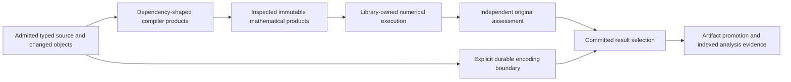

# Post-Plan44 pipeline optimization and the next investigative program

## 1. Integrated assessment and scope

**Decision: Revise.** Plan44 removed important numerical and preparation work, and its short cases now make a wider set of opportunities visible. The next substantial gains need not come from changing a solver: local authoring still constructs and immediately decodes transport representations; small edits copy complete source-index maps; result selection discovers more inventory than it consumes; and analysis creation repeatedly selects, decodes, encodes and validates the same evidence. A transient evidence join additionally performs a linear sample search for every response row. These are concrete execution-fit problems even though the exercised scientific results are correct.

The numerical opportunities are more selective. Adjoint consumers project parameter gradients after native work has already covered all parameters. Nontrivial repeated KINSOL applications still rebuild KLU symbolic analysis. More ambitious arithmetic composition, conservative JIT, derivative-route selection, sparse dynamics and checkpoint changes remain worthwhile investigations, with explicit deciding premises. This review does **not** select a universal solver, JIT backend or memory allowance from tiny timings.

This document provides two outputs: **thirteen source-grounded findings and their corrective contracts** in §5, and **a larger follow-up testing, library-qualification and design program** in §7. Recommendations are **Proposed**. A disposable membership prototype tests one replacement kernel; no production optimization was merged during this review. Work removed in a kernel is not an end-to-end speedup.

The target is the Process Simulator profile's *Functional target* and blueprint §0/§0.2: interactive edit/re-solve, studies, sensitivities, optimization/fitting, recycles, dynamics from the same definitions, extension and independently testable responsibilities. The judgment basis is Core 3.4, efficiency heuristics 1.0, Process Simulator 1.5 and the selected pse-arrow binding. Existing decisions, pins and plan dispositions describe the current system; §9 identifies recommended changes to them.

**Boundary and baseline.** Design tier, target purpose, covering source admission through mathematical preparation, native execution, result reading, scientific-artifact promotion and analysis construction, including their diagnostics and resource lifetimes. Inspected production baseline: `91fd915134f99edeb8ef00368096f84761960d95`, after Plan44 acceptance. Pre-existing environment/workflow edits were preserved. The coordinator inspected decisive source, ran the two bounded probe families in §3 and integrated three source/library inquiries plus a fresh independent assessment. The [evidence index](../evidence/post-plan44-pipeline-optimization-2026-10-18/index.md) identifies their roles and limits.

This is neither a new implementation campaign nor whole-product scientific qualification. No existing plan status, accepted ADR or architecture contract is changed. This review owns the proposed findings and investigations until a subsequently authorized plan adopts their disposition; it does not create another editable completion ledger for Plan44. Long-horizon models, sustained throughput, exhaustive native routes, process-wide memory completeness and every possible thermodynamic model remain unexamined. There is no environment/provenance attestation work or release-wheel requirement.

## 2. What the Plan44 results establish—and what they do not

The [Plan44 coordinator](../../plans/44-pipeline-performance-optimization.md), [investigation outcome](../../plans/44e-short-run-investigation-and-optimization.md) and [acceptance outcome](../../plans/44f-integrated-acceptance-and-follow-up.md) remain their own historical/status authorities. Their retained case artifacts were read, including the local resweep, matched output-density controls and canonical result/publication cases. A case count includes expected cancellation or refusal controls; it is not a count of accepted simulations.

| Observation | Interpretation retained or corrected here |
| --- | --- |
| Active study lanes retain compatible current views; exact mathematical artifacts and selected forward directions are implemented | Preserve these mechanisms. Additional cache layers or another proposal to select forward axes would repeat completed work. |
| Optional-rank preflight, one independent fresh final fitting evaluation and conditional combined forward quadratures are implemented | Preserve before-effect refusal, trial/final independence and truthful unavailable products. Investigate remaining consumed demand and crossover rather than rescheduling those fixes. |
| Matched unscheduled 5/25-time ODE controls retain the same native work: Diffsol 23 steps/9 setups; IDAS 16 steps/16 setups | More requested output times did not cause more native integration work in these controls. The separate resweep's 25-time case includes scheduling and another physical axis; comparing it directly with its 5-time case confounds variables. |
| Retained result controls: 80 states × 5 times gives 400 rows/1 dense batch, 5 selected rows/1 batch, 861 graph rows/14 pages; 80 × 25 gives 2,000/2, 25/1, 2,583/42 | Selection reduces returned rows, but this does not establish proportional metadata, decode or graph-construction work. The 96-state case changes the mathematical problem. |
| The 80-state, 5-time source-to-read chain takes 21.368 s in one observation | Inclusive owner intervals include source publication 3.882 s, simulation preparation 7.861 s, simulation/publication 3.625 s and analysis activation 3.446 s. They are not an exclusive CPU decomposition and must not be summed as one. The original transport oracle is deliberate test work. |
| That invocation records about 0.274 s of native work and 1.850 s of required publication | These are nested, differently scoped clocks. They support investigating the surrounding pipeline; they do not yield a same-scope percentage of total time attributable to a solver or store. |
| Analysis-phase-related operation 1328 reports 191 query builders/912 received statements, with complete cumulative counters in that inspection | Phase association is inferred from execution order/clocks because the operation kind is generic. A builder is not a statement or server CPU interval. Other partial operations cannot be added to this total. |
| Tiny KLU symbolic intervals are about 1.8–10.7 microseconds, including observation hooks | Repeated symbolic work is real; its measured tiny-case cost alone does not justify maintaining a different linear owner. Larger sparse shape/fill is the discriminator, not a longer four-variable simulation. |
| Logical reservations reach tens of GiB while RSS is hundreds of MB; final owned charges return to zero in the retained controls | These quantities cover different populations. They justify investigating representation and ownership, not lowering opaque admission bounds from RSS. |
| Ten-second CPU/timeline captures are partial; the publication-chain Samply profile is unsymbolicated and has unknown sampling loss | No exclusive attribution to serialization, allocations, the server or diagnostics follows. Use the existing work/phase counters first, then targeted aligned profiling if needed. |

The results therefore support a broader **source-to-answer** optimization program. They do not establish that native execution is optimal, that the store is the sole bottleneck, or that all short-duration investigative questions have been exhausted.

For identifier clarity, Plan44's **F01–F05 and F07–F09** remain completed corrections: selected forward directions, independent final fitting composition, early optional-rank refusal, active views, sparse IFT verification, early invocation recording, terminal publication and ordered trajectory checking. Its **F06** is this review's retained limitation **F13**. The new evidence-join F08 concerns analysis construction, not a regression of Plan44's repaired trajectory checker. Plan44 **O01–O06** retain lazy defaults, conditional exact quadratures, immutable inner compilation, same-point provider products with stateful barriers, explicit numerical controls and the bounded admission-cost conclusions. **N01/N02** preserve local fixture construction and returned failure observations. New work here extends those results; it does not reverse their implementation dispositions.

## 3. Additional tests and measurements performed in this review

### Public local preparation and execution

**Tested:** [the public Python driver](https://github.com/paul-heyse/pse-arrow/blob/f83bac0399d1d815b6ce91b692158b965fa054c7/docs/design_review/evidence/post-plan44-pipeline-optimization-2026-10-18/local-pipeline-probe.py) ran five simulations per invocation: first preparation/execution, another execution of the same prepared object, equal preparation, a parameter-default source edit and one equation edit. There were two invocations, ten usable joined simulations, zero assertion failures against a zero baseline, with eight independently checked linear states at five requested times. Both used Diffsol, forward sensitivity, ordinary `rtol=0.001` and component `atol=0.001`; authored physical checks and independent analytic values passed. A parameter-default source edit is explicitly **not** a pure runtime-value overlay.

The initial invocation read only the first bounded diagnostic catalogue page. The driver was corrected to follow `next_offset` and capture after stages; the second invocation supplies the retained [paged observations](../evidence/post-plan44-pipeline-optimization-2026-10-18/local-pipeline-observations.jsonl.gz). The [summary](../evidence/post-plan44-pipeline-optimization-2026-10-18/local-pipeline-summary.json) preserves both sets of stage clocks, selected metric coverage and resource reports. This correction changed collection, not production behavior.

**Measured, once-only per stage:** in the paged invocation, initial physical admission was 0.094 s, equal physical admission 0.076 s, initial model admission 0.139 s, first simulation preparation 0.043 s and equal preparation 0.005 s. Joined simulations took about 0.0025–0.0038 s. Parameter-default and equation-edit preparations took 0.015 and 0.020 s. Different cache/compiler/allocator warmth and intervening observation work prohibit interpreting these as controlled speedup ratios. The initial invocation's first preparation was 0.089 s and first join 0.012 s, illustrating why these are observations rather than latency targets.

Fresh native counter snapshots reported the same latest 22-step/8-setup pair for the first, same-prepared and equal-preparation runs; cumulative partiality/detail loss remains explicit. These are not asserted as complete whole-operation work totals. The changed parameter/equation cases changed the actual trajectory and native work. Equal reuse does not mean reusing a previous scientific answer. After releasing aliases and clearing optional program retention, `pool_reserved_now` returned to zero in both invocations. The second invocation's roughly 16.66 GB pool peak and 342 MB process peak RSS cannot be treated as the same memory population or a leak diagnosis.

### Disposable exact membership prototype

**Tested / Measured work counts:** [the standalone Rust prototype](../evidence/post-plan44-pipeline-optimization-2026-10-18/response-membership-probe.rs) compares the current transient sample-membership search with one exact hash index. [Results](../evidence/post-plan44-pipeline-optimization-2026-10-18/response-membership-results.jsonl) are deterministic operation counts, not elapsed benchmarks.

| Output symbols × sample times × response directions | Current sample visits | Index construction rows + membership probes |
| --- | ---: | ---: |
| 80 × 5 × 1 | 80,200 | 400 + 400 |
| 80 × 25 × 1 | 2,001,000 | 2,000 + 2,000 |
| 80 × 25 × 4 | 8,004,000 | 2,000 + 8,000 |

All positive memberships and twelve adverse/equality controls per shape passed: changed run/sample/time/output/unit, missing coordinates, NaN, signed zero, duplicate entries and infinity membership. The key preserves ordinary `f64 ==` semantics by rejecting NaN and normalizing signed zero. Infinity controls test equality only; they grant no scientific validity. The prototype uses synthetic scalar identities and tests **only membership**. It does not validate headers, contexts, endpoints, scientific permissions, graph provenance or allocation bounds, and is not a production implementation of F08.

The [evidence index](../evidence/post-plan44-pipeline-optimization-2026-10-18/index.md) records exact commands and exclusions. No durable service, experimental worktree, native factor owner or JIT prototype was created for these probes. The existing canonical cases and static source were sufficient to establish their remaining repeated work; uncertain replacements belong to §7.

## 4. Integrated target and preservation constraints

The system already has useful owners: authored declarations and physical context govern meaning; compiler/math owners produce immutable products; session/attempt owners hold mutable buffers; libraries own numerical iteration and factors; workflows compose experiments and qualify answers; artifact/result owners govern committed bytes and retention; diagnostics copy observations. Preserve those responsibilities. The target is to remove incidental work **between** them and retain only the actual products each consumer needs.

This is an ownership sketch, not a new execution engine or schema registry. In particular, serialization remains necessary for actual transport, durability and replay; scientific assessment remains necessary for every changed numerical state. Representation sharing cannot grant a different registry, receiver or validation context eligibility it has not established.

| Responsibility | Corrected consumed contract and meaningful variation |
| --- | --- |
| Local source revision | Admitted typed objects plus changed-object operations, immutable parser/span owners and exact indexed lookup, including absence and ambiguity. Full inventory export is an explicit full operation. |
| Compiler preparation | Inputs describe actually consumed source/physical premises; candidate peak admission differs from retained ownership. Value binding, source edits and structural edits remain distinct stimuli. |
| Mathematical preparation | One immutable region description and inspected library export carry their census/admission facts. Changed policy performs current admission; mutable evaluator/provider scratch remains private. |
| Numerical execution | Full physical parameter values are separate from demanded forward/adjoint coordinates. Symbolic analysis, numerical factors, starts and allocated sessions retain distinct validity. |
| Result selection | Exact immutable attempt, relation/range and optional output predicate determine the protected selection. Full and selected snapshot meanings are explicit rather than silently interchangeable. |
| Analysis construction | Reuse facts about identical admitted bytes while transferring final artifact coordinates and acknowledged ownership. New occurrence identity and reopening an existing occurrence are distinct operations. |
| Diagnostics | Existing invocation/work/phase/query observations are consumed with coverage, producer, generation and clock scope intact. Unknown/lost observations do not become zeros or exclusive timing. |

Representative scenarios are **S01** one source/value/span edit in a large mostly unchanged inventory; **S02** more unrelated physical declarations or more fixed fitting parameters; **S03** the same prepared simulation or study under optional-retention pressure; **S04** one selected result from a large immutable attempt; **S05** sensitivity-rich analysis creation and repeated access; **S06** changing coefficients under an unchanged sparse layout; and **S07** replacing the arithmetic realization or adding a unit/property/provider with existing meanings. These distinguish instance, composition, binding and mechanism changes without requiring every owner to implement its own cache or solver policy.

The critical preservation constraints are authored units/basis/reference states and domains; original physical assessment; explicit derivative order, scales and unavailable coordinates; exact snapshot manifests and late read failures; complete index-versus-IPC checks; producer/artifact retirement and escaped-buffer ownership; cancellation before/after effects; uncertain ACK recovery; and operation-local memory admission. No proposed optimization changes the ordinary engineering accuracy. Analytic oracle tolerances and rank/derivative qualification thresholds retain their separate meanings.

## 5. Findings and corrective contracts

Findings are current structural causes; their remedies and estimated benefits are **Proposed** unless separately labeled. **Implemented** below means the inspected path exists, not that its correction exists. All findings engage AP-07/G9; additional principles identify preservation or ownership obligations rather than independent unproven failures. Priority follows consequence and supported growth. It is separate from prerequisite order in §8.

### F01 — Local admission realizes a transport representation it immediately reconstructs

**High priority; S01/S03; AP-01/AP-07, H9/H12/H15.** **Implemented, source-inspected:** [canonical source admission](../../../crates/pse-runtime/src/workflow/modeling/canonical.rs), `persist`, builds a generated Arrow declaration batch from typed rows, finishes and drops it, builds a source index/parsed fields and serializes per-object JSON edits. `admit_revision` invokes local application before the local/durable branch. [LocalSourceObject::from_edit](../../../crates/pse-runtime/src/workflow/modeling/canonical/local.rs) decodes those payloads and obtains parsed fields again. Pure local execution avoids the store but still pays the transport realization.

**Correction:** the existing local revision owner should accept admitted typed objects/deltas and share their immutable declarations, spans, parser products and allocation owners. Serialize at an actual recording/export boundary. The least disruptive first correction retains current byte/hash identity while sharing typed products alongside it; deferring all encoding additionally requires RC01. Consumers receive the same lookup and exact revision contracts and stop interpreting JSON merely to use local declarations.

**Preserve / verify:** generated/native predicates still run under the actual receiving context; imported bytes remain untrusted. Compare typed ingress, changed/unchanged local reload and durable export/replay, with invalid rows, a different registry/context, deletion, spans and cancellation. Count encodes/decodes/materializations as well as clocks. A renamed wrapper around the same round trip does not close the finding. The new eight-state probe confirms local behavior, not the fraction of reference-load time caused here.

### F02 — Small edits clone complete local source-index maps

**High priority; S01; AP-07, H12/H15/H17.** **Implemented:** `AdmittedModelRevision::apply` in [local source revisions](../../../crates/pse-runtime/src/workflow/modeling/canonical/local.rs) reserves metadata over the whole old inventory and clones both complete `BTreeMap`s before filtering unchanged edits. Payload and unchanged bucket owners already share; map keys/nodes still copy. `persist` also constructs the full candidate edit population before filtering. Several retained revisions multiply metadata copying.

**Correction:** consume a typed changed-object set and structurally share ordered source indexes, keeping scope/kind/name/reverse-reference buckets authoritative. Existing pinned `rpds` offers a credible persistent ordered-map alternative; cold imports may use a transient builder. This does not justify a custom tree or another mutable source authority.

**Preserve / verify:** deletion, rename, changed references, negative lookup and ambiguity update the same indexes; persistent nodes are charged once to their real retained owners. A source-size ladder with one changed object must show changed-path construction rather than full-map cloning; include bulk import/iteration so the replacement does not optimize edits by making ordinary loads disproportionate. F01's typed changed-set contract enables the cleanest correction, but avoiding full-map copies need not wait for identity changes.

### F03 — Candidate construction allowances accumulate as retained compiler state

**High priority; S01/S03; AP-07, H12/H17/H28.** **Implemented:** [granular compiler preflight](../../../crates/pse-compiler/src/workspace/modeling/granular.rs), `Driver::preflight`, adds candidate phase allowances to `retained_preflight` before input equality/query reuse is known. `State::known_bytes` counts that cumulative history as retained. [Modeling workspace](../../../crates/pse-compiler/src/workspace/modeling.rs) and [workspace retention](../../../crates/pse-compiler/src/workspace.rs) eventually rotate the entire Salsa generation when it crosses the retained limit. A wholly unchanged revision already has an early return; repeated small accepted edits remain affected.

This is conservative accounting with a lifetime/reuse cost, **not an established under-accounting bug**. Candidate peak construction and still-retained product ownership are different quantities.

**Correction:** keep candidate admission separate from conservative newly retained ownership. Attach shared-node/container deltas to their actual immutable products; use Salsa's supported memory/heap reporting and LRU for the populations they cover. Keep justified allowances for hidden foreign state and safe whole-generation fallback. Resetting a cumulative counter without accounting for retained older nodes is unsound.

**Preserve / verify:** a repeated value/span/single-expression edit ladder observes query executions/backdating, retained charges and generation rotations; retain old outputs, pressure retention, cancel/fail a candidate and check restoration/release. Absence of extra rotations must accompany bounded retained ownership. RSS cannot supply the missing bound. RC02 applies only if the declared reserved-workspace model changes, not merely to fixing lifetime bookkeeping.

### F04 — Reused scalar products still require repeated program-description work

**Medium priority; S03/S07; AP-07, H9/H12/H15.** **Implemented:** [execution preparation](../../../crates/pse-math/src/execution.rs), `PreparedSupport::prepare_scalars`, forms arithmetic regions and collects reads/parameters; final compilation traverses/forms regions again. [Library admission](../../../crates/pse-math/src/library/admission.rs), [library products](../../../crates/pse-math/src/library.rs) and final program census count/export overlapping instruction descriptions. Exact Symbolica 3.0.1 `export_instructions` allocates descriptions. Plan44's immutable scalar compilation reuse is present; this is remaining description work, not the same missing cache.

**Correction:** carry an immutable prepared region and one inspected export, with source-qualified census/admission facts, through bounded conversion, reset eligibility, storage and optional compilation. Distinct Taylor orders/layouts stay distinct; a new policy rechecks its own admission against retained facts. The current compiled constructor already borrows its final export—do not reintroduce its removed clone.

**Preserve / verify:** count region formation/export/census passes on equal and changed preparation, with guards/providers and policy changes. Test private evaluator scratch and original failure attribution. Elapsed contribution is unmeasured. Dependent-region composition and JIT are separate I03 decisions, not prerequisites to removing redundant metadata work.

### F05 — Unrelated physical inventory changes invalidate consumed mathematical preparation

**Medium priority; S02/S07; AP-07, H5/H12/H17.** **Implemented:** [physical identity](../../../crates/pse-compiler/src/physical_identity.rs) includes the complete physical inventory; compiler lanes compare complete context and [view identities](../../../crates/pse-compiler/src/workspace/modeling/executable/solve.rs) frame its hash. An unrelated admitted unit/type can therefore invalidate a prepared product. Blueprint §14.4 deliberately documents this conservative boundary; current results are not claimed stale.

**Correction:** physical admission and resolution should expose the consumed type/conversion/reference-state/provider and resolution premises of each prepared product. Keep full-context identity for interchange/admission; use complete consumed dependencies for reusable mathematics. Positive IDs alone are insufficient: a new declaration can change ambiguity or satisfy a previously absent name.

**Preserve / verify:** compare an unrelated addition, a consumed conversion/reference-state change, a newly ambiguous lookup and a previously absent lookup. The former should preserve eligible structure, the others must invalidate. I02 must settle the closure and versioned frame before implementation; RC03 records the change to the current conservative contract. Keeping that rule leaves this optimization unavailable.

### F06 — Result readers rediscover inventory, and selected intent arrives too late

**High priority; S04; AP-02/AP-07, H5/H6/H9/H15.** **Implemented:** [result selection](../../../crates/pse-runtime/src/workflow/connected_results.rs), `result_selection`, eagerly [captures](../../../crates/pse-runtime/src/workflow/result_snapshot.rs) every block/descriptor in the relation/range. `next_checked_body` then queries the metadata again. `output_results` calls `results` before attaching its output predicate, so even an absent/one-output selection first inventories the broader relation.

**Correction has two distinct obligations.** Full readers can iterate their already protected frozen inventory. Selected readers need selection before discovery, one exact protected read and only the complete selected closure. The public synchronous `snapshot()` currently means the relation/range inventory, and native plans share it. Do not silently return a narrower snapshot. I04/RC04 must choose an explicit selected-snapshot constructor/meaning or deliberate API migration; the full-reader correction is independently actionable.

**Preserve / verify:** exact attempt/manifest, row ordering and ranges, schema, IEEE values, missing ranges, index-versus-IPC checks, unread-future-file protection, late errors and escaped allocations. On the **same** 80-state/25-time attempt, isolate constructor, first batch and EOF for full, one output and absent output; count block/descriptor/output queries and checked/decoded bytes. Grow blocks only after that short discriminator. Returned row counts alone do not close this finding.

### F07 — Analysis composition repeats selection and scientific evidence realization

**High priority; S05; AP-03/AP-07, H9/H12/H15/H20.** **Implemented:** [analysis selection](../../../crates/pse-runtime/src/workflow/analyses.rs), `select_result_analysis`, selects results/sources and decodes dispatch relations. [Artifact promotion](../../../crates/pse-runtime/src/workflow/artifacts.rs) independently selects results/sources, snapshots/decodes scientific members and encodes standalone artifact files. Analysis then reads/decodes/admit-checks those members for graph construction. These are serial physical passes through a single logical composition.

**Correction:** compose the existing owners through an internal protected-selection operation. During promotion, carry source-qualified validated scientific evidence and map it to **final** artifact locators after the required commit/ownership transition. Graph activation consumes those facts and acknowledged final ownership. Public standalone promotion remains available. Bound retained evidence versus re-reading; do not retain an entire unbounded trajectory simply to avoid a pass.

**Preserve / verify:** a second trust/ownership transition is not redundant just because its bytes compare equal. Preserve artifact-kind interpretation, original context/assessment/lineage, producer retirement races, uncertain ACK/recovery, graph failure and cancellation on either side of activation. Compare decode/encode/selection counts and exact graph/locators on the same run. Shared original files are a **larger alternative** under I04/RC05, because current artifact blocks are independently retained standalone files; a borrower flag alone cannot implement that target.

### F08 — Scientific response evidence is joined by repeated scans

**High priority; S05; AP-07, H5/H9/H15.** **Implemented:** [ResponseEvidence::transient_recorded](../../../crates/pse-runtime/src/workflow/analyses.rs) filters/collects headers, contexts and endpoints by run for every response, then searches the entire sample vector with `any`. Projection invokes it per response; related scalar/family checks also repeatedly group stable evidence. With S samples and R response rows, sample membership alone can visit O(S×R) rows.

**Correction:** within one bounded analysis operation, build exact sample membership and validated run/step groups once. Retain duplicate/conflict classification, original per-row locators and all header/context/endpoint/coordinate permission predicates. Consumers ask the evidence owner whether a specific coordinate is permitted rather than independently scanning relations. A local keyed join is sufficient; no persistent cache/service or compulsory DataFusion conversion is needed.

**Tested kernel / verification still needed:** §3 establishes exact membership behavior and work reduction for the prototype only. Production integration must also reject conflicting duplicate headers/contexts/endpoints, absent directions, wrong experiments/units and unsupported scalar-certificate claims. Partial/event trajectories retain their valid, weaker recorded transient meaning within the actual completed endpoint/sample coverage; they must neither be blanket-rejected nor acquire stronger local certificates. Preserve NaN/signed-zero equality, checked integer ranges and bounded index construction. Measure complete analysis creation and memory at increasing states/times/directions before claiming end-to-end improvement.

### F09 — Bounded graph pages repeat server lookups per edge

**Medium priority; S05; AP-07, H6/H9/H15/H20.** **Implemented:** [generated-query source](../../../crates/pse-codegen/src/codegen/surreal_analyses.rs) resolves endpoints, input ownership and artifact block/row coverage inside the edge loop. Many edges share those coordinates; one RPC page therefore still performs repeated server queries. Existing client `EdgePublication` already classifies readiness once, and composite substrate indexes already exist. Neither missing client readiness nor missing indexes is the established cause.

**Correction:** within each bounded page, resolve distinct endpoint/artifact-block facts once and perform set-oriented insertion/validation where exact replay and transaction semantics permit. Server validation remains authoritative; trusting only the client would weaken a boundary rather than optimize it. Change the generator, never generated queries directly.

**Preserve / verify:** missing/cross-analysis endpoints, absent artifact members, bad row coverage, conflicting replay, duplicate edges, retirement and lost ACK retain defined outcomes. Use pinned SurrealDB `EXPLAIN` on actual generated predicates and existing indexes before selecting physical changes. Concurrent reader contention around page `FOR UPDATE` is an unproven I04 question, not this finding's demonstrated cause.

### F10 — Standalone IPC decode performs the same bounded preflight twice

**Lower priority, small direct correction; S04/S05; AP-07, H12.** **Implemented:** [decode_result_file](../../../crates/pse-runtime/src/workflow/result_files.rs) preflights the supplied bytes and requires one batch, then calls `read_file_batch`, whose `open_file_reader` preflights them again. This is duplicate traversal of the same immutable bytes under the same bounded-file contract, not a second receiver's separate semantic admission.

**Correction:** use one checked reader construction with the expected single-batch count and retain the existing schema/row/decoded checks. Keep Arrow's decoder and hostile-input allocation preflight. No new decoder or validation bypass is warranted.

**Verify:** malformed footer/nodes/buffers, extra batches, wrong schema/rows and IEEE payloads retain their outcomes. Count preflight calls per standalone decode. Its small scope does not explain the multi-second publication chain and should not displace higher-consequence work.

### F11 — Cold physical source publication encodes twice and publishes each block separately

**Medium priority; S01/S07; AP-07, H9/H12/H15/H20.** **Implemented:** [Operations::put_physical_rows](../../../crates/pse-runtime/src/workflow/durable.rs) visits/encodes each source relation once to compute identity and again to publish it. Each block advances a separate store edit before the context receipt. Exact document/row receipt caching and fresh protection already optimize warm use; this is a cold/change path, not every preparation.

**Correction:** produce one bounded encoded source spool for identity and publication, then group coherent source admission where selective replay permits. The spool may spill or stream through an existing bounded owner; avoiding a second encoding must not require unlimited live copies. Retain per-relation selective replay and coherent package/context visibility.

**Preserve / verify:** first publication, current-runtime warm publication and actual changed rows have separate controls. Count encoding passes/bytes and statements, interrupt between blocks and before/after acknowledgement, verify exact identities/references and reclaim owned scratch. If grouped publication changes the externally recorded revision/retry contract, RC06 applies; eliminating the second encoding alone need not change it.

### F12 — Adjoint parameter demand is projected after full native gradient work

**Medium priority; S02/S03; AP-07, PS-07/PS-09/PS-11, H5/H10.** **Implemented:** [integrated attempt preparation](../../../crates/pse-runtime/src/workflow/integrated.rs) clears forward-axis selection for non-Forward requests; gradient/window methods return full parameter layouts before [shooting](../../../crates/pse-runtime/src/workflow/shooting.rs) projects consumed columns. [Diffsol integration](../../../crates/pse-backend-native/src/dynamics/integrator.rs) selects all integration parameters outside Forward, and [IDAS backward quadratures](../../../crates/pse-backend-native/src/dynamics/idas.rs) use the complete integration parameter count. Fixed/unconsumed parameters can therefore enlarge derivative products/storage despite selected consumers.

**Correction:** define consumed **adjoint parameter-gradient** coordinates separately from forward directions and state adjoints. Keep complete physical values and the required state adjoint; narrow parameter products/quadratures/returned coordinates where the consumer does not require them. Ordinary public adjoints can remain full. The state adjoint may dominate cost; a benefit magnitude is unmeasured.

**Preserve / verify:** I05 compares one free parameter with nonzero, coupled fixed inputs, schedules and anchored windows; preserve direct/initial dependence, tied/scaled sums and schedule mapping. Empty demand cannot become fabricated zeros. This requires an explicit internal layout and admission contract, with RC07 only where recorded shape/meaning changes. Do not reuse a field named forward axes to silently redefine adjoints.

### F13 — Nontrivial compatible KINSOL applications still repeat KLU symbolic analysis

**Conditional priority; S06; AP-07, PS-09/PS-11, H12.** **Interface-checked / historical Measured:** [Session::replace](../../../crates/pse-backend-native/src/kinsol.rs) retains allocations/layout and correctly clears setup validity. Exact SUNDIALS 7.1.1 initializes KLU with `FIRSTFACTORIZE`, and the next setup frees/rebuilds symbolic analysis plus fresh numerical factors. `KLUReInit` frees both. An already accepted start bypasses this path and cannot demonstrate symbolic reuse. Plan44's deferred F06 remains a real limitation with an unresolved beneficial remedy; this review does not recast it as newly measured damage.

**Correction direction:** I06 compares stock KLU with a narrow library-compatible symbolic-retaining `SUNLinearSolver` owner under exact CSC structure and all analysis settings, and with an eligible existing Krylov/preconditioned route. KINSOL retains nonlinear iteration/globalization; numerical factors remain fresh per application. Suppressing initialization or trusting old numerical validity is rejected.

**Preserve / verify:** changed coefficients, ordering/settings/pattern, singular/refactor failure/recovery, accepted versus ordinary starts, cancellation/drain and repeated release. Observe symbolic/full-numeric/refactor/substitution separately. A representative sparse fill/coupling ladder must show material complete benefit before maintaining another binding under RC08. Tiny symbolic timings alone favor keeping the current route while making this investigation explicit.

## 6. Library leverage and alternatives

The [preparation](../evidence/post-plan44-pipeline-optimization-2026-10-18/preparation-inquiry.md), [native](../evidence/post-plan44-pipeline-optimization-2026-10-18/native-inquiry.md) and [results](../evidence/post-plan44-pipeline-optimization-2026-10-18/results-inquiry.md) inquiries give exact source paths, capability limits, Context7 calls and primary upstream links. The root checked decisive production paths. No stale utilization catalog or capability-map entry supplies a conclusion.

| Consumed capability | Current or eligible library alternative | Recommendation and integration cost |
| --- | --- | --- |
| Persistent ordered local source indexes | Pinned `rpds=1.2.1`, already used by modeling phase maps | Qualify structurally shared ordered maps and a cold builder before inventing a tree. Shared-node accounting/deletion/index invariants belong to the existing source owner. Context7 did not resolve the relevant Rust library reliably; exact source supplies this capability. |
| Incremental semantic preparation | Salsa 0.28.4 equality/backdating, LRU/eviction and heap reporting | Correct candidate/retained ownership first. Library memory reports cannot discover arbitrary foreign heaps; do not replace the compiler or retain mutable Salsa handles across incompatible histories. |
| Arithmetic descriptions, composition and native realization | Exact Symbolica 3.0.1 exports, `FunctionMap`, registration/inlining options and JIT | F04 is direct metadata work removal. I03 qualifies larger dependent programs/JIT without losing intermediate/domain checks. The shared skill corpus is 3.0.0; exact installed 3.0.1 source was checked for these claims. |
| Conservative JIT configuration | Existing compiled-evaluator feature already enables native code generation; locked SymJIT 2.26.0 has fastmath/SIMD/thread options and gates FMA fusion on fastmath | Availability is established; equivalent generic-ISA, floating-point, memory, cancellation and private-scratch behavior is not. Compare with the existing bounded, cancellable C++ child route instead of assuming JIT is either forbidden or superior. |
| Sparse nonlinear/linear work | KINSOL/SUNDIALS 7.1.1 and KLU; eligible Krylov/preconditioner routes | Preserve library numerical ownership. Exact upstream [KLU source](https://github.com/LLNL/sundials/blob/v7.1.1/src/sunlinsol/klu/sunlinsol_klu.c) supports F13. An adapter must own a real consumed lifecycle gap, not duplicate generic iteration. |
| Forward, adjoint, quadrature and checkpoint composition | Vendored Diffsol 0.16.2 and SUNDIALS 7.1.1 IDAS | Use exact callbacks/layouts and native solvers. Diffsol's archive identifies source commit `dc30fee49e692c65577b11a1181bfca62f5ebf42`; current documentation/guessed tag paths are not version proof. Both adapters already skip zero-weight adjoint jumps. |
| Selection, projection and relational execution | DataFusion 55.1.0, Arrow IPC 59.3.0 | Existing streams, immutable file-reader caching and physical metrics are useful. Arrow projection exists, but full `FieldCheckedBatch` admission currently needs the complete schema. I04 must define projected admission; projection alone does not avoid whole-file digest reads. `DataFrame::cache` materializes results; a cloned plan is not a cached answer. |
| Bounded transactional graph publication and indexed reads | SurrealDB 3.3.0, actual generated functions and existing composite indexes | First reduce repeated work inside current transactions. Use exact query plans before prescribing indexes/range scans; hashed record keys are not automatically a useful range layout. No store replacement is selected. |

Current Context7 documentation was fetched for Salsa, Symbolica, SUNDIALS, Diffsol, DataFusion and SurrealDB where available. Current snippets supplied discovery, then exact local source/pinned references settled applicable contracts. Important mismatches include DataFusion's current-main scan signature and older Diffsol examples. No dependency bump was needed for this review. Full library eligibility remains; licenses are not a rejection criterion.

The simplest target is fewer representations/passes within current owners. A blanket cache, eager derivative policy, unconditional stored-artifact deduplication, larger global memory allowance or new store would carry more machinery and different semantics. Native composition/JIT and shared sealed artifact files remain eligible alternatives **only** after their complete consumed contracts are qualified. Keeping a justified current mechanism is preferable to hiding unsupported fallback or weakening scientific checks.

## 7. Follow-up testing, deeper investigation and design scope

These are **Proposed, not run here**. They intentionally go beyond another repetition of the Plan44 matrix. Each row names an unresolved choice, the smallest useful contrast, the capability/tooling work needed and what the result decides. Findings with already established causes do not wait for a statistically significant timing campaign; their tests distinguish sound corrections from moved work.

| ID / decision | Short discriminators and captured facts | Larger work and decision boundary |
| --- | --- | --- |
| **I01 — Typed incremental ingress and retained ownership**; F01–F03 | Same-runtime first/equal admission; increasing inert source inventory with one default/span/expression/deletion edit; typed versus current transport prototype. Count serialization/parsing/map nodes, query execution/backdating, peak versus retained ownership and rotations. Keep an old revision/result, fail/cancel one candidate. | Implement typed admission/delta and shared-index prototypes under existing predicates; qualify node ownership rather than derive bounds from RSS. Then choose the no-identity-change target first or RC01 explicitly. Distinguish actual retention pressure from construction-history inflation. |
| **I02 — Consumed physical dependencies**; F05 | Add an unrelated unit/type; change a used conversion/reference state; add a name that introduces ambiguity or satisfies prior absence. Observe which compiler/body/view products are rebuilt. | Specify resolution/negative-lookup/provider premises, then version the consumed identity contract. The experiment must distinguish safe precision from an unsound positive-ID-only key. Complete context remains an interchange identity. |
| **I03 — Arithmetic preparation, composition and JIT**; F04 | A dependent arithmetic chain, independent sibling blocks, provider-heavy body and guarded/nonfinite intermediate, at modest graph sizes. Separate prepare/export/compiler time from repeated evaluation; compare interpreted/current C++/conservative JIT only where eligible. | Qualify exact 3.0.1 function/sub-evaluator support through Taylor products, export/reset and derivative orders; generic ISA/FMA/fastmath, admission of code/heap, cancellation and mutable clone state. Dependent fusion must preserve original ordered failure attribution and may need an assessed domain barrier rather than expression flattening. Choose one library-owned realization per admitted policy, not a second scientific pipeline. |
| **I04 — Result/artifact/analysis physical operation**; F06–F11 | Same committed run: full/one-output/absent-output reads with constructor/first/EOF boundaries; first analysis creation versus explicit reopen; sparse versus dense response directions; repeated graph pages. Count query builders/statements with per-call scope, bytes/blocks checked and decoded, preflights, joins, file copies and distinct edge coordinates. | Settle selected-snapshot meaning first. Prototype a protected-selection promotion handoff; compare standalone copies with sealed shared-file ownership only if justified. Qualify projected registry admission and complete residual filtering before limit/null/IEEE semantics. Inspect actual SurrealQL `EXPLAIN` and short concurrent-reader/retirement behavior before changing locks/indexes. |
| **I05 — Consumed derivative demand and route crossover**; F12 and completed forward-quadrature route | One free input plus zero/four **nonzero coupled** fixed inputs; independently vary free controls, integral channels and windows. Include direct/initial/tied/scaled effects and a schedule/anchor. Count selected product width, native RHS/Jacobian/JVP, forward/backward/replay/quadrature work and simultaneous state. | Add an explicit internal adjoint parameter layout; compare exact forward quadratures, adjoints and weighted-functional contraction under the same objective. Stock quadrature sensitivity shape follows primal channels, so weighted contraction may need a composed functional binding. Keep all-window preflight and no after-effect fallback. Select a conditional route, not a universal parameter-count threshold. |
| **I06 — Repeated sparse native preparation**; F13 | Fixed support with changed coefficients, ordering/settings/pattern, singular recovery and accepted-start control. Increase sparse dimension/fill until linear preparation becomes visible while keeping runs short. Count actual symbolic/numeric/refactor/solve work and original residuals. | Qualify a symbolic-retaining `SUNLinearSolver` prototype versus stock KLU and eligible Krylov/preconditioning. Adopt another binding only for a sound complete benefit, including ownership/testing/upgrade cost. Do not share numerical factors or transplant KLU factors into the separate faer IFT problem. |
| **I07 — Dynamics method, stiffness and linear shape** | Small smooth nonstiff, stiff sparse ODE, index-1 DAE, event/reset and scheduled-input cases; vary coupling/fill and tolerable stiffness independently of output density. Record rejected/error/convergence steps and setup reasons, interpolation, residual/Jacobian/JVP/preconditioner work. | Qualify an explicit Diffsol method where eligible and direct/Krylov/preconditioned implicit routes where needed. An IDAS block-factor preconditioner currently has an explicit unsupported path; determine whether it is a needed integration gap before implementing it. Compare invariant/physical outcomes, not identical internal trajectories or wall time alone. |
| **I08 — Checkpoints and scheduled adjoint lifetimes** | One/several segments, terminal-only/nonzero interior observations and two checkpoint intervals, at the same science settings. Separate recording, replay, backward work, consistency initialization and simultaneous retained history. | Compare Diffsol's retained segment solvers with IDAS replay of earlier segments. Investigate a narrow exact-release/upstream checkpoint API that can remove the host reset-metadata recorder. Preserve sample-side schedule convention, algebraic consistency, initial corrections and explicit memory refusal. Zero-weight-jump skipping is already implemented. |
| **I09 — Historical preparation, studies and retained-result pressure** | Alternate current/one historical revision with changed selection and optional retention on/off; one/two independent workers and retained old outputs. Observe workspace construction/reservation, view lifetime, queue/admission wait, native time and final release separately. | Current historical misses can create a fresh separately charged semantic workspace. Compare bounded exact historical lanes, compact immutable phase retention and fresh construction; extra lanes may worsen admission. Preserve a sole live-lineage writer, fresh numerical admission, cancellation isolation and caller-held products. Reuse complete immutable model/profile identity components in bound views only after unchanged components are shown. |
| **I10 — Other solver classes and property/implicit work** | Repeated coefficient/bound/objective updates in LP/QP, cone and a small factorable mixed-integer case; a real property-heavy scalar/implicit derivative-eligible model; a slow-contracting recycle with controlled acceleration changes. Observe basis/presolve/setup reuse, callback/property/inner/IFT work and physical qualification. | HiGHS compatible updates/basis retention already exist. Qualify actual Clarabel update restrictions, SCIP expression/bound visibility and optional PETSc/Uno/JVP/preconditioner routes, using their library skills when this work is authorized. For a refused implicit derivative, establish the exact missing capability rather than substituting finite differences or measuring a refusal as a solve. |

**Testing method and progression.** Start with one complete observation per meaningful contrast and analytic/conservation/original-result assertions. Use existing small shapes before increasing size. A single observation can establish an unnecessary pass or changed work count; only repeat when variability would change a remedy choice. Keep output density, number of physical states, derivative directions, parameter values, scheduling, worker count and durability independently controlled. Zero-valued fixed inputs are useful controls but insufficient evidence for arbitrary coupled inputs.

Capture returned candidate, native and original-check observations before a fixture assertion can abort reporting, retaining Plan44 N02's correction. A native-converged candidate rejected by original checks is a useful adverse control, not an accepted scientific solution or missing data to suppress.

Aim for seconds of scientific execution and an initial 60-second cooperative observation budget per exploratory case, with separately reported setup/build/publication/cleanup. On budget exhaustion, request normal cancellation, wait for owned drain and preserve partial diagnostics; do not force a ten-minute case to finish merely for timing. A longer run is justified only by a named phenomenon that a compact surrogate cannot reveal, after the short work has removed obvious amplification. The result of this program should specify that later case and deciding question, not pre-authorize a broad long-duration tournament.

**Diagnostics/tooling scope.** Existing invocation/readiness, phase, compiler, math-product, native work/setup-reason, original qualification, pool/cache and canonical statement observations are the first instruments. Tag test stages with actual operation IDs and paginate their catalogues. Add narrow query-owner/call labels, encode/decode/block/join/export counts or retained-versus-candidate quantities only when their absence prevents a concrete decision. These are proposed supporting changes, not prerequisites to every optimization. Keep counter reset/generation/partiality; distinguish inclusive wall time from CPU and native steps from output times.

If CPU attribution remains decisive, collect a **phase-aligned, symbolized** short client capture and, when relevant, the authenticated owned server, retaining actual process and clock alignment and loss limits. Compare ordinary diagnostics with selected detail on the same work to identify observer interference. Existing partial/unsymbolicated profiles do not establish an instrumentation defect or mandate a new tracing platform. Fast editable correctness builds suffice when a native probe needs rebuilding; full Maturin installation/wheels and environment proof are excluded.

A useful result for every investigation is one of: a selected correction with its eligibility/preservation contract; a disproved mechanism with decisive evidence; or a specific unresolved premise and next experiment. An unexamined area alone is not a new defect. Negative results and typed refusals should narrow subsequent work rather than disappear into a new broad case count.

## 8. Priority, prerequisites and alternatives that must fit together

**Highest consequence:** F01–F03 affect ordinary edit/re-solve and sustained source evolution; F06–F08 amplify ordinary selected reads and sensitivity-rich analysis. Their structural causes are established without a long performance campaign. The immediate small F10 correction is independent and easy to verify but has lower total consequence. F04/F09/F11 remove repeated work at their own owners. F05/F12 need precise consumed-dependency/layout contracts; F13 needs a material sparse workload before a replacement is selected.

Prerequisite order is different. A typed changed-object contract supports persistent source indexes and honest retained-node accounting. A selected-snapshot contract precedes selected-reader discovery changes, while full-reader inventory reuse can land independently. Promotion handoff must establish final artifact coordinates/commit before graph construction consumes facts; a shared-file artifact design, if chosen, must establish retention independently before removing copies. F08's bounded indexed evidence can be corrected within today's artifact semantics. Server-side grouping can follow independently without moving trust to the client. F04's one-pass descriptions are useful whether I03 eventually chooses interpretation, C++ or JIT.

The proposed design must not trade one amplification for another. Retaining every historical compiler workspace, all decoded graph evidence or every compiled program can save construction while increasing simultaneous admission and blocking ordinary concurrency. Prefer current consumed products, optional bounded retention and product-held owners; compare complete operation work and live state. Higher logical budgets can mask repeated construction and do not close it.

Adding a unit/property with existing concepts should change its declarations/provider, not require that author to implement local transport, profiling or compiler invalidation policy. Substituting a compatible mathematical/solver library changes its integration owner and eligibility qualification, not original scientific meaning. More coordination can be legitimate where the substitute introduces genuinely different derivative, effect, checkpoint or factor semantics; a neutral wrapper that discards bulk/update capabilities is not the target.

## 9. Rule impacts and disposition boundary

These are proposed impacts, **not applied decisions**. Plan creation should present the consequential choices explicitly. The rules are current design, not reasons to reject the target. Routine removal of F02/F04/F08/F09/F10's redundant work can preserve current semantic rules; architecture descriptions still need reconciliation when implemented.

| ID | Current rule/location | Proposed change and dependent scope | If retained |
| --- | --- | --- | --- |
| RC01 | ADR-0089 and blueprint §14.4/§20 canonical object/revision identity | For F01/I01, decide whether local typed admission can defer byte realization while retaining exact current identity, or needs a deliberately versioned identity change. Preserve actual durable byte identity and receiving validation. | Share typed products alongside unchanged canonical encoding; do not claim all encoding is removed. |
| RC02 | Blueprint §14.3.2 reserved compiler-workspace/admission model | F03/I01 may replace construction-history retention with actual conservative retained ownership and an explicit separate candidate bound. A default reduction requires its own sound bound. | Correct bookkeeping within existing reservations; retain safe rotation/foreign allowances. RSS does not authorize a smaller bound. |
| RC03 | Blueprint §14.4 complete physical-inventory invalidation and affected versioned context frames | F05/I02 uses complete consumed physical/resolution premises for product reuse, while keeping full inventory identity for interchange. | Continue invalidation after unrelated physical inventory changes. |
| RC04 | Public `CanonicalResultReader::snapshot()`/`ResultSnapshot` relation-range contract and blueprint §20 result selection | F06/I04 introduces an explicit selected-snapshot operation/meaning or deliberately changes the API. A full snapshot cannot silently narrow to the selected output. Projected admission, if adopted, must explicitly retain the affected registry validation contract. | Remove the duplicate full-reader walk; retain broad selected-constructor discovery until an additive or replacement selected contract is chosen. |
| RC05 | ADR-0182/ADR-0187 and blueprint §20.4 independent standalone artifact-file realization | I04's larger alternative permits independent artifact ownership of sealed shared file/batch members with authenticated lifetime, digest and row-coordinate coverage. F07's composition improvement need not choose this alternative. | Retain standalone copies; share protected selection and byte-bound evidence only across justified transitions. |
| RC06 | Blueprint §20 selective physical-source replay, per-revision publication/retry identity | F11/I04 may group cold physical admission when coherent activation and exact replay can be stated; record any changed revision/acknowledgement granularity explicitly. | Reuse one bounded encoding spool but preserve existing per-block revision/edit sequence. |
| RC07 | Blueprint §13.6/§19 internal gradient layout and any affected recorded derivative frames | F12/I05 adds consumed adjoint parameter-gradient coordinates with full physical inputs/state adjoints; change external framing only if actual recorded shape/meaning changes. | Public/full adjoints remain full; consumers continue post-projection. Forward selection does not silently redefine this contract. |
| RC08 | Blueprint §18/§23 native linear preparation ownership and current KLU initialization behavior | F13/I06 may adopt a separately qualified symbolic-retaining native linear binding with exact structural/settings eligibility and fresh numerical setup. | Keep stock lifecycle and measured limitation; do not suppress initial setup. |
| RC09 | Proposed ADR-0191, blueprint §14.1/§14.3 current C++ realization, evaluator ABI and export/reset eligibility | I03 may admit qualified library composition/JIT and their explicit source/floating-point/lifecycle profiles. This does not automatically select JIT or change accuracy. | F04 and module/description sharing proceed within the current interpreted/C++ route. |
| RC10 | Blueprint §13.6/§18 checkpoint/replay and derivative-composition contracts | I05/I08 may introduce a weighted functional/checkpoint binding or narrow upstream API where it supplies the complete consumed contract. Existing exact callback, sample-side and before-effect refusal semantics remain. | Retain current forward-quadrature/adjoint eligibility and replay/recorder composition. |

Explicit reopening through `analysis(key)` changes no occurrence semantics. Automatically treating a request for a **new** analysis occurrence as an old one would change blueprint §20.3 and is **not recommended**. Likewise, no change to accuracy, physical validity, clean-room behavior, one type universe, force-validation or declared native outcome meaning is proposed.

## 10. Architectural foundations, gates and decision

The verdicts apply to the named operations and representative scenarios, not every model/backend in the codebase. The scientific checks exercised by Plan44 and §3 are separate from architecture. No newly accepted wrong scientific answer was established.

| Foundation | Verdict and evidence |
| --- | --- |
| AP-01 Separation of concerns | **Satisfied in the inspected ownership model.** Authored meaning, compiler/math preparation, native iteration, original assessment and committed retention remain distinct. F01/F07 identify inefficient physical composition at those boundaries; a broader claim of domain ownership failure is not needed to establish them. |
| AP-02 Stable contracts | **Satisfied for current inspected contracts.** Exact layouts, snapshot range and artifact ownership are explicit. The selected-snapshot and composed/JIT alternatives are not yet qualified substitutions; RC04/RC09 prevent silently reinterpreting them. |
| AP-03 Composition | **Satisfied structurally in scope.** Existing owners compose local/durable/study/native work; F07 shows redundant physical realization, not a demonstrated need to merge their responsibilities. Proposed handoffs must preserve distinct effects. |
| AP-04 Domain model and semantic authority | **Satisfied for examined distinctions.** Physical/model definitions govern variables, derivatives, original qualification and artifact family; complete values versus requested coordinates, analysis occurrence and committed bytes have explicit meaning. This does not certify every property model. |
| AP-05 Explicit structure | **Satisfied in inspected paths.** Selected coordinates, immutable identity, typed refusal, manifests and allocation owners are explicit. F05/F12 require finer contracts rather than implicit guessed keys. |
| AP-06 Local reasoning/testability | **Satisfied in inspected seams.** The new local controls need no canonical service; mathematical and membership responsibilities admit isolated checks. Full durable recovery and new native/JIT bindings still require their real dependencies. |
| AP-07 Execution fits workload | **Violated.** S01/S04/S05 incur unnecessary full-map copies, repeated encodings/discovery and O(S×R) evidence scans; repeated edits can discard retained compiler work due to lifetime-mismatched accounting. F01–F13 and §3 distinguish demonstrated work from unmeasured latency benefit. |

| Gate | Judgment in scope and basis |
| --- | --- |
| G1 Authority | **Pass:** no second mutable scientific authority found in the inspected paths; proposed sharing retains existing owners. |
| G2 Semantic fidelity | **Pass for inspected/exercised paths:** source/physical interpretation, full values and exact evidence coordinates remain present. New selected/gradient/JIT meanings require qualification before use. |
| G3 Validity | **Pass for inspected/exercised paths:** generated admission, original checks and explicit refusal remain. The membership kernel grants no scientific permission. |
| G4 Hidden behavior | **Pass in scope:** observation/results inspection does not intentionally rerun science; preparation/execution/publication have explicit owners. Repeated current work is reported under G9 rather than mistaken for an undeclared scientific effect. |
| G5 Consistency and recovery | **Pass on inspected contracts and retained selected controls:** immutable attempt/file protection, acknowledgement/activation and uncertain-outcome handling remain explicit. No new broad failure-injection campaign was run here. |
| G6 Transformation and reuse | **Pass for current inspected/exercised behavior:** conservative invalidation and fresh numerical assessment avoid asserting unsafe reuse. Proposed finer keys/fusion must retain the adverse cases in §5–§7. |
| G7 Truthful capability claims | **Pass at this scope/evidence level:** refused derivatives, partial diagnostics, tiny-case limits and unrun alternatives remain explicit. No whole-product performance claim is made. |
| G8 Library leverage | **Pass for current inspected numerical ownership:** libraries own iteration, derivatives/factors and relational/IPC operations; current adapter gaps have stated reasons. JIT/composition/projected admission need complete-contract qualification; their mere API availability does not establish a current G8 violation. |
| G9 Architectural fitness | **Fail:** AP-07's concrete work amplification affects ordinary supported edit/re-solve and result/analysis growth. Passing numerical cases do not compensate. |
| PS-G1 Physical consistency | **Pass only for the source/quantity contracts and simple physical controls examined.** No new thermodynamic envelope or general conservation qualification was performed. |
| PS-G2 Well-posedness | **Not applicable to this bounded structural-algorithm assessment:** no formulation, degree-of-freedom or decomposition algorithm was changed or independently audited. The simple well-posed local fixture does not qualify rejection of ill-posed models. Retained admission/refusal controls remain relevant preservation evidence; later program composition must retain those checks. |
| PS-G3 Numerical integrity | **Pass for inspected contracts and exercised original checks.** Standard accuracy, unavailable derivatives, fresh final assessment and native/original distinction remain; long/stiff/global scientific scope is unexamined. |

No unit/property scientific implementation was changed, so its conformance-suite status is unchanged. The new driver tests a linear physical-Time fixture, not a process-wide scientific family. Proposed JIT, consumed-adjoint and sparse-linear remedies remain unqualified until their named checks run.

The [fresh independent assessment](../evidence/post-plan44-pipeline-optimization-2026-10-18/independent-assessment.md) agrees on the scoped AP-01–AP-06 strengths and AP-07/G9 failure. Its six grouped findings are separated here where closure requires distinct ownership contracts. Its snapshot, artifact-transition, float-equality, complete-value/state-adjoint and JIT-lifecycle cautions are incorporated in F06–F08/F12 and I03. Its initially noted ambiguous prototype field was renamed to `sample_times` and the prototype rerun. PS-G2 is explicitly outside this review's independent algorithm assessment; proposed numerical alternatives have unresolved qualification rather than inheriting current scoped gate passes. No material adverse judgment was discarded.

**Overall: Revise architectural execution fit; retain the observed behavioral safeguards.** The source establishes thirteen causes/limitations at differing priorities; the membership prototype demonstrates one exact work-removal mechanism, and public local controls confirm that existing reuse and short correct simulation are real. Ten proposed investigations define the further tests, integration design and library qualification needed for a wider optimization program. All ten rule impacts await subsequent planning/decisions. No implementation acceptance or automatic change to Plan44 follows from publication of this review.
