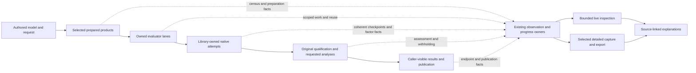

# Integrated solver diagnostics and performance target

## 1. Assessment, scope and evidence

**Decision: Revise.** The external reviews identify valuable opportunities and the current system supplies substantial foundations. Their combined recommendations need correction before they describe a safe, coherent target. Current live callback observations mix distinct producers; disabled POUNCE timers appear as numerical zero; independently coalesced fields cannot reconstruct a numerical iteration. Those are concrete diagnostic deficiencies. Source also establishes avoidable mathematical and boundary work, including cubic local second-order shape metadata, dense implicit contractions and IDAS hard stops at every output sample. No speedup or share of total runtime is established by this review.

**Architectural fitness fails in the reviewed scope. Behavioral adequacy is not accepted for diagnostic interpretation; assembled scientific qualification is not established here.** This does not invalidate previously recorded scientific results. The review distinguishes current defects, useful optional improvements, and hazardous interpretations of the external proposals.

The recommended target has one scientific pipeline and three diagnostic products: ordinary live observation, explicitly selected detailed collection, and derived analysis. Producers retain their own meanings; the system joins their evidence rather than inventing a second universal event authority. Optimization proceeds through selected mathematical products, library-owned numerical execution and compatible reuse. Instrumentation is neither a prerequisite for every local optimization nor permission to weaken original-problem assessment.

### Inputs and baseline

- [R1: external numerical diagnostics review](../../external_review_numerical_diagnostics_1.md).
- [R2: solver performance review](../../pse-arrow-solver-performance-review.md).
- Repository source at `9cf67375cdf6d0b06c2dc51bc10e1ff72b9a439c`; both reports state that same baseline. At review start the only working-tree additions were those two supplied reports. They remain unchanged.
- Core 3.4, efficiency heuristics 1.0, template 3.4, Process Simulator 1.5 and the pse-arrow binding selected by `standard.toml`.

The judgment basis is the standard and functional target: edit/re-solve without value-triggered structural reconstruction; sweeps, sensitivities, optimization and fitting; recycles; dynamics from the same definitions; new units/properties/solvers; and independently compilable/testable responsibilities. ADRs, blueprint choices, plans, pins and host settings describe the current design, not the acceptance criteria. Proposed changes to them are recorded in [§11](#11-rule-impacts-and-follow-up-ownership).

**Method and independence.** The coordinator inspected contracts, source, benchmark collection, inspection/capture and decisive numerical paths. Two fresh independent design reviewers assessed diagnostic architecture and mathematical execution; a library researcher checked native methods and exact-release capabilities. Their contrary evidence and judgments are reconciled below. The native-solver-libraries, symbolica-faer-oximo, datafusion and datafusion-tracing skills supplied discovery routes; Context7 and primary source supplied library evidence. Pinned APIs were checked separately from current documentation. Neither `docs/library-utilization.jsonl` nor `docs/capability-maps/` was used.

The findings are **Implemented source diagnoses** or explicitly identified representation limits; remedies and performance benefits are **Proposed**. Inspected interfaces are **Interface-checked**. Existing test names identify verification routes, not tests executed for this review. No simulation, product build, benchmark, service or system configuration change was performed. Read-only host inspection confirmed the current cache groups and permission settings; it was not a performance measurement. Document publication checks are reported separately from product evidence.

### Coverage and exclusions

The [complete recommendation crosswalk](../evidence/solver-diagnostics-and-performance-target-2026-10-17/recommendation-crosswalk.md) addresses all R2 **43 numbered items**, their subordinate proposals, R1's distinct section-based recommendations, and both reports' unnumbered proposals. The [capability and evidence notes](../evidence/solver-diagnostics-and-performance-target-2026-10-17/capabilities-and-evidence.md) identify decisive source owners, library versions, tools and limitations.

Coverage follows complete operations through preparation, transformation, evaluation, native execution, recovery, requested analyses, publication and caller access. It includes roots/NLP, coefficient/conic/discrete neighbors, recycles, dynamics, fitting, shooting, studies and concurrent execution. It does not requalify every unit/property, perform a solver tournament, install tools, implement changes, reopen completed plans or execute Plan40e's separate campaign. Environment/provenance attestation and repeated comparative benchmarking are excluded.

## 2. Responsibilities, domain distinctions and physical meaning

The target should preserve the present separation of authored physics, preparation, numerical policy, solver machinery, workflow orchestration, scientific acceptance and persistence. A new unit should acquire diagnostics through its equations/providers and existing semantic identities. It should not need its own tracing vocabulary, profiler integration or native solver policy.

| Responsibility | Authority and consumed contract | State/effects and local verification |
| --- | --- | --- |
| Authored equations, properties and physical conventions | `pse-modeling`, compiler admission and provider registrations; blueprint §8–§14 | Model/source authority; shared model and derivative checks without a diagnostic store |
| Selected mathematical preparation | `pse-math` body/assembly plans, supports, bindings and products | Immutable programs/maps/census; exclusive mutable worker/provider scratch; pure mathematical fixtures |
| Numerical policy and strategy | Resolved tolerances, starts, route eligibility and strategy transitions; blueprint §16–§18 | Declared choices and spent work; test decisions using injected capability/outcome facts |
| Native iteration, globalization and factors | Fitting native library through its adapter | Native session/workspace owner; owner-safe callbacks and returned statistics; backend integration fixtures |
| Original qualification and requested products | Original problem and workflow owners; blueprint §17–§19 | Fresh state assessment, derivative validity, withholding and result permission; independent oracles |
| Observational facts and live access | Producer-issued facts, `pse-diagnostics`, runtime hub/progress/capture; blueprint §23.1 | Optional bounded copied evidence, no scientific authority; injected clock/collector tests without solvers/store |
| Analysis and presentation | Pure interpretations of retained facts; Rust-owned documents projected to Python/CLI | Derived statements, hypotheses and next observations; no hidden residual/Jacobian evaluation |
| Persistence and comparison artifacts | Existing result/artifact owners; blueprint §20–§21 | Explicit immutable publication and retention; ordinary live inspection remains store-independent |

Consequential identities remain distinct: operation, native attempt, native session, callback producer, work-charging owner, physical source occurrence, prepared artifact and diagnostic artifact. They are related explicitly rather than collapsed into one solve ID. A diagnostic mode is not a physical model revision or a new scientific permission.

### Physical-semantics and well-posedness boundary

| Quantity | Meaning, convention and validity | Authority |
| --- | --- | --- |
| Original variable, residual, bound and closure | Authored units, basis, reference state, domain and row/variable identity | Physical admission and original candidate assessment |
| Native residual/stationarity/step | Named transformed coordinates, norm, normalization and tolerance; a native stationarity component is not automatically an original one | Adapter and transformation recovery contracts |
| Model time and derivative products | Physical time versus internal mesh/output time; parameter/output/direction coordinates; initial/event/branch and derivative-order premises | Dynamic model, integrator and mathematical product owners |
| Elapsed and CPU time | Monotonic interval versus executing thread/process CPU; process CPU is inclusive shared activity | Actual timing and attachment owner |
| Counts and memory | Attempted/completed/accepted work; counter generations; observed allocation versus reserved allowance versus process RSS | Performing producer, factor/workspace owner and existing work ledger |
| Conditioning/near-null observations | Operator, scaling, tolerance, residual of the approximate direction and numerical accuracy; not a global singularity or infeasibility certificate | Explicit numerical diagnostic operation |

Original structural admission is class-aware: roots require complete original square equality matching; optimization permits genuine degrees of freedom; point evaluation requires complete original obligations. Matching does not establish numerical rank. A transformed witness must describe the transformed row/column/support inventory or be re-established; an original witness cannot simply be forwarded. Diagnostics name original model elements through valid recovery mappings. This review inspected these boundaries, not every physical model's conformance suite.

## 3. Holistic target design

### T01 — Join complete executions without duplicating authority

One execution record references its request, operation, actual attempts, effective formulation/solver settings, preparation/reuse facts and governing outcome. It retains two direct elapsed endpoints: completion of governing original-problem qualification, and availability of all requested products to the actual caller. The first can include workflow closure and accuracy checks beyond a backend quality report; the second includes requested sensitivity/covariance work and applicable publication/materialization/reopening. Failed attempts and withheld products remain visible.

The record references existing strategy/work facts; it does not independently reconstruct charged work from callbacks. A known subtotal does not make an unknown total known. Nested elapsed intervals are work observations, not an exclusive partition. Asynchronous overlap and shared-flight relationships explain the critical path only to the available coverage; unattributed time remains unattributed.

If qualification is never achieved, its completion endpoint is unavailable; record terminal elapsed and the failure separately. A caller response containing a typed withheld covariance or sensitivity may be ready while that scientific product remains unavailable. Response readiness, product availability and original qualification are distinct facts.

The benchmark collector should produce a record per executed invocation before computing summaries. Criterion samples remain a separate statistical view. Warmup/sample membership is supplied by a verified harness interface or explicitly unavailable, never inferred from invocation order. Once-only design-phase observations remain useful without a comparative timing claim.

### T02 — Coherent live numerical checkpoints and selectable history

Fields interpreted together are published together under producer/attempt/event identity: sequence, actual event time, method phase, native iteration or step, native coordinates/norms, convergence quantities, acceptance/trial status and independent availability. Current/recent summaries retain a coherent latest checkpoint even when optional history is disabled. Aggregate counters remain separate from checkpoint rows.

Ordinary collection retains cheap local counters, coarse phases, prepared census references, coherent checkpoints, bounded recent history and compact terminal summaries. Producers accumulate locally and publish at owner-safe boundaries. Prepared handles avoid hot name formatting and linear metric searches where the path warrants it. No clock, counter or string-processing operation is presumed free.

Off means absent optional collection, not absent mandatory work accounting or scientific qualification; baseline local callback accounting can remain. Current `PSE_DIAGNOSTICS=off` selects hub collection at first registry initialization, engine `ObservationPolicy::Off` concerns operator metrics, and `Controls.history=0` concerns retained progress history. History-off still permits a current checkpoint. These settings must not be presented as interchangeable zero-instrumentation modes.

Selected numerical studies may request richer iteration/factor records and selected system profiles. A finite ring with decimation is sampled history, not a complete trace. A requested complete interval/event-family capture must either stream within explicitly selected finite limits or report gaps/incomplete outcome. Capture sufficiency can determine whether a diagnostic study answered its question; optional evidence failure cannot revoke a valid scientific result.

Do not enable an unbounded native history collector and truncate only on return. Do not flatten iteration arrays into thousands of generic metric keys. Extend existing progress/hub/capture owners, keeping recording, retention and presentation separate. A caller owns subscriber composition; a native collector must not shadow unrelated tracing layers.

### T03 — Explain mechanisms and uncertainty during and after execution

Live inspection should answer what is active, how fresh the fact is, what changed over the selected interval, and which next observation would discriminate a suspected cause. It distinguishes native progress, original qualification and caller readiness. Several minutes in an opaque native interval is not by itself proof of a hang.

Derived analysis separates: **more work**, **higher unit cost**, **work displaced into preparation/inner solves/post-analysis**, **waiting or contention**, and **different scientific outcome**. It uses event sequence and comparable native phase/norms before suggesting stagnation, restoration cycling, tiny steps or repeated worst rows. Accelerated recycle history does not directly establish a contraction constant. Threshold rules are explicit analytical policies and evidence-linked hypotheses, not silent retry or convergence policy.

Source attribution follows transformation and preparation authority. Preserve all contributing occurrences through CSE/fusion, duplicated addends, eliminated rows/variables, slacks and dual recovery. A many-to-many pullback may be necessary; it is not always a lookup. Charge shared computation once while showing the occurrences it serves.

Passive inspection does no new science. Top-k original residuals, Jacobians, condition estimates and sparse singular directions can require an explicitly selected operation with a point, requested operator, remaining budget and cancellation owner. An exhausted or invalid failed attempt may have no eligible diagnostic point. Preserve the original failure when a diagnostic probe also fails.

### T04 — Make mathematical execution follow the consumed product

Preparation owns selected supports, immutable coordinate/addend maps and a static census: selected outputs/axes, derivative shape, instruction/stage counts, frame/result capacities and eligible compiled regions. Execution records actual demand/order, cache result and incompatibility reason, provider work, implicit requests and retained state separately.

Use Symbolica-owned joint optimization and derivative lowering within bounded, compatible arithmetic regions. Preserve lazy branches, fallible provider obligations, guards, independent differentiation coordinates and all source occurrences. Prefer library multi-output/CSE capabilities before adding a second host optimizer. Avoid expanding to dense public representations when a consumer needs packed, weighted or directional products.

Weighted NLP Hessians and directional curvature are distinct products. Weights are held constant under differentiation; objective sign, scaling, aliases and multiplicity remain explicit. Provider second-order capability is still required wherever the chain consumes it. A scalar compiled arithmetic route does not compile the entire provider pipeline.

A completed richer result may serve a narrower request through a valid projection. Preserve separate lazy demands; do not evaluate unrelated constraints/guards merely to fill a combined cache. Exact input/configuration/support/coordinate premises govern reuse; `new_x` alone is insufficient. Failures cannot publish partial cache completion.

For implicit calculations, request unknown-only Newton Jacobians when parameters are not differentiated there. Preserve the already retained symbolic LU/scratch and one current factor for first/second multi-RHS solves. Compare library matrix contraction `Tᵀ Hᵢ T`, support-driven contraction and directional products against the actual demand. A retained KINSOL/KLU factor is not automatically current or substitutable for the separately verified faer derivative factor.

### T05 — Remove incidental crossings while retaining safe publication

Prepare coordinate/permutation/addend maps once. Give each callback owner reusable scratch, evaluate/normalize/accumulate into that scratch, and publish a complete successful result once. A final copy can be worthwhile to preserve untouched native output on failure. Fused scales must retain finite representability; a transport refill is only a permutation when its mapping is bijective.

Preserve checked canonical CSC/index/triangle invariants when removing repeated bridge validation; foreign callers remain a boundary. PETSc already preallocates row capacity: bulk value publication is the relevant remaining opportunity. Reuse POUNCE pools/workspaces across compatible admitted lifetimes rather than assuming a pool is constructed for every factor.

Coarse independent evaluator lanes may share immutable programs while owning mutable evaluator/provider/session state. Coordinate their memory and threads with outer studies and native factor pools. Deterministic scatter alone does not establish deterministic provider execution or error selection. Prefer coarse case/region parallelism and library batch/SIMD capabilities before a custom lane engine.

### T06 — Keep method choice and reuse explicit, capability-driven and library-owned

The portfolio remains one pipeline with class-specific realizations and typed actual outcomes. Compare full/reduced and direct/Krylov/block formulations using complete work and requested results. BTF solves, scalar brackets, Anderson acceleration, equilibration, continuation and bound tightening are eligible compositions under explicit scientific contracts, not universal defaults established by source inspection.

A reuse premise distinguishes immutable patterns, numerical values, fixed/equality/bound classifications, scaling, solver policy, starts, artifacts and worker state. Ipopt same-structure mode retains more than symbolic analysis; KINSOL no-initial-setup can retain numerical/preconditioner state. Keep fresh initialization unless the stronger compatibility and failure-recovery contract is selected and established. A source-compatible dependency or session hit is not factor reuse.

Algorithmic scaling must not redefine physical nominals/tolerances. Ipopt and POUNCE tolerance option aggregation has intentionally different semantics; compare original acceptance, not identical option numbers. Relaxed-bound projection must be followed by assessment of the projected original candidate, with invalid KKT/sensitivity products withheld. Native refinement settings remain one explicit effective configuration, with interior-point/SQP and outer refinement roles distinguished.

For IDAS, hard stops should mark genuine segment/discontinuity boundaries; requested samples should use eligible interpolation. Retain roots, resets, consistent initialization, sensitivity/quadrature values and post-transition sample semantics. Separate serving an already covered sample from issuing another native step when the cumulative work budget is exhausted. Compare sensitivity correctors using their method-specific counter semantics.

### T07 — Use a composable, question-driven tool stack

Keep Perfetto plus Trace Processor as the primary timeline analysis route, perf/Samply for CPU samples, and the existing Arrow/DataFusion boundary for derived tables. Add explicit capture capabilities for counters, allocations and off-CPU evidence when a concrete question needs them. Keep raw output and its availability/coverage separate from interpreted statements. Ordinary live inspection has no profiler or store dependency.

Heaptrack is a useful first native/Rust allocation tool; custom pools need their own accounting. Gungraun/Valgrind is useful for isolated instruction and simulated-cache questions, not a guarantee of hardware latency or universally noiseless counts. Coz is an optional causal-intervention experiment over a meaningful completion/progress point, not proof derived from ordinary sampling. Tracy, Tokio Console, AMD uProf/IBS, PGO/BOLT, LLVM remarks and `llvm-mca` remain specific tools for distinct questions, not a mandatory parallel telemetry stack.

Build/profile, BLAS dispatch, explicit FMA, ISA, ordering and thread changes must retain a declared numerical equivalence contract. Existing `profiling` already inherits `release` with full debug information; a new profile is not automatically needed. A disclosed dev/force-validated observation is valid evidence for that configuration. Profiling or timing-only routes do not replace force-validated correctness qualification. No blanket ≤1% budget, fixed frequency, ≥10 repetitions or new per-commit gate is adopted.

## 4. Findings and preservation constraints

Each finding's diagnosis is source-inspected; every remedy below is **Proposed**. Priority is consequence-based, not an implementation sequence. P1 denotes incorrect interpretation or material execution amplification; P2 denotes narrower work/cost improvements whose elapsed significance is still unknown.

### F01 — Work and timing populations are not joined per complete invocation

**Cause/evidence.** `native_process` accumulates phases, native times and observations across benchmark closure invocations, then divides by total invocation count; `scripts/case_measure.py` separately summarizes measured Criterion CSV samples. Descriptions disclose these populations, but they cannot associate a particular slow invocation with its attempts/outcome. Surrounding recovery/assessment/requested-analysis phases are also uneven. See `native_process`, `Observations` and `case_measure.samples` in the evidence notes.

**Consequence/scenario.** In S01/S04/S05, aggregate counters may describe different populations from timing samples, and apparent solver improvement can be displaced postsolve work. This limits diagnosis rather than invalidating all historical results. AP-04/AP-05, DP-21/DP-22; requested diagnostic target G9. **P1.**

**Correction.** T01: benchmark/workflow owners emit per-invocation joined records and owner-issued endpoint facts; analysis derives summaries. Reference existing work authorities. Preserve inclusive/unknown counts, all attempts, withheld outputs and once-only observations.

**Verification.** Exercise two invocations with different retries/products and ensure each retains its own timings/work/outcome, including failed and cancelled cases. K4 accuracy's per-operation records are an inspected starting point. Distinguish Criterion membership from all-call records without assuming membership by order.

### F02 — Nested callback producers overwrite one live metric population

**Cause/evidence.** The original presolve `Adapter` and foreign NLP context capture the same observation context and construct different `CallbackState` generations. Both actual Jacobian paths use `jacobian`; they publish identical `callback.jacobian.completed_calls` and `.seconds` keys. Inner/outer publication alternates generations and inclusive meanings. A latest `callback.work_owner` Boolean does not bind historical values to their producer. Sources: `callback.rs`, `presolve/pipeline.rs`, `execution/runner.rs`, `ipopt/sequence.rs`, `uno/callback.rs`, `tnlp.rs`.

**Consequence/scenario.** S02/S03 live series show resets and mixed costs inside one attempt. This does **not** establish double charging: the separate work-owner flag is a useful existing safeguard. AP-02/AP-04/AP-05; G2/G9. **P1.**

**Correction.** T02/T05: bind native boundary, transport and original-oracle facts to explicit producer scopes/prepared handles, retaining nesting and one charging owner. Do not infer an exclusive oracle time by subtracting overlapping totals.

**Verification.** The actual same-demand nested path performs at least two calls and a recoverable failure without cross-owner resets or population mixing. Existing `transported_callback_has_one_charging_owner_and_failed_operations_reconcile` uses different names and is insufficient for this specific property.

### F03 — Independent field histories cannot express one numerical checkpoint

**Cause/evidence.** Backend `observation::event` publishes each metric separately; each hub update independently uses `try_lock`; histories coalesce per key with no shared native event sequence. The current contract is honest about copied partial fields, but lacks the relation needed to reconstruct an iteration tuple.

**Consequence/scenario.** S06 cannot safely explain that a particular objective, infeasibility and step belonged to the same iteration, or infer continuous stagnation from coalesced endpoints. AP-04/AP-05, DP-07/DP-21; G9 for the richer requested target. **P1.**

**Correction.** T02/T03: atomic compact producer-owned checkpoints plus independent aggregate counters. Bounded live history, selected detailed streams and complete-capture promises remain distinct. Preserve current/latest progress when history is disabled and explicit sequence/coverage loss.

**Verification.** Inject reads/contention between production events; no published row mixes iterations. Exercise disabled history, generation reset, nonfinite values, gaps, terminal failure and mid-run attachment. Complete collection either retains all requested records or reports incomplete coverage; a decimated ring never claims completeness.

### F04 — Disabled POUNCE detailed timers are projected as zero measurements

**Cause/evidence.** `pounce.rs` inserts `Metric::Real(timing.field.total_wallclock_time())` unconditionally. Pinned POUNCE gates detailed timing behind options that this adapter does not enable. Its default zeros therefore do not demonstrate zero time. Ipopt already distinguishes disabled/running/absent timing availability.

**Consequence/scenario.** S03/S06 factor/evaluation comparisons can falsely identify free work. G2/G7; AP-02/AP-04/AP-05. **P1.**

**Correction.** T02: record activation/availability before values; wire selected detailed timing independently of ordinary intermediate callbacks. Do not delete useful history or enable all timers to conceal an availability defect. Selected native history requires bounded integration: its upstream collector grows during execution and adapter end-only truncation is insufficient.

**Verification.** Disabled, enabled, running, interrupted and absent-terminal paths preserve distinct meanings. Confirm POUNCE live callbacks work without optional `statistics.iterations`; never flatten an entire enabled iteration array into hub metric names.

### F05 — Local derivative construction can greatly exceed consumed support

**Cause/evidence.** `JetLayout::new` stores length-k shape vectors for O(k²) second components, giving O(k³) metadata with explicit bounds. `case_patterns` scans coordinate pairs before support filtering. Single-expression arithmetic stage boundaries restrict joint optimization; some public/provider boundaries expand packed second derivatives to dense output. Local selected axes are already narrowed and assembly already uses packed `TrialEvaluation` seconds: the defect is narrower than universal dense-Hessian work.

**Consequence/scenario.** S02/S07 growing local width can consume disproportionate preparation, memory and evaluation work even when global nnz is small. AP-07, DP-10/DP-13/DP-20; G9. **P1.**

**Correction.** T04: product-specific derivative preparation, support-driven contribution construction, compatible arithmetic regions and library-owned weighted/directional lowering. Preserve local-to-global aliases, both cross contributions where needed, independent coordinates, provider orders, guard/failure attribution and selected demand. Do not replace the mathematical library with project AD.

**Verification.** Compare requested support and constructed work, not just final nnz. Exercise alias diagonals, repeated addends, empty support, selected bad/unselected guards, provider-dependent branches, coordinate reordering and nontrivial first/second derivatives. No universal speed formula follows from Taylor width alone.

### F06 — Implicit derivatives materialize and scan broader products than needed

**Cause/evidence.** Native inner Jacobian evaluation constructs unknown-plus-parameter columns then exports unknown columns. Math IFT evaluates dense residual jets, extracts sparse unknown Jacobian, and scans the combined Hessian width twice for each parameter pair. Symbolic LU/scratch already persist and first/second RHS already share a current numerical factor.

**Consequence/scenario.** S02/S04 reduced formulations can move substantial work into inner derivatives and proofs, obscuring apparent outer-solver gains. AP-07, DP-10/DP-14; G9. **P1.**

**Correction.** T04: unknown-only Newton demand; explicit point/product projections; library matrix/sparse/directional contraction selected by support and consumer. Keep derivative residual checks, singular/bound-neighborhood refusal and original assessment. Do not equate retained native allocations with a current derivative factor.

**Verification.** Inspect/replay first/second products for selected inputs, bound-active/singular points, changed accuracy/configuration and cancelled upgrades. Separate jet construction, extraction, factor, RHS construction, backsolve, residual verification and expansion facts. Existing `implicit_ift_second_derivatives_and_singular_refusal` and same-point invalidation tests are relevant but were not run.

### F07 — Callback and sparse publication boundaries repeat materialization

**Cause/evidence.** Foreign callbacks allocate output vectors; TNLP normalization and presolve transport allocate/refill/copy further buffers. PETSc preallocates row capacity but submits values per nonzero. Separately, the C++ COO bridge performs a `std::set` duplicate check during native-sequence construction, already amortized by retained sequence reuse; it is not a per-callback or per-reused-solve cost. Exact passes/allocation counts depend on backend and route; the report's universal totals are not established.

**Consequence/scenario.** S01/S03 cheap evaluations or large sparse callbacks incur work unrelated to fresh mathematics. AP-07, DP-10/DP-14; G9. **P2.**

**Correction.** T05: prepared addend/coordinate maps, owner scratch and bulk library publication; retain one successful-output copy if required for atomicity. Replace repeated validation only where a complete checked bridge contract serves all callers. Derive transformed structural witnesses rather than forwarding an incompatible original one.

**Verification.** Permutation versus duplicate accumulation, physical/native scaling and objective sign, multiplier changes, overflow, nonfinite results, recoverable errors and panics preserve complete publication and original behavior. Existing failed-partial-output controls constrain the change.

### F08 — Requested IDAS samples constrain the internal integration mesh

**Cause/evidence.** `Session::segment` calls `IDASetStopTime(target)` at every requested sample. Diffsol's driver uses genuine segment stops and interpolation. Pinned IDAS supplies normal-mode interpolation, so output-grid boundaries need not all become hard native boundaries.

**Consequence/scenario.** S04 dense requested output can force additional native work independently of physical discontinuities. The amount is unmeasured; a grid speedup is a hypothesis. AP-07, DP-10; G9. **P1.**

**Correction.** T06: stop at true boundaries and serve eligible samples through interpolation. Preserve events, resets, consistent initial conditions, sensitivity/quadrature output, returned/internal time and cumulative effort limits. An exhausted stepping budget must not forbid a sample already covered by native state; native zero max-steps does not mean zero remaining work.

**Verification.** Fix equations, ICs, tolerances, events and first output while varying grid density. Check trajectories/conservation/derivatives and observed steps/setups/failures; include coincident root/reset/sample, off-grid endpoint, backward products and interpolation after budget exhaustion. No change to tolerance or event semantics may explain the improvement.

## 5. Further target opportunities and decisions

These are **Proposed improvements/investigations**, not invented current correctness failures. Each retains a bounded responsibility and settling question; the crosswalk supplies all subordinate obligations.

| ID | Target opportunity and boundary | Decision/verification that distinguishes the remedy |
| --- | --- | --- |
| O01 | Compatible native reuse: stronger pattern/classification/scaling signatures at the native owner; conditioning symbolic reuse; retain fresh numerical checks | Changed fixed/equality/bound status, values, scaling and starts invalidate exactly what they affect. Compare retained allocations with retained symbolic/numeric state separately |
| O02 | Declared numerical compositions: eligible block/scalar roots, root presolve/FBBT, Anderson/Picard/Newton tears, equilibration and finite continuation | Compare fitting existing native routes, branch/domain preservation, recovered original assessment and complete work; no automatic global depth/order/size default |
| O03 | Product-qualified compilation and evaluator lanes: optional derivative arithmetic compilation, library batching/SIMD, coarse admitted parallel work | Actual arithmetic eligibility and amortization; independent lane state, deterministic declared reduction/error behavior, memory and study throughput; preserve interpreted/provider path semantics |
| O04 | Explicit native configuration and diagnostics: refinement composition, timer/hook activation, actual order/scaling/fallback, selected sparse near-null analysis | Exact-release capability and overhead; equivalent original acceptance rather than raw option equality; library partial-SVD residuals and scaling validity |
| O05 | Host/build/provider exploration: release/profiling/O3/LTO, conservative versus selected ISA/FMA, MKL/AOCL/HSL eligibility, allocator scope | Numerical equivalence and actual linked/used implementation; backend ABI and workload fit. No assumed percentage improvement, deterministic whole-solve promise or licence-based rejection |
| O06 | Selected system tools and reusable analysis: Perfetto SQL, hardware counters, off-CPU/heap profiles, differential profiles and isolated kernel replay | Which question each resolves, process/thread/operation attribution and loss; capture from launch for short work, selected windows for long work; no mandatory profiler stack |
| O07 | Notification-based waiting within current admission/execution owners | Lost-wakeup, cancellation/deadline, fairness and drain tests; retain Uno's native-safety exclusion and existing resource authority, without another scheduler |
| O08 | Observational settings separated from numerical identity where sound | Classify controls by actual semantic effect. `Controls::identity` currently includes history; remove only observational settings proven irrelevant to trajectory, result and required stopping; keep effectful observer/probe settings explicit |

Additional opportunities absent or underdeveloped in the reports are coherent event publication (F03), separating diagnostic-study sufficiency from scientific validity, admission/retention failure of detailed native collectors, method-specific coefficient/conic/discrete progress, and preserving many-to-many source attribution through optimization. The target also makes **analysis withholding and completion tails** first-class: a qualified point with unavailable covariance is a different outcome from an unqualified point or a fully ready requested result.

## 6. Library fit and alternatives

The [capability notes](../evidence/solver-diagnostics-and-performance-target-2026-10-17/capabilities-and-evidence.md) contain exact sources and tool limitations. Principal choices are:

| Capability | Preferred owner/candidate | Fit, limits and simpler alternative |
| --- | --- | --- |
| Joint arithmetic/derivatives/compiled regions | Symbolica 3.0.1, existing math preparation/export owner | Joint evaluation/CSE/export fit; a fallible provider and lazy branch are not a plain external scalar function. Start with compatible multi-output regions |
| Implicit contractions/factors | faer 0.24.4 and current factor owner | Matrix products and separate symbolic/numeric/scratch lifetimes fit; preserve derivative residual verification; no bespoke factorization |
| Nonlinear/root/recycle/dynamic algorithms | Ipopt/POUNCE/KINSOL/PETSc/Uno/Diffsol/IDAS | Keep class-specific capabilities and returned meanings. Newer KINSOL damping/depth hooks are fixed-point/Picard controls, not general Newton iteration monitors |
| LP/QP/conic/discrete progress | Existing HiGHS/Clarabel/SCIP adapters | Method-native incumbent/bound/gap/nodes/certificates and stage coverage; do not force NLP fields into every row |
| Sparse near-null diagnostics | PRIMME/ARPACK-ng or a fitting established alternative | Explicit selected diagnostic operation; `JᵀJ` worsens conditioning and an existing J factor is not automatically a factor of that operator. Bespoke Lanczos is not the default |
| Timeline/CPU/analysis | Existing Perfetto/perf/Samply, Trace Processor, Arrow/DataFusion | Extend current interoperable formats and copied evidence; another live event authority is unnecessary |
| Allocation/off-CPU/hardware | Heaptrack, selected perf/BCC/IBS, optional isolated dhat/Valgrind | Different scope/permissions/perturbation; custom pools/native threads need independent interpretation |

The simplest viable correction does not require all tools or all numerical optimizations: correct scope/availability, publish coherent checkpoints, join invocation evidence, and remove demonstrably unnecessary local work under existing scientific contracts. Broader product-specific lowering and compatible native reuse offer greater potential with higher integration obligations. Automatic tuning and PGO/BOLT are later conditional explorations; they must not hide current semantics or encode unvalidated workload classifiers.

## 7. Scenarios, numerical stages and verification

| Scenario | Stimulus and expected target response | Verification boundary |
| --- | --- | --- |
| S01 Edit/re-solve | Value edit retains structural products; a genuinely structural edit rebuilds only dependent products; each execution records its own work and readiness | Original result checks plus preparation/reuse counters and per-invocation endpoints |
| S02 Wide/implicit derivatives | Selected outputs/coordinates, weighted Hessian and directional demands construct their required products; aliases/guards/providers retain meaning | Nontrivial derivative oracles, singular/bound refusal, cache projection/failure and constructed-versus-consumed work |
| S03 Formulation/native substitution | Full/reduced/block/Krylov or another solver remains admitted by class and consumed capability; actual fallback and original recovery are visible | Transformed witnesses, start/scaling/factor compatibility, original residual/domain/KKT and full attempt ledger |
| S04 Dynamics/fitting/shooting | Dense output does not invent discontinuities; reasons for primal/response/adjoint/curvature/identifiability work remain distinct | Event/reset/output/budget cases; initial conditions, conservation and derivative checks; checkpoint/replay generations |
| S05 Concurrent study/resource failure | Shared preparation is charged once, waiters remain distinct, lanes/pools retain issued work through drain | Operation relationships, inclusive CPU/RSS labels, cancellation, failed points and publication/retention limits |
| S06 Slow/stagnant/failing run | Current coherent native phase and recent changes are readable without performing science; selected detail reports gaps and may request explicit probes | Mixed-field/contention tests, freshness, same-demand nested callbacks, history-off, missing/disabled native facts and short-run capture |
| S07 New unit/property | Ordinary definitions acquire common checks and source attribution; provider derivative/envelope differences stay explicit | Local model/provider fixtures; unselected bad guards remain unselected, independent arguments stay independent |
| S08 Replace mechanism/test locally | Substitute a math implementation, native adapter or profiler through its fitting contract; low-level interpretation tests need no store/native startup | Pure policy/observer fixtures and separate adapter integration; no new telemetry framework in every consumer |

### Numerical stage obligations

| Stage | Formulation/derivative/scaling contract | Capability and outcome obligation |
| --- | --- | --- |
| Admission/preparation | Original domains, roles, selected outputs and symbolic support; no point validity inferred from structure | Class-aware matching/eligibility; disclose rejected or prepared scope |
| Presolve/reduction | Explicit transformation, guards, recovery, scaling and derivative maps | Native problem plus complete transformed witness; retain recovery/original assessment cost |
| Evaluation/implicit calculation | Exact admitted order/product and provider chain; declared physical/numerical scaling | Fallible complete output, exact-point reuse premises, singular/bound refusal, derivative residual check |
| Native attempts | Resolved tolerances, globalization/continuation and start permissions | Library-owned work/status; failed/limited/acceptable states remain distinct |
| Dynamic integration | Physical segment/event semantics, sensitivity order and error control | Internal versus returned time; actual forward/replay/backward work and cumulative budgets |
| Recovery/analysis | Original residual/bound/domain/closure and validity of KKT/response/covariance | Qualification and each requested product's withholding are independent outcomes |
| Publication/access | No new formulation; retain units/identities and result permissions | Exact publication/availability endpoints; diagnostic retention is not scientific activation |

**No product tests were run.** The evidence notes name existing controls for proposed qualification. Source reasoning establishes the diagnoses; it does not establish speedups, full new-product derivative correctness, complete event coverage, factor-reuse safety or hardware-profile equivalence. Every model/provider affected by implementation retains its shared conformance/physical checks; this review did not inspect all of those suites. Optional experiments should settle the specific remaining decision, using a complete observation and independent numerical assertion before considering statistical repetition.

**Tested — documentation only:** direct checks through the docs environment verified metadata, local links/fragments, fences and whitespace on the three new pages, with zero errors against a zero baseline. An explicit three-page scope passed the existing publisher's staging, mdBook rendering, HTML annotation and Pagefind indexing, also with zero errors. The crosswalk contains all43 expected numbered R2 rows. This does not establish full-book publication. `just docs` failed on the supplied R1 input's missing scalar title/H1; the input was preserved. `just turn-end` and the environment-recovery check `just ready` both failed before their steps because the resource registry requires explicit fenced migration recovery. No registry recovery or unrelated source/formatting change was attempted.

## 8. Architectural foundations and gates

These judgments apply to the inspected pipeline/diagnostic boundary, not the whole repository. The independent mathematical assessment supports AP-01–AP-06 in its narrower boundary; diagnostic defects do not erase those strengths. The combined judgment follows the material failures without averaging them.

| Foundation | Verdict | Evidence and consequence |
| --- | --- | --- |
| AP-01 Separation | Satisfied in inspected decomposition | Mathematical, scientific, native, observation, storage and presentation responsibilities remain recognizable; preserve §2 |
| AP-02 Stable contracts | Violated | F02/F04 fail to preserve callback population and native availability across the boundary |
| AP-03 Composition | Satisfied for inspected composition | Existing hub/progress/capture and class-specific adapters can compose; no second general event owner is needed |
| AP-04 Semantic authority | Violated for requested diagnostic target | F02/F03: producer scope and coherent checkpoint distinctions do not govern the available evidence sufficiently |
| AP-05 Explicit structure | Violated | F02–F04: activation, population and event membership are insufficiently represented |
| AP-06 Local reasoning | Satisfied for inspected low-level surfaces | Observation/interpretation and mathematical fixtures can be tested without the store; native extraction remains separate integration work |
| AP-07 Execution fit | Violated | F05–F08 establish incidental construction, contraction, materialization and output-stop work; elapsed shares and replacements remain unmeasured |

| Gate | Judgment | Evidence/scope limit |
| --- | --- | --- |
| G1 Authority | Pass for inspected ownership | Existing science/work/observation authorities are distinct; no second ledger is recommended |
| G2 Semantic fidelity | Fail | Mixed callback populations and zero-for-disabled timing, F02/F04 |
| G3 Validity | Pass for inspected diagnostic admission; unresolved for new numerical remedies | Current collection bounds and typed rejection are explicit; proposed products/reuse require numerical qualification |
| G4 Hidden behavior | Pass for current passive inspection | Selected capture is explicit; selected failure probes must retain that distinction |
| G5 Consistency/recovery | Pass for current explicitly partial collection | Loss/reset/stale/incomplete states exist; a future decimated recorder called complete would fail |
| G6 Transformation/reuse | Unresolved for proposed transformations/reuse | Cross-demand projections, fusion, factor handoff and changed IDAS driving need the verification in §7 |
| G7 Truthful claims | Fail in current native timing projection | F04; remove unsupported universal speed/count/determinism claims in target reasoning |
| G8 Library leverage | Pass for inspected current direction; new choices conditional | Symbolica/faer/native solvers and existing tracing stack supply fitting machinery; reject default bespoke AD/Lanczos/solver controllers |
| G9 Architectural fitness | Fail | AP-02/AP-04/AP-05/AP-07 violations independently require revision |
| PS-G1 Physical consistency | Unresolved beyond inspected contracts | No physical mismatch identified here; complete unit/property/closure qualification not performed |
| PS-G2 Well-posedness | Pass for inspected class-aware structural contract | Original and transformed inventories/witnesses remain explicit; every model and proposed reduction not requalified |
| PS-G3 Numerical integrity | Unresolved for assembled proposed changes | No scientific status-as-success defect established; new products, reuse, scaling/projection and events remain independently checked obligations |

## 9. Corrections that materially affect the external proposals

The crosswalk contains every item-level position. Especially consequential corrections are:

- POUNCE already has live intermediate iteration events. Optional native history needs a collector plus activation; detailed timers currently need truthful absence, not mandatory activation.
- Higher-order results already serve lower orders **within** a demand group. The opportunity is compatible cross-demand projection, not an eager combined cache.
- Assembly second derivatives are packed; dense expansion occurs at particular public/provider boundaries. Poisoning already covers requested-order frame extent and trial buffers retain capacity.
- PETSc already preallocates row capacity. POUNCE constructs a pool for a finite sequence, not every factor. Implicit symbolic LU/scratch and first/second RHS factor sharing already exist.
- Ipopt same-structure mode and KINSOL no-initial-setup retain more numerical/classification state than their proposed names suggest. Pattern equality alone is insufficient.
- Ipopt/POUNCE tolerance aggregation is intentionally different. Rachford–Rice constants govern dimensionless regularization/clipping; multiplying them by arbitrary physical nominals is not justified.
- Newer KINSOL damping/depth functions are fixed-point/Picard controls, not general Newton monitors. R1's PETSc 3.26 reference does not establish this checkout's 3.24.0 API.
- FERAL's exact fork documents bit-exact per-supernode parallel/sequential behavior. That supports a narrow library contract, not whole-solve determinism across all execution choices.
- Existing dev/validated measurements are disclosed configuration evidence. A new release profile, fixed repeat count, universal overhead budget or measurement gate is not required to recognize source-proven unnecessary work.
- Sparse singular-vector work should use a fitting library and operator/accuracy contract. A J factor is not automatically reusable for `JᵀJ`; near-singularity makes naive normal-equation/shift-invert diagnostics especially delicate.

## 10. Priorities, prerequisites and open investigations

Correct **F02/F04** first in consequence priority: they can mislead ongoing interpretation. Establish **F01/F03** contracts early because they enable dependable explanations. Address **F05/F06/F08** as direct execution-fit improvements and **F07** where callback/materialization work matters. This is not a requirement to complete a recorder before improving an evaluator or driver.

Prerequisites are specific: coherent event semantics precede iteration classifiers; a valid product projection precedes cross-demand reuse; transformed mapping precedes source attribution or witness reuse; a current numerical-state contract precedes factor reuse; dense-output/event/budget semantics precede IDAS driver changes; a declared equivalence profile precedes selecting a changed FMA/BLAS/ISA policy.

| Inquiry | Consequential question | Settling evidence and safe default |
| --- | --- | --- |
| Q01 Product lowering | Which selected widths/support/provider patterns benefit from weighted, directional or joint-region lowering? | Exact 3.0.1 capability and complete derivative fixture; retain current selected interpreter until replacement qualifies |
| Q02 Native reuse | Which state may survive changed values, classifications, starts and scaling? | Native-owner contract and adversarial invalidation/recovery tests; retain current fresh numeric initialization otherwise |
| Q03 Method profiles | Which eligible block/root/recycle/scaling/presolve policies improve required families? | Complete outcome/work with branch/domain assertions; retain explicit selectable policies and current defaults pending concrete decision |
| Q04 Detailed collection | Which event families require complete versus sampled retention, and where can native hooks supply them safely? | Pinned callback/logging implementation, finite collector and interruption tests; ordinary bounded collection remains default |
| Q05 Sparse diagnostic products | Are near-null directions required for a selected diagnostic request, with what scaling/residual accuracy? | PRIMME/ARPACK-ng fit and exact operator/residual fixtures; retain existing bounded dense diagnostics where adequate |
| Q06 Platform equivalence | What numerical reproducibility is required for a proposed provider/ISA/FMA/thread profile? | Explicit result/derivative/convergence checks for that profile and actual dispatch; keep conservative default until selected |
| Q07 Tool value | Which capture discriminates a current bottleneck, and what attribution/permission is available? | Small owner-safe tool feasibility/coverage check for the selected host; no installation sweep or blanket privileged setting |

These questions leave investigation scope explicit without claiming their answers. The integrated target contracts are recommended; conditional algorithm/hardware winners are not selected by conjecture.

## 11. Rule impacts and follow-up ownership

No rule is changed by this review. Findings and opportunities remain unscheduled proposals. **The maintainer owns the next disposition decision until an authorized subsequent plan becomes the single status owner.** Existing Plan40e retains its separate qualification scope; this review does not assign findings to it or reopen closed Plan39/42 work.

| ID | Current rule/record | Recommended change or bounded decision route | Dependents; if the rule is retained |
| --- | --- | --- | --- |
| RC01 | Blueprint §23.1 operation/checkpoint documents and bounded independent histories | Add coherent checkpoint/producer relationships and joined endpoint evidence; version externally consumed documents as needed | F01–F04, T01–T03; retain current per-field limitations and do not claim iteration tuples |
| RC02 | Blueprint §23.1 optional deep collection/passive inspection | Preserve ordinary policy; add explicitly selected finite detailed stream/artifact contract with independent capture sufficiency | T02/T03/O04; current bounded/sampled evidence remains, no complete-trace claim |
| RC03 | Blueprint §14 mathematical derivative/product contracts | Extend selected preparation to weighted/directional products and compatible region/projection semantics | F05/F06/O03; current selected per-output products remain authoritative |
| RC04 | Blueprint §14.5 and ADR-0191 Value-only compiled arithmetic profile | Permit a separately qualified optional derivative-arithmetic compilation route; preserve providers and conservative FP default | O03/E6; interpreted derivative products remain supported and other improvements can proceed |
| RC05 | Blueprint §17–§18 native reset/reuse and recorded start/scaling dependencies | Investigate stronger compatible symbolic/numeric reuse contracts; select actual retained state only after concrete validity decision | O01/N3/D4; retain fresh setup and existing allocation reuse |
| RC06 | Blueprint §18 IDAS sampling/effort and event contract | Replace sample-as-hard-stop driving with genuine boundary stops and separately governed interpolation/stepping | F08/N9; retain current driver with explicit output-grid work limitation |
| RC07 | Blueprint §16.1 scaling, original accuracy and explicit strategy defaults | Keep physical accuracy authority; allow declared conditioning/composition alternatives with concrete default decisions later | O02/N1/N5–N8/N11/D6; current defaults remain, no mechanical tolerance or nominal change |
| RC08 | Blueprint §18/AGENTS precision, target ISA and FMA controls | Define any optional changed numerical execution profile explicitly; no blanket relaxation or host-native default is recommended | O05/D2/D3/D5; retain conservative flags and scoped reproducibility claims |
| RC09 | ADR-0108 and blueprint §18 provider/CBWR/HSL choices | Keep technical eligibility open for AUTO/AOCL/HSL, including product use if fitting; require a concrete provider/ABI/equivalence decision before adoption | O05/D1; existing provider remains, neither licensing nor a comparator-only rule establishes technical unfitness |
| RC10 | `Controls::identity`, blueprint §17–§18 bound execution identity | Separate truly observational retention from mathematical identity only after effect classification; version identity if changed | O08; document conservative invalidation if current identity is retained |
| RC11 | Blueprint §15 description of diagnostic catalogue/parity | Correct absence wording to acknowledge named findings/profiles while retaining absence of full IDAES DiagnosticsToolbox parity | §9/R2 documentation proposal; retain truthful source-level distinction until owner amended through design route |

**Rules deliberately retained:** original scientific validation, Arrow force-validation for correctness closures, optional diagnostic failure separation, explicit collection/coverage, class-aware admission, clean-room reference use and library-owned numerical machinery. A mandatory ≤1% threshold, routine repeated statistical campaign, per-commit performance gate, unconditional failure probe or always-on scientific-store recording is **not recommended**. Those omissions do not defer environment/provenance proof work.

## 12. Decision and next use

The current reviewed boundary and external package **require revision** for F01–F08 and the unsafe conflations identified above. The proposed target preserves successful ownership and scientific distinctions while making execution explainable and removing incidental work. It is a design recommendation, not an implementation acceptance certificate.

The next plan-creation step can capture the complete crosswalk, F01–F08, O01–O08, Q01–Q07 and RC01–RC11. It should obtain concrete rule decisions, choose remaining numerical-policy alternatives from evidence, retain the specific preservation tests, and then sequence implementation. No implementation schedule, dependency adoption, host change or existing-plan disposition is enacted here.
