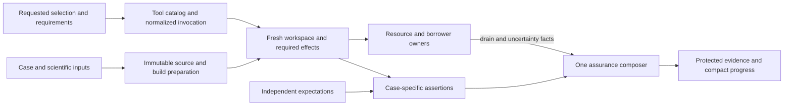

# Test architecture target

**Revise the composed test architecture toward responsibility-sized assurance, preparation and execution.** Keep the existing federation of owner-local tests, independent scientific references, shared conformance, native integration, durable lifecycle tests, installed Python journeys and selected parity. Give their joins coherent contracts: the same selected work must govern preparation, validation, resource requirements, execution and reported assurance. Reuse immutable preparation and evidence where their premises hold; keep mutable workspaces, numerical states and resource borrowers separately owned.

The target is a set of concrete corrections to existing owners, not a replacement test framework. Its largest benefits come from removing accidental dependencies and repeated work: store construction for capability checks, repeated admission of immutable scientific inputs, multiple interpretations of one invocation, selection payloads copied into every resource update, and growing evidence payloads rewritten at every checkpoint. No speedup, capacity improvement or complete scientific qualification is claimed by this review.

The refreshed audit is challengeable input. All 48 identities have a resolution path below, but they are not 48 production defects. DTA-008 and DTA-041 remain withdrawn. Additional inquiry supports **no corrective change for DTA-001 in the examined contracts**. DTA-044 does not establish that the remaining canonical barrier is unnecessary; two concrete consumers can shed the canonical fixture, and the barrier remains for actual canonical work until a narrower requirement is established. Retaining a valid guarantee is a design decision, not unfinished implementation invented to populate the table.

## 1. Contract, target and evidence

This is the independent principal **design-tier, target-purpose, holistic/unconstrained** review of the entire test architecture. It consumes the test audit published at `121af405a`, whose audited source is `05e6a2b8a49f08de4e33e2e9ad64a753cbea2287`. Initial source inspection used `452c556a68cf0da13d77739d135bd9bc41071348`, including the already delivered Plan52 mechanisms noted below. This source reference attributes evidence; it is not a constraint on the target. Subsequent source reconciliation belongs to plan creation, as requested; this review does not require a source freeze or another freshness campaign. The selected criteria are Core 3.4, efficiency heuristics 1.0, test-assessment companion 1.2, ProcessSimulator 1.5 and the pse-arrow binding through [standard.toml](../design_principles/standard.toml). The design-review and process-simulator skills supply the review contract. A fresh independent principal reviewer formed the integrated judgment, with two bounded contributors advising on scientific assurance and resource/evidence lifetimes; the coordinator independently checked decisive source and library contracts and owns publication. Their contributions are integrated here, rather than treated as separate overall verdicts.

The functional target is trustworthy, discriminating and understandable evidence for physically meaningful simulation, optimization, dynamics, fitting, studies, edit/re-solve and extension, with focused local feedback and honest composed qualification. This review includes inline Rust tests, test crates, doctests, Python/parity, reference packages/data, builders, comparators, doubles, collection, builds, fixtures, native/process/service resources, evidence and reuse. Production owners are included where their contracts determine assurance. It is not a production redesign or assertion-by-assertion census. All solver/platform/feature combinations and all model variants were not inspected individually.

Current mechanisms and diagnoses below are **Interface-checked**. Recommended changes and their benefits are **Proposed**. No test, probe, mutation, fuzz, benchmark, build or product qualification was run for this review. Prior receipts and qualification records remain historical evidence under their original conditions. Publication is not implementation acceptance and does not schedule work. Until an implementation plan is authorized, this principal owns remedy judgment; a future owning plan must hold disposition and closure, linking the original DTA identities rather than creating a parallel progress ledger.

### Reconciliation since the audit

Plan 52 has added useful mechanisms in the inspected source. `.config/diagnostic-tools.toml` and `scripts/cargo_tools.py::selected_identity` now pin and authenticate cargo-hack, llvm-cov, mutants and fuzz tools. **Nextest is not yet included**, so the remaining DTA-024 tool premise is narrower than the audit's older bootstrap account.

`scripts/validation_feature_campaign.py` already delegates enumeration to pinned cargo-hack, captures literal argv through the Cargo adapter rather than shell-evaluating printed text, freezes ordered combinations, adapter identity, compiler/native context and conservative Rust inputs, and resumes authenticated passing combination origins. It preserves failed/interrupted history and invalidates the applicable Rust closure after a repair. Do not build another powerset enumerator, resume service or general cache. Its composed evidence must continue to distinguish reuse from fresh execution.

`scripts/coverage_correspondence.py`, `assertion_sensitivity.py`, `boundary_fuzz.py`, activity watch and pressure observation add selected evidence or diagnostic capabilities. Coverage remains a population observation, does not establish assertion adequacy, and never narrows conservative selection. It does not supply runtime scientific dependency edges or eliminate the specific scientific discriminator gaps below. The tools are optional question-led instruments, not new compulsory campaigns for closing every DTA row.

The generation identity omission remains: `INPUT_SCOPES['generation']` excludes package inputs consumed by `xtask/src/codegen/physical.rs::load`. New combination-level reuse is positive counterevidence to a blanket absence of incremental qualification, not a repair for that separate scope omission.

## 2. Target decomposition and semantic contracts

The target preserves independent reasons for change. These responsibilities may be ordinary functions/modules and existing declarations; none implies a new crate, daemon, database, universal registry or serializable instruction language.

The arrows show consumed contracts. A local test instantiates only the preparation and effects its responsibility needs; the diagram does not prescribe a full-stack fixture for every case.

| Responsibility and existing owner | Consumes; owns the decision; produces | Consumer simplification and state boundary |
|---|---|---|
| Scientific scenario and expected property: authored reference packages, local analytic cases, parity generators | Actual model/case/conditions plus an independently justified expectation; owns the claimed physical/numerical property and its criterion; produces discriminating case evidence | A high-level consumer need not reimplement policy resolution or original-model completion. Expected values still challenge the relevant failure mechanism independently. |
| Narrow construction and observation: owner-local helpers, `pse-math`, `pse-testkit`, compiler observers | Explicit source/attribution maps, shape and tolerance contract or observed operation; owns mechanics shared by real consumers; produces valid inputs or truthful observations | No incidental query-name knowledge at every assertion; no infrastructure hidden behind a helper that only needs values. Helpers do not choose unrelated science or one tolerance for every quantity. |
| Scientific input preparation: package/document loaders and bounded source-fixture families | Explicit roots, authentic document bytes, admitted physical context and named synthetic substitutions; owns the selected closure/projection; produces immutable source inventories/admitted revisions and complete dependency facts | Selection and affected preview can use the consumed closure. Mutable workspaces and durable result recording remain per test/attempt. |
| Invocation and requirements: existing selection/composition owners in `select`, `native_tests`, `test_run`, `arrow_validation`, pytest | Literal requested options/environment and tool-produced catalog; owns one normalized interpretation and selected requirement resolution; produces a selected invocation and exact preparation/effect requirements | Build, report overlay, scheduler and fixture association stop independently parsing profile/filter/identity meaning. Nextest/pytest remain selection authorities. |
| Build/prepared artifact: existing Cargo capture and `python_extension` | Actual package/feature/profile/tool/config/native selection and consumed inputs; owns preparation and validity; produces a retained build/discovery artifact or an explicitly validated installed extension | Execution consumes prepared artifacts without re-enumerating or rebuilding unrelated variants. Mutable replacement windows still require verification. |
| Outcome composition: `test_run`, `validation`, existing native/Python result owners | Actual selection, child status, reports, setup observations and drain facts; owns reconciled assurance; produces distinct workload, assurance and cleanup outcomes | Exit-only managed consumers receive a truthful assurance status. Optional evidence and setup failures do not masquerade as product assertions. |
| Resource/evidence custody: `resource_store`, `test_resources`, service/process owners, receipt readers | Exact invocation/member/service/origin identities; owns pending effects, borrowers, terminal freeze, retained references and disposal; produces coherent protected state and authenticated evidence | Immutable selection/detail are referenced, not recopied on each mutable transition. Cleanup cannot grant scientific success or erase uncertain effects. |
| Scheduling: nextest/pytest plus existing host/service capacity owners | Resolved actual effects, timing and resource requirements; owns exclusion at the scope of the protected effect | Pure controls are independent; actual service-quiet cases use service-scoped protection; canonical work remains conservatively grouped when capacity independence is unestablished. |

The essential distinctions are **definition/case/expectation**, **selected/executed/assertion-not-reached/not-run**, **child return/reconciled assurance/cleanup**, **observed execution/current applicability**, **immutable prepared input/mutable attempt**, and **retained diagnostic state/live borrower/capacity demand**. Keep these distinctions in the existing contracts before choosing physical layout. An immutable selection header and a mutable membership record are two layouts of one owned invocation, not two authorities.

### Physical and numerical meaning

| Element used by test evidence | Required meaning and owner |
|---|---|
| Physical expected/actual quantities | Declared dimension, unit, basis, reference state and sign convention remain with authored models and independent case definitions. Comparators must not normalize those distinctions away. |
| Engineering and historical allowances | `numerical-policy.pse` owns the selected criterion. Resolver and projection controls challenge its realization; a reference's extra precision does not silently strengthen the criterion. Historical ±10% comparisons remain distinct from feasibility, conservation and regime classification. |
| Phase fraction/regime | A dimensionless fraction is not a categorical regime. A selected smoothing/complementarity realization needs a justified regime discriminator when the claim is phase disappearance, preserving its approximation and historical comparison scope. |
| Derivatives, sensitivities and covariance | Source/order, coordinate/row/objective scales, active-set/curvature/statistical assumptions and keyed identities remain explicit. Primitive accuracy and integrated binding/layout are different claims. |
| Residuals, bounds, domains and closure | New numerical states retain independent original-space/post-solve checks. Reusing an immutable admitted revision never substitutes for these checks. |

Well-posedness remains a production admission responsibility: actual declared variable roles, degree-of-freedom and structural analysis precede solving. Tests should distinguish structural refusal from numerical infeasibility and identify model elements. A reference helper must not repair an intentionally invalid case before the intended boundary, and a setup failure must not be presented as that boundary's rejection.

## 3. Coherent corrections

### R01 — Give scientific claims discriminating, independently grounded cases

**Proposed; DTA-001–007, DTA-020/021.** Keep the division between owner-local mechanism tests, integrated scientific witnesses and external/analytic references. Reusing production domain types, constructors, numerical policy and original completion is valid when another responsibility is the subject. The target adds only the missing challenge at the failure mechanism; it does not make each test independently reverify every layer.

DTA-001 warrants **no code, tolerance or test change for the examined contracts**. The resolver independently pins scales, precedence and equivalent-unit budgets (`crates/pse-math/src/numerics.rs::engineering_accuracy_uses_frozen_scale_and_equivalent_unit_magnitudes`); `plan14::resolved_physical_allowance` checks quantity/rule/unit identity and exact conversion from admitted source-floor data; `workflow/numerics.rs` directly copies resolved nominal, coordinate scale, budget and engineering fields; sensitivity parity's output scale algebra cancels between actual and allowance. No concrete consequential projection fault escaping those complementary controls was established. Parity is not described as an independent test of every exported budget. Unexamined portfolio breadth is a limit, not an invented repair obligation.

For phase disappearance, retain selected historical value allowances and add a separate, case-specific regime property where the journey claims that regime. Use the authored physical/realization semantics and justified approximation, rather than globally tightening 0.1 to a more attractive number. Use the existing engineering fraction resolution, `numerical_policy.dimensionless = 0.001`, together with the selected realization's declared approximation and propagated feasibility envelope. For the smooth-min realization, `epsilon_phase = 1e-4`; with positive complementary quantities, exact zero implies `a*b = epsilon_phase^2/4`. Choose a case with an independently expected phase and a positive slack bounded away from zero, so the absent-phase fraction has the justified bound `epsilon_phase^2/(4*slack_lower_bound)` plus propagated feasibility allowance. Apply that approximation envelope alongside the existing absolute fraction resolution, and retain the displayed approximation. The subsequent fixture design computes its concrete slack and feasibility bounds under this existing policy; it does not invent a new production tolerance policy. Smooth, disjunctive and penalty realizations need not share an exact endpoint. No arbitrary 0.99 cutoff is selected, and beta 0.9 is not claimed to pass the whole existing journey. Existing `nested_vapor` tight phase/material-balance evidence is a preservation constraint. A deliberately interior phase state must not satisfy a claim of phase disappearance merely because a historical endpoint comparison admits it.

Commit regeneration entrypoints for the independently computed PFR, controller trajectory and decay-fit references, with exact generating inputs, method/tolerance/environment, output correspondence and source locator in `references.pse`. Regeneration is a reproducibility operation, not a rule to overwrite golden values from current production output. Retain frozen reference values and independent derivation review when generator output changes.

Repair the HiGHS status inventory test to independently state the expected category of every declared status used by the adapter, including time/iteration/solution/memory limits and ambiguity. Unknown fallback must have its own explicit expectation. Do not test exhaustiveness by recognizing the old fallback spelling. Closed enums still need semantic category expectations even when the compiler protects arm completeness.

The PR composition witness should independently challenge root/coordinate identity, binding and upper-triangle assembly, building on the independent analytic primitive first/second derivatives already in `implicit_property_tests.rs`. A nontrivial multi-coordinate analytic composition or independent directional second-order relation should discriminate a swapped/missing cross term and a wrong root/binding. Do not duplicate the PR implementation or advertise the existing shared-primitive identity as independent Hessian evidence.

Use the existing derived-result owners for a small nonlinear active-constraint case. A concrete analytic candidate is minimization of `0.5(x-a)^2 + 0.5 y^2` subject to `y-x^2=0`, using `L=f+lambda*g`. At `a=3`, the solution is `(x,y)=(1,1)`, `lambda=-1`, `dx/da=1/7`, `dy/da=2/7`, and the value Hessian is `6/7`; omission of constraint curvature instead yields denominator 5. At `a=18`, `(x,y)=(2,4)`, derivatives `1/25`, `4/25`, and value Hessian `24/25` discriminate evaluation at a stale nonlinear point. These are **Proposed analytic cases**, not executed results. Carry unequal coordinate/row/objective scales and keyed permutations through actual publication/readback. The same science supplies a precise covariance case under `crates/pse-runtime/src/workflow/fitting/covariance.rs`: use free parameter `x`, a state `y` constrained by `y=x^2`, observations `x~3` and `y~0`, and declared absolute sigma and importance one. The owner uses half the weighted residual sum and exact covariance `B K^-1 B^T` without a residual-variance multiplier, so the expected exact parameter variance is `1/7`; Gauss–Newton from response Jacobian `[1,2]` gives `1/5`. At observations `[18,0]`, exact variance is `1/25`, while Gauss–Newton gives `1/17`. Retain the explicit nonlinear state constraint, an unbounded/full-rank parameter and valid KKT/curvature conditions; a direct unconstrained polynomial fit alone would not attack missing constraint curvature. Assert the published exact/approximate label and independent variance through the actual authored fit/result owner. These are related science with distinct sensitivity, covariance and lifecycle assertions, not one overloaded fixture.

Add discriminating solved reference cases for the default countercurrent exchanger and a mixer with unequal inlet pressures. Per-definition inventory remains honest inventory. The existing PID default-dynamics trajectory already challenges derivative action; its missing generator belongs to reproducibility, not a fabricated absence of variant coverage. No branch quota or universal coverage schema is selected.

Numerical helpers must reject mismatched extents and non-finite unexpected values before applying a relative allowance. Preserve each helper's actual scalar/vector and tolerance contract; do not replace all helpers with `approx_eq` when its semantics differ. Give consequential shared comparators small known-good/known-bad controls, including infinity and each zipped extent. Negative origin-sensitive cases should establish the intended resolved inputs and assert the typed refusal or a single-mutation admitted control that excludes wrong-cause rejection.

**Alternative and preservation.** A universal independent simulator/oracle doubles maintenance and can share mistakes anyway. Small analytic cases, existing independent primitive tests and committed independent generators are the simpler viable design. Keep selected external parity, wrong-expectation/missing-closure controls and actual reopened downstream results. The target changes assurance strength for the named cases, not production numerical acceptance.

### R02 — Make helper and test seams narrow without weakening real lifecycle evidence

**Proposed; DTA-008–011, DTA-019, DTA-028/029.** Keep DTA-008 withdrawn. Static Ready seams and contextual production routing tests challenge distinct real contracts; forcing all static policy tests to construct context would worsen local reasoning.

Reuse observations should express the intentional work invariant. Migrate applicable checks to existing owner-issued semantic-body counts and stable observed operations. For granular execution guarantees without a suitable count, either consume a complete bounded trace whose coverage is explicitly checked or add the smallest owner count at the existing observation point. Absent, refused or truncated optional telemetry is not zero execution. A simpler adequate correction is to centralize the remaining Salsa debug-name observer and require a positive cold/invalidation control before no-work comparisons; this removes vacuity and localizes the acknowledged private-name coupling. Preserve incremental-versus-fresh result comparison; retain exact internal counts only where that exact decomposition is the stated invariant.

The implicit body helpers should share the existing bound-source compilation mechanics in their owning math module. `BodyBuilder::prepare`, `SourceBindings::new`, `SourceBody::new` and compilation already supply the pieces: a narrow ordinary helper can bind explicit source attribution before compilation releases prepared source. Consumers still supply independent scientific cases, compilation settings, cancellation and residual demand. If a common helper would require unrelated policy switches, keep short local construction rather than introducing a general fixture language or new crate.

Do not remove deterministic post-ACK suspension, failure hooks or fixture lifetime ownership merely because they differ from shipped construction. They expose real races. Existing Python production-shaped close/reopen/retained-reader journeys and `fixture_lifetime: None` controls complement Rust fixture-backed tests. Make that scope explicit and preserve it. The simplest feature correction is to let `canonical-tests` select test participation while the existing `test-support` feature owns cross-crate diagnostic/fault hooks, selected explicitly by managed routes. Retain the production-shaped integration configuration with support absent. Do not demand one build variant when the two variants protect different obligations. An external fixture wrapper is only a candidate if escaping borrower association and final drain remain equivalent; that premise has not been established.

Remove unused `pse-testkit` doubles and unused dev dependencies after checking actual consumers and any expressly authorized bounded exploration. Do not force production tests to adopt a double just because it exists. Preserve the consumed factory, NativeFixture and capture responsibilities. Their own tests are not evidence of external adoption, while unused doubles do not prove missing product fault coverage.

Promote modeling contract refusal distinctions that consumers actually need from free text into a stable typed reason alongside declaration identity and existing diagnostic code. Keep human messages as projections. Migrate selected negative tests to the intended reason or admitted-control boundary; delete substring interpretation after consumers move. This is a narrow production-boundary correction proposed by test evidence, not permission to replace the complete error taxonomy.

**Revealing case.** A fixture's last public reader can outlive its test body. No seam simplification may let wrapper drop erase that borrower, declare drain or dispose the store early. This is why wholesale fixture-field removal is not selected.

### R03 — Make scientific dependencies and immutable preparation serve the same scope

**Proposed; DTA-018, DTA-027, DTA-030/031, DTA-035/036.** A scientific fixture family should own its root declarations, complete imported source/data closure, source identity and named synthetic substitutions. Reuse actual parsed import/dependency meaning for bounded declaration selection; use the production document/package resolver for full package transport. The existing explicit-immutable-byte loader is useful, but its equivalence to the declaration-only synthetic projection is not established. Keep that projection explicit about omitted transport and synthetic lineage; do not force it through a store/native/full-transport path. The simplest first correction shares genuinely equal closures in the existing fixture module and derives the imported closure from consumer-selected roots. Those family roots are authored choices; dependency closure is derived. Do not require each compiler/runtime/conformance consumer to maintain another document union or independently rewrite the same lineage.

Publish the consumed document inventory from that owner to both preparation and affected-test preview. It must cover additions, deletions, membership, absent lookups and the real runtime-loaded inputs. Extend `affected.py` with those scientific edges while retaining honest unknown/dynamic exclusions and conservative fallback. New source-fresh coverage observations can explain what executed, but cannot infer these dependencies or narrow required selection. No hand-maintained inventory of every expected test is needed.

For shared scientific documents, select captured immutable runtime inputs instead of `include_str!` in every consumer binary when the test is not specifically testing compile-time embedding. Bind exact bytes and source identity to the invocation/family before use. Keep tiny local authored examples and genuine compile-time controls embedded where that serves their claim. Missing inputs and changed inputs must still fail or invalidate honestly. This removes source-only changes from Rust compilation of unrelated fixture consumers without substituting an uncontrolled mutable filesystem read. The family closure is sufficient under its declared semantics; do not claim it is minimal merely because its final assertion is narrow.

There is an immediately usable preparation seam in `crates/pse-compiler/src/workspace/modeling.rs`, independent of perfect closure minimization. `CompilerWorkspace::publish_modeling` yields an immutable `Arc<ModelingRevision>` retaining rows, scope, documents, checked package and physical context. `publish_modeling_revision` selects it without rechecking declarations while enforcing full context equality, physical-owner Arc identity and receiving workspace budgets. Prepare one admitted revision per stable fixture family and create a **fresh mutable workspace per test** using its `compiler_context()`. Use this only for downstream structural/evaluation responsibilities. Admission, edit, invalidation and publication tests keep fresh ingress. Do not cache a mutable CompilerWorkspace, runtime, ModelingPackage, database or result under the guise of immutable preparation.

Separate source/admission preparation from durable fixture effects where the claim permits it. A capability-only Python case can construct the existing local runtime with `ephemeral=True` and no substrate; it should not create a canonical database or acquire `canonical-owner`. The constructor diagnostic that only needs admitted `study_module` evidence can consume `surreal_server::study_module` through a small immutable module-evidence fixture, without initializing a database or registering context. Authentic module/artifact admission still runs. These are concrete reductions; they do not establish local equivalence for every durable scientific workflow.

Keep fresh database/schema/module/identity and independent connection controls for lifecycle claims. Per-database guarantees are not invocation-wide invariants. Sharing a mutable database or cloning a template is not selected as a blanket solution to DTA-018. If a future template mechanism is proposed, it must independently preserve fresh installation, exact identity, registration-before-effects, independent connections and drain.

**Transition constraint.** First move consumers to the family input/preparation owner and preserve their independent expectations; then delete replaced include lists, duplicate source/lineage adapters and redundant parsing. Retain the named synthetic substitution/projection adapter wherever the bounded declaration-only assurance claim still consumes it. A data-only edit must update preview and runtime preparation without requiring unrelated binaries to be recompiled. A new genuine source concept may legitimately change the family contract.

### R04 — Resolve one invocation and its actual requirements before effects

**Proposed; DTA-015–017, DTA-022/023, DTA-026, DTA-045.** Keep nextest and pytest authoritative for actual selection. The existing orchestration should parse one small invocation value containing the supported Cargo/nextest or pytest selection, effective profile/default/environment, config and feature choices. Build graph resolution, listing, report overlay, fixture association and execution consume that value. Preserve custom configuration and default-filter semantics. Normalize `-P`, `--profile`, equals forms and applicable aliases consistently. Program arguments after `--` remain opaque. Reject unsupported scope-affecting forms before fixture effects rather than guessing their meaning.

Derive the selected catalog from the tools, including actual executable/package/binary/test identity. Resolve its fixture/effect/capacity requirements and campaign roles once. Homogeneous binary/module defaults with explicit exceptional selectors are sufficient; a universal per-test manifest is unnecessary. Requirement declarations must correspond to actual collected identities: stale/unmatched selectors fail their owned correspondence check, and a selected fixture/effect request must be admitted against resolved requirements before creating resources. A name cannot prove true effects; the runtime guard closes that gap. A test rename should require editing only its actual requirement owner where the meaning really changes, not independent runner, preparation and campaign lists.

Required campaign-role correspondence is distinct from selection. A required feature-absence, worker, scientific or optional CLI role must match its intended current population, so a nonempty union cannot silently lose one required member. Optional capabilities remain explicitly selected campaigns; ordinary qualification does not automatically acquire every feature or manual control. Preserve tool-produced selection and do not infer expected population from JUnit output.

Use one parsed TOML report-overlay owner for the same effective profile/config selection as execution, preserving all settings and custom configuration. The selected concrete library option is a direct exact tooling declaration `tomlkit==0.15.1` (already present transitively in the inspected lock): `tomlkit.parse` → edit the selected profile's `junit.path` using its document/table API → `tomlkit.dumps`. This pays one small integration cost, delegates TOML grammar/quoting/round-trip preservation to the library, and retires both regex rewriters. Do not rely on a transitive installation as a declaration or implement another generic configuration engine. Test effective nextest semantics, nested overrides, quoting, comments and custom configuration as well as representation preservation. A tool-config file is not selected as a generic override: nextest gives tool configs lower priority than repository/explicit configuration, so it cannot reliably override an already declared JUnit path. Nextest JSON catalog and retained Cargo/binaries metadata are the existing native mechanisms; do not parse human `show-config` output as a stable API or reconstruct Cargo's option language. Eliminate duplicate `rust_report_command`/`validation.native_report_config` interpretations after consumers migrate.

Remove stale universal `validate-features` declarations/comments and the governance assertion that merely checks their presence. `arrow_validation.resolve` owns actual normal/build/dev target/host Arrow leaf coverage. Correctness installer and codegen selections must enter that same owner through a shared build selection; retain existing Maturin feature forwarding and compiled import checks. This strengthens correspondence with the existing force-validation contract, not a new compiler/installer provenance proof campaign.

Managed sanctioned routes, including affected/native/Python/setup paths, should converge on the existing composer/environment/preparation contracts. Bare low-level Cargo remains a legitimate route with explicit narrower outcome-association and automatic-cleanup scope; conservative retention there is intentional. Do not turn low-level execution into a secretly managed full qualification.

The orchestration dependency direction is pure invocation/requirement interpretation first, performing library/runner/service owners next, and outcome/custody composition at the root. Lift shared values and operations out of reciprocal imports where needed; do not merely split files or relocate the same lifecycle decisions into a new runner.

### R05 — Reuse the prepared build and generation work that already exists

**Proposed; DTA-024, DTA-032–034, DTA-037/039.** Extend the existing `cargo_tools` pin/version/digest owner to nextest. Include actual test-tool identity in retained execution/build compatibility where behavior is consumed. Add package fixture-projection and selected package inputs to generation identity. Keep raw/full provenance separately from the smaller consumed identity; no wholesale lockfile/tool upgrade is implied.

Ordinary `_rust_capture` already retains metadata and executable inventory and validates root/suite/executable correspondence. Extend that prepared-operation route to the unprepared fallback rather than resolving/listing twice or creating another cache. Preserve exact pre-execution catalog and actual force-validation proof. Nextest's native `--cargo-metadata` and `--binaries-metadata` consume the artifacts already produced by `list --binaries-only`; the target does not wrap nextest by reimplementing build reuse.

Share structurally identical correctness feature closures where their actual guarantees agree, including the Python stub/codegen tool run when it reaches the same Arrow correctness closure. Keep interactive unvalidated builds and deterministic support variants where their purposes differ. Cargo feature unification within a selected closure is not a promise that every opt-in variant is identical; ADR-0122 is not contradicted by retained legitimate variants.

Split `python_extension.sync` into explicit environment synchronization, correctness-extension preparation/installation, stub generation and execution admission. An `ensure-correctness-extension` owner can reuse a successfully prepared extension only under complete known consumed installer/Rust/declaration/tool/config/native inputs and observed binary identity. Pure Python-only edits need not invoke unrelated stub generation or installation. Unknown scope conservatively prepares. Preserve source freshness, exact imported checkout, compiled validation/native features and independent parent/worker checks across mutable replacement windows. A stat check, hardlink or previous filename is insufficient. This is one bounded preparation owner, not a general build-equivalence interpreter; qualify its actual input domain before automatic skipping.

Compose codegen comparison once for overlapping roots: the full relations comparison already includes physical/Rust contract outputs. Mark those covered portions from actual generated root coverage, while preserving independent target recipes and Python/native ABI/untracked-root checks. If independent gate reporting must remain, share one in-process candidate generation rather than generate overlapping candidates again. Do not remove fresh regeneration or change mutating bootstrap order.

Allow `validation.sources` to select `INPUT_SCOPES` before reading/hashing file bytes; `rust_source_identity` requests `rust-product`. Retain full provenance capture where it is promised, symlink/mode/addition/deletion/absence and resolved local-environment target rules. Keep full-byte verification at mutable parent/wait/child/retained-reuse windows unless an equivalent immutable ownership boundary is established. The demonstrated removal is broad-before-narrow work, not a claim that all hashing is redundant.

### R06 — Make outcomes explain whether the intended assertion happened

**Proposed; DTA-012–015, DTA-025.** For a public managed correctness command, exit zero should mean **complete reconciled Pass**. Preserve the original `workload_exit` separately, including child failure and cancellation. A zero-exit child with a missing/invalid report remains an incomplete failed assurance result and must give the managed caller nonzero. This intentionally changes the current interface/self-test, not the scientific test result. Post-terminal cleanup has a separate outcome and cannot rewrite an already-frozen verdict.

A fixture/admission owner should report a typed setup/infrastructure failure to the existing invocation observation before an unwrap/panic. Only an authenticated observation from the actual setup owner establishes that classification. The composer records the affected assertion as not reached and retains the actual failed process/test report; absent or invalid owner evidence remains unknown/failure. Do not infer a diagnosis from panic wording, mask failure as a skip/pass, or pretend nextest already exposed a separate setup phase. Preflight or sharing a readiness failure can avoid repeated identical work only while the exact service generation/configuration premise remains unchanged. Do not introduce a forever-global outage cache.

Extract optional `qualify_operator` CLI work into a distinct explicitly selected test/driver result. Existing API cases keep their substantive API, pagination/query/observation claims. Missing CLI prerequisites fail when that CLI scope is selected; they do not invalidate an API-only selection. Similar explicit scope applies to context-overlap and external peer/restart controls: preserve or repair a real selected route when the control is required, retire unreachable bodies or stale rendezvous if no supported campaign consumes them.

Do not blindly enable the `pse-py` Rust harness: it is intentionally disabled for the extension-module linkage. Demonstrate equivalent public Python diagnostic-envelope assertions and remove unreachable duplicate Rust test bodies after coverage is established. A pytest-only context-overlap file belongs to an explicitly selected component campaign with its external peer prerequisites, not to a broader unittest discovery rewrite. This keeps inactive bodies, optional controls and required omissions distinct.

### R07 — Keep custody and recovery while making representations follow changing facts

**Proposed; DTA-038–042, DTA-047/048.** Keep DTA-041 withdrawn. Pending/uncertain effects, legacy-writer fencing, exact borrowers, accepted late effects, terminal freeze and unknown retention have real consumers. Removing them because resources are called disposable would weaken safety.

`FileStore` already has invocation declarations separate from invocation-state files. Publish selected declaration once after authoritative collection, explicitly distinguishing selected-empty from not-yet-collected. Mutable state references its nonce/digest and carries only mutable phase/membership/producer/projection/terminal references. Registration and freeze validate that immutable header under the existing invocation exclusion. Retain invocation→identity→resource lock ordering, Pending/not-started→uncertain→registered transitions, `_settle_members`, original deadlines and context admission before registered visibility. Delete the duplicate selection payload in every membership update. No journal, writer service or new lease protocol is selected.

Continue independent cleanup/settlement work after one eligible resource fails, until the original cancellation/deadline says stop. Aggregate the failures separately. This includes the deferred reclaim loop, Python fixture `drain`/`drain_context`/`record_drain` joins, and Rust peer-connection drains. Publish drained only if every required reader/client/native owner actually settled; partial success cannot authorize disposal. Unknown/incomplete terminal members remain pinned. Independently complete authenticated outcomes cannot be assumed from an untrusted enclosing report.

Narrow service lifecycle inspection to a service-scoped active access set under `FileStore`'s existing save discipline, including pending creation borrowers and exact service generation. Durable access markers precede active authority; authority departure precedes marker deletion. Stale/missing uncertain metadata remains conservative. This is a derived access path, not a second resource authority, and its adoption must preserve registration/maintenance races and exact lookups.

Report sealing remains authenticated custody even when all current artifacts are protected evidence. `finish_report`, `reference_report` and reuse continue to verify original receipt/manifest/artifact digests and paths, with reference acquisition coordinated against reclamation. Derive reclaim candidacy only from an explicit sealed nonempty disposable-scratch projection. Skip all-protected reports in routine cleanup discovery while retaining exact status, borrow and origin lookup. Do not remove report registration/sealing, and do not infer disposability from current lack of readers.

For growing qualification checkpoints, write immutable source/identity maps once and per-gate result/detail artifacts once. Atomically publish a compact root index containing current status/counts and references after each detail publication. An interrupted running prefix stays reviewable. Existing result/reuse readers should resolve the versioned representation through one reader and hydrate selected/failing detail on demand. Seal manifests cover the referenced artifacts. Replace repeated copies of failure payloads with compact indexes or derived views; keep original detail and the native Cargo/unit-graph parsing that validates actual root/suite/executable correspondence. A dangling/corrupt reference refuses rather than appearing complete.

DTA-040 does **not** require changing aggregate snapshot qualification. Historical execution and applicability to a chosen final source cut remain different claims, and existing scoped reuse/transfer plus Plan52 combination resume already support narrower useful units. Retain conservative final aggregate semantics. Before/after observations of an uncontrolled mutable checkout are not exact proof of all bytes consumed during execution. If a future claim requires stronger exact attribution, use controlled immutable inputs or explicitly retain the limitation; never relabel historical success as current qualification.

### R08 — Schedule at the scope of the effect, preserving unproven capacity barriers

**Proposed; DTA-016, DTA-043–046 and reduced consumers in DTA-018/031.** Resolve scheduling from actual requirements in R04. Remove demonstrably pure KINSOL profile-identity and Ipopt status/bounds controls from broad solver-module barriers, through narrower classification or local placement. Real solver pools, threaded MKL, heavy memory journeys and timing claims retain their actual requirements.

A test requiring service-wide quiet must use an invocation-owned supervised service or narrow its assertion to its own database. Per-nextest-run exclusive width does not exclude another run sharing that service. Only real service-wide/timing controls require that isolation; intentional contention tests remain deliberately composed. Preserve the maintainer-selected unbounded ordinary mode and explicit overload outcomes, not a newly imposed global serialized policy.

For Python, remove canonical fixture dependency from the two source-proven smaller consumers in R03. **Retain the remaining `canonical-owner` barrier.** Separate databases prove data isolation, not receiver capacity, timing or resource independence. Historical Rust canonical startup failures at width 16 and passing reruns at width 4 are cautionary prior evidence with unproven cause, not a new Python measurement or proof that its barrier is necessary. Do not claim either configured width or database separation proves safe simultaneous demand.

Use existing bounded explicit observer/runtime settings for the new local capability fixture. Retain a 64-GiB ceiling only for fixtures whose large workload contract needs it; it is a ceiling, not a reservation or evidence of live demand. The functional store 8-GiB allocation and the exclusive-observer 144-GiB role envelope (72 receiver, 64 observer, 8 control) have different scopes. Before widening canonical concurrency, identify actual simultaneously live observer/receiver/context/native owners and reconcile them with the existing capacity owner. A targeted concurrent case may settle material doubt if a wider claim is proposed; no new capacity planner, benchmark campaign or OOM inference is warranted by the current source.

## 4. Scenarios that distinguish this target

| Scenario | Expected target behavior and falsifier |
|---|---|
| S01: Add a physical model variant or nonlinear derived-result case | Existing shared model checks remain; the new physical distinction gets a case that would fail for the wrong regime/curvature. A declaration count or linear reference alone is insufficient. No unrelated execution-policy owner changes. |
| S02: Change only a scientific source/data dependency | The fixture family resolver and affected preview see the same current closure, including additions/deletions. Runtime input identity changes; unrelated Rust test binaries do not compile solely because shared science was embedded. Unknown dependencies stay conservative. |
| S03: Rename/split a test without changing effects | Tool catalog changes identity and requirement/campaign correspondence either follows the authoritative declaration or reports the exact stale/missing mapping. A nonempty union cannot hide a lost required control. |
| S04: Repeat a focused compiler/Python check | Immutable admitted scientific input and compatible prepared build survive. A fresh mutable workspace/runtime is created only where needed. A Python-only capability assertion acquires neither database nor canonical barrier. Source/feature/tool changes invalidate the affected preparation honestly. |
| S05: Replace an adapter/tool or change a feature selection | Integration owners absorb API/metadata changes, status expectations remain independent, tool identity invalidates incompatible reuse, and actual Arrow leaves are verified. Different capabilities are explicit; no silent fallback. |
| S06: Setup outage, cancellation or retained reader | Report says infrastructure/assertion-not-reached separately from product mismatch. Other independent drain/cleanup work continues within the original deadline. No reader is invalidated early; unknown state stays protected. |
| S07: Grow selection, resource count or gate detail | Immutable selection/source/detail is published once; mutable progress carries compact references. Exact association, recovery and original-detail inspection survive. Work does not multiply merely because selection is copied into every resource transition. |
| S08: Interrupt qualification and resume | Existing feature-combination owner reuses only authenticated unchanged-input passes and preserves failures/history; missing combinations block completeness. Aggregate qualification still names a coherent target cut. No reused observation is advertised as fresh execution. |
| S09: Concurrent runs and timing controls | Actual shared-effect scope determines exclusion; per-run groups do not impersonate service-wide quiet. Pure controls run independently; remaining canonical capacity barriers are retained until a narrower supported envelope is established. |

Numerical preparation uses the existing authored guards, provider derivative contracts and structural admission. Native solves remain library-owned and retain actual problem class, scaling, typed status and original-space acceptance. The proposed nonlinear references supply independent analytic derivative/value expectations. Comparisons use case-specific scaled/unscaled meaning, units and finite extents. Durable readback tests then establish preservation of those qualified values and conditions, not a second numerical solution algorithm. Reuse never removes independent checks of each new numerical state.

## 5. Audit correspondence and resolution evidence

The table is a remedy correspondence, not implementation status. Source audit identities and diagnoses remain at their original anchors. Each row's correction is Proposed unless it explicitly retains or corrects a diagnosis. Implementation closure requires the named evidence and the owning plan; publishing this table closes no code finding.

| Audit ID | Target resolution and closure obligation |
|---|---|
| [DTA-001](../test-audit/oracles-and-acceptance.md#dta-001) | [R01](#r01): no change for examined policy/projection contracts; retain independent resolver, conversion and direct export evidence and correct the overbroad reuse indictment. No escaped fault established; do not claim unexamined route completeness. |
| [DTA-002](../test-audit/oracles-and-acceptance.md#dta-002) | [R01](#r01): separate phase-regime discriminator under declared realization from historical ±10% final-value policy; show a wrong interior regime fails the claimed phase journey. |
| [DTA-003](../test-audit/oracles-and-acceptance.md#dta-003) | [R01](#r01): committed independent generators with exact inputs/environment/method and consumed-output correspondence for all three references; reviewed regeneration reproduces the recorded reference claim. |
| [DTA-004](../test-audit/oracles-and-acceptance.md#dta-004) | [R01](#r01): explicit independent declared status/category expectations plus unknown fallback; a removed declared arm fails. |
| [DTA-005](../test-audit/oracles-and-acceptance.md#dta-005) | [R01](#r01): independent integrated coordinate/root/cross-term discriminator; preserve existing analytic primitive evidence and label the shared-primitive witness correctly. |
| [DTA-006](../test-audit/oracles-and-acceptance.md#dta-006) | [R01](#r01)/[R02](#r02): resolved admitted input control and intended typed/single-mutation refusal; unknown IDs/context cannot satisfy the intended origin-sensitive claim. |
| [DTA-007](../test-audit/oracles-and-acceptance.md#dta-007) | [R01](#r01): finite/extent guards and meaningful wrong-result controls for the affected helpers, preserving distinct tolerance contracts. |
| [DTA-008](../test-audit/doubles-and-coupling.md#dta-008) | Retain withdrawal; preserve complementary static and contextual policy tests. No repair selected. |
| [DTA-009](../test-audit/doubles-and-coupling.md#dta-009) | [R02](#r02): stable applicable owner observations or centralized white-box observer with positive cold/invalidation and trace-coverage controls; fresh recomputation remains independent. |
| [DTA-010](../test-audit/doubles-and-coupling.md#dta-010) | [R02](#r02): one narrow bound-source construction operation where mechanics really agree; preserve explicit attribution/cancellation/residual differences and independent cases; remove replaced copies. |
| [DTA-011](../test-audit/doubles-and-coupling.md#dta-011) | [R02](#r02): preserve fixture borrower ownership and deterministic controls; identify actual supported build/lifetime scope and keep production-shaped complementary reader/drop journeys. No unproved wrapper replacement. |
| [DTA-012](../test-audit/evidence-routes-and-execution.md#dta-012) | [R06](#r06)/[RC01](#rc01): public managed exit reflects complete reconciled assurance, raw child return retained; zero child plus missing report yields nonzero managed exit; post-terminal cleanup separate. |
| [DTA-013](../test-audit/evidence-routes-and-execution.md#dta-013) | [R04](#r04)/[R06](#r06): inactive Rust assertions move to actual Python boundary coverage before deletion; optional component/native controls get explicit selected roles/routes or retire obsolete bodies; no automatic all-optional campaign. |
| [DTA-014](../test-audit/evidence-routes-and-execution.md#dta-014) | [R06](#r06): separately executed optional CLI result; API-only pass remains substantive, selected CLI prerequisite absence is explicit failure. |
| [DTA-015](../test-audit/evidence-routes-and-execution.md#dta-015) | [R04](#r04)/[R06](#r06): sanctioned managed routes use the same requirement/environment/composer contract; low-level routes explicitly retain narrower automatic association/cleanup scope. Compare actual selected resource/scheduling behavior. |
| [DTA-016](../test-audit/evidence-routes-and-execution.md#dta-016) | [R04](#r04)/[R08](#r08)/[RC02](#rc02): actual catalog correspondence and effect guard enforce requirements; rename/new-case controls detect stale/missing scheduling declaration. |
| [DTA-017](../test-audit/evidence-routes-and-execution.md#dta-017) | [R04](#r04): retire unused universal declaration/check; actual installer/codegen/managed graph leaf proof uses scoped owner for normal/build/dev target/host, including pure and unsupported closure controls. |
| [DTA-018](../test-audit/execution-efficiency.md#dta-018) | [R03](#r03): remove concrete accidental fixture consumers while retaining fresh database/schema/identity/connection/drain journeys. No blanket shared database/template or removal of per-database checks. |
| [DTA-019](../test-audit/evidence-routes-and-execution.md#dta-019) | [R02](#r02): consumer inventory justifies retained helpers; delete unused doubles/dependencies without forced adoption or loss of existing independent fault evidence. |
| [DTA-020](../test-audit/oracles-and-acceptance.md#dta-020) | [R01](#r01): independent nonlinear active-constraint sensitivity/reduced-Hessian and exact-versus-Gauss–Newton covariance publication cases with the explicit 1/7 versus 1/5 expectations under the existing convention; omitted curvature/wrong point must fail. |
| [DTA-021](../test-audit/oracles-and-acceptance.md#dta-021) | [R01](#r01): countercurrent and unequal-pressure solved cases discriminate the supported variants; preserve PID trajectory and honest per-definition inventory. |
| [DTA-022](../test-audit/test-execution-system.md#dta-022) | [R04](#r04): one normalized invocation/config/profile/report/association interpretation; aliases, env/defaults, custom config and opaque program arguments have matching selection/report identity. |
| [DTA-023](../test-audit/test-execution-system.md#dta-023) | [R04](#r04): preparation and required campaign roles correspond to actual catalog; lost member of a nonempty union fails explicitly; remove dead recipe references. |
| [DTA-024](../test-audit/test-execution-system.md#dta-024) | [R05](#r05): use delivered tool identity owner, add nextest and complete generation inputs; consumed package edit/tool change invalidates relevant reuse. Preserve Plan52 exact combo mechanism. |
| [DTA-025](../test-audit/evidence-routes-and-execution.md#dta-025) | [R06](#r06): typed fixture infrastructure observation plus assertion-not-reached, no panic-text parsing; unchanged-generation preflight bounds fan-out without hiding failure. |
| [DTA-026](../test-audit/test-execution-system.md#dta-026) | [R04](#r04): explicit performing composition over shared pure contracts removes duplicated interpretation/reciprocal ownership; no file-count or single-root mandate. |
| [DTA-027](../test-audit/doubles-and-coupling.md#dta-027) | [R03](#r03): one family root/projection/derived closure owner feeds consumers; add/import/data-lineage changes need no parallel private lists; full transport and bounded synthetic scopes remain distinct. |
| [DTA-028](../test-audit/doubles-and-coupling.md#dta-028) | [R02](#r02): stable consumed modeling refusal reasons and declaration identity; wording can change without weakening/breaking selected semantic assertions. |
| [DTA-029](../test-audit/execution-efficiency.md#dta-029) | [R02](#r02)/[R05](#r05): separate test participation from existing support instrumentation; explicitly exercise support and production-shaped configurations and preserve post-ACK/reader/drain controls. |
| [DTA-030](../test-audit/execution-efficiency.md#dta-030) | [R03](#r03): immutable admitted revision reused by compatible fresh workspaces; sufficient family closures, not presumed minimal ones; admission/invalidation controls stay fresh. |
| [DTA-031](../test-audit/execution-efficiency.md#dta-031) | [R03](#r03): local capability runtime and immutable admitted module-evidence fixture; prove those selected cases create no database/context or canonical scheduling requirement. |
| [DTA-032](../test-audit/execution-efficiency.md#dta-032) | [R05](#r05): share equivalent correctness closures; retain intentional interactive/support variants; inspect actual graph rather than claiming every variant is repeated compilation. |
| [DTA-033](../test-audit/execution-efficiency.md#dta-033) | [R05](#r05): separate ensure/sync/install/stubs; complete known unchanged inputs permit prepared execution, source/tool/feature changes or unknown scope prepare; mutable replacement still refuses. |
| [DTA-034](../test-audit/execution-efficiency.md#dta-034) | [R05](#r05): route fallback through existing retained Cargo/nextest preparation; exact catalog/graph validation preserved, no second cache. |
| [DTA-035](../test-audit/execution-efficiency.md#dta-035) | [R03](#r03): shared science captured as immutable runtime input rather than incidental compiled embedding; source-only edit changes input/preparation and not unrelated binaries. |
| [DTA-036](../test-audit/execution-efficiency.md#dta-036) | [R03](#r03): scientific source/data closure contributes to conservative affected preview; additions/deletions/imports and unknown edges are honest; coverage never substitutes or prunes. |
| [DTA-037](../test-audit/execution-efficiency.md#dta-037) | [R05](#r05): aggregate executes overlapping generation once with actual root coverage; independent recipes, Python/native checks and missing/extra/untracked detection remain. |
| [DTA-038](../test-audit/execution-efficiency.md#dta-038) | [R07](#r07): one immutable selected header; mutable membership references it under existing transitions/exclusion. Crash points and header mismatch/late freeze/duplicate registration stay fail-closed. |
| [DTA-039](../test-audit/execution-efficiency.md#dta-039) | [R05](#r05): filter source scope before byte access; preserve full provenance and separate mutable-boundary hashes. Out-of-scope files not opened, in-scope membership/replacement invalidates. |
| [DTA-040](../test-audit/execution-efficiency.md#dta-040) | Retain legitimate aggregate snapshot semantics and scoped reuse/transfer, including delivered combo resume. Historical execution is not erased or automatically current; no mandatory global receipt redesign. |
| [DTA-041](../test-audit/execution-efficiency.md#dta-041) | Retain withdrawal and authenticated pending/uncertain recovery. No disposal-only simplification selected. |
| [DTA-042](../test-audit/execution-efficiency.md#dta-042) | [R07](#r07): independent cleanup/drain continuation with aggregate errors and original deadline; service-scoped active lookup; unknown state protected and retained-reader races tested. |
| [DTA-043](../test-audit/execution-efficiency.md#dta-043) | [R08](#r08): actual service-quiet claims use service-scoped exclusion/owned service or narrower database claim, including concurrent separate-run control; unbounded ordinary mode retained. |
| [DTA-044](../test-audit/execution-efficiency.md#dta-044) | [R03](#r03)/[R08](#r08): no general unnecessary-barrier defect established. Two concrete consumers shed accidental fixtures; remaining barrier retained pending an actual wider concurrency claim and capacity evidence. |
| [DTA-045](../test-audit/execution-efficiency.md#dta-045) | [R04](#r04)/[R08](#r08)/[RC02](#rc02): demonstrably pure controls shed broad group requirements; genuine native/threaded/timing/heavy controls retain theirs. |
| [DTA-046](../test-audit/execution-efficiency.md#dta-046) | [R08](#r08): explicit bounded settings for local fixtures; distinguish configured ceilings from simultaneous demand and real role envelopes; no OOM claim, planner or automatic parallelism change. |
| [DTA-047](../test-audit/execution-efficiency.md#dta-047) | [R07](#r07): custody/sealing retained, explicit nonempty scratch projection selects reclaim candidates; protected origin reuse and active references remain authenticated. |
| [DTA-048](../test-audit/execution-efficiency.md#dta-048) | [R07](#r07): compact atomic root with immutable source/per-gate details and one versioned reader; crash/corruption/selective hydration controls preserve full original diagnostics and graph correspondence checks. |

## 6. Library fit, alternatives and whole-operation tradeoffs

The selected libraries remain the right mechanisms for generic work. Nextest/pytest own selection and execution; Cargo owns dependency/build semantics; the package/document loader owns source import resolution; production compiler/math/native owners provide actual admitted operations; standard atomic file publication and existing custody owners provide local coherent state. The bespoke remainder is test-specific requirements, scientific case/criterion meaning, actual resource association and truthful composed evidence. No established runner supplies this entire semantic contract, so deleting those domain owners in favor of a runner would lose guarantees.

Nextest's [machine-readable listing](https://nexte.st/docs/machine-readable/list/) provides package/binary/test/filter-match catalog facts. Its [build archive/reuse inputs](https://nexte.st/docs/ci-features/archiving/) include `--cargo-metadata` and `--binaries-metadata`, already used by ordinary capture. [Test groups](https://nexte.st/docs/configuration/test-groups/) provide native group widths and per-test thread requirements. The target uses those mechanisms and preserves their actual selection semantics; it does not assume human group displays are a stable machine schema. Exact selected nextest compatibility still needs the tool identity correction. TOMLKit 0.15.1's [exact API source](https://raw.githubusercontent.com/python-poetry/tomlkit/0.15.1/tomlkit/api.py) exposes `parse`, `dumps` and `table`; this **Interface-checked** mechanism supplies the report overlay's TOML parsing/writing, with nextest configuration meaning still owned by the invocation adapter. Maturin's feature/profile/locked selection is an installer capability, not an Arrow dependency-leaf proof; that gap stays with `arrow_validation`. Documentation supports capability/interface claims, not measured performance in this repository.

The process-simulator target does not require adopting another solver or reimplementing iteration/factorization for its tests. Analytic cases and independently generated reference trajectories challenge the selected libraries under the actual authored problem. Reference generator implementation should use established numerical routines appropriate to the declared method, with its exact environment and independence conditions, not a parallel in-repository ODE solver.

| Alternative | Assessment and selection |
|---|---|
| Keep every local table/helper/pipeline and fix individual stale names | Small immediate edits, but the next profile/test/import change again crosses independent owners. Appropriate for genuinely local assertions, insufficient for composed selection/requirements and scientific dependency reach. |
| One universal assurance registry/runner/oracle framework | Can centralize visible nouns while still duplicating library semantics, burdening local tests and correlating scientific expectations. Not selected; no universal framework earns its cost here. |
| Use only real full-stack fixtures | Strong integration fidelity where it is the claim; unnecessary service/native startup for policy, capability and downstream pure evaluation. Not selected as a default. |
| Use only local fakes/shared mutable databases | Removes setup but loses installed schema, transport, cross-process, native and borrower guarantees. Not selected. Narrow local construction plus retained actual integration is the simpler conforming design. |
| Reuse immutable revisions, prepared native catalogs and evidence artifacts through existing owners | Selected. It removes repeated work while keeping new mutable workspace/state and trust-transition checks. Validity keys and custody cost remain real obligations. |
| Cache all outputs or automatically share/template canonical stores | Not selected: exact equivalence and lifecycle premises are unestablished, and cached results cannot replace checks of a new numerical state. |
| Remove report recovery/sealing because current outputs are nondisposable | Rejected: unknown borrower safety and authenticated reuse consume those guarantees independently of reclamation. Compact representation and explicit reclaim candidacy address the actual excess. |
| Append-only event store for every checkpoint/member | Could reduce rewrites but adds replay, truncation, compaction and recovery obligations. Not needed: existing immutable detail plus atomic compact indexes is simpler for these local participants. |
| Parallelize every canonical case or impose one global serial queue | Neither follows from the evidence. Select effect-scoped isolation, remove proven accidental barriers and retain unproven capacity barriers. |

The seams earn their scope through concrete variation: scientific reference/import changes, test rename/split, feature/profile/tool replacement, selected workflow composition, and interruption/reader lifetime. They do not promise cheap replacement by a mechanism with incompatible capabilities. Static source establishes work removed; neither file-count reduction nor fewer copied bytes proves a particular latency improvement.

## 7. Architectural and scientific assessment

These verdicts assess the **inspected current design**. Proposed remedies do not make it conforming before implementation and evidence.

| Foundation | Current verdict and basis | Target correction |
|---|---|---|
| AP-01 | Violated: scientific closure knowledge, invocation interpretation and requirements require repeated cross-owner edits; R02 identifies a narrower helper seam | R02–R05 establish coherent owners, preserving intentionally independent science |
| AP-02 | Violated: debug-query names, free-text refusal meaning and inconsistent profile/report contracts expose incidental mechanics | R02/R04/R06 protect the consumed contract and explicit configuration scope |
| AP-03 | Violated: sanctioned compositions deliver different requirement/report/association semantics | R04/R06 compose existing owners over one interpretation rather than a new runner |
| AP-04 | Violated in the execution/evidence domain: selected requirements, actual outcome and reusable applicability have incomplete correspondence; scientific policy reuse itself is legitimate | R01 preserves acceptance authority; R04/R06/R07 distinguish and govern execution meanings |
| AP-05 | Violated: stale declarations, unchecked name correspondence and weak shape/refusal assertions leave decision-relevant constraints implicit | R01/R02/R04 provide boundary enforcement and truthful outcomes |
| AP-06 | Violated: capability-only durable setup and broad preparation obstruct local tests; meaningful real integration is already present | R03 removes accidental dependencies and keeps real lifecycle/scientific witnesses |
| AP-07 | Violated: repeated selected payloads, broad-before-narrow capture, overlapping generation and accumulating checkpoint copies have demonstrated amplification; pure controls acquire unrelated barriers | R03/R05/R07/R08 remove that work while retaining checks and protection with distinct premises |

| Gate | Current judgment within inspected scope |
|---|---|
| G1 Authority | **Fail** at duplicated interpretation/requirement meaning and stale assurance declaration; independent expected science is not a competing authority. |
| G2 Semantic fidelity | **Fail** at consumed free-text refusal and inconsistent profile/association/outcome scope. |
| G3 Validity | **Fail**, narrowly for the named comparator/refusal discrimination and requirement-boundary gaps. This does not establish that invalid current scientific results reach publication. |
| G4 Hidden behavior | **Pass** for the inspected declared-effect execution/custody paths, within the stated representative coverage. Accidental fixture dependencies are addressed under AP-06/07; not every cfg hook is undeclared behavior. This is not a census of all test effects. |
| G5 Consistency and recovery | **Unresolved** wherever cross-run service quiet or a combined concurrent-demand envelope is promised but unestablished. Existing local pending/uncertain/terminal/drain protection is a preservation constraint; no current corruption or race is claimed. Preserve conservative exclusion while correcting independent cleanup amplification. |
| G6 Transformation and reuse | **Fail** for complete generation/tool compatibility inputs; immutable revision reuse and current combination resume are positive consumed mechanisms. |
| G7 Truthful claims | **Fail** for the public managed exit-only assurance interface: a zero child return can accompany incomplete reconciled evidence. Terminal records themselves do not fabricate a pass. Optional CLI evidence needs a separate executed scope; its omission does not make the substantive API cases vacuous. |
| G8 Library leverage | **Pass** within the examined generic mechanisms: library runners/builds/numerics remain owners, and bespoke custody/assurance fills actual semantic gaps. Exact nextest compatibility and future added library boundaries still need their scoped qualification. |
| G9 Architectural fitness | **Fail** from the individual violated foundations; strengths and correct present outputs cannot offset them. |
| PS-G1 Physical consistency | **Unresolved** for the broader scientific assurance claim beyond the source-inspected evidence. No new physical inconsistency is established; physical scope/units/envelopes/closure remain preservation constraints, and the named regime discriminator needs R01. No whole-product physical qualification is claimed. |
| PS-G2 Well-posedness | **Unresolved** beyond the examined source-level pre-solve admission and identified invalid-model controls, which remain preservation constraints. No new structural-admission defect is established; source inspection does not qualify whole-product well-posedness. |
| PS-G3 Numerical integrity | **Unresolved** for the specifically unchallenged nonlinear derived-result/composition cases until discriminating evidence exists; no wrong published result is claimed. R01 corrects that portfolio limit independently of G9. |

Behavioral/scientific adequacy and architectural fitness are separate judgments. The suite already supplies real cross-layer, analytic and independently reopened evidence. Its presence does not settle the omitted nonlinear/variant cases, while those omissions do not invalidate every existing science test.

## 8. Verification and preservation

All verification below is **Proposed / not_run in this review**, against baseline zero. Subsequent implementation should use targeted owner tests during functional changes and relevant assembled qualification once at scope end under the repository rhythm. There is no new universal campaign or benchmark gate.

| Claim/risk | Appropriate evidence and expected result |
|---|---|
| Scientific references/discriminators | Targeted math/native/runtime/conformance cases for wrong status, root/binding/cross term, finite/extent failures, wrong regime, nonlinear curvature and variant expectations; generator reproduction with declared independent environment. A relevant wrong case must fail for the intended reason. |
| Invocation/requirement correspondence | Existing script/pytest/nextest integration controls with alias/env/custom-config forms, renamed/split cases, lost nonempty-union campaign member and undeclared actual fixture effect; actual selection/report/resource identity agree or fail before effects. |
| Actual Arrow correctness closure | Existing resolver tests plus real selected installer/codegen graph inspection covering normal/build/dev target/host, pure closure and unknown consumer refusal. No compiled feature-name-only substitute. |
| Prepared source/build reuse | Fresh-versus-admitted-revision results, incompatible physical context and receiving-budget refusal; source-only/import/deletion edits; actual retained nextest catalog use; extension source/tool/feature/config/native replacement refusal. Admission/invalidation tests remain on fresh paths. |
| Outcomes | Zero-exit child/missing report, typed setup outage, selected optional CLI missing prerequisite, cancellation, terminal freeze and failed cleanup; assurance/child/cleanup remain separately observable and no missing assertion passes. |
| Resource custody/cleanup | Kill/interleave after header and each pending/uncertain/index/save transition; duplicate/late registration/header mismatch; one drain/reclaim failure followed by independent sibling settlement; original deadline; retained reader and service registration/maintenance races. Unknown state remains protected. |
| Compact evidence | Detail-before-index interruption, dangling/corrupt referenced artifact, selective `just result --gate` hydration, original failure/detail equivalence, authenticated reuse and sealed manifest validation; native unit-graph correspondence remains checked. |
| Scheduling | Known pure controls lack solver reservation; actual service-quiet control remains isolated across two runs; canonical local consumers allocate no store; wider canonical concurrency is tested only if selected as supported scope. |
| Delivered feature resume | Preserve exact enumeration/literal argv/coverage and per-origin authentication; interrupted unchanged campaign resumes unfinished work, real Rust input edit invalidates applicable passes, missing/failed combinations prevent complete qualification, reuse never called fresh. |

Existing shared model checks, independent primitive Hessians, wrong-expectation/missing-closure controls, clean recomputation comparisons, authentic native calls, installed Python extension, canonical close/reopen/downstream covariance, tamper refusal and retained-buffer ownership remain part of the preservation basis. Nothing here restores removed automatic portable reconstruction/publication loops or retired proof campaigns. Portable component APIs and ordinary fresh-process workflows continue to make distinct claims.

## 9. Rule impacts and follow-up ownership

The standard and functional outcome determine the target; current rules are not target acceptance criteria. The following are proposed impacts only. They take effect through operator confirmation during plan creation and the applicable decision/document route.

| ID | Current rule/interface and owner | Proposed change; dependent recommendation | If retained |
|---|---|---|---|
| RC01 | Managed child-status preservation in `test_run::execute_selected` and `test_actual_child_status_survives_missing_report_reconciliation` | R06 changes the public managed correctness exit contract to complete reconciled assurance, retaining raw `workload_exit` and independent cleanup result. Update its documented command/result boundary and intentional self-test. | Every caller must consume terminal assurance explicitly and zero remains only a child-status fact. R06 becomes a structured-result/API plus mandatory caller migration, not an exit-only guarantee. No incomplete pass may be inferred. |
| RC02 | Source scheduling policy in `.config/nextest.toml`, root/Python conftest grouping and managed pytest scheduler selection | R04/R08 replace independent regex/route interpretations with corresponding selected effect requirements and narrow the demonstrably pure cases. Remaining canonical grouping and real timing/native demands stay conservative. | Keep current conservative groups and accept their serialization; still repair correspondence and route mismatch. No parallelism benefit may be claimed. Service-wide assertions still require real service-scoped protection. |

Typed modeling refusal changes in R02 also require detailed contract review at the existing §23.2 diagnostic owner: the current `ModelingError::Contract(declaration, message)` and `ModelingContract` projection expose only prose for some consumed distinctions. Preserve stable diagnostic code/source/location while adding the required semantic reasons and migrating constructor/forwarding/test consumers. If a public diagnostic compatibility promise or accepted ruling blocks that change, record its precise additional rule impact during plan creation; do not silently extend the review into a wholesale error-model migration.

Other recommendations require source/consumer changes under existing contracts, not a waiver of those contracts. In particular preserve blueprint §24.1's tool-owned selection/no exact-name acceptance manifest, actual force-validation, Drop-as-drain-not-pass, Pending-before-authority, conservative unknown retention, reference protection and terminal immutability. Keep the selected historical acceptance policy, clean-room reference boundary, exact dependency/tool declarations and one resolved Arrow family. Separating feature participation/support ownership does not remove the support configuration's guarantees or change the shipped scientific contract. Narrow typed diagnostic additions follow the existing diagnostic owner; any genuine enduring contract change discovered during detailed design must be routed, not silently treated as ordinary wording.

A future authorized implementation plan should own one correspondence from these recommendations and the original DTA findings to its work/acceptance evidence. It should not copy this review as another completion ledger. No recommendation is automatically scheduled, and adopting a rule/ADR never establishes implementation or qualification.

## 10. Decision and consequential order

**Architectural fitness: Revise.** The inspected system violates the named foundations in representative supported development and assurance operations. The preferred target is the existing federation with coherent requirement/outcome composition, immutable preparation, responsibility-sized fixtures and compact protected evidence. That target is **Proposed**, with consumed enabling interfaces **Interface-checked**; it is not a tested replacement.

**Behavioral/scientific adequacy: bounded existing evidence, with specific unresolved discriminator obligations.** No wholesale invalidity of current numerical results is established. Retain valid policy/routing/lifecycle/custody guarantees and the no-change dispositions for DTA-001, DTA-008, DTA-040, DTA-041 and the unproven general DTA-044 indictment. The concrete scientific cases in R01 remain necessary to substantiate their named stronger claims.

**Overall: Revise the current design through the selected corrections.** This is a target selection and set of implementation obligations, not approval to implement or qualify it during the review.

| Consequence priority | Correction | Dependency and acceptance boundary |
|---|---|---|
| Highest assurance impact | R01 discriminator/helper/status/refusal corrections; R04 actual validation/required-role correspondence; R06 truthful managed/setup/optional outcomes | Preserve current science and independent witnesses. R04's normalized invocation and actual catalog enable reliable preparation/association and R06 outcome composition, even where that contract work is less visibly urgent than a consumer defect. |
| Focused development and dependency impact | R02 narrow helper/diagnostic/feature roles; R03 scientific closure and immutable preparation; R05 build/generation reuse | Scientific root/projection ownership precedes consistent affected preview and runtime-source movement. Existing admitted-revision reuse can remove repeated admission without waiting for a minimal closure. Complete inputs precede automatic preparation reuse. |
| Lifecycle and scaling impact | R07 compact publication/evidence and independent cleanup; R08 effect-scoped requirements | Immutable header/detail design must preserve exact recovery/custody before deleting duplicate payloads. Capacity/barrier relaxation follows actual effect/envelope evidence, not source-level database independence. |

These are consequence priorities, not an implementation schedule. The next decision is adoption of the target and RC01/RC02 in an owning plan, including preservation and deletion boundaries. After migration, delete replaced parsers/tables, unused helpers/dependencies, embedded shared-science lists, stale declaration tests and repeated payload paths together with their consumers. Keep no compatibility production path merely as historical evidence. Measurement is needed only for later quantitative benefit claims, not to recognize the demonstrated structural amplification or to retain a valid safety guarantee.
