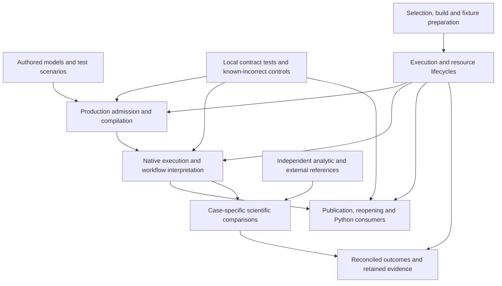

# Integrated test architecture and assurance

**Interface-checked · 2026-10-23 · source `05e6a2b8a49f08de4e33e2e9ad64a753cbea2287`.**
The [collection baseline](README.md#baseline-and-method) identifies the standard, excluded
changes and evidence limits. This is the holistic follow-up's architectural account, not a
replacement design, test qualification or implementation plan. The primary findings remain in
their topic pages with stable identities.

## The test system is federated by assurance responsibility

The organizing distinction is the responsibility a test challenges, not its directory, runner
or size. Crate tests exercise identity, physical admission, compilation, mathematical evaluation,
adapter policy and result interpretation. Engine, conformance and lifecycle suites connect those
capabilities where interaction, physical behavior or ownership is the claim. Python tests exercise
the installed public boundary, actual durable results and downstream consumers. Parity supplies
selected external comparisons with their own assumptions; it does not confer general equivalence.

These arrows describe responsibilities and evidence paths; they do not imply that every local
test starts the entire workflow or that one test must traverse all layers.

The support structures serve different purposes. `pse-testkit` constructs actual bounded engine
resources and has useful factory/capture consumers. `tests/support/plan14.rs` is a richer source
package/workflow composition used by conformance and benchmarks. The lower-layer
`tests/fixtures/reference-source-fixture.rs` intentionally substitutes synthetic data transport
while retaining source declarations. Shared conformance is itself a product capability whose
interpretation mechanisms have local controls. Independent expectations may legitimately repeat
scientific relations without becoming another writable production authority.

Execution has a different dependency structure: Cargo features, nextest/pytest collection,
resource preparation, invocation association, child outcomes, terminal reconciliation, retention
and later reuse. General host admission and server lifecycle serve more than tests. Charging
their entire implementation to test support would conceal real consumers rather than establish
an architectural defect.

## What the portfolio establishes that a local inspection can miss

Several plausible systemic-gap hypotheses were contradicted by complementary controls.

**Reusing production completion is not by itself a circular oracle.**
`modeling/assessment.rs::AssessedPoint::completion`, `workflow/numerics.rs::complete` and
`modeling/results.rs` carry original obligations into accepted results. The acceptance helper
`tests/support/plan14.rs::authored_success` consumes that interpretation. But the underlying
mechanisms are challenged separately:

- `workflow/numerics.rs::composed_acceptance_retains_incumbent_and_closure_qualifiers_and_missing_evidence`
  supplies missing, insufficient and incomplete closure evidence and requires refusal.
- `modeling/conformance.rs::accounting_totals_do_not_create_missing_closure_obligations` supplies
  closed and unclosed authored cases and asserts their acceptance and exact closure-row population.
- Compiler `workspace/modeling/tests.rs::kernel_pure_authored_tests_use_existing_math_without_runtime_or_solver`
  includes a deliberately incorrect expectation and asserts three observations, two passes and
  the actual/expected mismatch. Adjacent controls alter a bound value and require changed evidence.
- Conformance controls challenge wrong fixtures, selected versus full populations, caps, uncovered
  definitions, oracle attribution and wrong failure lineage.

That division can provide independent discrimination without every high-level test reimplementing
the completion rule. It does not exhaustively exclude every possible case-specific omitted check.
The residual nonlinear/variant gaps in DTA-020/021 are concrete scenarios, not grounds for a
universal expected-check manifest.

**There are real cross-layer joins.**
`tests/conformance/src/acceptance/connected_results_resource.rs` follows authored preparation,
native execution, actual canonical result reads, cancellation and retained-buffer ownership.
`python/pse/tests/test_scientific_boundary_adoption.py` closes the original runtime, reopens
qualified covariance, checks an independent analytic matrix, creates a changed optimization
revision, consumes a canonical reference downstream and rejects tampered content.
`test_native_workflow.py` compares edited/restored inventories with independent fresh ingress
while retaining old history. `test_canonical_results.py` checks exact reopened records, analyses,
retirement and new occurrence identity. `tests/lifecycle/tests/result_memory_budget.rs` challenges
detached-buffer accounting and final release. Thus neither a missing integration layer nor generic
stale/reopened-result blindness was established.

**Different test compositions can be legitimate.** Static adapter class/rank tests reuse the
real policy primitives with supplied readiness; contextual tests independently exercise the
production assessment contract. The old DTA-008 indictment is withdrawn. Likewise, dormant fault
hooks, synthetic data bindings, an in-memory policy fixture or a real durable integration fixture
must be judged against its particular assurance responsibility. A shared framework, all-real
dependency policy or public-only test policy would not follow from these observations.

## Additional integrative shortfalls and improvement opportunities

The following are wider interactions supported by the follow-up. They extend the diagnostic
meaning and footprint of existing findings; they are not duplicate findings or selected remedies.

### Scientific change reach and physical preparation use different dependency models

`affected.py::owner/closure/main` maps edits through Cargo package roots and manifest dependency
edges. A reference-only edit outside those roots has no Rust selection and is honestly reported
as unowned/dynamic. Meanwhile `reference-source-fixture.rs::SOURCES` embeds explicit source
lists in compiled tests, while `plan14.rs::package_documents/seed_package_on` loads a much broader
runtime package closure. The same scientific dependency change can require manual include-list
maintenance, invalidate several test binaries, and provide no automatic affected-test selection.

This is a whole-feedback inconsistency across DTA-027/030/035/036. Fixing an individual include
list, reducing one fixture or making the package preview faster would leave the other boundaries
unchanged. The opportunity is to make consumed scientific dependencies and assurance scope
understandable across authoring, selection and preparation. This need not become one universal
registry, and compiler depfiles alone cannot describe arbitrary runtime-loaded data.

### Broad fixture dependencies amplify failures before the intended assertion

`plan14::runtime` creates/registers a canonical fixture before broad source preparation and the
selected scientific assertion. An unrelated admission failure in that closure can therefore stop
the selected case after durable fixture effects. Setup failures enter Rust's failed-test channel
(DTA-025), while incomplete enclosing evidence conservatively retains the resources (DTA-042).
The Python capability-only case in DTA-031 demonstrates an even smaller responsibility acquiring
the whole durable fixture and canonical-owner scheduling group through dependency alone.

The opportunity is responsibility-sized preparation and intelligible setup failure, considered
together with ownership, retention and scheduling. Merely increasing parallelism can multiply
unnecessary preparation and receiver demand; merely sharing a database can destroy isolation.
The audit has not established an equivalent smaller closure for every authentic scientific
composition, so DTA-030 and DTA-018 retain that uncertainty.

### Assurance requirements are distributed without complete composed correspondence

Python markers declare a test category, but fixture closures determine actual infrastructure.
Rust features select some bodies; exact names/regexes in nextest, special-fixture tables and
qualification scopes separately reconstruct requirements. The test tool, report overlay,
invocation catalog and child exit can each be locally meaningful while disagreeing in composition
(DTA-012/015/016/017/022/023).

For a renamed/split test or a new backend control, the critical question is whether the same
meaning reaches selection, preparation, isolation, execution and reporting. Correcting one table
entry does not establish that correspondence across all routes. Conversely, supplementary manual
controls are not automatically required ordinary checks, and many do have documented routes.
The opportunity is coherent requirement ownership and explicit evidence scope; a new runner,
test manifest or mandatory qualification campaign is not selected.

### Evidence lifetime and resource lifetime have different consumers

Resource registration protects active/uncertain borrowers across crashes and service lifecycle
changes. Report sealing also authenticates the immutable origin consumed by evidence reuse.
These guarantees remain meaningful even when current report producers declare no disposable
scratch (DTA-047); disposability did not justify the old DTA-041 overengineering verdict.

There is still demonstrated amplification: membership publications repeatedly carry the full
immutable selection (DTA-038), broad source capture precedes a narrow identity projection
(DTA-039), and checkpoints serialize accumulating maps and detail (DTA-048). The opportunity is
better correspondence between changing facts, physical representation and the owner that relies
on them. It requires preserving authentication, pending/uncertain recovery, exact association
and reader/drain obligations, rather than deleting evidence protection as overhead.

## Representative change and failure scenarios

| Scenario inspected | Integrated judgment |
|---|---|
| Add/change a scientific model variant | Automatic authored fixture discovery is a strength; per-definition inventory does not distinguish every variant (DTA-021). Manual source closures, compile inputs and affected preview also disagree about change reach. |
| Change numerical policy or a shared primitive | Shared declared engineering/historical policy is legitimate. Independent analytic mechanisms and complementary tests matter; consuming a published allowance alone does not establish its projection, and a linear derived-result example cannot distinguish nonlinear constraint curvature. |
| Add a backend or change an implementation | Static and contextual policy controls have different legitimate roles. Actual native outcome tests and independent analytic values are strengths; scheduler/campaign requirements still need separate name-sensitive maintenance. No universal common solver fixture is required. |
| Rename/split a test | Body semantics can stay identical while name-keyed preparation, scientific grouping or feature-absence selection changes. The full composed requirement is the relevant unit of reasoning. |
| Repeat a focused Rust/Python check | Ordinary supervised Rust preparation already reuses its metadata/inventory; the fallback differs. Python still invokes a broad extension pipeline, though Cargo freshness is not recompilation. Feature variants and mutable-path verification have distinct premises. |
| Setup fails, a run is cancelled, or a reader outlives it | General process admission, exact borrowing, terminal immutability and retained readers are safeguards. Setup/product outcome distinction, coarse retention and cleanup failure joins can nevertheless widen diagnosis and subsequent lifecycle work. |

## A discovered evidence boundary, not a new automatic-reuse requirement

Portable component reconstruction and ordinary fresh-process science establish different claims.
All inspected `publish_body`, `publish_unqualified_body` and `reuse_body[_current]` call sites
are confined to `crates/pse-runtime/src/math/portable.rs`, with callers in its test modules.
Its reconnect control explicitly publishes/reconstructs a body and manually evaluates a scalar
Newton update; it does not run ordinary ModelingPackage preparation. Worker tests and Python
journeys establish actual fresh-process execution and retained-result behavior. Optional worker
probe variables have no committed driver in the inspected current scripts/recipes/workflows;
Python comments still refer to a separately named RefuseFreshAdmission discriminator.

History resolves the apparent missing join: commit `401f0d70a5db484063281b7618a96de736a2409a`
deliberately removed ordinary preparation's canonical candidate/reconstruction/publication loops
when preparation moved to held local source. Public portable APIs remain valid caller-composed
capabilities. The current evidence must not be combined into proof that ordinary preparation
automatically restores those products, nor interpreted as proof that result persistence is broken.
This is a claim/support boundary and a stale-comment lead, not a new diagnosed integration defect
or authority to restore removed effects or strict proof campaigns.

## Assessment limits and next use

All seven core foundations informed these judgments: responsibility separation and change locality;
consumed contracts; composition across test layers; semantic/acceptance authority; explicit
requirements and outcomes; local reasoning and independent evidence; and physical execution fit.
Scientific profile obligations constrain the shared checks and independent references, especially
PS-07/10/12/13. Other inherited scientific observations were not upgraded to comprehensive
qualification by this representative follow-up.

No distinct additional structural cause reached the finding threshold beyond the existing 48
identities. The wider interactions above are nevertheless additional architectural conclusions:
they show why isolated local corrections can leave the feedback and assurance system deficient.
This is not a proof that no other shortfall exists. Large portions of the test population and
all runtime performance remain unexamined. DTA-044's barrier necessity, simultaneous budget demand,
smaller valid scientific closures and some case-specific oracle independence remain unresolved.

A later solution review can compare coherent corrections against these interactions and preserved
guarantees. This account selects neither a helper framework, replacement runner, priority ordering
nor implementation package, and authorizes no repairs.
