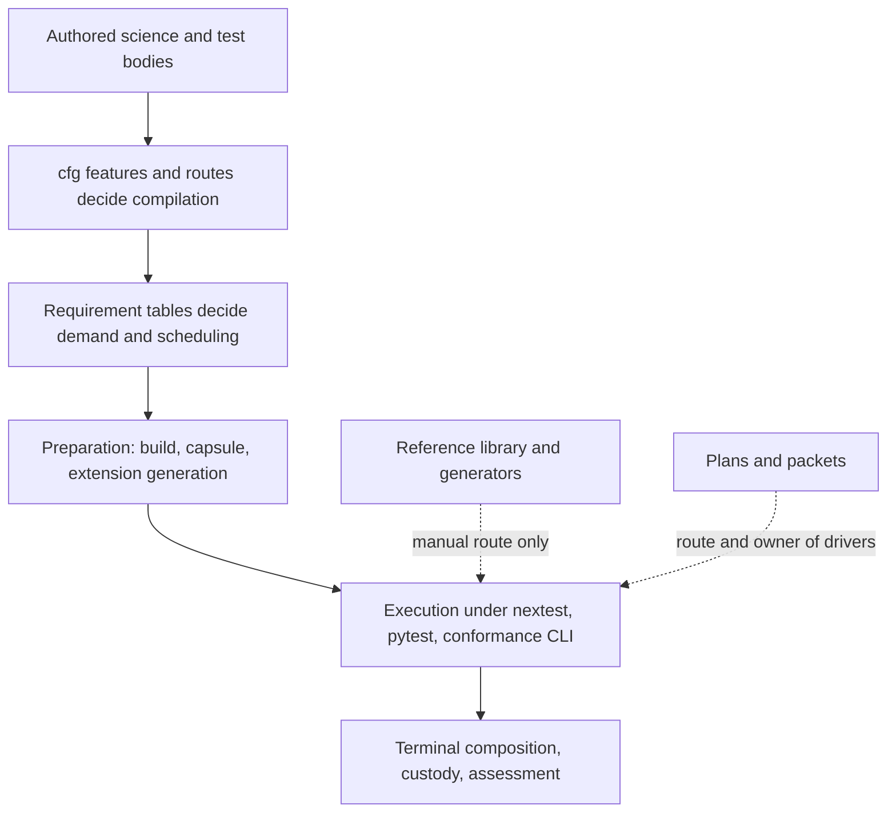

# Integrated test architecture and assurance

**Interface-checked · 2026-10-27 · source `87f2eb9050ae24976956628c16e0e7376190be7a`.** The
[collection baseline](README.md#baseline-and-method) identifies the standard and evidence limits.
This is the architectural account behind the findings, not a replacement design, test
qualification or implementation plan. Primary findings live in the topic pages.

## The system as built

The test system has two halves that grew at different rates.

**The assurance half** challenges product behavior. Crate tests (about 5,000 Rust test functions,
mostly inline `#[cfg(test)]` modules, about 310k of 896k source lines in `crates/*/src`) own
identity, admission, compilation, numerics, adapters, workflow and publication. Small workspace
packages (`tests/conformance`, `engine`, `lifecycle`, `governance`, about 6k lines) join selected
capabilities. `python/pse/tests` (about 300 tests) exercises the installed boundary and durable
results; `python/pse/parity` makes four focused IDAES comparisons. The authored model library under
`packages/reference` carries about 123 fixtures with oracle provenance, run as a set by the product
conformance CLI.

**The execution half** decides what runs, where and with what evidence. Between the 2026-10-23 audit
and this refresh it roughly doubled: `scripts/` from about 119k to 225k lines, `scripts/tests` from
about 63k to 125k, `xtask/src` from about 18k to 44k. It holds invocation interpretation
(`test_invocation`), requirements and scheduling (`test_requirements`), Arrow-leaf proof
(`arrow_validation`), preparation and generations (`python_extension`, `artifact_publication`,
`scientific_inputs`), resource authority and custody (`resource_store`, `test_resources`), terminal
composition (`test_run`), assessment storage (`assessment_store`, `validation`) and the shared
`surreal_server` supervisor. Plan 53 delivered most of its targeted joins.

Size is not the finding. The structural observation is that assurance meaning (which tests must run,
under what prerequisites, with which references) is held *beside* the tests in tables, plans and
recipes, while the execution half's investment has gone mostly into protecting what runs rather than
establishing that what matters runs.

## Six integrated conclusions

### 1. The scientific basis has weaker routes than the machinery around it

The product's central scientific claim, agreement of authored models with independent references,
lives in a route outside both the test catalogues and comprehensive assessment
([DTA-049](oracles-and-acceptance.md#dta-049)). No full pass of it is recorded. The last full run
(2026-10-11) failed nine and left eleven of 118 fixtures inconclusive, and no owner tracks that state. Its generators bind outputs but not inputs, so
staleness is invisible ([DTA-054](oracles-and-acceptance.md#dta-054)). Pure scientific preconditions
are gated behind solver or store features ([DTA-050](evidence-routes-and-execution.md#dta-050)). The
reports that Plan 53's handoff names for its pending simultaneous-controller consumer appear to hold an
inconclusive result, subject to the identity check the plan requests
([plan-state discovery](oracles-and-acceptance.md#dta-003)).

Meanwhile terminal composition, custody and pending/uncertain protection received exact, tested
treatment. Fixing one route entry would not change this balance: the reference library needs an
owner in qualification scope and a representative slice in ordinary feedback, and its references
need staleness signals. Strong local scientific tests (analytic, exhaustive and independent
references; see the contrasts below) show the capability exists.

### 2. Execution meaning is held beside tests, keyed by location and history

A test's prerequisites, native/store demand, exclusivity, route and owner are declared in several
places, none at the test:

- module-path prefixes and hand-listed names in `test_requirements.py`, with a separate timeout
  regex in `.config/nextest.toml` ([DTA-016](evidence-routes-and-execution.md#dta-016));
- Python file-name sets for demand and capsule relevance ([DTA-016](evidence-routes-and-execution.md#dta-016), [DTA-023](test-execution-system.md#dta-023));
- `cfg` features and recipe filters for activation ([DTA-050](evidence-routes-and-execution.md#dta-050));
- the commissioning plan for driver routes and support placement ([DTA-051](doubles-and-coupling.md#dta-051));
- crate lists, private prefixes and file lists for scientific-input demand ([DTA-027](doubles-and-coupling.md#dta-027)).

Each owner is locally consistent, and C02 catches some drift. But a move, rename, new module or plan
retirement silently changes execution: de-grouped native modules run sixteen-wide, a moved Python test
loses its classification, qualification tests run without their receipt, a property test never
compiles, and route-less drivers are maintained without running. The classification fails open in
Rust. Correcting one table leaves the others; the boundary needs one place where a test's assurance
requirements are discoverable and a converse check that declared tests are executed somewhere.

### 3. Focused feedback is sized by the largest units and then re-verified

What an agent instantiates to check one function is set by physical units unrelated to the
responsibility:

- the whole 324k-line crate and up to about ten variants of it ([DTA-053](execution-efficiency.md#dta-053));
- a workspace-wide validity bracket hashed three times, with binaries and libraries hashed twice ([DTA-039](execution-efficiency.md#dta-039));
- a full extension generation and stub regeneration per Python iteration, even for identical content ([DTA-033](execution-efficiency.md#dta-033), [DTA-052](execution-efficiency.md#dta-052));
- a single serial run of all tooling tests as the only route for tooling edits ([DTA-053](execution-efficiency.md#dta-053));
- a full nineteen-family capsule decode per test process, with process-local reuse that nextest's
  process-per-test model cancels ([DTA-030](execution-efficiency.md#dta-030)).

The repository's working mode amplifies this. Several agents edit one checkout concurrently, so a
workspace-wide "changed during preparation" refusal turns another agent's unrelated edit into a
failed run. Each mechanism has a legitimate premise; together they make the focused loop pay for the
largest scope at every stage. Merely adding parallelism multiplies the repeated work.

### 4. Lifecycles are built for protection, not convergence

Pending/uncertain protection, custody, sealing, terminal freeze and joined settlement serve real
participants (concurrent lanes, crashes, late `Drop` effects, retained readers, service restarts);
this refresh again rejects an "overengineered" verdict. What is missing is the other end: generations,
capsules, discovery candidates and passed resources after an aborted deferred cleanup have no
reachable owner that converges them ([DTA-052](execution-efficiency.md#dta-052)). Routine work also
re-serializes and re-hashes growing state at registration and checkpoints
([DTA-038](execution-efficiency.md#dta-038), [DTA-048](execution-efficiency.md#dta-048)).
H25 is met for recovery obligations and missed for retirement obligations.

### 5. Production and test structure entangle at seams and wording

Test choreography and fixture lifetime are threaded through production fields and parameters in four
`cfg` vocabularies, with duplicated counter channels and a shipped doc-hidden fixture drain
([DTA-055](doubles-and-coupling.md#dta-055)). Some reuse observations depend on `Debug` substrings
without positive controls ([DTA-009](doubles-and-coupling.md#dta-009)); typed refusal reasons cover
only migrated distinctions ([DTA-028](doubles-and-coupling.md#dta-028)); residual-body helpers still
diverge from production construction ([DTA-010](doubles-and-coupling.md#dta-010)); a text-replacement
fixture adaptation can silently drop data ([DTA-027](doubles-and-coupling.md#dta-027)). The
deterministic interleavings these seams buy are valuable; the cost is in their scattering and the
surfaces they leave.

### 6. Techniques are strong where used and thin at universal claims

Exhaustive enumeration, frozen vectors, injected-fault generators and differential oracles appear
where the repository reached for them, and mutation, coverage and fuzz tooling are library-first
with thin wrappers. Universal identity and pruning claims still rest on curated examples
([DTA-056](oracles-and-acceptance.md#dta-056)); cross-process cancellation infers solver entry from
elapsed time ([DTA-057](evidence-routes-and-execution.md#dta-057)); layer and governance descriptions
claim more than their checks discriminate ([DTA-058](oracles-and-acceptance.md#dta-058)).

## How the conclusions interact

| If you correct… | …this remains deficient |
|---|---|
| The reference-library route only | Generators still bind no inputs (DTA-054); a full sweep still cannot sit in the focused loop (DTA-053); the representative slice still needs requirement and route correspondence (DTA-050) |
| One requirement table | Python file-name sets, timeout regex, capsule demand lists and plan-held driver routes still drift (DTA-016/023/027/051) |
| Extension republication only | Capsules, candidate entries and passed resources still accumulate without an owner (DTA-052); the workspace-wide bracket still refuses unrelated edits (DTA-039) |
| Crate structure only | Variants, re-verification and per-process capsule decode still repeat (DTA-030/039/053) |
| Retired drivers only | Enduring tests still import plan modules, and the next plan creates the same pattern (DTA-051) |

## Representative change and failure scenarios

| Scenario | Integrated judgment |
|---|---|
| Edit a seed package's thermodynamic method | No ordinary or assessment route runs the library's oracle comparisons, whose last full run failed; generators with hard-coded inputs still pass (DTA-049/054) |
| Rename or split a native solver test module | Its native grouping falls to `LOCAL` without refusal in Rust; the timeout regex disagrees (DTA-016) |
| Run `pytest` bare, as AGENTS.md permits | `worksteal` distribution ignores `xdist_group`, so `scientific-owner` cases run sixteen-wide (DTA-015) |
| Move a canonical Python test to a new file | File-name inference drops its classification; it fails at fixture time far from the cause (DTA-016) |
| One-line change in `pse-runtime` checked by an agent while another agent edits a script | Whole-crate rebuild per variant, triple workspace identity, and a "changed during preparation" refusal (DTA-053/039) |
| Repeat `just py-unit` with no source change | Full image publication, import and stub regeneration; another generation retained with no retirement owner (DTA-033/052) |
| Retire Plan 52's remaining packets | Ten telemetry drivers lose their only route; enduring tests that import them block clean deletion (DTA-051) |
| Run the native canonical graph on an ordinary server | Four qualification tests panic for a missing receipt, reported as product failures (DTA-050) |
| Cancel a SCIP study before branch-and-bound starts | The "stops SCIP" journey passes without discriminating native cancellation (DTA-057) |

## Contrasting strengths

These are strengths to preserve, and they are why the findings concern joins rather than test
quality in general:

- **Discriminating scientific oracles.** Exhaustive structural oracles
  (`pse-structural/src/incidence_tests.rs`), adversarial qualification tests
  (`pse-backend-native/src/quality.rs`), independent PR implicit-function and nonlinear covariance
  oracles, analytic regression covariance, the pushdown differential oracle with its own negative
  control, frozen identity vectors and IDAES/FeOS references with version checks.
- **Assertions that name what failed.** Assertions are mostly typed; there are no retries in normal
  profiles and flaky results fail; deterministic in-process interleaving hooks are scoped per task or
  test and verify their own premise.
- **Outcome truthfulness.** Complete-pass exit (DTA-012), typed setup failure and assertion reach
  (DTA-025), Arrow-leaf proof on managed routes, one invocation interpretation, role correspondence
  and the canonical guard before allocation.
- **Recovery that handles uncertainty.** Real pending/uncertain recovery, custody, sealing and joined
  settlement.
- **Library-first tooling.** Mutation, coverage and fuzz tooling (cargo-mutants, cargo-llvm-cov,
  cargo-fuzz) and insta/proptest where used. Native reproducibility settings have an owner.

## Assessment limits

Ten read-only contributors and the coordinator worked from source, configuration, Git history and
ignored local build directories. Nothing was built, tested or timed. Counts of tests, gates and lines
are approximate static parses. Large parts of the Rust and Python populations were sampled rather
than read. The challenger review recorded in the [README](README.md#challenger-review) tested this
account's claims; its corrections are integrated. This account selects no remedy, priority or plan
and authorizes no repair.
