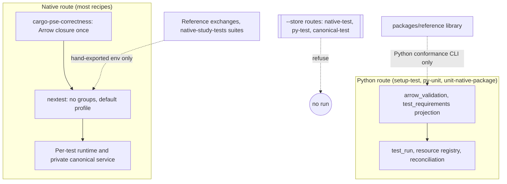

# Integrated test architecture and assurance

**Interface-checked · refreshed 2026-10-29 · source `7bd341f0b` plus the working tree, which landed as
`f5b436bbf`; line citations refer to `f5b436bbf`.** The [collection baseline](README.md#baseline-and-method)
identifies the standard, included changes and evidence limits. This is the architectural account behind
the findings, not a replacement design, test qualification or implementation plan. Primary findings live
in the topic pages. The previous version of this page (source `87f2eb905`) is preserved in Git.

## The system as built: mid-cutover

Plan58 is replacing first-party Python host, product and test machinery with Rust owners. At this source,
the test system is in two states at once.

**The native half is growing quickly.** Since `87f2eb905`:

- `crates/pse-host` (about 19k lines, new) owns the environment boundary, admission, systemd user-manager
  control, containment, provider preparation and the Cargo/nextest correctness adapter;
- `crates/pse-operations` grew by about 27k lines of canonical migration, progression and the
  `NativeCanonicalService` fixture owner;
- `crates/pse-runtime/tests` now has 22 integration binaries, including native study, worker,
  repeated-analysis, diagnostics, dynamics and conformance journeys, plus four reference exchanges that
  call isolated oracle processes in `tests/reference/oracles`.

Most Rust recipes now run through the native adapter, which proves the Arrow-leaf closure once per
invocation and hands arguments straight to nextest.

**The Python half is shrinking but still carries routes.** `scripts/tests` lost about 35k lines and
`python/pse/parity` lost its four candidate families. Still present: about 126 `scripts/tests` test modules, mostly for host and
runner machinery, the product test suite, and the runner itself (`test_run`, `test_requirements`,
`test_resources`, `python_extension`, `arrow_validation`, `surreal_server`). Some routes use them:
`setup-test`, `py-unit`, `coverage` and `seed-conformance`, plus `unit-native-package` once the full
native profile is explicitly prepared. Every route that passes
`--store` refuses before execution, so the managed native, canonical and Python integration aggregates do
not run at all.

Size is still not the finding. The structural observation of 2026-10-27 was that assurance meaning lives
*beside* the tests. On the native route it is not relocated; it is mostly **absent**. The replacements
also recreate several established causes in new code: per-test lifecycle reconstruction, production
choreography seams, and outcome policy held in test bodies. Meanwhile they improve oracle isolation and
physical settlement.

## Six integrated conclusions

### 1. Scientific evidence moved to better oracles but not onto routes

The four parity families now exchange candidate results with isolated oracle processes. The oracles run
with `-I`, refuse any candidate import, bind the case literally, and cover wrong, missing and incomplete
candidates. That is stronger independence than before.

The weaknesses:

- **No route.** The exchanges read undeclared interpreter variables that no recipe sets, and `just parity`
  now runs only a preflight while every guide still points parity claims at it
  ([DTA-050](evidence-routes-and-execution.md#dta-050), [DTA-058](oracles-and-acceptance.md#dta-058)).
- **Allowances come from the candidate.** Covariance and sensitivity acceptance allowances cross from the
  candidate under test ([DTA-061](oracles-and-acceptance.md#dta-061)).
- **The environment contract has drifted.** It is restated in each oracle, and the copies no longer agree
  ([DTA-062](oracles-and-acceptance.md#dta-062)).
- **The authored reference library is unchanged.** It still runs only through the Python conformance
  command, and its last full run failed ([DTA-049](oracles-and-acceptance.md#dta-049),
  [DTA-054](oracles-and-acceptance.md#dta-054)).
- **Migration history is self-referential.** The persistent-store analogue, historical compatibility of
  migration requests, is checked against the current serializer
  ([DTA-065](oracles-and-acceptance.md#dta-065)).

### 2. Execution meaning was not carried onto the native route

The native route assigns no nextest group, so the `scientific` and `store` declarations and their comment
describe a projection that only the Python route performs ([DTA-015](evidence-routes-and-execution.md#dta-015)).

Feature gates decide which tests exist, and nothing reports what was omitted:

- 16 of 22 `pse-runtime` integration binaries are feature-gated;
- about 134 canonical-gated inline workflow tests depend on a store that can no longer be constructed;
- the canonical `native_service` target and the publication controls have no recipe at all.

Prerequisites are environment variables checked by `expect` inside the tests. Most of the replacement
evidence for Plan58 exists only as hand-exported checkpoint commands
([DTA-050](evidence-routes-and-execution.md#dta-050)).

Three Rust route families, plus duplicated environment and receipt policies, hold divergent meanings
([DTA-063](test-execution-system.md#dta-063)). The routes that carry surviving evidence are built from the
modules scheduled for deletion ([DTA-064](test-execution-system.md#dta-064)).

### 3. Focused feedback is sized by the largest units, now per test as well as per crate

Each native test builds a whole runtime. Each canonical native test launches a systemd-bound service and
installs the full schema, including tests whose claims are database-local. That cost pushes independent
claims into single long journeys; one binary's only test fuses five claim families into one journey
([DTA-018](execution-efficiency.md#dta-018)).

Integration binaries multiply by about ten feature sets, and the whole runtime crate still compiles for a
focused unit check ([DTA-053](execution-efficiency.md#dta-053)). Under the deliberately uncapped local policy,
native worker journeys each size themselves to the whole-workstation envelope and run ungrouped at 16
lanes, with no evidence that their joint demand fits ([DTA-046](execution-efficiency.md#dta-046)). The Python preparation and republication costs remain
reachable through `py-unit` ([DTA-033](execution-efficiency.md#dta-033),
[DTA-052](execution-efficiency.md#dta-052)).

### 4. Lifecycles: physical settlement converges, disposal does not

Native fixtures settle physical owners on every path, and containment ends their services with the
caller. Those are real improvements over the Python registry ([DTA-038](execution-efficiency.md#dta-038)
and [DTA-043](execution-efficiency.md#dta-043) premises retired on that path).

Disposal is different:

- each test body decides it with one of three conventions, and one internal deadline exceeds the
  runner's termination ([DTA-060](evidence-routes-and-execution.md#dta-060));
- failed private stores, including credentials, accumulate with no reclaimer, and `bootstrap-host` keeps
  every published generation ([DTA-052](execution-efficiency.md#dta-052));
- setup refusals report as product failures ([DTA-025](evidence-routes-and-execution.md#dta-025)).

### 5. Production–test entanglement recurs in the replacements

The native fixture owner carries `test-support` twin fields and shutdown branches. The canonical client
carries a held-transaction dispatch, migration carries an ungated `discard_acknowledgement` parameter
and fixture installers, and progression assertions ship as a library module
([DTA-055](doubles-and-coupling.md#dta-055)).

Fixture policy is restated per integration binary and has drifted from production's pool-derived
construction ([DTA-059](doubles-and-coupling.md#dta-059)). Host tests bind to the operator's live
admission journal and capacity file ([DTA-069](doubles-and-coupling.md#dta-069)). On the Python side,
orchestration tests stub the construction that now refuses and validate readers against test-authored
configuration whose Python-only fields have no producer ([DTA-070](doubles-and-coupling.md#dta-070)).

### 6. Techniques are strong where used and thin at the dangerous transitions

Real containment and caller-death journeys, deterministic held-transaction interleavings, frozen DDL
literals and reference negative controls are exemplary. Thin spots:

- **Fault injection is added per call site.** It leaves the migration final-edge recovery branches
  unstimulated ([DTA-066](oracles-and-acceptance.md#dta-066)).
- **Refusal assertions accept any error.** This holds across the host and canonical tests
  ([DTA-067](oracles-and-acceptance.md#dta-067)), partly because host refusals have no type
  ([DTA-028](doubles-and-coupling.md#dta-028)).
- **Provider preparation is shown only by fakes and refusals** ([DTA-068](doubles-and-coupling.md#dta-068)).
- **Lease expiry is reached by wall-clock waits, and no concurrent commit race is exercised**
  ([DTA-057](evidence-routes-and-execution.md#dta-057)).
- **Universal identity and pruning claims still rest on curated examples**
  ([DTA-056](oracles-and-acceptance.md#dta-056)).

## How the conclusions interact

| If you correct… | …this remains deficient |
|---|---|
| A recipe for the reference exchanges only | Allowances still come from the candidate (DTA-061); environment checks still disagree (DTA-062); the library still runs only on the Python route (DTA-049) |
| Static nextest groups only | Each worker journey still claims the whole envelope (DTA-046); feature gates still hide inventory (DTA-050); setup still panics as failure (DTA-025) |
| Delete the Python runner per F02 | Surviving tooling, oracle and unit tests lose their launch route unless rebuilt (DTA-064); the second closure and environment implementations go with it, which resolves DTA-063 only if the native side covers what the Python tests covered |
| Share one canonical service across database-local tests | Fixture spec selection is still restated per binary (DTA-059); disposal policy is still per body (DTA-060) |
| Type the host refusals | Canonical tests still use bare `is_err()` where a typed helper exists (DTA-067) |
| Freeze a v2-era request and receipt | Final-edge recovery branches still lack a stimulus (DTA-066) |

## Representative change and failure scenarios

| Scenario | Integrated judgment |
|---|---|
| A resolver change inflates engineering budgets | Covariance and sensitivity exchanges widen with it and all negative controls pass (DTA-061); no route runs them anyway (DTA-050) |
| Run `just parity` as AGENTS.md describes | A full native extension build, then five host checks; no IDAES comparison runs (DTA-058, DTA-051) |
| Run `just test` after a study/worker regression | `native-study-tests` targets are skipped by Cargo and the run reports success (DTA-050) |
| Run `just worker-test` on a busy workstation | Seven ungrouped journeys each sized to the whole envelope, each with a private service; a 31 s lease sleep (DTA-046, DTA-018, DTA-057) |
| Omit the module receipt variable for `worker-test` | The recipe does not check it; the tests panic as product failures (DTA-025) |
| Reorder a field in the migration request struct | Every historical fingerprint changes; the "historical" test, built by the current serializer, passes (DTA-065) |
| The final migration edge loses its acknowledgement and readback fails | The `SettlementUnresolved` branch has never executed under test (DTA-066) |
| Delete `test_requirements.py` as F02 schedules | `setup-test` and `py-unit` stop launching, taking docs, oracle and unit evidence with them (DTA-064) |
| Run `just surreal-fixture-test` | Refuses at construction while its unit suite, which stubs `setup`, stays green (DTA-070) |
| `run_cli` stops calling the capability-vocabulary check | The CLI refusal test still passes on the containment error (DTA-067) |

## Contrasting strengths

These are strengths to preserve, and they are why most findings concern joins rather than test quality
in general:

- **Isolated, discriminating reference oracles.** `-I` with environment scrubbing, a candidate-import
  guard, literal case binding, typed closed exchange, whole-population batching, and wrong, missing,
  incomplete and mixed controls with order and identity preserved. Missing references fail, never skip.
- **Real containment journeys.** Controller SIGKILL with escaped descendants, bound-service drain on
  TERM and KILL, and `BindsTo` propagation, all observed through kernel state (`cgroup.events`,
  `/proc`) rather than product parsers. The host crate's test closure stays lean, with no
  dev-dependencies.
- **Deterministic interleavings and frozen anchors.** Held-transaction fence crossing, restart with
  original-bytes comparison, frozen DDL literals verified before every migration body.
- **Earlier strengths still hold.** Exhaustive structural oracles, adversarial native qualification
  tests, independent PR and covariance oracles, frozen identity vectors, IEEE-derived bit images in
  `pse-math`, typed assertions in the changed `pse-runtime` inline tests, and no retries in normal
  profiles.
- **Retirement by refusal.** Retired paths refuse before effects and the refusals are tested.
  Deletions carried their tests, so every first-party import in the test trees resolves.
- **Settlement after failed assertions.** Native fixtures use `catch_unwind` then `close`/`dispose`,
  with diagnostics retained and no success claimed in `Drop`.

## Assessment limits

Eight read-only evidence streams, a challenger and the coordinator worked from source, configuration and Git history.
Nothing was built, tested or timed. Counts are static parses with roughly ±10% accuracy. About 15k lines
of native tests, most `pse-operations` conflict and transport tests, the remaining Python product
journeys and `xtask` were sampled rather than read. The challenger review recorded in the
[README](README.md#challenger-review) tested this account's claims. This account selects no remedy,
priority or plan and authorizes no repair.
