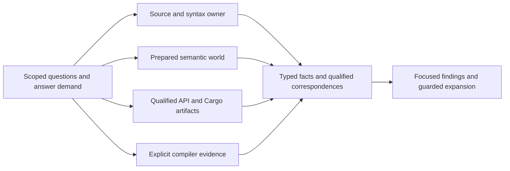

# Code-intelligence capability expansion

## Judgment and scope

**Proposed:** deepen the intelligence system along three connected axes: explain more of Rust's
meaning, connect independently qualified evidence into useful investigations, and support more
precise transformations. The strongest immediate opportunities use capabilities already present
in the selected native analyzer and syntax libraries. Compiler-derived lifetime explanations and
broader indexing offer additional depth, with distinct integration and evidence obligations.

The subject is the underlying subsystem. The CLI is an access surface whose query and presentation
contracts must preserve these capabilities. A new command for every library API would make the
system harder to use. Better answers, meaningful relationships and reusable investigations are
the functional target. This review does not consult or map Plan60, amend existing plans, implement
features, or certify a replacement architecture. Current capabilities provide the baseline rather
than a ceiling. Breaking changes and removal of replaced machinery remain options for adoption.

Independent assessment supported the subsystem focus and conditional proto integration. It
recommended leading with role/capture explanations and contextual API selection, keeping layout
demand-dependent, and exposing the native prepared-world limitation explicitly. Those judgments
are integrated below. It did not independently qualify new integrations or their performance.

Source baseline: `5be967c10f3905732d73dfaa960fdad9aa9534b0`, with twelve modified Rust analyzer
overviews and the untracked `cargo_metadata.md` supplied by the operator. All thirteen analyzer
documents were read end to end, including original material and addenda. The principal proto
mechanisms were followed through the Buffa overview and relevant reflection, validation,
generation and ConnectRPC material. Library overviews are discovery inputs; exact sources govern
consequential applicability claims. Research corrections below do not modify those input documents.

Assessment uses Core 3.4, the selected efficient-architecture heuristics and the pse-arrow binding.
AP-01–AP-07 apply to responsibilities, meaning, composition, enforceable contracts and execution
fit. This is functional exploration, without a diagnostic-audit prerequisite. No new physical or
scientific interpretation is proposed; process-simulator numerical qualification is outside scope.

## What exists and what is newly valuable

The current system already has source/index/revision acquisition, lossless Rust outlines,
ast-grep and Tree-sitter querying, guarded proposals, reusable LSP/native sessions, semantic
relations and predicates, API/rustdoc acquisition, compiler artifacts, typed protobuf facts,
authenticated local RPC and offline descriptor/payload/origin investigation. Native search already
shares parsing for compiled structural rules, supports relational predicates and cancellation.
API inspection already exposes original declarations, documentation, example fences and qualified
reexports. These are not new opportunities merely because the expanded overviews describe them.

The important distinction is between a mechanism existing in a library, being wired into a
provider, and producing a useful structured answer. The native snapshot backend currently handles
Explain, Importable, References and Implementations; its wildcard refusal does not mean the IDE
library lacks the other operations. Live LSP has broader operation coverage. Conversely, a rendered
section or original dump is not automatically a composable fact. `semantic/facts.rs` and
`NativeObservedFacts` are the consumed-fact owners, while `NativeSection` retains original evidence.

Current source owners, relative to `crates/pse-host/src/`:

| Responsibility | Owners relevant to extension |
| --- | --- |
| Source interpretation and proposals | `source_read.rs`, `source_command.rs`, `source_query.rs`, `source_query/native.rs`, `source_proposal.rs` |
| Native meaning and lifecycle | `semantic/native.rs`, `semantic/engine.rs`, `semantic/facts.rs`, `semantic/protocol_facts.rs`, `semantic/rpc.rs` |
| Query composition and presentation | `investigation/model.rs`, `investigation/composition.rs`, `investigation/providers.rs`, envelope/stream owners |
| Package, API and compiler context | `dependency.rs`, `api/query.rs`, `api/comparison.rs`, `compiler_investigation.rs`, `compiler_investigation/artifact.rs` |
| Wire and schema provenance | `../proto/pse/code_intelligence/v1/contracts.proto`, `semantic/wire.rs`, `code_intelligence_contracts/local.rs`, `schema/` and the existing generator |

The review's benefits are qualitative hypotheses unless otherwise labeled. No latency, memory,
context-efficiency or accuracy improvement was measured. The reviewed APIs were source/interface
checked where specified; candidate integrations were not compiled or executed here.

## Recommended opportunities

### O01 — Explain semantic context and compare interpretations

An engineer should be able to ask: “Why does this location mean this item here, and what changes
under another feature, target or containing crate?” Return established crate/module membership,
possible alternatives, active configuration and explicit unresolved mappings. A physical file or
offset must not silently select one of several semantic interpretations.

New HIR source-to-definition and macro/attribute descent information, plural module mappings,
edition/scope information and analyzer crate-membership facilities can deepen existing session and
package contexts. Compare interpretations by running the same bounded question in separately
qualified worlds and relating their observations; do not reuse local IDs across those worlds.
Existing native importability refuses ambiguous contexts and some associated-item questions;
enrichment should explain or resolve these boundaries rather than fabricate applicability.

The loaded world itself is a material limit: current native preparation selects
`load_out_dirs_from_check = false`, no proc-macro server and zero proc-macro processes. Better
mapping cannot recover expansions that were never loaded. Distinguish unavailable build-generated
or procedural-macro semantics from ambiguous mappings within an available world. Reuse the
explicitly prepared live-LSP route where suitable; separately prepared native enrichment is an
alternative to assess, not permission for ordinary reads to start builds or macro processes.

Recommend this as a shared foundation for O02–O05 and O09. It should extend the current context
and locator owners, not introduce an independent workspace resolver. A revealing case is one
source file belonging to two crates with different feature sets and a macro-generated definition
whose original source mapping has multiple candidates. Success includes an inspectable reason
for ambiguity. Mechanisms: HIR addendum §§1–2; analyzer addendum §§14,20; current native package
contexts and original source guards.

### O02 — Role-sensitive relationship investigations

“Show uses of this resource” should distinguish construction, import, read, write, call, implicit
trait operation and source-level mention where the provider supports those distinctions. Format
identifiers, pattern constants, field-offset expressions, lifetime/label references and generated
origins should be discoverable without reducing everything to text matches or call edges.

Compose categorized reference search, constructor restrictions, semantic resolution of operators
and conversions, bounded `SearchScope`, and existing navigation. Extend typed relationship facts
only for distinctions actually observed. A constructor occurrence is not object lifetime; a static
call relation is not runtime causality. Scope restriction must preserve the population needed for
the requested answer, especially a global negative or exact count.

Recommend native adapters over new text-based inference. Keep lexical candidates useful where
semantics is unavailable, with their different meaning explicit. Demonstrate a definition used
through an ordinary constructor, a format capture and an implicit operator, plus an import that
must not become an executed call. Sources: HIR addendum §1; IDE addendum §1; analyzer §§15–16;
existing `FactRelation`/`RelationshipFact` and reference owners.

Concrete adapters include `resolve_index_expr`, `resolve_prefix_expr`, `resolve_try_expr` and
`resolve_await_to_poll`, complementing existing method/binary resolution. Preserve reference
`IMPORT` and `TEST` categories currently dropped by the narrower read/write projection. Call
answers should retain occurrence ranges as well as declaration locations; a declaration alone
cannot identify which selected expression produced the relation.

### O03 — Operation, capture and constraint explanations

Extend “explain this expression/type” into a structured account of adjustments, selected callable
kind, closure capture projections, generic parameters, declared bounds and relevant obligations.
This would help choose a library API, understand an unexpected borrow or conversion, and review
whether a proposed refactoring changes captures or generic assumptions.

Use HIR type/callable/closure APIs and IDE predicate evaluation rather than scraping hover text.
Separate declared constraints, observed inference, supported solver outcomes and unresolved
questions. `NotProven` is not false; a solver fingerprint is not a proof or portable type ID.
The current predicate and importability facts are useful starting points, not evidence that every
trait or associated-item applicability question is already supported.

Contextual `highlight_related` observations can connect captures, exits and suspension sites to
source. They remain targeted semantic relationships, not a general CFG. Type-directed candidate
selection and bounded expression/term synthesis are valuable adjacent extensions: present
suggestions as candidates and checked previews, preserving imports, context and uncertainty.
Recommend the explanation capability first; synthesis should have an explicit bounded question
and retain its own feasibility assessment. Sources: HIR addendum §§3–5; IDE addendum §§1,3–4;
current native Explain and predicate adapters.

`Semantics::expr_adjustments` supplies ordered source/target adjustments: dereference, borrow,
pointer and never conversions should remain separate steps. `Type::as_closure` and
`Closure::captured_items` expose projected captures, uses and capture kind; the captured place's
type differs from the stored reference's type. Preserve ordinary versus async callable kind.
`PredicateEvaluationStatus::{Holds,NotProven,Invalid,Unsupported}` should survive typed projection;
the present truth-oriented predicate fact loses useful distinctions. Evaluate declared bounds
and inferred obligations in the actual world, rather than interpreting a displayed trait name
as satisfaction.

**A distinct workflow worth developing is contextual API selection:** “Which callable fits these
available values and desired result, and why?” Existing completion and assist candidates are
already available facts; another candidate list adds little. Combine rustdoc discovery with HIR
`iterate_method_candidates`, trait-aware variants, `iterate_assoc_items`, resolved callable
substitutions and contextual coercion/unification. Explain required imports, receiver adjustments
and unmet or unresolved obligations. A method available through `String`'s dereference differs
from an unrelated same-spelled method; an extension trait missing from scope differs from a
blanket implementation whose bound is unproven.

HIR `term_search` is a bounded candidate producer, not a complete synthesizer. Its fuel and
alternative limits can yield collapsed `Many` results; an empty result is not an impossibility
proof. Generated source and `traits_used` can support a guarded preview using contextual path
rendering. Compare this with ordinary candidate explanation before introducing synthesis work.
Acceptance should distinguish a selected applicable call, a missing import, an unresolved bound
and a search stopped by fuel. All new integrations here remain Proposed.

### O04 — Structured type and layout inspection

Answer “What is this type made of, which representations are known, and where is the size or
alignment coming from?” with qualified fields, variants, offsets and unavailable children. This
is useful when assessing large enums, boxing, nested state or library representations.

Prefer accessible HIR layout information for a typed projection; assess the IDE recursive layout
view when its hierarchy adds useful explanation. In native .358 its result structs are defined
in a private module and are not ordinary public reexports. Inferred field access may permit an
adapter, but this review does not claim that such an adapter was compiled. Zero-valued placeholder
children must not become claims of zero-sized fields. Dynamic allocation/capacity and actual
resident memory are separate from static layout.

The alternative is the existing target-qualified compiler layout artifact route, particularly
where ABI precision or unsupported analyzer layout matters. Recommend a common question with
provider-specific evidence, not pretending the two producers establish identical guarantees.
Demonstrate a nested enum under a declared target and a child with unavailable layout. Sources:
IDE addendum §4.1; HIR type/layout APIs; current compiler artifact owner.

### O05 — Compiler-backed suspension, drop and unwind explanations

The high-value deeper question is: “What can retain this value across suspension, and what
cleanup paths does the compiler construct?” Combine source-level captures with selected MIR
initialization, liveness, storage, borrowed-place and drop effects; coroutine witness/layout
information; and ABI-sensitive unwind behavior. Show the relevant source sites and compiler phase.

The pinned compiler exposes `get_bodies_with_borrowck_facts` and `ConsumerOptions`, closure capture
information and coroutine layout/query machinery. This supports an isolated compiler-driver
candidate, not arbitrary calls into private lowering helpers. Body capture can be expensive and
interacts with compiler query consumption/MIR stealing; collect needed facts in the correct
callback and retain an owned, phase-qualified projection. Do not export compiler pointers or
session-local IDs as durable identities.

Prefer the current artifact owner for original MIR/THIR/layout/mono-item evidence. Add structured
driver integration only for questions the artifacts and analyzer cannot adequately answer.
Do not build a general textual MIR parser and advertise borrow-checker facts from it. Optimized
MIR can erase the source relationships needed for an explanation; use/drop liveness, lexical
regions, coroutine storage conflicts and runtime retention have different meanings.

Recommend staged compiler depth: source captures and contextual relationships first, original
phase-qualified artifacts next, a pinned optional driver for structured questions where justified.
This is a strong functional opportunity with higher integration burden. Static analysis never
establishes that an actual worker/process released a resource; correlate original runtime
observations separately when that is the question. Acceptance examples include a projected
capture across `await`, different use/drop liveness, and a destructor path changed by unwind ABI.
Sources: both compiler overviews, treated as one overlapping family, and exact compiler references
in the evidence appendix.

For suspension, inspect compiler `closure_min_captures`/capture-kind origins and selected
`CoroutineLayout` fields, variants, source information and storage conflicts. Compare a non-Send
value scoped before an await with one retained across it, and two awaits retaining different
locals. Saved-local evidence is conservative; absence of a storage conflict does not guarantee
physical overlay or runtime resource release. Restricted-visibility lowering helpers are not
downstream public APIs merely because their implementation explains the analysis.

For destruction, distinguish initialization state (`MoveData`, maybe-initialized/uninitialized
places and drop flags), lifetime validity for destruction, and lowered runtime cleanup.
`ElaborateDrops` and `AbortUnwindingCalls` expose different questions. A partial move followed by
ordinary return versus a panicking call is a useful discriminator; `extern "C-unwind"` needs its
own ABI context. Before/after native artifacts may suffice without a structured driver.

Only acquire borrow-checker facts when diagnostics and selected MIR leave a concrete question
unanswered. The consumer API entails type-checking-root and nested-body coordination, regenerated
region identifiers and query-order constraints. Legacy Polonius facts are not integrated Polonius
Alpha, and `MaybeBorrowedLocals` is not a loan checker. Dataflow analyses converge separately;
checking composes their results rather than running one universal combined fixed point.

### O06 — Structural investigations that explain their matches

Turn selected source into a reusable structural question, expose the compiled pattern/captures,
and explain the native relations used to select a match. Combine literal, attribute, doc-comment
and qualified-path facts with current full-rule and relational query support. The new value is
structured evidence and composition, not reintroducing already implemented relational filters.

`Pattern::from(Node)`, strictness-aware pattern inspection, matcher composition and traversal
controls offer native mechanisms. `ra_ap_syntax::SyntaxText`, string-token facilities and
attribute ownership can supply facts beyond ordinary outlines. Value offsets inside escaped
literals require an explicit mapping back to original source; adjusting quote offsets does not
decode escapes. Attribute normalization does not evaluate cfg. Syn's embedded-literal parsing
does not magically provide fine-grained interior source spans.

Recommend precise structural facts and native pattern explanation with existing query demands.
Compare ast-grep, RA syntax and Tree-sitter by the meaning needed. Tree-sitter query containment,
match limits, cancellation and metadata should remain visible; grammar recovery is not compiler
acceptance. Demonstrate documentation and cfg attributes attached to the right declaration,
escaped embedded Rust, and a query whose native match limit makes coverage incomplete.

For literal mappings, `IsString::map_range_up` shifts quote-free source-spelling coordinates;
decoded character positions require `escaped_char_ranges` plus the token's absolute start.
Use concrete value APIs for faithful string/byte/C-string content. Syn's `LitStr::parse_with`
can interpret embedded Rust but gives its nodes the enclosing literal span. Attribute inventory
should use typed ownership and doc-comment helpers, avoid duplicate inner attributes and retain
`cfg_attr` predicates without claiming effective configuration.

There is also a focused simplification to carry with these consumers. `source_query.rs` and
`source_query/native.rs` independently traverse, project captures and construct results. The
former scans for exact totals and prepares template edits, reporting cancellation after traversal;
the latter already stops by demand/cancellation and shares compatible parsing. Consolidate the
selection/projection substrate with explicit witness, first-N, complete-inventory and exact-total
demands, followed by optional diagnostics or proposals. Exact totals still require complete work.
Use `Matcher::potential_kinds` where applicable, and distinguish Tree-sitter intersection from
containment, parser cancellation from query cancellation, and match-limit exhaustion from counts.
Do not replace explicit nested/overlapping candidates with `replace_all`, which skips nested
matches. This is consumer-driven consolidation, not a prerequisite persistent parser service.

### O07 — Grammar-aware and semantic transformation previews

Extend previews toward edits such as adding a where-bound, removing a syntactic construct with
correct punctuation, changing imports, transforming a receiver, or applying semantically resolved
SSR across selected files. Preserve the original source and distinguish match extent from edit
extent. Preview, source applicability and successful compilation remain different claims.

Use native replacement-variable inspection and ast-grep's edit facilities for structural rules;
RA `SyntaxEditor`, `GetOrCreateWhereClause`, `Removable` and collection editing for Rust grammar;
and IDE assists/rename/SSR for semantic transformations. Syn/quote/prettyplease are strong for
owned AST generation, but token-to-text round trips do not preserve arbitrary original formatting,
comments, spans or hygiene. Prefer minimal source-preserving changes when those matter.

Do not use ast-grep .51's named `before/after/append/prepend` insertion helpers: their inspected
implementations are `todo!()`. RA's editor is the stronger candidate for compound Rust edits.
Its editable tree may be detached, so use returned handles and explicit annotations/mappings;
kind-and-relative-position lookup is not durable identity. Appending a where-predicate does not
deduplicate it or establish necessity. Minimal text-patch construction and semantic validation
remain integration work rather than guarantees of the editor API.

The live LSP provider already exposes SSR. Native .358 also has
`Analysis::structural_search_replace(query, parse_only, FilePosition, Vec<FileRange>)`, returning
a `SourceChange`; the current native dispatch does not expose it. Recommend native preview parity
as a concrete addition. Its semantic match structure does not expose public capture/range fields,
so addressed semantic SSR capture inventories need an upstream API change or separate supported
route. Do not manufacture captures by reparsing the replacement.

Keep one guarded proposal/merge owner for overlapping edits and file operations. Library AST
mutation is not a multi-file transaction. Actual application can be assessed later as a distinct
capability; it is not required to obtain value from richer previews. Sources: syntax overviews'
editing chapters/addenda; exact `.358` SSR interface and match visibility; current proposal owner.

### O08 — Rich API contracts and example evidence

Deepen existing API search and comparison into questions about callable/trait properties, precise
generic constraints, typed attributes, representation, stability dimensions, target features,
evaluated discriminants, stripped structure and effective public routes. Show whether a method
is reached through dereference or a reexport and which artifact/context supports that answer.

The current rustdoc owner already has full declaration material, docs/examples and qualified
definition acquisition. Extend its query/projection model rather than creating another loader.
Rustdoc JSON is not a complete body type-check or a lossless Rust source model. Macro text can
omit matchers; associated-constant strings and blanket-implementation metadata need conservative
interpretation. Missing or stripped members are unknown coverage, not absence.

Add explicit doctest/source-example evidence where useful. The pinned compiler's extracted
doctest format is version 2, distinct from API JSON format 61. Preserve original versus transformed
test code, hidden setup and compilation context. Reading examples need not execute them; native
test owners remain responsible when execution is requested. Scraped examples and executable
Markdown are conditional acquisition modes, not automatic work on every API query.

Demonstrate an inlined reexport, a private/hidden/stripped distinction, an associated-item bound
and an example whose wrapper differs from its authored source. Sources: both rustdoc documents,
including their addenda; current `api/query.rs`/`api/comparison.rs`; exact doctest source below.

Use schema61's `Generics`, `WherePredicate`, `AssocItemConstraint`, `GenericBound::Use`,
`PreciseCapturingArg`, typed attributes and `Trait.is_dyn_compatible`. For example,
`Iterator<Item = T>` differs from `Iterator<Item: Clone>`; `for<'a> Fn(&'a T)` differs from a
free lifetime; and `use<'a,T,N>` needs enclosing declarations to classify its parameters.
Ordinary, const and provided-default stability are separate dimensions; missing third-party
metadata remains unknown. `repr(C)` is authored representation evidence, not computed layout.
These refine the existing structural contract query; they do not duplicate the native public-API
comparison owner or prove contextual applicability.

For examples, show the native transformation of a Result-returning fragment, `test_harness`,
`standalone_crate`, conditional ignore flags or `cfg(doctest)` inputs. Extraction, compilation
and execution are separate evidence. A passing `compile_fail` example alone does not establish
that the intended diagnostic occurred. Retain inexpensive authored-fence reading when actual
compiler preprocessing is unnecessary.

### O09 — Explain package, feature and compiler-world differences

Provide a connected answer to “Why is this dependency or declaration present under this
configuration?” Preserve authored requests and aliases, resolved package identities, target
conditions, host/build roles and command-specific compiler units. Relate these to the semantic
world actually loaded for an investigation.

`cargo_metadata` already supplies the package and event layer. Its graph does not encode every
command-specific feature/compilation-unit distinction. Native pinned Cargo unit graphs and the
current correctness-selection owner should remain authoritative for actual planned units.
Typed diagnostics/build-script/artifact events can improve source reconciliation; artifact
freshness alone is not rebuild causality. Preserve raw events where typed decoding loses fields.

Guppy offers worthwhile graph reachability/set operations and, conditionally, CargoSet simulation
and summaries. Prefer library algorithms to expanding bespoke graph code where they fit. However,
simulation fidelity for this repository's experimental workspace feature unification is not
established here. Do not substitute a modeled graph for observed unit context. Hakari does not
earn adoption simply because it appears in the overview; native unification is already selected.
Determinator-style impact predictions can nominate investigation/validation scope, with their
false-positive and false-negative limits; they do not establish exhaustive semantic impact.

Recommend package-to-unit-to-analysis explanations and context comparisons. Generic build
telemetry, cache management and a new build/test controller lack a separate value argument here.
Sources: new cargo_metadata overview, dependency-tooling original/addendum material, current
dependency and compiler-unit owners, and Cargo's metadata/unstable unit-graph documentation.

### O10 — Semantic validation relevance and runnable discovery

Connect an inspected item or proposed change to relevant tests, modules, benches, doctests and
binaries, retaining cfg eligibility and source provenance. This helps select meaningful validation
without claiming that relatedness proves coverage or that a candidate command has executed.

Use native runnables/related-test facilities, package targets and current test-selection owners.
Keep actual Nextest discovery, fixture construction and execution where they already belong.
Snapshot-update metadata is evidence about an intended update operation, not authorization to
rewrite snapshots. A doctest-only declaration belongs to its own configuration world.

Recommend structured candidate relevance and an explanation of the association. Include a test
behind an inactive cfg and a documentation example absent from ordinary library compilation.
Sources: IDE addendum §5, rustdoc doctest chapters and cargo_metadata target discovery.

### O11 — Focused composed answers with progressive evidence

Support questions such as “Find references that construct this type in the selected feature
world; explain captures for the relevant closures; expand only unresolved cases.” A single useful
investigation should preserve the contributing facts and their different scopes, rather than
requiring agents to scrape and manually join large dumps.

Extend the existing request, relation, demand and expansion owners. Model selected relationships
and evidence routes without inventing a universal query language or ontology. User-facing detail
selection must be capable of reducing provider work through supported scoped/native operations;
truncating a fully materialized answer is not the same optimization. Exact absence/counts can
require broader acquisition than the displayed witnesses.

Recommend concise typed findings with explicit unknown/unsupported/omitted states, whole-record
budgets and guarded expansion into original source/provider artifacts. Do not make every question
pay for all available enrichment. A representative case mixes lexical candidates and semantic
refinement, including an unavailable world that must remain unknown under negation. This builds on
current composition and coverage contracts, whose useful behavior should survive redesign.

### O12 — Reusable native retrieval with honest coverage

Repeated global navigation may benefit from native `StaticIndex` projections and deferred IDE
work. Compare direct queries, a request/session-owned index, and serialized SCIP/LSIF artifacts
using the questions each serves. No persistent service or database is required merely to enable
index computation.

Native .358 `StaticIndex::compute` borrows analysis and returns analysis-bound state; it is not a
free-standing `Send + Sync` cache. Keep it with its semantic owner or extract owned qualified
facts. Coverage excludes ordinary library roots unless the vendored-library selection includes
them. The pinned `StaticIndexedFile` has folds and tokens, not the inlay-hint field suggested by
an overview. Deferred hints, completion edits and richer HIR queries remain separate acquisition.

Tree-sitter trees can be cheaply cloned, but a tree clone does not version its source bytes or
derived facts. Reuse needs source/configuration/provider identity and an invalidation owner.
Recommend an index only when repeated/global queries demonstrate a useful retrieval population;
preserve direct native operations for richer questions. Typed `type-sitter` wrappers are a
conditional alternative where they remove substantial extraction code, with the documented
runtime-version mismatch resolved before adoption. No benchmark advantage is claimed.

### O13 — Typed evidence and lineage across providers and protocols

The new answers need richer public facts, not a growing collection of category strings and
opaque blobs. Extend the existing authored proto families where facts cross the helper boundary:
reference roles, captures/adjustments/obligations, layout, runnable relevance and selected
compiler observations. Preserve original opaque documents as original evidence, not as the
authority consumers must reverse-engineer to make decisions.

Give source, native entity, rustdoc item, descriptor declaration and compiler body/unit their
own qualified identities. Relate them through explicit correspondence with origin and confidence
limits. Macro expansion and embedded literals may require many-to-many source mappings. A
matching spelling, field number or type URL cannot establish Rust identity. Historical source
must not inherit the current generation's lineage. Extend the existing descriptor/origin mechanism
where these questions need it rather than creating another producer catalog.

Retain Buffa/ConnectRPC as the preferred physical baseline. Direct `ReflectMessage` VTable access
serves known generated values; genuinely external schemas use dynamic reflection. `OwnedView`
and `ServiceRequest`/`StreamMessage` can retain binary bodies safely; choose them for actual
read-mostly consumers, not as a blanket rewrite. Lazy views defer validation and lack several
eager-view integrations at .9.2. Maps/lists still have allocation or lookup costs. Custom `Bytes`
storage, boxing and segmented encoding can be assessed for large evidence bodies, but wire
compatibility does not make Prost and Buffa Rust types interchangeable.

Keep declared schema generation, compiled validation, diagnostic causes, Start/Cancel/Terminal
and work-owner settlement aligned. Schema validation establishes message/constraint properties,
not truth of a semantic conclusion. Dynamic external constraints remain unevaluated unless an
actual validator is selected. Protobuf is a contract/data boundary, not a reason to move all
analysis into RPC, to use ProtoJSON as the agent presentation, or to add remote services.

Compare Prost/reflection/Tonic or Rust-first contracts only if a concrete capability materially
changes this choice. A second decoder universe or general RPC gateway is not presently justified.
Generated-source annotation opportunities should reduce reconstruction where the producer can
emit reliable mappings; do not assume the current plugin emits `GeneratedCodeInfo`. Sources:
proto overviews cited below, current authored contracts, direct projection and origin owners.

A concrete enabling improvement uses existing types rather than more infrastructure.
`xtask/src/codegen/code_intelligence/associations.rs` parses syn ASTs but recognizes
`field.number()` and field-number patterns by token-string formatting. Inspect
`Expr::MethodCall`, receiver, method, arguments and literal patterns directly; use
`LitInt::base10_parse` with explicit accepted shapes and suffix rules. Preserve conservative
oneof and ambiguous-mapping behavior. No additional parser dependency is needed.

The association manifest already records field mappings, while `schema/compare.rs` currently
filters to associations without a Rust field and follows enclosing struct/impl origins. Extend
precise generated-field/accessor selections to their authored proto field where that mapping is
explicit. Different spacing, raw identifiers and accepted numeric spellings should not alter
meaning; another receiver, nonliteral discriminant or ambiguous oneof must not be guessed.
Keep descriptor, producer and digest validation with the existing origin owner.

## Coherent target and tradeoffs

The proposed target has a shared question/evidence surface over several capable owners:

These are responsibilities, not required crates or process boundaries. Analysis remains native
and retains library-specific meaning. A new fact need not introduce a service, registry, queue or
cross-process call. Where a boundary exists, generated protobuf types and existing custody/drain
owners carry the contract. The CLI adapts this surface; no command-per-library structure is proposed.

Recommended sequence by value/dependency, not implementation packages:

1. Lead with reference roles, operation/capture explanations and contextual API selection
   (O02–O03), sufficient world qualification from O01, and the smallest O13 fact additions they
   consume. Compose one useful investigation through O11 while developing those answers.
2. Make structural/literal/documentation evidence and native semantic previews more useful
   (O06–O08), independently of full multi-world comparison or recursive layout. Add layout (O04),
   Cargo context and runnable relevance (O09–O10) where the chosen questions benefit.
3. Pursue selected compiler-backed lifetime questions (O05) with exact-phase evidence. Evaluate
   reusable indexing (O12) against repeated/global retrieval needs rather than making it a universal
   prerequisite for simpler answers.

This is not a rigid waterfall: a valuable source-only extension can proceed independently of an
optional compiler driver. Existing useful functionality should survive, while redundant source-query
paths and reconstruction can be retired after their consumers move. Parser consolidation should
follow fidelity and semantic requirements, not the smallest dependency count. Creating another
handwritten feature resolver, borrow checker, semantic SSR matcher or test controller is rejected.

Rule impacts require the normal decision route if adopted: new crates, compiler-private integration,
changed boundary/metadata meanings or significant owner changes may affect blueprint §21.7,
§23.2 and ADR-0235/0233/0234. This review changes none of them. Library/version moves are technical
options with tested compatibility obligations, not automatically disallowed by current pins.

## Evidence, corrections and follow-up

**Tested, bounded read-only consumer checks:** `pse search syntax 'Command::new($BIN)' --path
crates/pse-host/src --limit 3 --format json` settled and emitted three records. `pse inspect
--source crates/pse-host/src/code_intelligence_contracts/local.rs --lines 15:35 --format json`
succeeded. These establish the exercised source interface, not semantic/compiler feature support.
No semantic service, compiler probe, analysis-integration build, dependency installation or
benchmark was run for this review. Existing test sources informed acceptance scenarios; previous
qualification is not freshly certified here. `just docs` built the HTML/search publication with
zero failures against a zero-failure baseline; that validates publication, not the proposed
intelligence capabilities.

Important research corrections:

| Lead | Exact-source judgment and effect |
| --- | --- |
| Compiler overviews target 1.99.1 | Actual pin reports `rustc/rustdoc 1.101.0-nightly (c1070d693 2026-09-28)`. Check commit sources, not dates alone. |
| Newer `precise_liveness` analysis | Not exposed by the inspected pinned dataflow module list. Defer this specific API pending matching source/toolchain support; existing liveness/storage analyses remain useful. |
| Static index includes inlay hints | Pinned .358 file record exposes `file_id`, `folds`, `tokens`; hints need their own acquisition. |
| Recursive layout is an ordinary public IDE type | Structs live in a private module without an ordinary public reexport. Adapter feasibility remains interface-level, not compiled here. |
| Semantic SSR exposes addressable captures | The match object's relevant fields are crate-private. Native `SourceChange` preview is viable; capture inventory requires additional API work. |
| Named ast-grep insertion helpers are usable | `before/after/append/prepend` are `todo!()` in inspected .51 source. Prefer actual RA editing implementations for compound Rust edits. |
| Source grammar libraries are interchangeable | Native RA syntax .358, standalone .360, Syn3.0.5 and Tree-sitter .27.0/grammar .24.2 have distinct contracts; some overview examples target newer patches. |
| Successful text parsing preserves all fields | Buffa .9.2 generated text reader skips unknown names; the current strict protoc route should remain until a supported alternative is qualified. |
| Metadata feature graph is actual compiler selection | Cargo documents this expressiveness limit. Use actual selected unit context where that distinction affects meaning. |

Uncertainties worth resolving during subsequent design, rather than by speculative machinery:
which additional native operations merit portable fact contracts; whether inferred recursive-layout
access is an adequate adapter; which compiler questions require a private driver; whether a native
index materially improves repeated retrieval; and whether typed wrappers remove more complexity
than their generation/version support adds. Representative compile probes should resolve these
questions individually. None requires a blanket performance campaign or production repairs now.

### Documentation coverage and precise research leads

All original sections and addenda were read in the following thirteen files. The two compiler
overviews overlap substantially and count as one source family for their MIR claims.

| Overview under `../libraries/rust_analyzers/` | Applied to |
| --- | --- |
| [ra_ap_hir.md](../libraries/rust_analyzers/ra_ap_hir.md) | O01–O05: mappings, types, bounds, captures, implicit operations |
| [ra_ap_ide.md](../libraries/rust_analyzers/ra_ap_ide.md) | O02–O04, O07, O10–O12: relationships, predicate/layout, SSR, runnables, deferred work |
| [rust-analyzer.md](../libraries/rust_analyzers/rust-analyzer.md) | O01–O03, O11–O12: environments, scopes, native index and source/document interpretation |
| [cargo_metadata.md](../libraries/rust_analyzers/cargo_metadata.md) | O08–O10: package/target/event fidelity and context |
| [rust_dependency_tooling.md](../libraries/rust_analyzers/rust_dependency_tooling.md) | O09–O12: graph algorithms, simulations, actual units and impact limits |
| [ast-grep-core.md](../libraries/rust_analyzers/ast-grep-core.md) | O06–O07: patterns, relations, captures, traversal and replacements |
| [ra_ap_syntax.md](../libraries/rust_analyzers/ra_ap_syntax.md) | O06–O07, O13: literal/doc/attribute facts, editing and coordinates |
| [syn_quote_prettyplease.md](../libraries/rust_analyzers/syn_quote_prettyplease.md) | O06–O07, O13: context-specific parsing, generation and fidelity |
| [tree-sitter-rust.md](../libraries/rust_analyzers/tree-sitter-rust.md) | O06–O07, O12: bounded queries, snapshots, grammar and typed-wrapper limits |
| [rustdoc.md](../libraries/rust_analyzers/rustdoc.md) | O08, O10: API meaning, examples, doctest extraction and validation boundaries |
| [rustdoc-types.md](../libraries/rust_analyzers/rustdoc-types.md) | O08: schema61 fidelity, stripping, stability, associated and generic data |
| [rust-compiler-internals.md](../libraries/rust_analyzers/rust-compiler-internals.md) | O03–O05: types, borrow facts, dataflow, lowering and phase meaning |
| [rust-compiler-internals-continued.md](../libraries/rust_analyzers/rust-compiler-internals-continued.md) | O05: initialization/drop, shims, coroutine storage and newer-version leads |

Proto source map: [Buffa](../libraries/proto/Buffa.md) §§2–9,11–12;
[ConnectRPC](../libraries/proto/ConnectRPC_for_Rust.md) §§2–3,6;
[reflection/JSON](../libraries/proto/prost_reflection_and_pbjson.md),
[validation](../libraries/proto/protobuf_validation_rust.md),
[generation](../libraries/proto/protobuf_generator_ecosystem_rust.md),
[compilation](../libraries/proto/protobuf_compilation_and_orchestration_protox_protoc_and_buf.md)
and [local RPC](../libraries/proto/Local_RPC_and_Diagnostics_in_Rust.md). Alternative paths are
described in [Rust-first contracts](../libraries/proto/Rust_first_proto_contracts_and_proto_rs.md),
[Prost](../libraries/proto/prost.md) and [Tonic](../libraries/proto/tonic.md); they are candidates,
not selected replacements.

Primary/exact-source pointers, checked or retained for the named bounded claims:

- Native [IDE .358](https://docs.rs/ra_ap_ide/0.0.358/ra_ap_ide/) and
  [HIR .358](https://docs.rs/ra_ap_hir/0.0.358/ra_ap_hir/): installed release sources for
  `Analysis::structural_search_replace`, predicate/layout surfaces, StaticIndex and HIR mappings.
  Exact SSR match visibility is in the installed `ra_ap_ide_ssr-0.0.358` source; no public range or
  placeholder-field accessor was assumed.
- [HIR semantic operations](https://docs.rs/ra_ap_hir/0.0.358/ra_ap_hir/struct.Semantics.html),
  [type-directed candidates](https://docs.rs/ra_ap_hir/0.0.358/ra_ap_hir/struct.Type.html),
  [captures](https://docs.rs/ra_ap_hir/0.0.358/ra_ap_hir/struct.ClosureCapture.html) and
  [term search](https://docs.rs/ra_ap_hir/0.0.358/ra_ap_hir/term_search/index.html) were checked
  against installed .358 sources for the named bounded mechanisms.
- [rustdoc-types schema61](https://github.com/rust-lang/rustdoc-types/blob/v0.61.0/src/lib.rs)
  retains generic/associated constraints and distinct stability metadata. Installed RA syntax
  .360, ast-grep-core .51 and syn3.0.5 sources establish the literal/edit/AST recognition claims;
  overview examples targeting later patches were not assumed to compile unchanged.
- [Pinned compiler dataflow modules](https://github.com/rust-lang/rust/blob/c1070d693/compiler/rustc_mir_dataflow/src/impls/mod.rs),
  [borrow-check consumers](https://github.com/rust-lang/rust/blob/c1070d693/compiler/rustc_borrowck/src/consumers.rs),
  [coroutine layout](https://github.com/rust-lang/rust/blob/c1070d693/compiler/rustc_mir_transform/src/coroutine/layout.rs)
  and [doctest extraction](https://github.com/rust-lang/rust/blob/c1070d693/src/librustdoc/doctest/extracted.rs).
  Query-facing accessibility is distinct from internal helper visibility.
- [Cargo metadata](https://doc.rust-lang.org/cargo/commands/cargo-metadata.html) and
  [unit graph](https://doc.rust-lang.org/cargo/reference/unstable.html#unit-graph): Context7 located
  the documented graph distinction. [cargo_metadata .23.1](https://docs.rs/cargo_metadata/0.23.1/cargo_metadata/)
  is the wrapper release baseline, not an independent resolver.
- [Buffa .9.2](https://docs.rs/buffa/0.9.2/buffa/) and installed `src/view.rs` confirm
  `HasMessageView`, `OwnedView` and `reborrow`; [descriptor reflection](https://docs.rs/buffa-descriptor/0.9.2/buffa_descriptor/)
  supplies the static/dynamic interfaces. Context7's mutable main-branch examples were treated
  as leads, not release evidence or compilable examples to copy blindly.
- [ConnectRPC .9.1](https://docs.rs/connectrpc/0.9.1/connectrpc/) and installed `src/request.rs`
  confirm borrowed `ServiceRequest` access and explicit owning conversion. Missing Context7
  coverage for this Rust project did not establish capability absence; versioned sources govern.

Library documentation/tag checks establish interface evidence, not executed integration. No
formal proof, universal analysis completeness or measured efficiency claim follows from this review.
