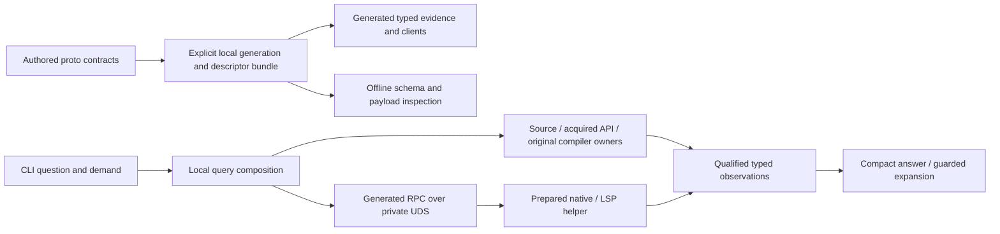

# Protobuf foundations for existing code intelligence

## Judgment and review boundary

**Proposed target:** adopt schema-owned typed evidence, Buffa generated messages/views and
reflection, and ConnectRPC at the existing isolated analysis-helper boundary. Use a coherent
local Buf generation route, selected compiled validation and a separate compact agent-facing
presentation. Source-only work remains in-process. This is a design recommendation, not
implemented or assembled qualification; the release-composition questions below remain explicit.

The reason for this choice is the composed capability: typed consumers, selective observation,
view-based inspection and validation, generated dispatch and useful descriptor-backed tooling.
No speedup is inferred from the codec. Prost/Tonic is the strongest alternative, with simpler
built-in UDS connection metadata but a less direct representation/reflection/validation
composition for the selected target. The installed tool collection is not an adoption bundle.

This integrated second-stage review supersedes the first milestone's documentation handoff;
the exact earlier account is retained in Git at `cc1d99e08`. O01–O08 retain their lineage;
O09–O13 develop related capabilities enabled by the target. The operator explicitly permits
unrestricted breaking changes and selects a hard cutover. Flags, JSON, saved queries and
helper protocols can change together; no compatibility shim or second production path is a
target. Protocols are chosen per boundary rather than imposed universally. Implementation
still follows separate planning/decision routes. Reconsider Plan60 after the foundation is
implemented; this review neither changes its status nor executes its packages.

## Scope, baseline and evidence

Initial inspected baseline: `f78b3a5bb`. Second-stage baseline: `cc1d99e08`, refreshed against
`96d0ff64f` during concurrent documentation publication (no intervening crates diff), including the
operator's moved/new Proto references and concurrent documentation edits visible at entry.
Concurrent plan, lifecycle, environment and register edits were preserved and are not this
review's implementation evidence. No Rust product diff was present at entry.
The delivered CLI and native helper are the subject. Source-only discovery, semantic/native
facts, API refinement, original diagnostics and source proposals are consumers to preserve;
this is not a rewrite of LSP, rustdoc, the compiler or every CLI command.

Criteria are Core3.4, Efficient Architecture1.0 and the pse-arrow binding. Test Assessment1.2
informs independent evidence and Process Simulator1.5 limits interpretation: a transport or
schema cannot establish scientific/model correctness. No broad diagnostic audit or conformance
certification is claimed. AP-04/AP-05 and DP-01–DP-03 favor explicit meaning and owned
construction; AP-07 and heuristics H4/H6/H16/H27 favor removing unnecessary conversions and
coordination while assessing the complete generated and runtime machinery.

**Interface-checked:** current source contracts and the library/tool mechanisms cited below.
The full [ecosystem overview](../libraries/proto/rust_protobuf_ecosystem_overview.md) and
[installed-tool inventory](../libraries/proto/protobuf-grpc-installed-tools.md) informed the inquiry.
The [Prost](../libraries/proto/prost.md) and [Tonic](../libraries/proto/tonic.md) references were read during
preparation and their consequential limits revisited against source and current pins. Context7
supplied discovery; exact release documentation, installed sources and upstream repositories
settled the qualifications identified below. Main-branch documentation is labelled as such.

Executable discovery and selected version/help/build-metadata observations from preparation
establish local availability only. Selected `protoc` reports36.2, `/usr/bin/protoc`3.21.12,
Buf1.75.0, Granc0.7.7 and the three Rust plugins0.5.0/0.5.0/0.4.0. grpcurl's version display
says development build, while embedded Go metadata identifies modulev1.9.4. The JSON Schema
plugin's metadata identifies `github.com/pubg/protoc-gen-jsonschema`v0.8.0. Executable name
and displayed version alone are therefore insufficient identity evidence.

The current source-only `pse search symbol Section --path crates/pse-host/src/semantic.rs
--limit 2 --format human` returned the one guarded declaration, exact count1, complete coverage
and zero failures. This tests only the delivered discovery path. No generator, candidate server, new native preparation, load test, packet capture, collector,
benchmark or product qualification was run. No runtime or context-saving improvement is
Tested or Measured. Source reads through `pse inspect` are inspection evidence only.

## Decision-shaping research results

These qualifications refine the supplied overviews; they are not adoption decisions.

- **Buffa0.9.2:** published archives contain text support and `buffa-descriptor`
  feature-gated `DescriptorPool`, `DynamicMessage` and reflection interfaces. Its package
  README nevertheless says text is unsupported, and default-feature rustdoc hides reflection.
  Reconcile release source, enabled features and generated-code prerequisites; do not infer
  absence or main-only support from those pages. Newer main-guide lazy-view claims still
  need release qualification. Sources: [runtime archive](https://static.crates.io/crates/buffa/buffa-0.9.2.crate),
  [descriptor archive](https://static.crates.io/crates/buffa-descriptor/buffa-descriptor-0.9.2.crate).
- **ConnectRPC0.9.1:** its [released API](https://docs.rs/connectrpc/0.9.1/connectrpc/)
  exposes four RPC shapes and Connect/gRPC/gRPC-Web. Its Buffa representation is a real
  stack choice; a suitable Unix-socket realization remains a question to qualify.
- **prost-protovalidate0.6.0:** released documentation covers both backends, direct
  standard-rule validators, runtime-only rule policy and Buffa `runtime_bridge`. Edition2023
  normalization compensates for prost-reflect0.16's Editions limitation. Buffa's schema
  support therefore does not establish unrestricted composed validation. Investigate bridge
  conversions and `fail_on_runtime_only`: [build API](https://docs.rs/prost-protovalidate-build/0.6.0/prost_protovalidate_build/),
  [runtime API](https://docs.rs/prost-protovalidate/0.6.0/prost_protovalidate/).
- **Rust-first alternatives:** [Tarpc0.38.0](https://docs.rs/crate/tarpc/0.38.0) merits
  a local-RPC account. [proto_rs main](https://github.com/4r33x/proto-rs), manifest0.12.0,
  documents a bundled Tonic patch for its optimized owned route and an upstream buffered
  alternative. That first-stage patch observation was main-source evidence. Second-stage
  research found published proto_rs0.11.26 with upstream Tonic0.14.6 integration; development
  0.12 transport-neutral/owned mechanisms are not selected for this target.
- **Installed generators:** prost/tonic plugins0.5.0 declare0.14-family dependencies;
  generated Tonic code uses `tonic_prost::ProstCodec`. Serde plugin0.4.0 delegates to
  pbjson-build0.8.0, distinct from the overview's0.9.0 family. Insertion-point output needs
  coordinated Prost generation/include order and consistent WKT/extern mappings; separate
  invocations need the documented alternate include arrangement. Runtime compilation remains
  untested. Sources: [Prost plugin](https://docs.rs/protoc-gen-prost/0.5.0/protoc_gen_prost/),
  [Tonic plugin](https://docs.rs/protoc-gen-tonic/0.5.0/protoc_gen_tonic/),
  [Serde plugin](https://docs.rs/protoc-gen-prost-serde/0.4.0/protoc_gen_prost_serde/).
- **JSON Schema:** installed PUBG0.8.0 is not the similarly named chrusty project. Defaults
  differ from ProtoJSON int64 strings. Its presence option also needs source inspection before
  use as an ingress validator: making presence-bearing fields required must not reject valid
  omitted optional fields. An option name is not a conformance guarantee. Source:
  [exact README](https://raw.githubusercontent.com/pubg/protoc-gen-jsonschema/v0.8.0/README.md).

Context7 coverage was uneven: some Rust ConnectRPC/proto_rs/plugin searches returned unrelated
libraries. Primary sources were used rather than inferring capability absence. Two bounded
independent research contributions covered runtime combinations and the installed toolchain;
the coordinator reconciled their qualifications with the code seams below.

## Current responsibilities and useful seams

| Current owner | Observed behavior | Consequence for a foundation change |
| --- | --- | --- |
| `investigation/model.rs` | Typed Request, Truth, guarded references, source contexts and Begin/Source/Result/Diagnostic/Terminal events; serialization-direction Schemars schema | Reuse these distinctions; shared context and stream finality are delivered foundations, not missing features |
| `semantic.rs` | Typed Answer/Failure/context surround category-labelled `Section.evidence: Value`; Reply::Answer carries Value | Normalize consumed meanings where useful while preserving deliberately opaque original backend data |
| `semantic/service.rs` | Authenticated Unix socket, one JSON-line request/reply, cancellation control byte and native settlement acknowledgement | A real local RPC comparison exists today; replacing framing must preserve peer identity and actual CPU completion |
| `semantic/native.rs` and engine/transport | Native snapshot facts and live LSP operations have different contexts and capabilities | Wire uniformity must not invent provider parity or remove native context qualification |
| `api/bridge.rs` | Original artifact/source/Cargo-feature-target qualification before linking API evidence to native context | A descriptor or type URL does not replace this evidence or confer semantic identity |

Paths above are relative to `crates/pse-host/src/`. The enduring owner is
[blueprint §21.7](../authoritative_design/sections/workflows-and-results.md#section-21-7).
Native helper isolation keeps its compatible HIR family separate from ordinary source syntax.
Existing prepared-tool, source, managed-process and completion owners remain relevant whatever
codec wins. This review establishes concrete improvement surfaces, not a finding that every
Value or custom protocol operation is defective.

## O01 — Typed evidence with preserved original observations

**Recommend; realized by the integrated typed-contract target below.** An agent should inspect a reference,
type observation, failure or candidate without interpreting a category string and arbitrary
payload anew. Promote fields that consumers actually interpret into declared evidence kinds;
keep original LSP/rustdoc/compiler data available with its own provider/context meaning.

Compare extending current Rust enums/constructors with Protobuf messages and `oneof` payloads.
Prost maps `oneof` to an optional enum, message presence to Option and enum fields to raw integer
representations. Successful decoding does not establish all required fields, valid contextual
joins or application invariants. Strong Rust types can remain the construction boundary even
if generated transport types are selected. Conversely, intentionally shared generated types
can be appropriate when their semantics fit. Do not add a duplicate domain model by default.

Acceptance in a later implementation would include actual existing semantic and API consumers,
a positive fact, unknown/unavailable evidence, a stale reference and mismatched context. A
rendered type spelling or identical field shape cannot establish identity. This benefits
existing inspection and refinement independently of Plan60's new relationships.

## O02 — Compact answers and progressive inspection

**Recommend independently of binary encoding.** Preserve current shared source/provider context,
bounded demand, payload projection, guarded expansion and terminal coverage. Extend typed
selection into places that still expose whole sections when a consumer needs a few facts.
An agent should obtain a useful compact answer and expand one exact observation with its
premises intact. Do not concatenate complete alternative artifacts to obtain a comparison.

Descriptor-aware projection, Protobuf FieldMask, generated typed views and ordinary Serde views
are candidates. FieldMask supplies paths, not an implementation of semantic query planning;
presence and omitted-versus-default distinctions still need deliberate meaning. Buffa borrowed
views may reduce copying, but a small view can retain a large backing allocation, and lazy
decoding can change validation/error timing. Investigate exact available APIs before selecting.

Binary byte savings and agent-context savings are different claims. To measure the latter,
hold the question, required evidence and rendered format comparable; include coverage and
expansion needed to reach the useful answer. No token SLA or speed claim is established here.

## O03 — Generated communication at the existing local helper boundary

**Recommend generated communication; alternatives were compared below.** Prost/Tonic can supply generated method dispatch,
typed requests/responses and streaming over a local connector. Buffa/ConnectRPC is a competing
stack. Tarpc is a bounded Rust-first comparator; Protobuf messages with retained local transport
separate representation benefits from RPC benefits. Remote deployment is not a prerequisite.

Map any replacement against the existing one-request connection, peer authentication, preparation
identity, cancellation request and settled reply. A gRPC stream reset or dropped Rust future
does not establish that native/Rayon work stopped. Current native_response cancels and retains
the actual CpuTask owner through settlement. Preserve that property with a native integration,
not a second universal task registry. HTTP/2 flow control does not bound producer allocations.

The comparison must show which framing/dispatch/control code disappears and what generated
services, adapters, buffers and lifecycle work replace it. Retain original errors and terminal
facts through the selected protocol. Tarpc's documented cascading cancellation is a relevant
mechanism, not proof of cancellation of separately running CPU work. See
[Tarpc](https://github.com/google/tarpc) and the supplied Tonic §§4–7.

## O04 — One declaration and coherent derived representations

**Recommend scoped authority as selected below.** A field change should have one authored meaning,
with message types, codecs, relevant schemas and documentation following a declared derivation.
Compare schema-first `.proto` ownership, Rust-first generation and selective Protobuf boundary
types against strengthened current Rust/Serde/Schemars ownership.

`prost-build::Config::{compile_fds,extern_path,file_descriptor_set_path}` and generation
attributes can reuse descriptors and compatible external types. Installed protoc plugins offer
another invocation route to these families, not automatically another authority. Buf can
coordinate local plugins; its core local functions do not require hosted registry adoption.
Compare direct build-library generation before adding plugin orchestration. Buf's v2 local
plugin configuration exposes whole-schema versus directory strategies, import/WKT selection
and managed options; these affect meaning and output composition. The Prost0.5 plugin's
`file_descriptor_set` output preserves raw encoded per-module descriptors, including extensions,
but is not automatically a complete transitive descriptor bundle. Compare this with a retained
standard FileDescriptorSet produced by Buf, keeping encoded original metadata where needed.
See [Buf descriptor formats](https://buf.build/docs/reference/descriptors/) and
[generation configuration](https://buf.build/docs/configuration/v2/buf-gen-yaml/).
Choose one owner
for schema dependencies and output publication; Buf, protofetch and protoweld should not each
introduce another resolution or generation layer without a distinct responsibility.

Current Rust output schemas distinguish serialization direction. ProtoJSON has its own enum,
bytes, int64, naming, presence and well-known-type rules. A schema generated from `.proto` need
not describe the existing JSON contract. This question includes public consumers, saved requests,
portable references and native output; a coordinated intentional cutover is legitimate, while
retained artifacts still require their original interpretation. Compatibility tools inform this
decision rather than imposing indefinite internal compatibility.

## O05 — Descriptor inspection and useful discovery without a new registry

**Investigate selectively.** An agent could inspect the exact supported evidence/message shape,
its fields and documented conditions without bespoke catalog code. Static descriptors,
`prost-reflect::DescriptorPool`/`DynamicMessage`, typed ReflectMessage integration and optional
service reflection can serve different parts of this need. Existing parser/Schemars discovery
is the baseline to improve, not something to replace by name alone.

Retain custom options and source information where downstream interpretation needs them;
descriptor loading can discard extensions if the route is wrong. Distinguish message type
identity, descriptor artifact identity and code-analysis world identity. `Any` does not infer
the meaning of an unknown payload, and `Struct` is not a replacement for the typed evidence
model. Runtime reflection earns its cost for a named discovery/projection consumer; statically
known CLI operations may need only generated types and exported descriptor files.

grpcurl can list/describe from a protoset without a running endpoint. Prefer that over creating
a service solely for schema exploration. A hosted schema registry and persistent semantic
index remain separate, unselected decisions.

## O06 — Reuse declarative validation where it removes duplicate rules

**Candidate, not a mandatory validation engine.** Compare generated direct-field validation,
descriptor-based validation and native Rust constructors for local and cross-field constraints.
The current prost-protovalidate project documents both Prost and Buffa backends; this is a
cross-stack comparison axis. Complex CEL rules may require a runtime bridge and additional
evaluation machinery. Qualify exact rule coverage and unsupported behavior before selection.

Schema rules cannot establish source freshness, provider applicability, completed CPU work or
the validity of a cross-artifact API/native association. Keep contextual checks under those
owners. Prefer structurally impossible invalid states where practical, not a second runtime
rule system duplicating a Rust invariant. A later consumer test must challenge absent/default
presence, invalid combinations and unsupported rules; passing a wire decoder is insufficient.
See [implementation and build documentation](https://github.com/zs-dima/prost-protovalidate).

## O07 — External inspection and diagnosis instead of custom tooling

**Recommend reuse during research and future operation.** The installed tools can eliminate
throwaway inspectors and offer independent views of generated contracts. This does not require
wrapping every command in pse or embedding every client's library. Prefer one scriptable client
for routine interrogation, retaining other tools when their distinctive capability helps.

| Tools | Useful role | Limit or selection condition |
| --- | --- | --- |
| Buf build/lint/breaking/generate; protoc | Descriptor/generation experiments and classified schema changes | Formatting/fix modes only in explicitly owned scratch; no blanket no-breaking policy |
| Rust/Serde/JSON Schema/doc plugins | Inspect actual generated representations and publication routes | Output compatibility with chosen runtime/serializer must be checked |
| grpcurl; buf curl; granc | Scriptable schema discovery/invocation, descriptor-file or reflection routes | Current JSON-line semantic socket is not a gRPC endpoint; Granc embedding is a separate choice |
| grpcui; Evans; protolens | Interactive exploration of a question that benefits from it | No interactive-tool requirement for ordinary agent use |
| protoscope; prototext | Inspect field presence, unknown wire data and conversion behavior | Byte preservation does not establish semantic canonicalization |
| protoscan; reproto; sample instantiation | Recover metadata or form examples when originals are unavailable | Reconstructed schemas/samples are not authored authority or independent semantic truth |
| grpc_health_probe | Query a standard service's reported status | Does not independently establish native preparation or drain |
| otelcol-contrib; existing tracing | Inspect selected request/stream outcomes and traces | No collector deployment or new telemetry stack is required merely to assess a codec |
| strace/socat/nghttp; packet/kernel diagnostics | Resolve a specific socket/framing/stall question | Use the relevant owned workload; do not start broad capture/profiling by default |
| hyperfine; ghz; h2load; flamegraph | Named CLI, RPC, HTTP/2 or CPU measurements | Their workloads and claims differ; no mandatory benchmark campaign |
| Go/C++ message and RPC generators | Optional independent interoperability challenge | No new production language; compiler/runtime pairing matters |
| gateway/OpenAPI generators | Conditional external/browser interface study | No current requirement for a gateway, REST service or second public API |

Use the repository environment/ownership routes for actual workloads. Preserve its pinned Rust
toolchain even though stable Rust is installed. Tool availability reduces setup work; it does
not authorize broad captures, service startup, publication or tool upgrades. No new diagnostic
framework or receipts ledger is proposed.

## O08 — Explicit generation and evolution without development blockers

**Recommend as a target property.** One selected derivation should reproduce outputs from
authored inputs, generator settings and exact tool/runtime families. Buf lint/breaking and
native compilation can expose different failures; neither establishes the meaning of every
generated view. Reuse current codegen/publication owners and delete replaced code/callers/tests
when the selected replacement is exercised. Do not retain a second production path as evidence.

Distinguish source compatibility, wire compatibility, JSON compatibility and retained-evidence
interpretation. Ordinary development can use coordinated rebuild/cutover where no independent
reader requires coexistence. A new wire format does not create a requirement for durable
recovery, hosted distribution or rolling upgrades. Protocol bytes are not automatically
canonical; continue to define what content identities actually claim.

## Complete alternatives considered

| Alternative | Potential value for today's tooling | Residual questions before selection |
| --- | --- | --- |
| Strengthen current Rust/Serde/Schemars | Typed consumed payloads and compact views while retaining current owners | Can it also simplify communication sufficiently? Which generic transport code remains justified? |
| Protobuf data contract, current local transport | Generated message/descriptor ecosystem without HTTP/2 lifecycle | Does the codec/generation benefit exceed conversion work? What framing remains? |
| Prost/Tonic with selected companions | Established generated messages/RPC and standard external inspection | Actual deletion of custom machinery, exact JSON contract, cancellation acknowledgement and peer authentication |
| Buffa/ConnectRPC | Competing owned/borrowed representations and service/protocol composition | Exact released reflection/text/view support, local transport and full integration lifecycle |
| Rust-first proto_rs or Tarpc | Keep Rust declarations primary while generating schemas or local RPC | Published generation semantics, interoperability and patch requirements; preserve typed meaning rather than derive a second editable contract |

These are considered alternatives, not a request for five implementations or exhaustive cross-product
benchmarks. Narrow using documented semantics first. A small probe is justified only where an
unsettled fact changes the decision. Additional protocols, Editions, zero-copy and unknown-field
preservation are useful capabilities to assess, not automatic requirements for this system.

The provisional interaction is: agent request → validated question/demand → original provider
owner → typed consumed observations plus qualified original evidence → compact answer and
guarded expansion. The helper crossing may use generated RPC; source-only operations remain
local and usable without preparing it. Facts/context, transfer and presentation have different
responsibilities. This sketch selects no new service, persistent store or universal graph.

## Detailed research inputs

The following first-stage briefs were supplied and consumed in the second-stage inquiry.
They remain a useful capability map, not outstanding commissioning obligations. Concrete
research conclusions and the target below replace the earlier stop at this handoff.

| Priority and brief | Coverage requested | Decision unlocked |
| --- | --- | --- |
| First — Buffa family | buffa, buffa-build, buffa-codegen/protoc-gen-buffa, buffa-types and buffa-descriptor: exact owned/borrowed APIs, reflection/text/JSON, presence, unknown fields, Editions, decode limits, view lifetimes and released versus main-only features | Whether representation/preservation benefits change the preferred foundation |
| First — ConnectRPC Rust | connectrpc/build, connectrpc-health and connectrpc-reflection, structured errors, Buffa coupling, supported transports, Unix/custom connection route, streaming, cancellation, shutdown, middleware and conformance limits | Whether this is a complete local-helper alternative to Tonic |
| First — Rust-first contracts | proto_rs message/service/schema generation and supported upstream/patched Tonic routes; separate short Tarpc local-RPC/transport account | Choice of declaration authority and whether HTTP/2/Protobuf RPC is necessary |
| First — Reflection and JSON | prost-reflect/build plus pbjson/build/types, their exact family compatibility, dynamic versus static APIs, extensions/source info, WKT mapping and JSON presence/int64/bytes/enums | What can be generated/shared without changing or duplicating current JSON meaning |
| First — Validation | prost-protovalidate runtime/build/types, Prost/Buffa support, direct rules versus CEL/runtime bridge, unsupported behavior, constraints and structured violations | Whether declarative validation removes real duplicated policy |
| First — Compilation/orchestration | protox, protoc and Buf local commands/plugins/images, compiler parity, imported/custom options and source locations; contrast protofetch/protoweld only where distinct | One coherent schema dependency/compiler/generation route |
| First — Installed generator family | Exact protoc-gen-prost/tonic/serde/crate versions/options/output layout/runtime bridge; PUBG JSON Schema plugin and protoc-gen-doc semantics | Compatibility and publication choices that can invalidate a superficially simple stack |
| Supporting — Local RPC and diagnostics | Focused Tower/Tokio/Bytes integration, peer identity, stream/lifecycle behavior, grpcurl/buf curl/granc capabilities, relevant upstream conformance facilities | What generic machinery is delegated and how independent inspection works |

Every brief should provide project/release identity, concrete APIs/commands, composition and
type-family requirements, ownership/allocation behavior, unsupported cases, primary references
and meaningful alternatives. Do not call a library absent merely because Context7 lacks it.
Do not convert current main documentation into a released capability claim. Runtime library
and command-line wrapper compatibility need separate treatment; a plugin's version is not the
version of every library resolved into its executable.

### Screened and conditional coverage

Keep Google protobuf4 and official grpc on a bounded current-status screen; do not confuse
protobuf4 with rust-protobuf3 under the same crate name. Deepen if their distinct runtime or
interoperability properties change the shortlist. Keep quick-protobuf, pbrs, Bilrost and other
codecs as landscape alternatives; Bilrost's lack of Protobuf wire compatibility is a material
choice, not a licensing rejection. Investigate wire-forensics libraries such as protofish and
protobin only if a diagnostic consumer needs them. Tree-sitter proto/textproto belongs in the
deep queue if schema-source search/editing becomes a selected capability; resolved descriptors
and source syntax are complementary, not interchangeable.

Defer hosted schema registries/Kafka adapters, xDS/mesh, REST/browser gateways, TLS-specific
deployment and dedicated telemetry wrappers until their own consumer or failure boundary earns
them. Local Buf use does not require BSR adoption. A local deployment still needs its actual
concurrency and identity semantics, but not every distributed-system mechanism.

## Later discriminating evidence and rule impacts

After documentation arrives, select revealing existing journeys: source discovery→inspection,
semantic facts→guarded expansion, API→contextual refinement, original compiler error→source,
source-bound proposal, and incremental results→terminal completion. Include missing capability,
unknown versus negative evidence, same-spelled unrelated identity, stale source/context,
unusual path bytes, invalid field combinations and consumer closure during native work.

For generation, qualify outputs against the selected runtime and actual serializer on known
presence, int64, enum, WKT and unknown-field cases. Independent Go/C++ or upstream conformance
can challenge a specific interoperability claim; generator round trips sharing one model do
not establish independent semantic correctness. Keep binary/ProtoJSON/validation/RPC conformance
claims separate. No future acceptance is supplied by this first-milestone source inspection.

Potential rule impacts are **Proposed**, not operator-approved: RC01 would choose the governing
declaration/derivation and possibly change current schema-publication meaning; RC02 would choose
a helper protocol/control realization within blueprint §21.7; RC03 would classify consumer and
retained-artifact compatibility and any intentional cutover. Their exact scope depends on the
chosen design. Later plan creation obtains operator disposition and follows the applicable
ADR/design route. This functional review does not substitute for a required formal design review.

## Integrated target and selected composition

The target has five responsibilities: authored evidence/service contracts; original source and
analysis providers; typed observation construction and contextual qualification; generated
boundary transport; and question-shaped presentation/inspection. These are responsibilities,
not a requirement for five crates, services or materializations.

| Role | Selected mechanism and boundary | Why it earns its place |
| --- | --- | --- |
| Contract | Authored `.proto` for the evidence/query/control crossing, generated Buffa types | One wire meaning; avoid handwritten parallel JSON/Rust/Proto models |
| Representation | Owned messages by default; eager `MessageView`/`OwnedView` and `ViewEncode` where selected access/lifetime benefits exist | Supports selective consumption without requiring a dynamic tree or forced owned hydration everywhere |
| Reflection | Shared immutable descriptor bundle; Buffa static/view reflection where release-qualified; DynamicMessage for genuinely dynamic payloads | A generic inspector can serve typed evidence without replacing native semantic identity |
| Local RPC | ConnectRPC generated handlers/client; gRPC binary over HTTP/2 on authenticated UDS | Delegate framing, dispatch and streaming while preserving existing helper isolation |
| Validation | Rust construction for domain/context invariants; dedicated protovalidate-buffa generated rules for selected boundary constraints | Compile supported rules on owned/view representations without an automatic interpreter bridge |
| Generation | Buf local generation with exact selected generators and one complete descriptor artifact through current explicit codegen owner | Coordinate multiple derived outputs; no routine generation on help/read/launch |
| Presentation | Typed semantic views rendered to compact human/JSON/NDJSON output | Binary encoding and full ProtoJSON are not the agent interaction design |
| Diagnosis | Offline descriptors and grpcurl/buf curl; selected framework middleware plus existing tracing | Reuse inspection machinery without a second RPC registry or telemetry system |

The candidate release set is Buffa0.9.2, ConnectRPC0.9.1 with compatible0.9 generation
companions, and protovalidate-buffa0.7.2 with its matching generator. This names a researched
composition, not a compiled lockfile or authorization to bump unrelated dependency families.
Select exact compatible generator/runtime features during planning; their independent version
numbers do not prove assembled compatibility.

Decisive source references include [Buffa's tagged build API](https://raw.githubusercontent.com/anthropics/buffa/v0.9.2/buffa-build/src/lib.rs),
[ConnectRPC's exact release archive](https://static.crates.io/crates/connectrpc/connectrpc-0.9.1.crate)
and [tagged hosting guide](https://github.com/connectrpc/connect-rust/blob/v0.9.1/docs/guide.md),
plus the [dedicated validator's tagged documentation](https://raw.githubusercontent.com/mathematic-inc/protovalidate-buffa/v0.7.2/README.md).
The latter is distinct from the Prost validator bridge considered in the first milestone.

Native HIR, AST, rustdoc and compiler formats remain authoritative at their native scopes.
Normalize meaning that callers consume; retain opaque original evidence deliberately. For
example, current `composition::predicate_truth` searches JSON sections for category
`predicate_evaluation` and accepts a boolean or `holds` subtree. Replace that interpreted
agreement with one typed predicate outcome and explicit uncertainty. Do not convert arbitrary
native backend JSON into generic `Struct` and claim the semantic problem is solved.

Use structured types for facts but do not recursively serialize every HIR Type as a universal
Rust type algebra. A fact can carry scoped native identity, classification, supported structure
and an expansion reference. HIR handles/binders stay in their world; rustdoc IDs stay in their
original artifact. Original versus adjusted type, explicit call versus reference usage, macro
source fallback versus exact origin, and unknown versus contradiction remain visible. The
HIR §§2/4/5 and rustdoc-types §§1–2 references explain these distinctions. No formatter, Protobuf
enum or descriptor pool proves generic applicability, runtime reachability or scientific truth.

### Query, output and inspection contracts

Keep source universe, contextual predicates, answer demand and presentation distinct. Demand
can specify existence, limited results, counts or stable continuation; projection names useful
evidence roles rather than arbitrary JSON paths. Context and source declarations are shared
within an answer, and guarded references can expand a chosen fact later. A complete result
record remains indivisible. Omission, unknown and actual terminal settlement survive projection.
Do not promise exact totals for an early-stop question or perform expensive full analysis just
because a transport offers server streaming.

Retain native Serde/Schemars for deliberate CLI presentation views, including serialization-
direction schemas reflecting actual fields/budgets. A generic Protobuf JSON Schema generator
does not replace that owner. Existing product registry declarations retain their authority;
derive `.proto` if it is another representation of an already declared product meaning.
New code-intelligence wire-only messages/services may be authored directly in `.proto`.

Use schema-aware validation/help to explain supported inputs, effective query and provider
requirements. Generate only the mechanical parts of discovery; handwritten examples still
explain useful questions. Standard ProtoJSON is an optional interchange view with qualified
WKT behavior, not a forced human/agent format. Retire old JSON shapes rather than maintain
adapters indefinitely. Preserve original acquired evidence with explicit format/version
meaning where needed; no current data deletion or retrospective relabelling is authorized.

### Local helper lifecycle and control

Retain explicit preparation and the existing managed helper; do not introduce a second universal
daemon or move source reads across RPC. Carry transport-derived peer credentials into typed
request context. Authenticate the actual prepared helper process on the client side as today,
not merely the same UID or a claimed header. Exact ConnectRPC0.9.1 client source supplies
Http2Connection::connect_with_connector and Unix convenience methods. Use the custom connector
to authenticate the server before HTTP/2 handshake and on reconnect. The tagged server uses
TCP; UDS requires the documented custom Hyper hosting path for ConnectRpcService. The new
local-RPC overview's framework Server::serve_connection claim is not established for that
release and must not hide this work. Derive peer context explicitly in the accepted Unix
connection. This hosting/shutdown integration is a real cost relative to Tonic's UdsConnectInfo,
accepted here for the selected representation/reflection capability, not presumed to disappear.

Use one bidirectional query conversation carrying typed Start/Cancel control and streamed
observations plus a terminal summary. Cancellation requests cooperative cancellation of that operation;
the original work owner remains until joined. A transport reset/disconnect stops admission and
requests cancellation, but cannot itself certify completion. A terminal acknowledgement is
emitted only after native settlement; if delivery is lost, the client reports completion as
unobserved. Preserve request-group isolation so cancellation cannot terminate a sibling or the
prepared world. This does not require durable operation history or resumable distributed jobs.

This preserves a conversation-local control/completion owner without a separate cross-request
cancellation lookup registry. Unary operations suffice for status, package context and
capability/descriptor inspection. Existing
CPU/Rayon/native ownership remains the completion authority. Library stream limits and HTTP/2
flow control do not replace application demand, bounded producer queues or actual task joins.

### Generation and validation choices

Produce one complete, source-qualified descriptor bundle, generated message/service code and
selected validators under the existing explicit generator workflow. Preserve original encoded
options/source information before consumers decode/re-encode them. Reject conflicting logical
filenames before building pools; a loader that skips duplicate filenames is not an update or
schema-conflict policy. Share compatible immutable pools, with identity bound to the actual
descriptor artifact, not just a package name. Generated origin should name the authored schema
and generation inputs.

Select `protovalidate-buffa` together with its plugin/macros only for constraints that actually
belong at the boundary. Its `Validate` trait is distinct from prost-protovalidate's. Request
validation macros do not establish response or per-stream-item validation automatically.
Preserve violation paths and distinguish invalid data, rule compilation failure and evaluator
failure. Native context/freshness and invariant-rich construction remain Rust responsibilities.
Avoid using CEL to restate ordinary type-enforced invariants. Dynamic validation remains a
conditional need for genuinely runtime-acquired schemas, not a default engine for every call.

Do not add protox to the generation pipeline if Buf already supplies that compilation step.
Use protox's Compiler/FileResolver only if source-schema investigation needs in-process import
resolution/diagnostics over supplied inputs; that is a separate consumer, not a second build
authority. Do not adopt prost-wkt/pbjson alongside Buffa merely because they were in the initial
shortlist. Keep existing unrelated Prost/Tonic uses outside this code-intelligence cutover.

## O09 — Schema and generated-Rust contract investigation

**Recommend as an integrated extension.** Extend existing search/inspect to browse message,
field, oneof, enum, service-method, constraint and import relationships from acquired descriptors.
Connect a generated Rust declaration to its authored schema/source information where declared.
An agent changing a result field can inspect its meaning, generated consumers and compatibility
impact without searching several independent catalogs. Use descriptor identity plus field
number/qualified declaration as scoped addresses; an HIR relation requires its own resolved
evidence. SourceCodeInfo nominates source locations, not arbitrary exact byte spans.

Reuse current source/generated-origin and query machinery. A graph-shaped answer is a compact
view of the question, not a persistent universal schema/Rust graph. Demonstrate a field rename,
unchanged field number, generated source link and a same-named field in a different descriptor
bundle. Unavailable source/semantic context remains unknown rather than guessed ownership.

## O10 — Payload explanation and constrained previews

**Recommend for actual evidence/request types.** A developer should inspect a retained message
or request using its exact schema, understand presence/defaults and named violations, and obtain
a focused view without another bespoke pretty-printer. Static/view reflection handles known
contracts; dynamic messages handle explicitly acquired unknown contracts. Preserve binary
originals where exact replay is the claim. Protoscope/grpcurl remain useful external companions.

Do not infer a schema from arbitrary bytes as authoritative or automatically invoke a decoded
method. Preview validation is passive and preserves malformed/partial evidence as such. Include
absent optional fields, unknown enums, unsupported payload types, invalid ranges and JSON WKT
cases. Lazy views are conditional: their deferred errors, repeated decoding and reflection/
OwnedView restrictions must not silently weaken the eager inspection contract.

## O11 — Contract-aware comparison and change previews

**Recommend.** Combine existing source/API comparisons with descriptor differences and generated
origin, showing field/type/presence/constraint and RPC-shape changes. Classify binary, JSON,
Rust-source and semantic changes separately. Buf breaking supplies native schema checks but
does not decide whether an intentional break is acceptable in this design phase. An unchanged
wire field number cannot prove unchanged validation or code-analysis meaning.

Expose the affected generated contracts and nominated consumers through normal inspection.
Actual Rust use still needs original HIR/artifact qualification. Include a wire-safe rename
that changes JSON, a constraint-only change and a cfg-only Rust-context change. This is a
useful current-tooling workflow; it does not execute Plan60's broader planned comparisons.

## O12 — Typed query diagnostics and operation observation

**Recommend selectively.** Show which original phase rejected a query: schema decoding, local
constraint, source/context admission, provider execution, or delivery. Include useful field or
source locations and a corrective action through the existing diagnostic owner. Generated RPC
method metadata can identify operations without reparsing paths; typed payload interception can
reuse decoded facts rather than repeatedly translating JSON.

Keep transport admission ahead of expensive processing where supported. Released middleware
may run after body reading/decompression; establishment-time interception is not per-stream-item
validation. Preserve actual native causes and terminal status; HTTP200 alone is not RPC success.
Use existing tracing and optional Collector for a concrete investigation. Do not emit full
payloads or add per-fact spans merely because metadata is available. A source-only query must
not require a telemetry service.

## O13 — Reusable batch and typed-client access

**Recommend a minimal reusable surface, conditional deployment.** The generated operation
contract should support a typed caller and batch-shaped query intent without making callers
coordinate one process request per fact. Local CLI and helper use this surface first. Keep
request-local provider/preparation reuse and allow progressive results with meaningful frontiers.
Do not confuse one HTTP request containing scalar loops with co-designed native bulk work.

Independent clients and future GUI adapters can reuse this contract without inheriting CLI
rendering. Remote listeners, browser gateways, hosted registries, durable sessions and universal
dynamic invocation remain separate decisions. grpcurl/buf curl often suffice for occasional
developer-service interrogation; embedded granc-core needs a real product workflow, and its
shared Tonic ancestry is not full implementation independence.

## Alternatives, material uncertainties and cutover

Buffa/ConnectRPC is preferred for the selected composition of eager views, reflection and
generated validation; this is not a claim that multiple protocols or zero-copy alone justify
it. Prost/Tonic remains a serious alternative: built-in UdsConnectInfo, mature typed dispatch
and the already pinned runtime family reduce integration uncertainty. Prefer it instead if the
chosen Buffa/ConnectRPC release cannot realize authenticated UDS, preserved terminal semantics
and the representation/validation composition without substantial bridging. Do not silently
fall back at runtime; an alternative selection changes the reviewed design coherently.

Rust-first proto_rs offers valuable generated projections but introduces a second mapping
surface and version-sensitive transport integration for this target. Tarpc simplifies local
Rust RPC but does not supply the selected portable descriptor/schema tooling. Retaining JSON
transport after strengthening types is the least disruptive alternative; it retains framing
and generic-payload conventions that the generated boundary is intended to remove. None is
rejected for licensing or because a consumer is not yet implemented.

| Question | Evidence needed before the dependent implementation | Consequence if not established |
| --- | --- | --- |
| Exact Buffa/ConnectRPC/validator release composition | Compatible generated APIs and required view/reflection/validation features in one resolved family; do not attribute current-main examples to older releases | Choose a coherent exact family or revise the preferred stack; no compatibility shim |
| UDS framework and client path | Exact released custom-connection APIs, original peer authentication and cancellation/CPU-settlement journey | Reassess transport selection, not helper custody guarantees |
| ProtoJSON and schema output | Known optional/default/int64/enum/Any/FieldMask cases against selected serializer and schema consumer | Use typed presentation or qualified dynamic JSON; do not claim blanket ProtoJSON conformance |
| Compiled constraints | Selected rule coverage and actual request/view/stream handling with complete error categories | Keep a native checked operation or explicitly supported rule scope, not silently ignored constraints |
| Descriptor source locations and conflicts | Complete bundle identity, extension preservation and declared source mapping | Unknown provenance remains explicit; no fabricated cross-language identity |

These are bounded integration questions, not a new requirement to prototype every alternative
or conduct a benchmark campaign. An upstream conformance result supplies its actual protocol/
release coverage, not qualification of this assembled application. No candidate server was
compiled or exercised during this review.

Independent advice was not unanimous about stack choice. The tooling researcher preferred
Prost/Tonic for its existing native schema fit and simpler UDS integration; the runtime
researcher preferred Buffa/ConnectRPC for shared representations/reflection/compiled validation.
The independent design challenge agreed on typed evidence and local schema/payload investigation,
and required explicit accounting of custom UDS hosting and a genuine reflective consumer.
The coordinator selects Buffa/ConnectRPC because O09/O10 and typed projection use that composed
representation capability, while retaining Schemars/native presentation and charging the UDS
integration cost explicitly. If planning demonstrates those consumers still require repeated
owned/dynamic conversion, the stated advantage fails and the choice must be reconsidered.

The hard cutover should first establish the authored contracts and complete generation, then
migrate actual evidence producers/consumers and helper control through one integrated target.
Replace category-sensitive predicate/refinement parsing with typed operations; remove the
JSON-line transport/control byte and their mechanism-only tests when generated RPC consumers
pass the relevant lifecycle tests. Migrate search/inspect/propose rendering, saved queries,
schemas/help/examples and skill consumers together. Preserve useful scientific/provider
acceptance at the new callers rather than port old transport tests mechanically.

Do not launch a compatibility listener or retain old JSON decoders for convenience. Deliberately
rebuild derived preparation/artifacts where appropriate, and classify any uniquely authored
inputs or retained evidence before changing their interpretation. A hard cutover is not data
deletion authorization. Existing non-code-intelligence CLI and third-party scientific owners
remain outside the replacement footprint unless a concrete shared consumer needs migration.

## Decisions, coverage and next work

O01–O08 are retained, sharpened foundation opportunities; O09–O13 are selected related target
capabilities. The earlier documentation briefs are now inputs, not an outstanding first-stage
gate. Final planning should schedule source/provider/output consumers together and name the
single owners of declaration, validation, context qualification, generation and native drain.

The operator's breaking-change/hard-cutover direction is recorded. RC01–RC03 above remain
concrete decision-route work for the selected contract, transport and retained-evidence scope;
permission to break interfaces does not itself accept an ADR or amend blueprint §21.7. A formal
review required by the selected architectural change remains separate from this functional
judgment. Plan60 is revisited after implementation, not used as a compatibility constraint.

Research coverage: the eight new detailed Proto documents were read end to end across two
bounded research contexts (4,602 and 4,088 lines, truncated ranges recovered); original Prost/Tonic and ecosystem/tool references
were consumed in this engagement and preparation. Relevant HIR identity/type/macro and rustdoc
identity documentation, current query/demand, helper settlement and API qualification sources
ground the target. No fresh full compiler-internals campaign or whole-codebase audit is claimed.
Current source-discovery observations do not qualify the proposed native or RPC interfaces.

The next deliverable is an implementation plan for this reviewed foundation and its selected
related capabilities, with the material release/API questions resolved before dependent work.
All new capability, complexity-reduction and context-efficiency benefits remain Proposed;
measured latency, memory and agent-token savings remain unestablished.
