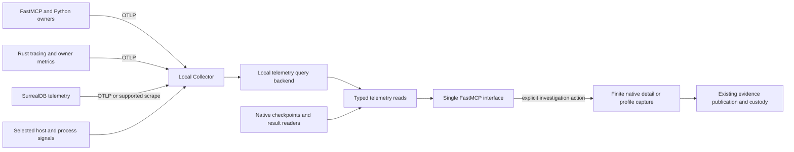

# OpenTelemetry, native observability and agent capabilities

## Recommended direction

**Proposed:** make OpenTelemetry the shared instrumentation, propagation and transport
foundation for operational insight across FastMCP, Python tooling, Rust execution and
SurrealDB. Give agents useful, structured access to that information through the existing
single FastMCP endpoint. Improve instrumentation at the performing owners so the same
information serves MCP, CLI, Python and native consumers.

The maintainer's premise is compelling: many difficult agent interactions concern missing
or hard-to-connect information rather than missing commands. Standard telemetry can supply
cross-component traces, correlated diagnostic events, historical operational distributions
and collection-health information. Combining these with existing native readers can explain
what a request caused, where time went, what remains active and what evidence is unavailable.

The recommended local architecture is **an explicitly configured, persistent Collector and
query backend, ordinary low-cardinality metrics and selected tracing, plus existing finite
native detail/profile capture**. OpenObserve OSS is the preferred first backend realization
for its native local deployment and usable SQL/PromQL interfaces. A disposable native probe
established actual retrieval, while also revealing mapping and semantic limitations. SigNoz
is a substantive alternative if structural trace queries and integrated APM become central;
Grafana's specialized stack is attractive when TraceQL and profiling dominate. Backend
selection should preserve these differences rather than hide them behind a universal query
abstraction.

Keep native operation state, source coverage, scientific outcomes, admission, cancellation,
settlement and drain at their current owners. These are useful domain capabilities to join
with telemetry. Their stronger semantics do not follow from recording a span or receiving
an OTLP acknowledgement. Conversely, current custom transport/capture mechanisms are not
automatically permanent: replace generic machinery when a standard realization preserves
its consumed contract.

This is a **functional-extension review with explicit design assessment**, not a diagnostic
audit, production deployment, implementation plan or completion claim for Plan52. All
opportunities and rule impacts below are proposals. Developer/agent workflows on the sole
operator's workstation are primary; related product, operator and research capabilities are
included. No semantic search, separate developer MCP or Docker dependency is proposed.

## Source basis and evidence

The inspected implementation baseline is `640035fbf7c840f05d1fa82eb4b67b57244efa80` on
`main`. Pre-existing dirty changes to Rust-build reviews and their indexes were preserved.
The user-supplied OpenTelemetry references were untracked inputs. No production source,
dependency declaration, lockfile, service configuration or existing plan was changed.
The publishing commit is distinct from this implementation baseline.

The review preparation read both supplied OpenTelemetry references and the FastMCP
reference end to end. Review investigation used version-specific Context7, primary
documentation, downloaded released crate source, installed Python source and representative
repository owners. Source/version checks matter: older indexed fork advice and specification
proposals were not treated as current SDK behavior.

The selected standard is Core 3.4, Efficient Architecture Heuristics 1.0, Process Simulator
1.5 and the pse-arrow binding in `standard.toml`. The test-assessment companion informs
test/build opportunities and probe proportionality. Blueprint §23.1/§23.2, §19.2 and
§21.1 remain relevant owners. No living diagnostic audit was refreshed, and no numerical
method, physical model or scientific acceptance rule was reassessed.

### Existing capabilities that change the starting point

**Interface-checked:** source inspection establishes the following integration foundations.
This is representative coverage, not an audit of every producer or entry point.

| Current owner | Useful existing capability | Consequence for the target |
| --- | --- | --- |
| `pse-diagnostics::observation` and its producer module | Process-scoped operation/producer IDs, poll-scoped native context, phases, coherent facts, counters, generations, relationships and coverage | Reuse their meanings and IDs; do not reconstruct them from span names |
| Runtime observation/detail and tooling inspection | Passive checkpoints, actual process/thread identity, source activation, native detail, retained reads and explicit losses | Preserve live diagnosis when exporters or backends fail |
| Runtime capture and `CaptureLayer` | Caller-composed `tracing_subscriber::Layer`, bounded nonblocking span/event capture, Perfetto/CPU/offline investigation | Compose export layers and assess selective replacement by capability |
| Modeling/compiler/math/native/engine owners | Preparation, materialization, native admission/work/drain and DataFusion tracing | Much useful instrumentation already exists; coverage and context need reconciliation |
| Canonical store and durable studies | Original deadlines, request ownership, dispatch uncertainty, attempts, leases, terminal records and settlement | Explain their lifecycle without moving its authority to telemetry |
| Python capability observation and progress | Recording trace IDs, loaded-source correlation, native references and bounded progress | Enrich framework spans and keep authentic reader references |
| FastMCP 4.1.3 / MCP 2.3.0 | Protocol/client/server/provider spans and request-context propagation | Reuse native instrumentation rather than add a competing middleware hierarchy |
| SurrealDB telemetry tools | Finite selected-server OTLP capture and server/module investigation | Retain finite investigations while adding continuous collection/query where valuable |
| Test/build/evidence/pressure tools | Structured invocation records, compiler diagnostics, stage results, environment and cgroup facts | Export useful projections; original evidence and identities remain inspectable |

The root Cargo manifest and lockfile have `tracing` 0.1.44 and existing subscriber/capture
dependencies, but no resolved application OpenTelemetry bridge/exporter. Python has API
1.45.1 and SDK 1.45.1 in the inquiry group; ordinary serving configures no SDK/exporter.
Installation is not activation. The existing Plan52o inquiry demonstrated in-memory FastMCP
spans and a Python fixture child, not production-helper, Rust or database continuity.

### New bounded inquiries

**Tested — isolated Python SDK behavior:**

```bash
scripts/pse-env -- timeout 15s .venv/bin/python -m scripts.tests.opentelemetry_sdk_inquiry --output build/otel-review/sdk-qualified/results.json
```

The [retained manual driver](https://github.com/paul-heyse/pse-arrow/blob/6d5e5d273b807e3e8f59278115ec5a6929a86301/scripts/tests/opentelemetry_sdk_inquiry.py) and
[captured result](probes/opentelemetry-sdk-2026-10-24.json) cover API/SDK 1.45.1 only.
Three measurements with distinct detail labels became two stage histogram series through
`View.attribute_keys`; count, sum, min/max and explicit buckets matched the fixture.
`AlwaysRecordSampler(ALWAYS_OFF)` supplied a RECORD_ONLY span to a local processor while
ordinary export and trace-based exemplars remained empty. The sampled comparison exported
one span and produced a matching exemplar. A rejecting exporter rejected its span while
`otel.sdk.processor.span.processed` increased and `force_flush()` returned true. Baseline
zero: no assertion failures. No product import, endpoint, network exporter or native work.

**Tested — disposable native backend retrieval:**

```bash
scripts/pse-env -- .venv/bin/python -m scripts.tests.opentelemetry_query_inquiry --output build/otel-review/openobserve-qualified
```

The [retained manual driver](https://github.com/paul-heyse/pse-arrow/blob/6d5e5d273b807e3e8f59278115ec5a6929a86301/scripts/tests/opentelemetry_query_inquiry.py) downloads the exact OpenObserve
OSS 1.1.2 native archive into temporary storage, binds loopback listeners, uses generated
fixture credentials and sends synthetic OTLP JSON. Its [captured result](probes/opentelemetry-query-2026-10-24.json)
records the archive digest, responses and cleanup. Five distinct spans were retrieved in
2/2/1 SQL pages; a separate count returned five. Parent references, a correlated classified
log, four cumulative counter snapshots including a reset, histogram queries and exemplar IDs
were retained. The exact child exited zero after termination and temporary state was removed.

The initial inquiry checked the returned population; fixture-semantic assertions were then
added, checked against saved replies, and exercised in the final fresh disposable run.
They check ingest responses, unique
span/parent/operation/process identities, the count, log correlation, SQL counter/reset
representation, nonempty PromQL results and exemplar pointers. Baseline zero: no assertion
failures. The final result comes from that strengthened live driver.

Important observed limits prevent overstating the backend result:

- `service.instance.id` became `service_service_instance_id` in traces and
  `service_instance_id` in logs/metrics. Trace parent fields became
  `reference_parent_span_id` / `reference_parent_trace_id`.
- Search response `total` was page-local: 2/2/1. The first response did not advertise the
  whole trace population. Concurrent ingestion and equal-sort-key pagination were not tested.
- SQL retained each counter point's original/reset start timestamp. PromQL returned the
  latest `start_time` label across historical points; that label is not per-point provenance.
- `increase` is extrapolated and histogram quantiles interpolate buckets. Neither is an
  exact count or raw-observation percentile. No independent general PromQL oracle was run.
- The exemplar pointer appeared on every histogram bucket, including a bucket below its
  value. This establishes pointer retention, not bucket-consistent attribution. Fixture
  exemplar times also precede their referenced trace: ID equality is not demonstrated
  measurement-to-contributing-execution causality.

No Collector, application SDK network exporter, real Rust/database propagation, backend
restart/crash recovery, retention behavior, assembled FastMCP telemetry query or performance
campaign was exercised. There is no latency, overhead, capacity or productivity claim.

## Target architecture and semantic model

**Proposed:** use a small explicit model of operations, observations and their relationships,
with library mechanisms supplying collection and transport. Avoid a universal telemetry
ontology, a second execution ledger or a bespoke query language.



The Collector's role is useful here beyond forwarding: shared transport policy, normalization,
filtering, queueing, infrastructure observations and pipeline health. It should not interpret
scientific success or recreate native scheduling. OpenObserve supplies the preferred first
query realization; the semantic boundary is the consumed retrieval capability, not a promise
that all backends support identical questions.

| Distinction | Target meaning and ownership |
| --- | --- |
| Entity/revision/run/attempt/operation | Existing domain and execution owners; associated explicitly with telemetry |
| Process/service incarnation | Actual process instance, version and checkout/build association; PID or service name alone is insufficient |
| Trace/span | Diagnostic execution context; one native operation can span several requests or attempts |
| Parent versus link versus shared ID | Propagated causal parentage, explicit asynchronous/fan-in relation, and association are different |
| Instrumentation scope | Producer library/module and version, distinct from service/process identity |
| Metric population | Defined event/stage population, units, aggregation and reset semantics; not an arbitrary set of spans |
| Native outcome versus span status | Scientific/controller meaning versus telemetry's coarse diagnostic status |
| Native coverage versus delivery | Source activation/observed detail versus SDK/Collector/backend processing and availability |
| Query/evidence interval | Supplied interval, source clocks, retrieval time, retention and partiality; a composed read is not an atomic cross-source snapshot |

Keep IDs needed for exact investigation in spans, logs and evidence references. Ordinary
metric dimensions should use bounded declared classes such as operation family, stage,
provider class, package and outcome category. Unique requests, cases, model objects, paths
and trace IDs do not belong in ordinary metric labels. Service/process resources and their
promotion into metric labels also need deliberate selection.

Use one process-composition owner for providers, configuration and shutdown. Rust and
Python each have their own SDK state when embedded together; bridge context deliberately
and identify their actual process relationship. Do not install a global subscriber per
Runtime, MCP server instance or tool call. Libraries expose instrumentation and optional
composition seams, while executable/host owners select export policy.

## Opportunities

All opportunities below are **Proposed**. Mechanisms identified as available are
**Interface-checked** unless the bounded inquiry above explicitly establishes more.

<a id="O01"></a>
### O01 — One inspectable telemetry bootstrap per process

Give agents an exact account of enabled signals, selected resources, instrumentation scopes,
filters, sampler, reader/exporter configuration and lifecycle owner. Reuse standard `OTEL_*`
settings and SDK builders, deriving launch settings through the existing environment owner.
Initialize before FastMCP construction or native work; own shutdown explicitly.

For Rust, compose `OpenTelemetryLayer` with the existing subscriber and selected capture
layers. `OpenTelemetryTracingBridge` supplies logs, not trace spans. For Python, retain
API-only instrumentation in libraries and configure providers at executable entry points.
Keep `FASTMCP_TELEMETRY_MODE=native` unless another deliberate owner supplies that same
protocol hierarchy; use `propagation_only` or scoped suppression for that specific overlap.

Python's experimental `opentelemetry-configuration` and `OTEL_CONFIG_FILE` deserve a
bounded comparison with a small explicit bootstrap. File configuration has different
environment precedence and bypasses equivalent initialization extensions: it is not an
extra overlay to stack silently over environment defaults. Prefer a single chosen source
and an effective-configuration projection, not another configuration framework. [S03, S04]

Assess pinned HTTP/RPC, threading, logging and system instrumentors where they cover the
actual dependencies. FastMCP's HTTPX2 path must not be assumed compatible with an instrumentor
written for an earlier HTTPX API; Python gRPC instrumentation does not instrument Rust's
tonic client. Prefer explicit compatible integrations over bootstrap commands that install
whatever packages they discover. Layer-specific filters should control export detail without
silently disabling independent native observation or selected capture.

<a id="O02"></a>
### O02 — Authentic Python, Rust and database trace continuity

An agent should follow a real capability invocation into the helper, native operation and
database request, with unsupported edges visible. Use W3C `traceparent` / `tracestate`,
standard injectors/extractors and explicit parent/link semantics at the actual boundaries.

The current fixed helper launcher supplies no per-call trace carrier. MCP SDK STDIO launch
inherits a small environment allowlist; deployment settings and per-request `_meta` context
are different mechanisms. Pass a selected configuration allowlist and a bounded request
carrier; extract/attach/detach in the child owner. FastMCP's AnyIO sync-tool runner already
preserves contextvars; adding a blanket threading instrumentor there buys no missing transfer.

**Decisive database source finding:** the vendored bounded SDK's `BoundedEngine::execute`
spawns an owned request task and scopes native `REQUEST` state, but does not propagate a
tracing/OTel context. `Transport::call` owns the actual HTTP request and dispatch marker,
while `GrpcEngine::open_query` passes generated messages without trace metadata. This is
a concrete integration seam, not evidence that gRPC cannot propagate context.

The pinned server mounts gRPC behind its common HTTP middleware; its
`HttpTraceLayerHooks::make_span` already extracts W3C headers and sets the span parent.
Prefer preserving context across the owned SDK task and injecting headers at the transport
boundary to introducing a proxy, altering SurrealQL arguments or adding a second RPC path.
Keep original deadlines, ownership and uncertain-dispatch semantics unchanged. Streaming
response completion needs its own correct span lifetime. Actual application-to-server/module
continuity still requires qualification. [S01, S03, S05]

In Rust, use `tracing::Instrument` / `OpenTelemetrySpanExt::context`, or
`FutureExt::with_context` where OTel context is the owner. An attached thread-local guard held
across `await` is not task propagation. Set a remote parent before the span starts; the
released bridge's `set_parent` can fail. Native child and PyO3 boundaries need the same
explicit treatment, including operations that outlive their caller.

<a id="O03"></a>
### O03 — Explain execution using meaningful native stages

Expose an execution explanation that connects observed modeling specialization, compiler
lowering/materialization, mathematical preparation, evaluation, solver work, result handling
and publication. Combine existing `tracing` spans with source-issued native phase/producer
facts. Add missing observations at the owner where they distinguish a useful behavior.

The useful answer is a stage sequence, actual intervals, related operations, selected
diagnostics and missing coverage. A wrapper's total duration cannot explain these internals.
Do not turn inclusive intervals into additive exclusive time or label an opaque native
interval a hang. Use trace summaries to identify the next exact native reader or capture.

<a id="O04"></a>
### O04 — Distinguish admission, execution, waiting and drain

Make resource contention and long-running behavior understandable: queued requests, reserved
capacity, actual execution, shared-flight waiters, response handling and drain are different
states. Export already-owned gauges/counters and transition spans/events, including the
bounded SDK's application/control admission and session readiness where useful.

After timeout, disconnect or cancellation, an agent can recover the original native operation
reference and ask whether work is queued, executing, draining or settled. Ended MCP spans and
notification silence do not release native resources. Shared producers should be represented
once with waiter links/associations, not counted as repeated construction.

This supports diagnosis of pool nesting, serialization, queue saturation and cancellation
latency without adding an OTel task scheduler, retry controller or watchdog authority.

<a id="O05"></a>
### O05 — Population-correct operational metrics

Enable rates, distributions and current-state questions independently of selected trace
retention. Use direct `Counter`, `UpDownCounter`, `Histogram` and observable instruments at
operation owners. Declare the population, unit, outcome classes and reset behavior once.
An observable cumulative counter reads an owned total; repeatedly adding a polled total to
a synchronous counter is incorrect.

Use Views to select attributes and aggregation before maintaining unnecessary SDK state.
Choose explicit histogram buckets for useful operational ranges; exponential histograms are
eligible when SDK, transport and backend behavior fit. Do not assume an estimated bucket
quantile is an exact percentile of raw samples.

The Python reference's blanket cardinality/overflow statement is not established by installed
1.45.1: `View` has attribute filtering but no `cardinality_limit`, and inspected SDK metrics
sources supplied no matching overflow implementation. Bound the selected dimensions. Rust's
stream cardinality control and overflow behavior are different; allowed-attribute filtering
is behind `spec_unstable_metrics_views`. Experimental bound instruments can reduce repeated
lookup for stable high-frequency dimensions, but do not justify instrumenting every scalar.
[S02, S03]

<a id="O06"></a>
### O06 — Explain preparation, reuse and repeated work

Help an agent distinguish cold construction, valid reuse, value binding, invalidation,
shared-flight waits and actual repeated preparation. Instrument the performing compiler,
mathematical-library, Salsa/preparation and engine owners where their existing contracts
can expose these distinctions. Associate a request with its prepared artifact and cause of
rebuild through compact references.

This can guide efficient edits and investigations across Symbolica preparation, native
artifacts and DataFusion planning. A cache hit counter alone does not explain why reuse was
valid, and telemetry must not become another cache-key or dependency authority. Correlate
observations with existing dependency/build identities; do not place every source identity
in metric labels or hydrate full model provenance in hot loops.

<a id="O07"></a>
### O07 — Database and storage insight connected to actual operations

Combine application request/transport spans with server query stages, selected metrics,
Surrealism module activity and existing service/storage-health readers. This can distinguish
application preparation, SDK admission/session wait, transfer, database work and response
decoding rather than blaming the entire interval on the database.

SurrealDB 3.3.4 has shared OTel-backed metric production, OTLP export, `/metrics` and
independent process-metric refresh. Inspect the actual released/custom build's enabled
metric and log families before selection; documentation includes enterprise audit/slow-query
features that the current community build must not be assumed to supply. Existing engine
statistics and maintenance commands remain valuable candidates for additional observations.
[S05]

Use query-template identity and selected classification rather than full SQL, bindings or
scientific payloads by default. Tie server/cgroup/process facts to the selected service
incarnation. Keep engine-managed memory, process RSS, host pressure and allocation reservations
distinct. Query plans and explicit `EXPLAIN` investigations remain separate selected actions.

<a id="O08"></a>
### O08 — Correlated structured diagnostics, with truthful outcomes

Project existing stable diagnostic codes, stages, source references and outcome classes into
logs/events while preserving the complete native report at its owner. A returned capability
result can link directly to its related diagnostic events and original reader. Standard
logging bridges reduce bespoke formatting/transport without making prose the classification
source.

Choose deliberately between a span event and a separately exported log; forwarding every
event through both doubles representation without necessarily adding value. Rust Debug
formatting does not preserve an arbitrary typed diagnostic as structured OTLP fields.
Python's old SDK `LoggingHandler` is deprecated; inspect/pin the instrumentation companion
when selecting its replacement. Filter exporter/transport internals and use stderr fallback
to prevent recursive telemetry failure reporting. [S02, S03]

OTel status is `Unset`, `Ok` or `Error`, not scientific usability. Do not eagerly set `Ok`
on a host response and expect later native failure to override it: current Trace API gives
`Ok` precedence. Nonconvergence, requested cancellation and infrastructure failure retain
their owned classifications. [S06]

<a id="O09"></a>
### O09 — Engineering evidence across builds, tests and qualification

Make cold compile, discovery, setup, execution, publication and teardown observable from
the command owners already producing structured records. Associate build/test invocations,
selected test populations, source/build contexts and failure classes with traces and logs.
Aggregate by declared package, suite, stage and mode to identify recurring slow or failing
areas without turning every test name or source path into a metric dimension.

An agent could ask which stage delayed a targeted test, whether a failure recurs for the same
configuration, or whether teardown rather than execution dominated. Structured compiler/test
records and durable evidence retain exact case results and baseline counts; sampled telemetry
does not become the correctness ledger. Reuse existing frozen comparison and evidence readers
for exact analysis. This extends Plans47/50/51/52 capabilities rather than replacing them
with another run database.

<a id="O10"></a>
### O10 — Diagnose the observation pipeline itself

Provide an exact health read that distinguishes configuration/recording, SDK queue/drop
observations, export attempts/errors, Collector receipt/refusal, queue admission, backend
acceptance and query visibility. Show the last observation and unknown portions at each stage.
Retain a cheap local reader/stderr path that works when the backend is unavailable.

Python's experimental SDK internal metrics expose useful queue and processing observations,
but the new probe shows `processed` and successful force-flush do not prove exporter acceptance.
Rust also has feature-gated SDK self-observation. Combine these with Collector internal
metrics and actual backend queries rather than inventing one optimistic delivery boolean.
No finite probe proves permanent loss-free delivery. [S02, S03, S07]

The result should answer “why are there no Rust spans?” with observed disabled/unsupported,
sampled, refused, failed, expired or unknown states where evidence permits. Empty results
alone cannot distinguish those causes. This is a first-class agent capability, not merely
a dashboard for the telemetry server.

<a id="O11"></a>
### O11 — Persistent local collection and retained operational history

Use a native, supervised Collector and query service with owned state and explicit retention.
This enables questions after a process exits, across agent attachments and across comparable
runs. Ordinary producers should export asynchronously through standard SDK processors;
the Collector centralizes pipeline policy instead of each tool carrying its own retry,
redaction and backend configuration.

Start with application metrics and selected traces/logs; inspect useful host/process/cgroup
receivers against existing exact identity-aware readers. Avoid silently duplicating the
same metric through scrape and OTLP paths. Use Collector processing for mechanical
normalization/filtering, not domain interpretation.

Persistent exporter queues with `file_storage` improve recovery after backend interruption,
but capacity, disk failure, retry expiry and nontransactional delivery remain real. A queue
is not an evidence store or exactly-once protocol. Keep telemetry service state and disk
lifecycle separate from generated scientific data and test workspace cleanup. [S07]

<a id="O12"></a>
### O12 — Backend-aware exact retrieval

Provide compact trace lookup, selected span/log detail, operational distribution queries,
pipeline health and schema/capability description through one backend integration owner.
Push time selection, projection, classification and aggregation into the backend. Preserve
result populations, units, source intervals, scanned/partial information where supplied,
and opaque continuation/selection references where appropriate.

The OpenObserve probe makes this route concrete: SQL search, trace parent fields, PromQL
and exemplar endpoints work. It also proves why a mechanical per-signal normalization map
is needed. Do not use page-local `total` as whole-trace completeness or a PromQL label as
point-specific provenance. Bind pagination to a stable sufficient query/cut, or report the
concurrent-ingestion limitation instead of promising a coherent snapshot.

Prefer a small set of meaningful typed reads with composed filters. Supply schema resources
for advanced investigations, and consider a separately described read-only backend-native
query capability when a concrete workflow needs it. Do not build a universal query DSL,
replicate a query engine in Python, or expose an entire generated backend API as the default
agent inventory. [S08, S09]

<a id="O13"></a>
### O13 — Progressive FastMCP investigation workflows

Integrate telemetry capabilities into existing exact domain/workflow discovery. Reuse typed
requests, selective results, result references, resource links, guidance and invoke-read
fallback for hosts with a fixed tool inventory. Native framework spans remain the protocol
instrumentation; useful telemetry queries are ordinary capabilities over the backend.

An example interaction is: describe an execution explanation → read a compact stage/coverage
summary → select the suspect interval → fetch associated spans/logs → open the native
operation or result reader. Guidance should explain units, observed scope and useful next
operations alongside the relevant result, including backend-unavailable recovery.

Existing progress notifications remain coalesced presentation. Correlated stage changes can
improve them, but absence of a token or failed notification delivery is not evidence that
native work stopped. Telemetry does not require adopting protocol tasks or another worker
queue. [S04]

<a id="O14"></a>
### O14 — Correlate distributions with useful example executions

Let an agent move from a slow/error distribution to an exact trace and its original native
operation. Python trace-based exemplars are useful when sampling and retention preserve
the referenced trace. RECORD_ONLY spans do not automatically produce those exemplars.
Rust 0.33.1 does not supply the same native exemplar capability; do not substitute unique
trace labels or promise cross-language parity. [S02, S03]

The OpenObserve result demonstrates retrievable IDs but exposes loose bucket attribution.
Treat them initially as related examples, not proof that an execution contributed to a
particular bucket. Validate timestamp, population, sampling and bucket membership before
stronger drill-down claims. A backend with different semantics may be preferable if that
specific correlation becomes central.

<a id="O15"></a>
### O15 — Escalate from operational signals to native profiling

Connect an observed expensive/waiting stage to existing selected CPU/Perfetto/native detail
capture. Assess Pyroscope, supported eBPF/off-CPU tooling and runtime-specific diagnostics
when their collection and query contracts answer unresolved questions. Keep actual process
and thread identity, symbolization, clock alignment and capture overhead visible.

Rust's experimental `ContextObserver` / `GlobalContextObserver` can publish context-entry
transitions for external profiling integration; they are not a profiler. Prefer an existing
qualified integration over a custom trace-to-profile bridge. Python and Rust profile support
and SDK maturity differ. A long span is elapsed lifetime, not active CPU; thread CPU and
process pressure provide different evidence. [S02, S11]

<a id="O16"></a>
### O16 — Bounded offline diagnostic evidence

Export a selected investigation with exact query parameters, backend/source intervals,
signal/schema versions, native references, observed losses and completeness limits. Reuse
existing immutable evidence custody and offline publication. This allows later agent sessions
to inspect the same explanation without requiring the live backend or rerunning science.

Python OTLP JSON file export and Collector file export are useful interchange candidates,
not automatic replacements for sealed publication. The inspected Collector file exporter
is alpha, defaults to truncation, lacks queue/retry support and does not fsync. Preserve the
existing evidence owner's stronger publication contract. Do not bulk-copy the entire telemetry
database or store a second mutable interpretation in SurrealDB. [S03, S07]

<a id="O17"></a>
### O17 — Alerts, watches and operator views over meaningful conditions

Offer selected watches or native backend alerts for recurring queue saturation, exporter
loss, service failure, stale checkpoint publication or duration distributions that merit
investigation. Return related operation/service references and the observations supporting
the condition. A signal can be useful without authorizing automated intervention.

Prefer backend-native alert evaluation and existing process/service supervision to another
MCP polling scheduler. Do not equate a missing heartbeat, long span or quiet callback with
a proved deadlock. Any restart, cancellation or tuning action remains explicit under its
native owner. An optional operator dashboard can share the same semantic queries; no second
developer interface is required.

<a id="O18"></a>
### O18 — Telemetry lifecycle that does not obstruct execution

Make configuration errors and export failures diagnosable while preserving original operation
outcomes. Use batching, appropriate transport deadlines, bounded queues and explicit shutdown
placement. Keep network export out of native callbacks and MCP stdout. Avoid recursively
exporting exporter failures and avoid initializing expensive instrumentation in a cheap read.

Released Rust thread-based processors require compatible transports: blocking HTTP is a
straightforward initial option; tonic needs a live suitable Tokio runtime. Cargo feature
unification can select an async HTTP client over the blocking default. Provider shutdown can
deadlock a current-thread runtime if it blocks the runtime needed for export. Qualify the
actual feature closure and shutdown owner. [S02]

Installed Python batch `force_flush` ignores its timeout argument and its stored export timeout
is unused in that shared processor. Do not treat an argument as a hard bound. Select actual
exporter transport deadlines and shutdown behavior; if a required bound cannot be honored,
report that limitation without holding native drain or result publication hostage. Existing
post-fork hooks improve SDK behavior but do not qualify every exporter/native library. [S03]

<a id="O19"></a>
### O19 — Sampling and collection policy fitted to scientific workloads

Use ordinary owner-level metrics for the intended complete operational populations, selective
traces for diagnostic detail, and explicit finite numerical capture for dense callback data.
Parent-based sampling preserves cross-component decisions when configured coherently.
Select errors/slow examples through an appropriate policy without claiming head-dropped spans
can be recovered later.

Compare head sampling, selected full capture and Collector tail sampling against actual long
operations. Tail sampling is stateful, needs all spans at the same collector and requires
decisions about traces lasting longer than its window. It is not the initial default.
`AlwaysRecordSampler` is a useful Python alternative for a genuine local processor consumer,
but retains recording cost. Direct owner metrics are usually simpler than a custom span-counting
processor that must distinguish request, provider, wrapper and transport populations.

Collector `span_metrics` is an alpha candidate for generic transport RED metrics. If used,
derive from the intended received population before sampling and select the right span kinds;
it cannot replace scientific/controller outcome metrics. Rust `MetricsLayer` is eligible for
already-structured metric events, while direct Meter instruments give clearer ownership for
new operational measures. [S02, S03, S07]

<a id="O20"></a>
### O20 — Contract and regression verification for observability

Make added telemetry locally testable using in-memory exporters/readers, captured configuration,
small propagation fixtures and exact normalized backend responses. Verify operation/span
associations, refusal classifications, reset/coverage semantics, no duplicate population
counting, bounded attributes and failure isolation. A new stage should gain standard export
and query behavior through its owning declaration/composition seam, not coordinated switches
across unrelated wrappers.

Add representative end-to-end qualification only for the assembled claim: actual SDK →
Collector → backend → FastMCP, a real Rust/database path, a broken edge, restart, cancellation
with continuing native work, and exporter/backend failure. Assess observability-off/ordinary/
selected-detail overhead at useful workloads before making quantitative performance claims. Avoid
turning the review's tiny protocol fixture into a production-sized stress test or making every
focused scientific test start an observability stack.

## Backend comparison and proposed selection

**Proposed:** select Collector + native OpenObserve OSS as the initial implementation target,
with the probe's limitations encoded in query contracts and stronger claims left pending.
The choice is supported by an actual useful read route, not an assumed universal equivalence
to the other systems. Preserve one selected production query path. Reconsider the backend
if structural matching, metric fidelity or profiling needs outweigh the integration benefit.

| Alternative | Value here | Burden or limitation affecting the decision |
| --- | --- | --- |
| Finite SDK/capture output | Exact bounded investigation, no permanent query service | No indexed cross-run operational history; keep as complementary capability |
| Direct OTLP to OpenObserve | Simple local ingest/query topology | Per-process export bears outages and repeats more pipeline policy |
| Collector + OpenObserve OSS | Native binary, local disk/SQLite, SQL across signals, PromQL, embedded UI; direct retrieval tested | Per-signal normalization, page semantics, exemplar attribution and metric provenance require explicit handling |
| SigNoz | Unified APM/query API, trace matching and metric temporality support | Supported native topology includes SigNoz, ClickHouse, Keeper, PostgreSQL, Collector and migration ownership; richer capabilities may justify it |
| Tempo + Loki + Prometheus, optional Grafana/Pyroscope | TraceQL relationships, specialized signal queries and profiling | Multiple retention/query/configuration owners; do not add Mimir/Kafka by reflex for one workstation |
| VictoriaMetrics/Logs/Traces | Native signal-specific services and local storage | VictoriaTraces Tempo/TraceQL compatibility remains experimental; not a drop-in guarantee |

OpenObserve's SQL search accepts explicit microsecond intervals; PromQL endpoints use
seconds/RFC3339. Metrics are stored in signal-specific streams; explicit histograms expand
to bucket/count/sum families. Start with explicit cumulative metric export and supported
histograms, with reset interpretation qualified. Configure retention deliberately: the
documented default is far longer than a disposable development history should assume.
Use standard authentication and owned state; the inquiry's fixture credentials are not a
deployment configuration. [S08]

SigNoz is not Docker-only. Current native/systemd installation and API support make it a real
alternative. Its trace matching distinguishes direct child (`=>`) and descendant (`->`),
plus same-trace Boolean combinations. Its metric builder handles cumulative/delta data;
its PromQL interface does not read delta series. Exact structural-query API payloads still
need release-specific validation. [S09]

Current Tempo monolithic deployment can avoid Kafka, and Prometheus can supply metrics for
this workstation without a larger distributed stack. The local filesystem/retention and
query semantics of each component still need deliberate operation. Profiling can be adopted
independently if that is its actual value. [S10, S11]

Persistent service supervision should follow existing native ownership patterns, using
user-level systemd where it fits, loopback endpoints, distinct state and inspectable selected
versions/configuration. Do not make lifetime telemetry serving consume a scientific run's
allocation or alter the maintainer's ordinary unbounded build selection. SDK queues, retained
history and disk use still need workload-appropriate controls; no arbitrary workstation memory
ceiling is selected by this review.

## Design assessment and machinery to simplify

**Proposed architectural judgment:** the target is well aligned if telemetry remains an
owned diagnostic projection with real consumer access, rather than a second domain authority.
Implementation and qualification remain pending independently of that judgment.

| Foundation | Consequential scenario and target response |
| --- | --- |
| AP-01 | Changing an exporter/backend affects the telemetry integration, not solver policy or every MCP handler |
| AP-02 | A replacement must preserve the consumed query's population/identity/partiality semantics; unsupported structural or metric behavior stays explicit |
| AP-03 | A new operation composes native instrumentation, shared bootstrap and existing query/exposure mechanisms |
| AP-04 | Operations, attempts, process incarnations, trace relations, metric populations and observation availability govern behavior through explicit owned contracts |
| AP-05 | Effective configuration, propagation boundaries, source coverage, delivery stages and unsupported capability are inspectable |
| AP-06 | SDK semantics and query adapters can be exercised with small fixtures; native tests need no unrelated backend startup |
| AP-07 | Coarse spans, aggregate metrics, upstream filtering/reduction and selected detail avoid per-scalar export, repeated hydration and full-history scans |

DP-01/04/05/07 preserve scientific identities and relation kinds; DP-13–16 favor standard SDK,
Collector and backend capabilities; DP-19–23 preserve native lifecycle, evidence and truthful
claims. H4, H8, H17 and H25–H28 matter especially: delegate complete generic capabilities,
preserve useful query intent, consider combined live state and judge the total operating burden.
PS-09–PS-12 prohibit replacing numerical ownership or physical result interpretation with
telemetry status or a sampled execution history.

Concrete consolidation opportunities follow from these judgments:

- Prefer standard OTLP receivers/exporters to growing the handwritten HTTP/2/protobuf finite
  sink into a production collector. Retire that sink only after its finite capture identity,
  bounds, restoration and retained-reader consumers have an equivalent supported route.
- Let SDKs own ordinary batching/aggregation and Collector/backend components own generic
  retry, filtering, indexing and exploration. Avoid per-tool exporters, custom durable export
  queues, a second dashboard service or a Python trace-search engine.
- Keep native hubs/checkpoints, coherent callback populations, finite complete-record capture,
  result readers and execution settlement. Standard export can carry selected facts without
  preserving their entire native admission/acknowledgement contract.
- Reuse capability observation metadata for request/native references and compact availability.
  Historical signal detail can live in the backend rather than expanding every MCP result
  into a duplicated timeline. Keep useful response-local context when no backend is available.
- Retain CPU/Perfetto/offline mechanisms when they answer different questions. A trace backend
  is not an automatic replacement for CPU samples or exact immutable evidence publication.

## Priorities, decisions and qualification handoff

Begin with the shared foundation: O01/O02/O10/O11/O12/O13/O18. It gives authentic continuity,
retrieval and an explanation of missing telemetry. Add owner-stage and lifecycle insight
(O03/O04/O08), then population-correct operational metrics and preparation/database/test
workflows (O05–O09). O14–O17 add useful drill-down, profiling, offline evidence and watches
where their concrete consumer justifies them. O19/O20 apply throughout rather than becoming
an observability campaign required before every ordinary edit.

The review's preferred architecture is a recommendation. These decisions remain explicit
inputs to plan creation:

| Decision | Recommendation and remaining obligation |
| --- | --- |
| Persistent local pipeline | Select it for retained agent-facing inquiry; implement/supervise it through the normal plan route |
| First backend | OpenObserve OSS; qualify Collector/SDK ingress, exact consumer queries, restart and retention; revisit for structural or metric requirements |
| Rust realization | Released API/SDK/OTLP 0.33.1 and tracing bridge 0.34.0 are compatible candidates by manifest/source inspection; lock actual feature closure and test executable lifecycles |
| Python configuration | Existing 1.45.1 API/SDK basis; choose explicit bootstrap versus experimental file configuration after the small composition comparison |
| Sampling | Owner metrics independent of trace sampling; selective tracing and finite detail, without default long-window tail sampling |
| Profiling and alerts | Select by useful questions; preserve finite capture and explicit control, with no automatic intervention policy implied |

### Proposed rule and contract impacts

<a id="RC01"></a>
**RC01 — Continuous diagnostic telemetry and retained query service.** Expand the current
finite-capture-only deployment premise in Plan52f/F02 and the Plan52o pause handoff into the
selected continuous local pipeline plus finite capture. Carry enduring observability/export,
configuration and query meanings through blueprint §23.1 and the environment/capability
guides when adopted. This does not transfer scientific or execution authority.

<a id="RC02"></a>
**RC02 — Shared export and retrieval contracts.** Add owned mappings for native identities,
selected semantic attributes, per-signal backend fields and typed FastMCP telemetry reads.
Preserve the existing Rust scientific/Python host boundary; do not mirror scientific records
in Pydantic. Any genuine D1–D14, Python-boundary or crate change follows its decision route;
ordinary third-party dependency additions do not acquire an ADR requirement by association.

Existing plans retain their current status. Plan52f/F02 remains the natural home for the real
application/database seam; broader instrumentation/deployment/query opportunities need their
own selected scope. Plan52g can consume actual agent workflows/operator views, Plan52h can
own assembled acceptance, and Plan52o's task/composition decisions remain separate. Completed
Plans47/50/51 supply existing capabilities, not reopened backlogs.

### Representative delivered-capability scenarios

1. A real canonical operation passes through FastMCP, helper/PyO3, Rust SDK, server and selected
   module. Verify parent/link edges independently and preserve a deliberately broken edge as
   missing continuity rather than reconstructing it from timestamps.
2. A slow request returns a small stage explanation and exact native references. Follow one
   suspect stage to spans/logs, then to original native detail through actual FastMCP access.
3. Cancel or disconnect while issued native work continues. Subsequent reads identify the
   same operation and its actual drain/settlement; request-span completion changes neither.
4. Compare cold/warm and value/structural-change preparations, a shared producer with waiters,
   and concurrent study cases. Distinguish reuse, independent work and observation loss.
5. Disable/export-fail/queue-fill or stop the backend. Native execution remains truthful and
   local diagnostics work; availability reports actual observations and unknown delivery stages.
6. Restart a process with the same service name and query before/after intervals. Preserve
   instance identity, counter reset meaning and old-source freshness.
7. Read several pages while ingestion continues; test equal sort keys, partial responses,
   missing/expired traces and unsupported queries. Completeness follows the actual contract.
8. Test metric population/temporality, histograms and exemplars against an independent small
   oracle. Include the observed normalization, bucket-attribution and start-label limitations.
9. Export a bounded investigation and read it offline with original parameters, source cuts,
   native references and loss/retention limits. It need not claim an atomic multi-source snapshot.
10. Measure ordinary/selected-detail overhead when making quantitative overhead, latency,
    throughput or capacity claims, using
    representative edit/re-solve, study and developer workflows without a full benchmark matrix.

These are **Proposed** acceptance scenarios, not tests already run. Current **Tested** evidence
is limited to the two isolated inquiries and their named conditions. No production telemetry
was enabled, and no assembled product, Rust propagation or whole-plan qualification is claimed.

### Review artifact verification

**Tested:** targeted `ruff check` and `pyrefly check --min-severity warn` over the two retained
manual drivers passed against baseline zero, with zero remaining lint/type diagnostics.
The saved backend result reconciles with its fixture checks and recorded zero-exit cleanup.
`scripts/pse-env -- just docs` published the documentation site successfully, and
`scripts/pse-env -- just turn-end` passed its ADR-index/format bundle. These establish
artifact checks/rendering, not the proposed observability deployment. No Rust build or
product test suite was needed for this review and its isolated evidence drivers.

## Sources and concrete implementation leads

The supplied overviews provide breadth:
[Rust](../libraries/OpenTelemetry_Rust.md),
[Python](../libraries/OpenTelemetry_Python.md), and [FastMCP](../libraries/fastmcp.md).
Consequential source leads follow; current documentation and experimental features must be
rechecked at implementation selection rather than inferred from the overview alone.

- **S01 — Repository owners:** blueprint §23.1/§23.2 and
  [simulation diagnostics](../dev/simulation-diagnostics.md),
  [capability interface](../dev/capability-interface.md),
  [agent environment](../dev/agent-environment.md), and
  [Plan52o's pause handoff](../plans/52o-conditional-composition-and-protocol-tasks.md#execution-checkpoint--pause-handoff-2026-10-24).
  Source modules inspected include `pse-diagnostics::observation`,
  `pse-runtime::{observation_detail,tooling,math}`, `pse-operations::canonical_transport`,
  `vendor/surrealdb/src/engine/remote/{grpc,grpc_lifecycle}.rs`,
  `vendor/surrealdb-engine-api/src/request.rs` and the capability/helper/telemetry scripts.
- **S02 — Released Rust mechanisms:**
  [API 0.33.1](https://crates.io/crates/opentelemetry/0.33.1),
  [SDK 0.33.1](https://crates.io/crates/opentelemetry_sdk/0.33.1),
  [OTLP 0.33.1](https://crates.io/crates/opentelemetry-otlp/0.33.1),
  [bridge 0.34.0](https://crates.io/crates/tracing-opentelemetry/0.34.0), and
  [span extension methods](https://docs.rs/tracing-opentelemetry/0.34.0/tracing_opentelemetry/trait.OpenTelemetrySpanExt.html).
  Exact crate archives/manifests were read for view/context features, provider shutdown,
  HTTP-client feature selection and bridge compatibility. The Rust overview §§4–8/11
  supplies the corresponding capability context, including the exemplar gap.
- **S03 — Python 1.45.1:**
  [samplers](https://github.com/open-telemetry/opentelemetry-python/blob/v1.45.1/opentelemetry-sdk/src/opentelemetry/sdk/trace/sampling.py),
  [Views](https://github.com/open-telemetry/opentelemetry-python/blob/v1.45.1/opentelemetry-sdk/src/opentelemetry/sdk/metrics/_internal/view.py),
  [batch/fork/flush behavior](https://github.com/open-telemetry/opentelemetry-python/blob/v1.45.1/opentelemetry-sdk/src/opentelemetry/sdk/_shared_internal/__init__.py),
  [processor metrics](https://github.com/open-telemetry/opentelemetry-python/blob/v1.45.1/opentelemetry-sdk/src/opentelemetry/sdk/_shared_internal/_processor_metrics.py), and
  [configuration](https://opentelemetry-python.readthedocs.io/en/latest/sdk/configuration.html).
  Installed source was inspected alongside these release-specific leads; overview §§5–10/12
  maps metrics, logs, instrumentation, process resources and declarative configuration.
- **S04 — FastMCP 4.1.3:**
  [telemetry modes/setup](https://github.com/PrefectHQ/fastmcp/blob/v4.1.3/docs/servers/telemetry.mdx),
  [server spans](https://github.com/PrefectHQ/fastmcp/blob/v4.1.3/fastmcp_slim/fastmcp/server/telemetry.py), and
  [context-preserving sync dispatch](https://github.com/PrefectHQ/fastmcp/blob/v4.1.3/fastmcp_slim/fastmcp/utilities/async_utils.py).
- **S05 — Exact server revision selected by `scripts/surreal_source.py`:**
  [gRPC route](https://github.com/surrealdb/surrealdb/blob/1ac2b1dba7cd177621a4cf5d507caebeb2414395/surrealdb/server/src/ntw/grpc.rs),
  [header extraction](https://github.com/surrealdb/surrealdb/blob/1ac2b1dba7cd177621a4cf5d507caebeb2414395/surrealdb/server/src/ntw/tracer.rs), and
  [3.3.4 telemetry surface](https://github.com/surrealdb/surrealdb/blob/v3.3.4/doc/TELEMETRY.md).
- **S06 — Signal semantics:** current
  [Trace API/status](https://opentelemetry.io/docs/specs/otel/trace/api/#set-status),
  [metrics model](https://opentelemetry.io/docs/specs/otel/metrics/data-model/), and
  [logs model](https://opentelemetry.io/docs/specs/otel/logs/data-model/).
- **S07 — Collector:**
  [resiliency](https://opentelemetry.io/docs/collector/resiliency/),
  [internal telemetry](https://opentelemetry.io/docs/collector/internal-telemetry/),
  [transform processor](https://github.com/open-telemetry/opentelemetry-collector-contrib/blob/v0.163.0/processor/transformprocessor/README.md),
  [span metrics](https://github.com/open-telemetry/opentelemetry-collector-contrib/blob/v0.163.0/connector/spanmetricsconnector/README.md),
  [tail sampling](https://github.com/open-telemetry/opentelemetry-collector-contrib/blob/v0.163.0/processor/tailsamplingprocessor/README.md), and
  [file exporter](https://github.com/open-telemetry/opentelemetry-collector-contrib/blob/v0.163.0/exporter/fileexporter/README.md).
  Release discovery found distribution 0.163.2; component contracts here were inspected at
  0.163.0, not assumed from the distribution version.
- **S08 — OpenObserve:** [native deployment](https://openobserve.ai/docs/getting-started/),
  [search API](https://openobserve.ai/docs/reference/api/search/search/),
  [trace retrieval](https://openobserve.ai/docs/reference/api/traces/trace-search-api/),
  [API surface](https://api.openobserve.ai/swagger/),
  [1.1.2 metric ingestion](https://github.com/openobserve/openobserve/blob/v1.1.2/src/core/src/metrics/otlp.rs),
  [configuration](https://github.com/openobserve/openobserve/blob/v1.1.2/src/config/src/config.rs), and
  [stream settings](https://openobserve.ai/docs/reference/api/stream/setting/).
- **S09 — SigNoz:** [native installation](https://signoz.io/docs/install/linux/),
  [trace API](https://signoz.io/docs/apm-and-distributed-tracing/traces-api/),
  [trace matching](https://signoz.io/docs/querying/multi-query-analysis/),
  [metric semantics](https://signoz.io/docs/metrics-management/types-and-aggregation/), and
  [query API](https://signoz.io/docs/metrics-management/query-range-api/).
  Release discovery found 0.147.0; native installation and advanced-query claims remain
  documented/interface-checked rather than locally deployed.
- **S10 — Specialized backends:**
  [Tempo API](https://grafana.com/docs/tempo/latest/api_docs/),
  [TraceQL](https://grafana.com/docs/tempo/latest/traceql/construct-traceql-queries/),
  [native Tempo](https://grafana.com/docs/tempo/latest/set-up-for-tracing/setup-tempo/deploy/locally/linux/),
  [Loki API](https://grafana.com/docs/loki/latest/reference/loki-http-api/),
  [Prometheus OTLP](https://prometheus.io/docs/guides/opentelemetry/), and
  [VictoriaTraces querying](https://docs.victoriametrics.com/victoriatraces/querying/).
- **S11 — Profiling:**
  [Pyroscope deployment](https://grafana.com/docs/pyroscope/latest/reference-pyroscope-architecture/deployment-modes/),
  [collection platforms](https://grafana.com/docs/pyroscope/latest/configure-client/supported-platforms/),
  and Rust overview §11.3/§12.1 for the experimental context observer and profiler boundary.

Independent contributions mapped native observation owners, researched Python/FastMCP and
local backend contracts, and assessed domain/architecture fitness. The coordinator reconciled
them with source inspection, ran the backend inquiry, strengthened its saved-response checks
and authored this integrated recommendation. No recommendation audit or deployment qualification
is implied by that collaboration.
