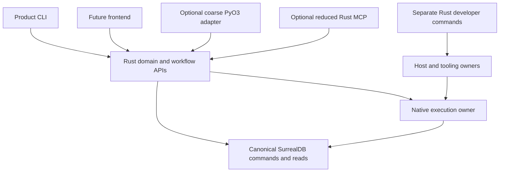

# Rust-owned execution, interfaces and development workflows

> Subsequent planning disposition: [Plan58](../plans/58-rust-owned-system.md) entirely
> supersedes Plan57. The operator later made CLIs optional, retained RMCP as conditional
> and deferred PyO3 implementation. This review's CLI recommendation and Plan57-amendment
> table remain the original proposals, not current scope or authority.

## Recommendation and evidence boundary

**Proposed:** make Rust the complete first-party application and operational owner. Deliver useful product and developer operations directly through Rust APIs and executables. Retire the Python FastMCP stack rather than require feature parity; consider a smaller RMCP adapter only after the native interfaces stand alone. Make any Python package an optional consumer, with coarse PyO3 bindings selected for an actual interaction need. Keep independent Python scientific references outside the first-party execution closure.

This is a functional-extension review with a combined capability, library and architectural lens. Its outcome is a more independently usable system, not a language-conversion quota. The operator explicitly selected end-to-end first-party scope and preservation of workflow value rather than existing Python interface behavior. Peripheral MCP functionality may be lost in exchange for robustness. A future GUI is a credible consumer of the Rust API, not a requirement to retain Python or build a GUI now.

The inspected baseline is clean `bd1c4891ea7d71178e809b11045dd4fd89602c0f`. The applicable standard is Core 3.4, efficiency heuristics 1.0, test assessment 1.2 and process-simulator 1.5, selected by `standard.toml`. Existing architecture and plans remain binding until separately amended. This review authorizes neither implementation nor changed ADR status. Plan57's testing/implementation pause remains intact.

**Interface-checked:** source and library documentation research supports the responsibility map and candidate mechanisms below. **Proposed:** all target changes and benefits. No compiler, test suite, database, native workload or performance campaign was started for this review. Prior passes and failures retain the conditions in [57j](../plans/57j-qualification-and-publication.md); notably, the interrupted workbench component's SIGSEGV cause remains unresolved. No fraction of past failures is attributed to Python.

## Current capabilities and opportunities to simplify

Python is not the numerical engine. `pse-authoring`, `pse-compiler`, `pse-math`, `pse-runtime` and the class-specific native adapters already own authored meaning, preparation, derivatives, workflow policy and scientific execution. `pse-py` is an extensive interface to those owners. Its waits, async bridge, Arrow capsules and destruction paths add genuine obligations even where a Python method contains little code. See blueprint §21 and `crates/pse-py/src/{workflow,diagnostics,wait}.rs`.

| Current responsibility | Existing foundation | Opportunity and remaining work |
| --- | --- | --- |
| Authoring and scientific workflows | Rust authoring/compiler/runtime; `pse-project` and `pse-worker` | Make every selected user journey constructible without the Python object facade; existing binaries do not establish complete ergonomic coverage. |
| Durable commands and compact reads | Rust `pse-operations`; generated database functions/APIs; new Python HTTP control client | Provide native callers over the same policy and receipts; do not make Python HTTP transport the product's required control root. |
| Results and scientific inspection | Rust result providers, strong snapshots, Arrow/DataFusion; Python `TableStream` | Offer native selective readers and export, independent of PyArrow and interpreter-owned objects. |
| Agent interface | Python FastMCP server, fixed child workers and retained read sessions | Remove the Python serving/worker layer; assess optional reduced RMCP after direct operations exist. |
| Development workflows | Rust xtask plus Python catalogue, CLI, preparation, evidence and assessment scripts | Make development operations directly executable rather than dependent on an MCP connection or generated Python CLI. |
| Host ownership and deployment | Python `pse_env`, `host_admission`, `operation_lifetime`, service tooling; Rust deployment/recovery operators | Consolidate host control into a bootstrap-capable Rust executable; preserve process identity and physical release semantics, not every current helper/ledger boundary. |
| Data and type adaptation | Rust-owned declarations; generated Python documents, attrs/cattrs/msgspec | Keep Rust types authoritative; generate optional consumer projections without round-tripping ordinary Rust calls through JSON. |
| Independent scientific evidence | Isolated IDAES/Pyomo, SciPy and teqp reference groups | Retain external oracle execution where useful; it is not a reason to require Python in simulation or normal operator commands. |

The current capability CLI is not execution-independent: its invoke/call/session routes still connect to or launch MCP. Replacing only its presentation would leave the server dependency intact. The finite Rust host-operation catalogue is a useful starting point, but its receiver/prerequisite metadata still names Python methods and extension preparation; it is not already a native dispatcher.

The runtime dependency list in `pyproject.toml` is boundary-oriented: PyArrow, attrs/cattrs, msgspec, referencing, HTTPX2 and AnyIO. NumPy is an optional array boundary. IDAES/Pyomo are reference/parity dependencies. Source inspection found no production numerical callback requirement forcing Python to remain. That is not a proof that all public Python conveniences already have equivalent Rust caller interfaces.

Several recent failures would survive a language migration: discarded worker lane authority, cold-batch native-job admission, database API rollback/string decoding, Cargo lock contention and disk exhaustion. Rust future composition also has recorded stack failures. Moving Python interfaces cannot substitute for correcting or qualifying these owners.

## Preferred target and complete alternatives

Use existing responsibility owners, not a universal new application framework. Rust APIs take typed definitions/requests and return values or explicit operation/result handles. Product executables expose those capabilities to operators. Development executables compose checkout-only preparation, validation, evidence and maintenance without putting those dependencies in the ordinary product closure.

The canonical SurrealDB deployment retains durable projects, study intent, guarded transitions and receipts. Rust workers retain scientific/native execution and physical joining. An operation can outlive an observing client when its durable contract permits it. Disconnection, RPC cancellation, requested scientific stop and actual release are separate events. Ordinary pure/local operations need no new service or persistent receipt merely because a remote variant exists.

The arrows describe responsibility use, not a requirement to link every frontend into one binary or add network calls between Rust modules.

| Complete alternative | Judgment |
| --- | --- |
| Keep rich Python interfaces and only translate their helper implementations | Least consumer disruption, but retains interpreter lifetime, extension packaging and dual-runtime obligations. Not preferred under the changed priorities. |
| Native product/developer APIs and CLIs, no MCP, optional Python deferred | Preferred foundation and a valid final operating configuration. Loses MCP discovery/presentation but leaves ordinary agent shell access. |
| Same native foundation plus reduced RMCP | Preferred conditional agent extension when actual host use justifies it. Reuse domain operations; no Python runtime or Python worker intermediary. |
| Mandatory service for every operation with Python as remote client | Useful isolation for durable work, but introduces deployment/authentication/serialization costs for local operations. Select per workflow, not as a universal target. |
| Embed all storage and move scientific execution into database modules | Not selected. A shared language does not merge failure domains, allocator ownership, transaction semantics or native ABI eligibility. |

## O01 — Complete native product workflows

**Value:** a user, CLI, agent or future UI can author a model, prepare a case, execute and inspect results without constructing a Python Runtime. Extend existing Rust capability owners and executable roots; do not introduce another scientific interpretation or blanket command-dispatch abstraction.

Make scientific preparation reusable across local and supervised execution. Expose explicit authored revisions, bindings, prepared operations, immutable results and durable identifiers at the appropriate interfaces. Keep typed in-process calls direct; serialization belongs at file/network/frontend boundaries. Do not expose solver internals or interpreter objects as the application contract.

**Delivery scenario:** with Python unavailable, perform model admission, edit/re-solve, local execution, durable study submission, progress inspection and selective result export. Preserve the currently supported square/root, optimization, dynamics/events, fitting, sensitivity, recycles/initialization, generated-design/study and diagnostic workflows with their existing class-specific limits, physical typing, initialization and independent assessment. Preserve project/source/history and reproducible result workflows where they support those activities. Interface feature-loss permission is not permission to silently discard scientific modes. Separate missing native caller coverage from missing scientific functionality. This is first priority because every thinner frontend depends on it.

## O02 — Developer CLI as the primary development interface

**Value:** developers and agents can discover, prepare, validate, inspect evidence and recover work without an MCP connection. Extend existing Rust xtask/development owners; retain product/development dependency separation in blueprint §3.2.

Provide ordinary help and typed machine-readable requests/results for finite operations. Environment composition, agent/runtime configuration, tool installation, generation, preparation, build, validation, source/evidence queries and controlled maintenance remain first-party Rust-owned operations. Third-party tools can remain subprocesses; that does not retain a first-party Python coordinator. Independent Python oracle drivers are the bounded reference exception. These remain explicit operations with original owners and exit outcomes. Keep exact operation schemas and effect distinctions; do not regenerate the whole FastMCP/Cyclopts architecture in Rust. Shell/editor tools can remain the simplest interface for ordinary file work.

**Accepted loss:** dynamic visibility selection, workflow presentation, rich prompts and connection-specific navigation need not survive where command help and source documentation suffice. MCP-specific editing previews need not become another durable subsystem. Preserve valuable editing capability through existing editor/diff/version-control workflows.

**Delivery scenario:** from a fresh checkout, explain requirements, prepare only the selected capability, run a selected check, inspect its original terminal result and diagnose failure without importing `pse`, FastMCP or a Python CLI.

## O03 — Retire Python MCP; add only useful native protocol access

**Value:** remove Python serving and subprocess bridges from agent access. Prefer a reduced RMCP endpoint over a full feature-parity port if an actual host benefits from MCP. No MCP remains a supported alternative, not a failed migration.

Use RMCP's typed tool routing and structured results over the same Rust operations. Product operations and developer commands retain separate dependencies and activation. A discovery/read operation must not incidentally prepare the scientific extension. Direct Rust inspection should retain a Rust snapshot handle when needed, rather than a Python subprocess whose role is to hold a native Runtime.

Translate protocol cancellation into the particular domain operation's policy; transport teardown does not establish native exit or rollback. Long-running database work uses existing durable identifiers and receipts. Do not adopt MCP tasks, subscriptions, elicitation or multi-round-trip state merely because available: require actual client support and a concrete advantage over CLI/native handles.

Deletion candidates are `scripts/capabilities` serving/worker/session machinery and MCP-specific Python dependencies, readiness/currency adapters and generated CLI wiring after retained workflows move. Some build provenance and process ownership still belong in native/developer owners; removing a Python check does not remove the underlying guarantee. Conversely, retire presentation/source fences, preparation receipts, reconnect logic and progress files whose only purpose was MCP/Python extension currency after that consumer disappears. Do not preserve every existing check as an abstract guarantee: each surviving check needs a retained uncertainty, publication or execution consumer. A loaded Rust host should not inherit per-read Python-source currency scans.

**Delivery scenario:** compare no-MCP CLI use with a fresh actual-host RMCP connection for the retained tool subset, including failure, cancellation and endpoint teardown. Record removed features individually. Protocol example success is not host or scientific acceptance.

## O04 — Optional Python bindings with a deliberately small contract

**Value:** preserve interactive access when useful without making Python responsible for the application. PyO3 wrappers may accept typed input/documents, start a coarse operation and expose explicit status/cancel/result access. Python contains no scientific policy, native scheduler or host supervisor.

Choose in-process bindings only where their interaction/data benefits justify interpreter coupling. Prefer process-isolated access for long-lived independent work. A short `#[pyclass]` wrapper can still retain large native state; `detach`, Send/Sync constraints, shutdown and Python exception behavior remain consequential. Do not promise that replacing Python methods with Rust methods removes those obligations.

Initial Rust delivery need not ship these bindings. If adopted, avoid recreating the broad object graph and six different synchronous wait contracts by default. A future GUI can use the same Rust capabilities directly or through a deliberate frontend boundary; no Python GUI framework is selected.

**Delivery scenario:** deleting or not installing the Python adapter leaves every supported native workflow operational. Optional adapter tests establish only their own conversion, lifetime and cancellation contract.

## O05 — One host ownership implementation, with cold-start independence

**Value:** run and diagnose builds/services/native workers without a Python orchestration dependency. Move the existing environment, launch, identity observation and release responsibility into a small Rust tool root that does not require scientific compilation, the database or its own live admission to bootstrap.

Preserve exact boot/PID/start/unit identity, borrowed ownership and empty-kernel-population release conditions. Consolidate records that exist only to bridge helpers; retain distinct scientific admission, host containment, immutable artifact identity and durable study ownership because they protect different effects. Do not force host liveness into a database transaction or allow database unavailability to block physical cleanup.

Retain the current systemd controller path as a viable native command-based realization; a new D-Bus dependency is not required merely to remove Python. Even `bootstrap.sh --rust-only` and the Python `cargo-pse-correctness` launcher currently depend on Python. The existing xtask closure includes scientific/codegen dependencies and is not established as a minimal seed. Compare a genuinely feature-separated existing root with a dedicated small executable; a new crate requires the decision route. A tiny shell seed can locate Cargo without implementing a second host policy. Bootstrap must provide/install the small tool without first building the whole scientific product; select its publication and upgrade mechanism during implementation planning.

**Delivery scenario:** missing/stale tool, partial spawn, interrupted caller, unavailable manager, borrowed child and failed teardown all preserve actionable ownership. Migrate writers together; no two independent release ledgers or permanent Python fallback.

## O06 — Rust-owned lifecycle composition

**Value:** application tasks, native computation and delivery have explicit owners with fewer frontend-specific wrappers. Reuse runtime task/cancellation facilities where they match actual semantics; retain dedicated native joins for blocking libraries. A dropped future or canceled task is not proof that a started blocking call ended.

Keep domain-specific stop versus detach behavior explicit. Bound concurrent case admission and nested native work using the current selected allocation; preserve the workstation's configured parallelism. Neither a global serialization policy nor new CPU/RAM caps is proposed. Avoid a generic lifecycle framework that hides distinct publication, observation and physical completion.

**Delivery scenario:** canceled observer, original operation stop, late delivery, cached preparation, concurrent studies and native callback failure each settle the correct owner. Existing Rust stack/admission defects remain obligations even after Python disappears.

## O07 — Database-native durable commands and bounded reads

**Value:** clients submit complete durable intents and observe canonical outcomes rather than orchestrating multi-step database transitions. Extend existing generated command/read policy; retain exact actor/store/operation identity, immutable receipts and uncertain acknowledgement handling.

Construct compact control from connection, authentication and bounds alone, without a mathematical Runtime or scientific provider preparation. Share Rust policy between direct native callers and published ingress without exposing administrative credentials as the client contract. Compare an existing constrained API against SDK/RPC delivery for each consumer. Keep guarded changes short; prepare science outside transactions, then publish under the appropriate revision/fence. Live notifications can reduce polling but require authoritative catch-up after lag or reconnect.

Retain the supervised canonical SurrealDB/MX deployment initially. Embedded storage is a separate deployment alternative requiring the same actor, concurrency, backup/recovery and owner semantics. Database modules are candidates for bounded data-local policy, not an automatic home for native solver calls or host release authority.

**Delivery scenario:** repeated identical command, changed intent under reused identity, actor refusal, lost acknowledgement, restart, stale fence and missed notification yield truthful original outcomes without reissuing uncertain effects.

## O08 — Native selective results and deliberate data interchange

**Value:** Rust operators and future frontends inspect relevant results without hydrating Python objects or all payloads. Keep Arrow at columnar boundaries and DataFusion for consumed relational operations; use compact typed metadata for control.

Native retained-result reading and export must not construct mathematical services or prepare scientific providers. Control needs connection/authentication/bounds; retained data adds protected selection, decoding and delivery custody; scientific execution adds model/math/native services. These are capability distinctions, not mandatory new crates or transports. Preserve strong result snapshots, projection and batch delivery. Expose protected snapshots/cohorts as composable native relations for cross-attempt joins, windows, aggregates and comparisons, using their configured SessionState and deployment pool. Current SnapshotProvider already combines inexact pushdown/pruning with residual filtering; the cohort provider does not claim arbitrary predicate pushdown. Preserve those distinctions. Export IPC/Parquet where useful; current authoritative completed payloads are Arrow IPC, so Parquet is a selected derivative rather than an assumed storage migration. object_store ranges/streams and Bytes sharing can avoid incidental copies, but borrowed views and slices retain their backing allocations. Selection, retained data, copied arrays and transport cleanup remain distinct lifetimes.

Do not replace every data boundary with protobuf or JSON, or infer that Tonic owns domain admission and drain. A transport replacement must preserve predecode bounds, partial delivery, original response ownership and unknown-effect handling. Use one appropriate delivery route per consumer rather than maintaining speculative parallel transports.

**Delivery scenario:** native selection/export with Python absent; early reader close, retained output, cancellation during delivery and partial file attachment preserve data meaning and ownership.

## O09 — Carry typed contracts and diagnostics directly

**Value:** native operations use their domain types without Python schema mirrors or intermediate decode cycles. Serde/Schemars derive external projections where needed; thiserror/miette and tracing preserve structured causes and context across adapters.

Keep required/optional/nullable, exact integers, document versions and direction-specific contracts explicit. Generated schemas describe external shapes; they do not replace scientific admission. Maintain existing Rust declarations and generators, removing Python-only generation only when its consumer retires. Preserve external wire compatibility only for deliberately retained interfaces.

Native tracing/OTel should attach at real operation boundaries, not reproduce a Python-to-Rust propagation chain after that chain is deleted. Keep optional exporters out of ordinary local computation. Independent external telemetry and canonical scientific outcomes retain different authorities.

## O10 — Exploit prepared scientific structure rather than add a second engine

**Value:** a native user can compose repeated studies and diagnostics through existing library-owned mathematics. Symbolica's multi-output evaluator exposes CSE across outputs; faer's sparse symbolic/numeric separation and explicit scratch preserve reusable structure. Current code already consumes these mechanisms (`pse-math/src/library.rs`, `implicit.rs`, `native_compiled.rs`); they are strengths to extend, not new discoveries claimed as missing features.

Keep immutable evaluator programs and structural products separate from attempt-local mutable evaluators, numerical factors and workspaces. Reuse symbolic analysis only for compatible sparsity; reuse numeric factors only for unchanged coefficients. Pass borrowed matrix views when the lifetime fits; avoid materializing frontend-shaped arrays between native stages.

Potential extensions include selective native diagnostics using matrix-free `LinOp`/`BiLinOp`, partial spectra and explicit scratch where they improve a real consumer. They are conditional scientific capabilities, not prerequisites to retire Python. Symbolica exact solving, interval/dual arithmetic, term streaming and JIT/SIMD/CUDA are also distinct candidates with mathematical, memory and compilation obligations; do not enable them as a generic Rust migration package.

The workspace uses maintained Symbolica 3.0.1 and faer 0.24.4 sources, with bounded-root and nonfused arithmetic deltas. Generic upstream examples do not override those suppliers, current no-FMA limits or conversion holds. Existing independent validation, physical envelopes and class-specific solver selection survive unchanged in meaning. The native-solver-libraries skill informed these boundaries; no solver implementation was changed.

## O11 — Native assurance and external oracle isolation

**Value:** most behavior is tested directly at its Rust owner; only retained frontend contracts need frontend tests. Port the behavioral purpose of valuable Python acceptance scenarios into native/public executable journeys, not every wrapper-specific assertion. Remove tests only when their mechanism retires and the retained guarantee has another explicit home.

Keep independent IDAES/Pyomo, SciPy and teqp oracle execution isolated where it supplies scientific evidence. An independent oracle is not a competing production authority. Do not recreate those expected results from the same native implementation and call the result independent validation.

Rust-first reduces the interface matrix structurally, but does not establish a measured reduction in build time, memory or failure rate. Reassess scope-end qualification after actual migration; do not restart the archived failed component as proof of the changed design.

## O12 — Native incremental workspace and explanatory dependency views

**Value:** interactive Rust users and future frontends can edit inputs and request only affected preparation, with explanations of dependencies rather than Python-managed workspace caches. Extend existing Salsa inputs/tracked derivations, preserving complete source and interpretation identity. Keep side effects and mutable native solvers outside tracked queries.

Salsa persistence is a conditional acceleration candidate, not canonical storage: pinned 0.28.5 exposes persistence APIs but the workspace does not enable that feature. Any persisted cache needs compatibility/input namespaces and safe recomputation on mismatch; it cannot replace database recovery. Petgraph/rustworkx filtered views, SCCs and deterministic topological operations can expose dependency explanations without becoming a second semantic graph or scheduler. Acyclic graph APIs fit genuinely acyclic dependencies, not physical recycle graphs by assumption.

**Delivery scenario:** value-only edit versus structural edit preserves the right prepared products; explanation points to authored dependencies. A missing or incompatible acceleration cache causes recomputation, not a changed scientific result. This extends O01/O10; persistence itself can wait for a concrete consumer.

## O13 — Native adaptive-study composition

**Value:** a user can ask for expensive-case suggestions, evaluate them through existing workers, and resume from recorded observations without Python optimization loops. EGObox's pinned `EgorServiceFactory`/`EgorServiceApi::suggest` offers an ask-and-tell candidate; the current runtime also already retains an `EgorSolver`/`EgorState` actor for thread-affine strategies. Compare those routes rather than add another optimizer service automatically.

Use ndarray views/axis or Zip operations for native batch preparation where layout permits. Assign random streams to stable study/point identity rather than task completion order. Preserve the selected recorded-realized-point replay contract: this opportunity does not impose bit-portable seed regeneration. RNG state alone does not capture sampler caches, adaptive state or implementation version.

The newer EGObox/Basin and multi-objective overview capabilities are future candidates; the current ego/moe/gp/doe family is 0.38.1/0.35.5/0.36.4/0.35.1. Its ndarray 0.16/rand_xoshiro 0.6 interfaces cannot be silently mixed with the newer overview APIs. Any family move must update reproducibility identity and affected consumers together.

**Delivery scenario:** suggest a batch, evaluate through original native owners, retain real failures and observations, cancel/restart and continue without treating imputed outcomes as measurements. This is useful optional extension scope, not a prerequisite to remove Python.

## O14 — Optional native configuration explanations

**Value:** developers could obtain concrete witnesses or contradictory premise sets for discrete capability/configuration requirements. Z3 `assert_and_track`, `check_assumptions` and `get_unsat_core` are a candidate for a bounded explanatory tool when ordinary validation is insufficient.

Do not put a solver on the ordinary admission path merely to translate existing conditionals. Keep original policy authoritative; distinguish Sat/Unsat/Unknown, attach source premises and do not promise a minimal unsat core. Numerical feasibility, continuous optimization and runtime capacity remain at their existing owners. Adoption is deferred until a concrete question benefits enough to justify another dependency and lifecycle.

## O15 — Conditional interoperable bulk delivery

**Value:** a remote Rust or Arrow client can retrieve exact selected results without Python materialization or a bespoke batch wire format. Apache Arrow Flight is a new integration candidate: pinned-family 59.3 offers `FlightDataEncoderBuilder`, `FlightRecordBatchStream` and `DoGet`. The repository's `pse-columnar::flight` is keyed single-flight coordination, not Arrow Flight transport; no Arrow Flight integration was found in the inspected source/manifests.

Prefer ordinary completed IPC-file HTTP delivery when the need is just an immutable file download. Select Flight only for actual interoperable batch-stream consumers. Its approximate message sizing is not a hard memory/message bound; dictionaries, oversized values, queues, authentication and original snapshot custody still need explicit treatment. Flight SQL is not necessary for this capability.

For later remote published artifacts, object_store's pinned `Signer::signed_url` could remove the control process as a bulk relay. Require immutable publication, authorization and retention covering the permitted download interval. Signed URLs neither retain results nor grant execution. Current local storage does not need a new object-store topology merely to remove Python.

Tonic/Prost descriptors, generated services and reflection are useful if a new typed RPC contract earns its cost, but are not selected as a second control protocol by default. Keep one declaration and do not recreate current REST/actor/receipt semantics in parallel. Pinned Tonic 0.14.6 lacks the explicit cancellation-handle API described for 0.14.8. Every transport still needs exact command identity and uncertain-effect reconciliation.

**Delivery scenario:** an independent client retrieves selected batches or a completed artifact, preserves dictionary/schema meaning, abandons delivery and leaves retention/physical release truthful. Remote deployment, transport replacement and measured speed benefits remain conditional.

## Priority, rule impacts and delivery order

First settle the product/developer operation inventory and retained workflow outcomes (O01/O02). Develop the bootstrap and host-owner boundary alongside it (O05), because developer tools cannot depend on a successful scientific build. Then migrate native lifecycle/control/results and their consumers together (O06–O09), preserving O10's existing scientific strengths. Retire the Python MCP stack and unneeded Python facade consumers once the chosen native replacements work; optional RMCP and Python adapters follow demonstrated need (O03/O04). O11 applies throughout rather than adding a second qualification ledger.

| Plan57 owner | Proposed integration impact, not adopted scope |
| --- | --- |
| Coordinator/J | Reconcile this changed target before resuming broad acceptance; retain failures, prior passes and open scientific limits. |
| D | Keep native sampling/design/statistical work and recorded-point replay. Delete Python-only assembly only after native callers cover retained workflows. |
| E/K/L | Reassess mandatory Python client delivery; keep actor/receipt, canonical policy and bounded data contracts. K's broad Python facade work may shrink or retire; L's placement inquiries remain distinct choices. |
| F | Preserve native joins/attribution; narrow interpreter wait obligations to any selected optional bindings. |
| G | Expand the host/tooling owner migration, including cold-start bootstrap and one release implementation; do not just translate every helper. |
| H/I | Preserve useful reference/developer/public-family outcomes; reassess generated Python projections and adapter work against retained consumers. |

Changing D12/blueprint §21, boundary contracts and host/governance rules uses the ADR/design route before implementation. This review does not change accepted ADRs, architecture sections, dependency pins or Plan57 status. Earlier MCP reviews optimized a retained Python endpoint; this new operator-selected ability to retire features changes the comparison without invalidating their historical tests.

Delivery requires an original Rust-native author→prepare→execute→inspect journey, a supervised durable study and exact cancellation/reconcile journey, developer commands independent of MCP, bootstrap/partial-failure recovery, selective data delivery with retained-output safety, and actual-host acceptance if RMCP is selected. A future GUI replacement scenario should require frontend adaptation without another scientific policy implementation. These are proposed acceptance scenarios, not tests run by this review.

## Remaining decisions and evidence limits

Implementation planning must choose the initial native operation set, bootstrap artifact publication, retained MCP subset (possibly empty), optional binding mode, and exact dependencies/features after the selected release contracts are checked. Those are concrete adoption decisions, not reasons to retain the existing architecture indefinitely. No requirement for Python in first-party scientific execution was found; caller ergonomics, remote access, reference evidence and deployment remain separate considerations.

The library research appendix below records source-backed mechanisms and unresolved feasibility. Quantitative robustness, memory, latency and throughput benefits remain unmeasured. The principal benefit established by architecture reasoning is removal of specific interface and ownership layers; the remaining Rust/database/native obligations still require implementation and qualification.

## Library mechanisms, sources and qualifications

Research used Context7 resolution/query before consequential primary-source checks. Context7 examples sometimes reflect old signatures or unpinned main; installed/maintained source and tagged APIs take precedence. Unavailable hosted pages were not interpreted as missing capabilities. The following preserves actionable leads rather than repeating the complete overviews.

| Mechanism and design role | Source and material limit |
| --- | --- |
| RMCP `ServerHandler`, `ToolRouter`, `Parameters<T>`, `Json<T>`, structured `CallToolResult`; optional O03 transport adapter | [Tagged 3.7.0 guide](https://github.com/modelcontextprotocol/rust-sdk/blob/rmcp-v3.7.0/README.md), [features](https://github.com/modelcontextprotocol/rust-sdk/blob/rmcp-v3.7.0/crates/rmcp/Cargo.toml). RMCP is not currently a workspace dependency. Select only needed server/stdio features. |
| RMCP service close versus domain settlement | [Tagged service implementation](https://github.com/modelcontextprotocol/rust-sdk/blob/rmcp-v3.7.0/crates/rmcp/src/service.rs). Bounded response drain is followed by handler cancellation and transport close; close success does not establish native drain. |
| PyO3 `detach`, native classes/functions and metadata-derived stubs | [Pinned 0.29.2 API](https://docs.rs/pyo3/0.29.2/pyo3/), [stub guidance](https://pyo3.rs/v0.29.2/type-stub). Overview targets 0.30.1; these mechanisms do not require that upgrade. Introspection is experimental and object destruction/thread safety remain relevant. |
| Schemars directional schemas and Serde projections | [SchemaSettings 1.2.2](https://docs.rs/schemars/1.2.2/schemars/generate/struct.SchemaSettings.html), [Serde attributes](https://serde.rs/container-attrs.html). Existing boundary owner uses serialize/deserialize modes. Schema bounds alone do not enforce receiver validation; RMCP default generation must not silently replace the versioned directional contract. |
| Tokio-util `TaskTracker` plus application admission and `CancellationToken` | [Pinned 0.7.19 tracker](https://docs.rs/tokio-util/0.7.19/tokio_util/task/struct.TaskTracker.html). Close plus empty tracker completes wait after destruction; close does not prohibit new registration. Native blocking calls still require their actual join owner. |
| Existing Futures/Rayon execution and joining | `workflow/worker.rs`, `math.rs`, `math/joined_pool.rs`: existing scoped futures, native-job allowances and retained OS handles are foundations. No replacement scheduler or global thread pool is proposed merely because Tokio-Rayon exists. |
| Protected native relational results | [DataFusion TableProvider 55.1.0](https://docs.rs/datafusion/55.1.0/datafusion/catalog/trait.TableProvider.html), [execute_stream](https://docs.rs/datafusion/55.1.0/datafusion/dataframe/struct.DataFrame.html#method.execute_stream); current `workflow/result_snapshot.rs` and `cohort_provider.rs`. Use exact protected snapshots, their pool and residual predicates; relation composition is not scientific acceptance. |
| Optional Arrow Flight streaming | [59.3 encoder](https://docs.rs/arrow-flight/59.3.0/arrow_flight/encode/struct.FlightDataEncoderBuilder.html), [Flight protocol](https://arrow.apache.org/docs/format/Flight.html). New integration, not the current `Flights` reuse owner; approximate size targets and dictionary choices require explicit admission/fidelity assessment. |
| Existing payload allocation custody | [Bytes 1.12.1 from_owner](https://docs.rs/bytes/1.12.1/bytes/struct.Bytes.html#method.from_owner), `pse-columnar/src/owned_buffer.rs::attach_bytes`. Existing LeasedBytes retains charged ownership through clones/slices. Reuse that mechanism. |
| Native HTTP/gRPC delivery | [Hyper 1.11.1 graceful shutdown](https://docs.rs/hyper/1.11.1/hyper/server/conn/http2/struct.Connection.html#method.graceful_shutdown), [Tonic 0.14.6 timeout](https://docs.rs/tonic/0.14.6/tonic/struct.Request.html#method.set_timeout), [Prost build descriptors](https://docs.rs/prost-build/0.14.4/prost_build/struct.Config.html). Connection polling, flush custody and ResultReadDrain retain duties beyond protocol shutdown; descriptors should derive from the existing contract owner. |
| Optional direct immutable artifact delivery | [object_store 0.13.2 Signer](https://docs.rs/object_store/0.13.2/object_store/signer/trait.Signer.html), [GetOptions](https://docs.rs/object_store/0.13.2/object_store/struct.GetOptions.html). Basic signing exists; newer signed-url options do not. Backend version/range behavior and retention need actual assessment. |
| Salsa incremental queries and optional persistence | [Pinned database source](https://docs.rs/salsa/0.28.5/src/salsa/database.rs.html). Exclusive writes/read drain, complete dependencies and mutable solver exclusion remain necessary. Persistence feature currently disabled. |
| Graph dependency views | [Petgraph 0.8.3 Acyclic](https://docs.rs/petgraph/0.8.3/petgraph/acyclic/struct.Acyclic.html). Maintained topological order is not resource admission; local graph indices are not semantic identity. |
| EGObox ask-and-tell and native batch arrays | Installed `egobox-ego-0.38.1/src/solver/egor_service.rs`; [upstream history](https://github.com/relf/egobox/blob/master/CHANGELOG.md). Advanced overview releases are not current resolved APIs. |
| Symbolica multi-output evaluators and compilation | [Numerical evaluation](https://symbolica.io/docs/numerical_evaluation), maintained `pse-math/src/library.rs`. Current direct-translation/function-map/abort hooks and exact conversion policies govern use; older Context7 examples have a different builder signature. New JIT or SIMD paths need separate arithmetic qualification. |
| faer symbolic/numeric factors, matrix-free operators and explicit scratch | [0.24.4 solver APIs](https://docs.rs/faer/0.24.4/faer/sparse/linalg/solvers/), [matrix-free APIs](https://docs.rs/faer/0.24.4/faer/matrix_free/). Local maintained source and `vendor/faer-arithmetic.md` govern actual dispatch. Overview issue reports are not newly reproduced failures; arbitrary parallel/accelerated upstream paths cannot replace the nonfused realization without qualification. |
| Typed diagnostics and native telemetry | [miette Diagnostic](https://docs.rs/miette/7.6.0/miette/trait.Diagnostic.html), [tracing Instrument](https://docs.rs/tracing/0.1.44/tracing/trait.Instrument.html), [OTel batch processor](https://docs.rs/opentelemetry_sdk/0.33.1/opentelemetry_sdk/trace/struct.BatchSpanProcessor.html). Extend existing `tooling/telemetry.rs::Host`; transport JSON rendering is not automatically the persisted error protocol. Exporter shutdown can block and is not backend ingestion. |
| Existing patched SurrealDB/MX durable owner | `scripts/surreal_source.py` and `scripts/surrealdb-source/mx-1.0-controls.patch`; [upstream 3.3.4 manifest](https://github.com/surrealdb/surrealdb/blob/v3.3.4/Cargo.toml), [MX1 source](https://github.com/surrealdb/surrealmx/tree/v1.0.0). Stock 3.3.4 uses older engine dependencies; this checkout deliberately selects MX1 SSI and synchronous AOL. Neither stock defaults nor overview labels identify the effective server. |
| Complete constrained API commands | [DEFINE API permissions](https://surrealdb.com/docs/reference/query-language/statements/define/api), current control generator and API rollback patch. Endpoint authorization does not replace explicit actor/operation checks inside the API body. Intentional refusal and actual evaluation failure have different transaction behavior. |
| Surrealism bounded data-local policy | [Tagged guest imports](https://github.com/surrealdb/surrealdb/blob/v3.3.4/surrealism/src/imports.rs), [WIT ABI](https://github.com/surrealdb/surrealdb/blob/v3.3.4/surrealism/wit/surrealism.wit). `sql_with_vars`, `run`, typed exports and writeability metadata are candidates; current readiness module deliberately forbids arbitrary queries/network/KV. KV is volatile and not record-transaction rollback. |
| SurrealKit library and schema/testing tools | [Library](https://surrealdb.com/docs/manage/schema-migration/library), [testing](https://surrealdb.com/docs/manage/schema-migration/testing). Existing pinned integration can avoid selected subprocess/filesystem steps. `embed_schema!`, permission matrices and API request tests do not make SurrealKit typegen the scientific schema authority. |
| Progressive database query delivery | [Rust query methods](https://surrealdb.com/docs/reference/rust/methods/query). `stream_items`/row/statement-end is a candidate distinct from Arrow batches and durable subscriptions; HTTP/WS replay versus progressive embedded/gRPC behavior requires exact selected transport assessment. |
| Alternative SurrealKV storage | [KV1 source](https://github.com/surrealdb/surrealkv/tree/v1.0.0). `TreeBuilder`, history, checkpoints and immediate durability are useful capabilities, but default SI is not current MX SSI. Switching requires explicit adapter/migration and backup/recovery work. |
| Rust build reuse | [Pinned sccache 0.19.0 Rust hasher](https://github.com/mozilla/sccache/blob/v0.19.0/src/compiler/rust.rs). It hashes cwd and has no basedirs normalization there; the caching overview's broad `SCCACHE_BASEDIRS` lead does not establish Rust cross-checkout reuse. Keep independent targets and existing build policy. |
| Optional discrete explanations | [Z3 Solver](https://docs.rs/z3/0.21.1/z3/struct.Solver.html). Context/thread restrictions and Unknown outcomes remain explicit; not proposed as a mandatory runtime dependency. |

Overview versus pin discrepancies include PyO3 0.30.1 versus 0.29.2, Schemars 1.2.3 versus 1.2.2, serde_json 1.0.154 versus 1.0.151, ndarray 0.17.2 versus 0.16.1 and rand_xoshiro 0.8.1 versus 0.6.0. Current sccache is 0.19.0 rather than the overview's 0.18.0. Arrow overview 60.0.0 versus pin 59.3.0, DataFusion 55.2.0 versus 55.1.0, object_store 0.14.2 versus 0.13.2, Hyper 1.12.0 versus 1.11.1 and Tonic 0.14.8 versus 0.14.6 likewise require exact-release discrimination. Prost 0.14.4 and Bytes 1.12.1 match. These discrepancies require deliberate selection, not wholesale updates. The Surrealism pool environment-variable descriptions conflict; the actual source-build controller/memory/deadline patches are the relevant contract. No claim that all overview features are enabled is made.

### Overview reading coverage

Research contributors read the substantive content end to end, repairing truncated reads; decorative citation artifacts and table whitespace could be normalized. Coverage was:

- Interfaces/contracts/observation: RMCP, PyO3, Serde/serde_json/Schemars, thiserror/miette, rust-tracing, OpenTelemetry Rust; FastMCP as the additional comparison.
- Durable state/modules/tooling: SurrealDB, SurrealKV, SurrealMX, Surrealism and both SurrealDB tooling documents.
- Execution/preparation/development: Rust concurrency, Rust caching, Salsa, petgraph/rustworkx-core, ndarray, rand_xoshiro, egobox and Z3.
- Mathematics: Symbolica and faer, with current maintained-source integration and the native-solver skill's responsibility/qualification routes.
- Data/transports: Arrow, DataFusion, object_store, Hyper, Tonic, Prost and Bytes.

Python-only overviews other than FastMCP were not given the same full-read claim; Python responsibilities were traced through manifests, actual adapters and existing interface documentation. This is broad capability awareness plus focused source verification, not exhaustive verification of every upstream feature or every repository call site. Library documentation and source claims do not constitute replacement runtime tests.

## Independent assessment and synthesis

A fresh design-reviewer context independently examined the pre-appendix target draft against current source and the selected standard. It supported native APIs/CLIs first, Python MCP retirement without parity and optional adapters, as a Proposed functional direction rather than whole-system acceptance. It required four clarifications: retain control/data independence from mathematical initialization; include all first-party tooling rather than only MCP developer commands; distinguish a cold-start bootstrap root from current xtask and delete consumerless MCP provenance machinery; preserve named scientific outcomes while allowing peripheral interface losses. Those clarifications are incorporated above.

The independent assessment did not reverify the library researchers' release claims or exercise the target. Its support does not establish measured robustness, implementation completion, or resolution of Plan57's interrupted qualification. No contradictory target recommendation remained after synthesis; exact release integration, selected frontend coverage and the bootstrap publication route remain planning decisions.
