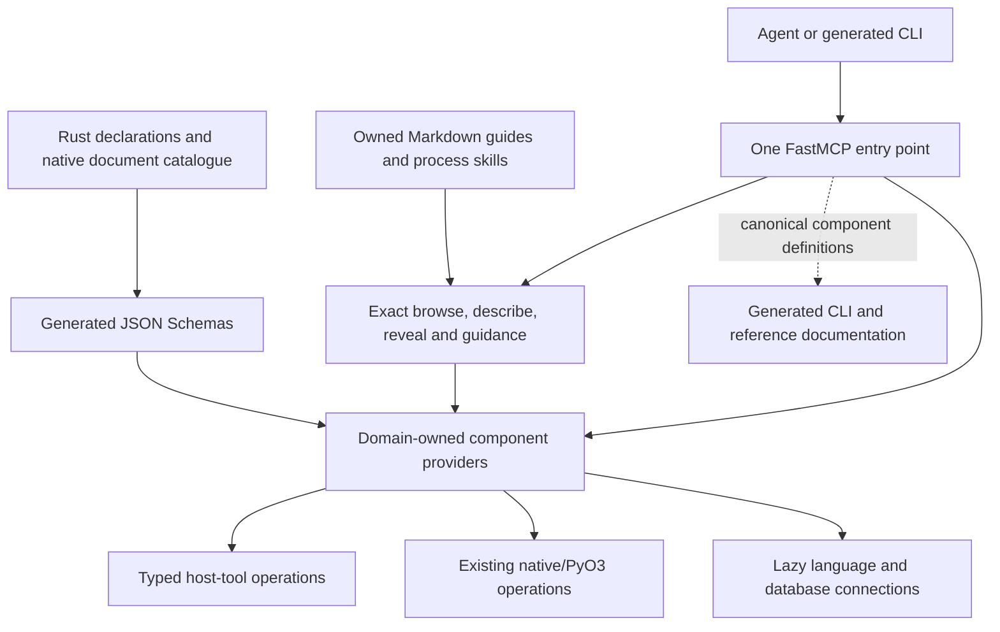

# One structured FastMCP capability interface

Functional-extension review with architectural assessment · 2026-10-24.

## Recommended target and assessment boundary

**Proposed:** one canonical FastMCP entry point for the repository's agent-facing capabilities,
organized by explicit domains and workflows, with deterministic discovery, progressive tool
reveal and substantial instructions at the point of use. The same surface serves programming
agents and prospective consumers. Focused views select existing capabilities within it; they
do not require a separate developer server, another implementation or a persona-specific API.

FastMCP component definitions own the agent-facing operation names, exposed schemas and
membership. Domain metadata and instruction references are attached there once. Existing
operation owners retain scientific meaning, contextual admission, execution, resource lifetimes
and authoritative results. An optional Cyclopts CLI and its help derive from these same MCP
definitions. There is no independently authored Typer tree or parallel agent capability grammar.

Use the existing PyO3/JSON and Rust-authoritative schema routes where they fit. Improve existing
tool interfaces when doing so makes the complete integration clearer or more capable without
losing functionality. Protobuf descriptors and gRPC were assessed as genuine alternatives;
schema alignment alone does not justify adding a parallel Rust operation service here.

This combines functional-value exploration with explicit design-principle assessment. It is
not a defect-remediation exercise, recommendation audit or implementation acceptance. The
operator explicitly excluded refreshing the living design-principle audit; neither living audit
was refreshed. Architectural choices below are assessed against the selected standard rather
than justified solely by current implementation conventions or framework features.

The [earlier opportunity review](agent-tool-discovery-and-access-2026-10-24.md) supplies the
repository-wide inventory, causal examples and initial probes. The operator subsequently selected
one canonical interface and rejected separate developer exposure, semantic search and an
independent CLI. This review develops that selected direction and supersedes the earlier
recommendation on those choices. It preserves the earlier report as dated evidence.

## Source basis and evidence limits

Inspected source baseline: `fe41a9a727280fd49fa773434bb44dc9b4ec1277`. The checkout contained
extensive concurrent Plan53 work in Rust, Python, recipes and test tooling, plus `history.txt`
and the user-supplied untracked library overviews. Those changes were preserved. Relevant
current tooling was read as a working-tree observation, not represented as clean HEAD.
No scientific or test-architecture completion judgment is made about that concurrent work.

The FastMCP and Pydantic overviews were read end to end during preparation; focused research
revisited their mechanisms against exact FastMCP4.1.3/Pydantic2.14.1 documentation and installed
source. A library researcher independently examined reveal, schemas and protobuf alternatives;
a design reviewer independently assessed responsibilities, composition and AP-01–AP-07. The
coordinator reconciled their evidence and ran the bounded probe below. No production interface,
dependency change, server registration, plan revision or architecture amendment was implemented.

The [selected standard](../design_review/design_principles/standard.toml) is Core3.4, Heuristics1.0,
process-simulator1.5 and the pse-arrow binding. The test-assessment companion1.2 informs probe
and future acceptance design. PS-10/PS-11 matter where the interface carries scientific outcomes
and source context; this review proposes no new physical formulation or solver algorithm.

All opportunities and target behavior are **Proposed**. Exact source/API examination is
**Interface-checked**. **Tested** applies only to the named synthetic/library checks under
[evidence](#evidence). Actual Codex refresh/attachment and assembled native workflows remain
unqualified. No speed, reliability-rate or productivity benefit is claimed **Measured**.

## Functional proposition

An agent arriving at an unfamiliar task should be able to obtain:

1. A short map of meaningful domains and workflows, including applicable tools it did not know.
2. The instructions, operation schema, effects and prerequisites relevant to its selected task.
3. The real callable operation, with source/context and output meanings intact.
4. An authentic result or operation handle, followed by useful bounded reads and continuation.

The inventory covers all agent tooling, not only Plans47/50/51/52. This includes source and
generator ownership, compiler-symbol navigation, protected edits, process skills, research,
builds, correctness/scientific checks, live/offline diagnostics, evidence, projects/revisions,
experiments, environment preparation, documentation and maintenance. A process skill or tool
guide can be discoverable instruction material without becoming an executable workflow tool.
Planned capabilities remain explicitly planned rather than appearing as working operations.

For example, an agent navigating a generated-boundary workflow would receive producer and
consumer references, editing rules and scoped regeneration/check operations together. An agent
investigating an unfamiliar invocation would find the authentic observer/result owners and the
right interpretation of partial output. A missing database or compiler allocation would leave
unrelated source, guidance and offline-evidence capabilities usable through the same entry point.

This is structured conceptual navigation, not similarity retrieval. Exclude embeddings, semantic
search, fuzzy matching and ranked capability retrieval, including BM25/Jev search transforms.
Exact paths, identities, declared relationships and explicit filters suffice. Existing literal
source-content searches can remain ordinary tools; compiler-based semantic navigation concerns
symbol identities and references, not semantic-similarity discovery.

## Target architecture and semantic authorities

The diagram separates semantic responsibilities; it does not require a service or process for
each box. Prefer ordinary modules and local providers. A separate process remains appropriate
for an existing CLI execution owner or upstream language server whose lifecycle has that purpose.

| Meaning | Authoritative definition | Derived consumers |
|---|---|---|
| Native scientific/document contract | Existing Rust declarations, registry, codec and admission owner | Native JSON Schema, generated Python documents and MCP schema reference/projection |
| Agent-facing operation binding | Canonical FastMCP tool/provider definition beside its integration owner | `tools/list`, exact descriptions, capability membership, generated CLI |
| Domain/workflow relationships and instruction references | Small typed exposure metadata attached to the canonical components; workflow guides own their composition | Exact catalogue and selected views; tags are mechanical projections |
| Detailed procedure, scope and rationale | Existing Markdown/rule/skill owner, or new owned guide for genuinely new interaction meaning | MCP resource, selected instruction excerpt and generated reference links |
| Effective context, prerequisites and execution effects | Existing environment, source, admission and operation owners | Explicit observations and operation-specific outcomes |
| Invocation, result, evidence and resource lifetime | Existing native/tooling handle and result owners | Bounded MCP summaries, detail readers and continuation |

Do not infer operation schemas from Just `*args`, copy native defaults into a side catalogue or
author the same tool in both CLI and MCP. The catalogue is a derived view of registered
components and owned metadata. Native operation contracts can have richer meaning than their
JSON Schema expresses; their enforcement remains native.

### The access model is small but consequential

Represent these distinctions deliberately because behavior depends on them:

- **Domain:** a coherent responsibility, such as source, verification, execution, diagnostics,
  projects, evidence, experiments, research, environment, maintenance or workflow guidance.
- **Workflow:** an ordered or related set of capability references for an intent, such as a
  generated-contract change or an interrupted-run investigation. It does not own copied policy.
- **Capability:** an exact reference to a canonical tool, resource, prompt or instruction package,
  including its owner and supported purpose. Instruction retrieval is distinct from execution.
- **Exposure selection:** the currently revealed component set. It is presentation state,
  separate from selected checkout/project/service, installed availability and authority to act.
- **Operation context and result:** native input/source selection and operation-specific outcomes,
  with typed handle/resource distinctions where needed. Neither is a mutable global current value.

Use a stable component key/name with an explicit mapping to native identity; display labels and
hierarchy paths need not become execution identities. Keep domain membership and workflow
membership distinct: one operation may appear in several workflows without duplicated handlers.
Derive exact-key and parent-child lookup from these declarations. No general ontology, external
capability database or universal action enum is needed.

## Opportunities and resulting interactions

### O01 — A complete navigable surface with one exposure authority

Expose a cheap root description and exact catalogue operations. Illustrative names are
`capability_browse`, `capability_describe`, `capability_open`, `capability_reset` and
`instruction_read`; implementation naming is not fixed by these examples. Browsing names a
domain/workflow path and explicit facets. Describing a known capability returns its exact
schema and applicable guidance directly, without requiring a ritual of traversing every parent.

Root results contain concise purpose, child identities, native owner and instruction links.
Selected descriptions add real parameters/defaults, output meanings, effects, prerequisites,
examples, known exclusions and related next operations. They distinguish implemented operations,
unavailable dependencies and planned leads. Availability is an explicit current observation,
not a reason to hide a capability from conceptual browsing.

FastMCP providers and mounted namespaces compose this surface. Use local registration for
ordinary typed host functions and a custom provider when deriving components from existing
native declarations earns its complexity. Override targeted `_get_tool()` where the default
list-and-scan lookup would repeatedly reconstruct unrelated tools. See the exact
[provider contract](https://github.com/PrefectHQ/fastmcp/blob/v4.1.3/docs/servers/providers/custom.mdx).

Keep inventory and execution separate without maintaining two writable definitions: a catalogue
entry describes the same component resolved for invocation. Registration should detect duplicate
identities, broken workflow references and missing instruction owners. These are local checks
of meaningful constraints, not a new architectural certification framework.

**Value and delivery:** an unfamiliar applicable capability outside the four starting plans can
be found through its conceptual purpose, understood and used. Listing current recipes alone does
not establish this improvement. The operation description must reach actual leaf contracts.

### O02 — Deterministic reveal with explicit client and transport semantics

Prefer one local STDIO FastMCP process per agent attachment initially. This is one canonical
implementation and entry-point definition with process-local presentation state, not separate
interfaces per audience. Bootstrap tools stay visible. Domain/workflow selection resolves exact
component identities, returns guidance and reveals the corresponding native tools/resources.

Built-in `disable()` plus `Context.enable_components()`, `disable_components()` and
`reset_visibility()` provide the underlying mechanism. Use exact names/keys or derived family
tags; tag sets match any supplied tag rather than expressing an arbitrary relational query.
For a compound workflow, resolve its explicit component set before applying visibility.
Visibility affects both listing and direct name resolution; it is not merely a search result
filter. Source: [visibility implementation](https://github.com/PrefectHQ/fastmcp/blob/v4.1.3/fastmcp_slim/fastmcp/server/transforms/visibility.py).

For modern MCP2026-07-28, scope needs care. STDIO/in-memory state follows the server process;
authenticated HTTP follows the principal across that user's connections, while unauthenticated
HTTP cannot persist built-in visibility selection. Legacy session behavior differs. Consequently,
two in-memory clients sharing one server are not evidence of independent modern conversations.
Use separate server processes for the initial isolation guarantee; the new probe does so.
See [Context scope](https://github.com/PrefectHQ/fastmcp/blob/v4.1.3/fastmcp_slim/fastmcp/server/context.py).

Make selection changes deterministic and idempotent at the access owner. A selected-set operation
should replace presentation selection deliberately rather than accumulate an unbounded history of
enable/disable rules. Serialize concurrent selection changes within the process and report the
resulting set/version. FastMCP's helpers alone use append-style rule updates and are not an atomic
replacement protocol. Reset remains cheap; reconnecting can start from the root. Native operation
handles survive according to their own owner, not the exposure store.

Visibility helpers emit list-change notifications, but actual host refresh must be demonstrated.
Return exact exposed identities, the selected guide and an explicit refresh indication. The
probe verifies a FastMCP client using `list_tools(cache_mode="refresh")`; it does not prove that
this Codex host updates its callable inventory automatically. Current-session tool attachments
cannot be hot-added by publishing this review.

The preferred interaction is ordinary revealed tool calls. If the host cannot consume dynamic
listing, investigate exact schema lookup plus canonical-tool invocation within this same endpoint.
Such a compatibility adapter must resolve the same tool and delegate its validation, middleware,
effects and results; it cannot become arbitrary shell execution or a second operation language.
Choose this only from actual host evidence. Do not solve a host limitation by creating a separate
developer server or advertising every detailed schema on initial contact.

**Value and delivery:** agents receive the tools relevant to a known conceptual selection, can
reset or change it, and do not alter another attachment's presentation or effective project.

### O03 — Instructions travel with the selected intent and operation

Provide guidance at three useful levels: concise root orientation, substantial selected
domain/workflow instructions, and exact operation guidance/examples. Root orientation explains
how to browse, describe and reveal. Workflow guidance connects purposes and native references;
operation guidance explains applicability, parameters, effects, prerequisites, failure meanings
and legitimate next steps. Instruction size follows useful demand rather than an arbitrary
requirement that every response be tiny.

Keep critical interpretation/effect constraints in the callable tool's description and enforced
contract. Do not assume the agent read a separate resource or use documentation retrieval as a
mandatory acknowledgment gate. Return selected instruction content with reveal when useful,
plus links for deeper material. Detailed rules remain with their existing owner.

Use ordinary resources/resource templates and selected `SkillProvider`/`SkillsDirectoryProvider`
content for existing guides and process skills. Parameterized prompts can prepare a repeatable
task context when that is more useful than a static guide. If the host needs tools to read these,
`ResourcesAsTools`/`PromptsAsTools` can present the same content without another definition.
Prefer ordinary resource-based skill serving: the experimental Skills extension excludes
namespaced/mounted/proxied sources and does not activate or execute skills. See
[skills providers](https://github.com/PrefectHQ/fastmcp/blob/v4.1.3/docs/servers/providers/skills.mdx)
and [experimental limits](https://github.com/PrefectHQ/fastmcp/blob/v4.1.3/docs/servers/providers/experimental-skills.mdx).

A planning skill remains instruction-only; returning it cannot trigger implementation. Generated
quick-start documentation can link these owners and derive exact signatures, while authored
explanation supplies intent and rationale. Do not require all detailed guidance to be generated
from schema fields, which cannot express the whole workflow.

**Value and delivery:** the agent learns the right procedure when it selects the capability,
including tools it did not initially know, without loading the whole repository's instructions.

### O04 — Rich aligned schemas through existing native and Pydantic authorities

Use two complementary routes because their authorities differ:

| Operation kind | Canonical input/output source | FastMCP integration |
|---|---|---|
| Host-tooling operation | Typed host function/request/result, using Pydantic where useful | `FunctionTool` derives its exposed signature and performs argument validation. |
| Rust-owned document/operation | Appropriate existing registry/schemars schema and native decoder/admission | A narrow custom `Tool` publishes generated `parameters`/`output_schema` and delegates native handling. |

For host contracts, reuse `Annotated` constraints and `TypeAdapter`s over suitable types; choose
`BaseModel` where its modeling features help. Use strict structured-input validation, explicit
unknown-field policy, discriminated variants and typed identity/handle distinctions where they
affect behavior. Reuse prepared adapters. Input parsing from CLI text is not identical to
validation of an already structured MCP value. See versioned
[type adapters](https://github.com/pydantic/pydantic/blob/v2.14.1/docs/concepts/type_adapter.md)
and [strict-mode behavior](https://github.com/pydantic/pydantic/blob/v2.14.1/docs/concepts/strict_mode.md).

Pydantic2.14's `MISSING`, field-set tracking and selective serialization preserve absent,
explicit null and empty values. Validate defaults deliberately; emit the appropriate validation
or serialization schema when representations differ. Field/model serializers and context can
preserve wire formats and redact sensitive inputs, but must not silently stringify unsupported
native values. Model construction bypasses, unchecked copy updates, partial validation and
duck-typed serialization are unsuitable shortcuts for authoritative final boundaries.

For native contracts, `Tool(parameters=..., output_schema=...)` allows the existing JSON Schema
to be exposed without handwritten Pydantic scientific mirrors. Its `run(arguments)` must call
the native decoder/admission before effects; custom `Tool` registration and result conversion
do not automatically validate the supplied arguments. Keep the request schema and actual native
entry function bound together at the integration owner. Source: exact
[Tool implementation](https://github.com/PrefectHQ/fastmcp/blob/v4.1.3/fastmcp_slim/fastmcp/tools/base.py).

Choose the correct native schema family. The registry's
[authoring schema generator](../../crates/pse-codegen/src/codegen/jsonschema.rs) deliberately
differs from schemars on hydrated structs: parser spans, integrity fields, contextual omissions
and authored aliases have different meaning. The
[boundary document catalogue](../../crates/pse-runtime/src/boundary_documents.rs) and
[schema publication owner](../../xtask/src/codegen/schemas.rs) already supply other Rust-owned
documents. MCP must expose the schema appropriate to the admitted operation, not any similarly
named generated type. Preserve blueprint §4.2 and §21.5.

Keep schemas self-contained with their dialect and `$defs`/local references. MCP inputs need
an object root; a generated host envelope may reference a native union/document without copying
its fields. Reference rebasing must be generated and checked. Object-shaped outputs fit the
current FastMCP `structured_content` contract. Test representative enums, recursive definitions,
tagged alternatives, numeric limits and authoring/hydrated boundaries. Client output validation
is useful protection, but is not evidence that the producer enforced native semantics.

FastMCP also contains JSON-Schema-to-Pydantic conversion utilities. These are useful leads for
consumer adaptation, not a lossless universal replacement: the inspected converter can drop
unsupported regex constraints with a warning. Do not make a lossy projection the only admission
authority. Lower-level Pydantic core-schema hooks or dynamic models require a specific benefit
and compatibility evidence; the ordinary native-schema route avoids needing them here.

**Value and delivery:** callers see rich trustworthy shapes that remain aligned as Rust tooling
changes; malformed input is refused at the actual boundary and native context still governs
validity. Generation is a derivation, not a second writable scientific contract.

### O05 — Adapt tools where that improves their operation boundary

Current CLI shape is not a preservation requirement. Preserve supported behavior and native
guarantees while simplifying the path from a typed request to its actual result. Compare a
thin adapter with refactoring the owned tool itself; choose the latter when the adapter would
otherwise reconstruct parsing, defaults, exit handling or lifecycle policy.

| Current evidence | Recommended integration change | Behavior to preserve |
|---|---|---|
| [experiments.main](../../scripts/experiments.py) dispatches through outer `argparse`; archive leaf help is consumed early. [test_archives.archive](../../scripts/test_archives.py) takes `argparse.Namespace`. | Extract an operation-specific typed request/function/result and keep CLI formatting outside it. Register that function once through MCP; derive any replacement agent CLI. | Archive/replay source identity, owned execution, explicit paths and cleanup/retention obligations. |
| [active_diagnostics.execute](../../scripts/active_diagnostics.py) consumes a parser namespace and selects tools/process effects. | Give the execution owner an explicit typed request/context; reuse its exact process identity checks and resource handling. | Attachment is to an identified subject; cancelling the diagnostic helper must not own/cancel that subject. |
| [validation.execute](../../scripts/validation.py), assessment and result readers already have distinct responsibilities. | Expose selected check intent, invocation identity and structured results without calling `main()` and scraping printed output. Extend an owner-returned result where a handle is currently only printed. | Force-validation, actual selection, incomplete populations, detached observation and terminal/drain distinctions. |
| Native project/evidence commands use shared Rust owners behind Clap frontends. | Reuse an existing PyO3 operation where available; otherwise expose a narrow typed native boundary or retain the genuinely process-owned command using its structured output. | Project/revision context, database identity fencing, offline evidence semantics and explicit preparation. |
| Language and selected-database MCP connections are separately configured by [codex_session](../../scripts/codex_session.py). | Compose lazy local providers/proxies under the one entry point and move useful normalization into the owning adapter. | Pinned tool paths, correct positions/edits, readiness, selected service identity and real connection teardown. |

Changes may include proper subcommands/help forwarding, callable kernels separated from parsers,
structured native causes, bounded result readers, async/cancellation boundaries or targeted
Python bindings for Rust tools. Do not retain a difficult interface merely to make the wrapper
small. Conversely, do not reimplement a process owner in Python solely to avoid a subprocess.

Remove replaced parsers, output scraping and duplicated agent command declarations when actual
callers migrate. Native executors and low-level development commands may remain where they have
independent work to do; their existence does not justify another handwritten agent-facing API.
Adding or changing a public Python/native boundary follows its existing decision route when
implementation is selected. This review authorizes no such production changes.

**Value and delivery:** a tool can be used through FastMCP without hidden reconstruction while
retaining all supported effects and results. Both the happy path and previous failure/lifetime
behavior must survive the refactoring, with an actual consumer using the new boundary.

### O06 — Lazy dependencies and a reachable control surface

One public endpoint must not eagerly initialize all compilers, native libraries, language
servers or storage connections. Pure catalogue/source/instruction/offline reads need only their
declared inputs. Expose availability and the explicit preparation route when an operation cannot
run. Browsing does not install tools, synchronize packages, start a database or rebuild a binary.

Use module/provider composition and scoped DI/lifespans to acquire dependencies when the selected
operation needs them. FastMCP mounts compose child lifespans at parent startup; a child that
starts an LSP/store in its lifespan would defeat lazy startup. Introduce lazy acquisition in that
owner or use a lazy proxy/provider rather than claiming that `mount()` alone is lazy. See the
[versioned composition contract](https://github.com/PrefectHQ/fastmcp/blob/v4.1.3/docs/servers/composition.mdx).

Launch the catalogue through the pinned checkout interpreter and cheap explicit configuration.
Do not hold ordinary workload admission/compiler preparation for the entire MCP process merely
to keep it alive. The existing read-only `activity` exception demonstrates the need: unavailable
admission must remain diagnosable. Effectful operations still enter their established `pse-env`,
host, native and store owners; the endpoint does not become another resource scheduler.

Maintain one explicit checkout attachment and supplied/owned project, service and source context.
Changing reveal does not change these selections. Reuse session-launcher identity checks; do
not create ambient global current-project state or expose credentials as public tool arguments.
The endpoint may be long-lived, but native work has its existing process/allocation lifetime.
If a current helper assumes its launcher is short-lived, adapt that helper rather than attaching
native work incorrectly to a request or server lifetime.

**Value and delivery:** guidance and diagnosis work even when an unrelated compiler, database
or admission path is unavailable; selecting a capability incurs only the dependencies it needs.

### O07 — Preserve outcomes, bounded evidence and lifecycle across interactions

Retain native distinctions among malformed invocation, unavailable prerequisite, stale source,
domain refusal, incomplete observation, interrupted work, transport/schema failure and an
unexpected implementation error. Pydantic supplies structured field locations/types; native
diagnostic codes and causes retain their meaning. Redact raw inputs/context deliberately rather
than exposing all validation details or disabling error masking globally.

An MCP success indicates a protocol operation completed, not that a scientific result is valid.
Client schema refusal may be an exception outside the ordinary tool error result, as the earlier
probe demonstrated. Keep producer outcome, test population, child return, cancellation, drain,
settlement and scientific assurance separate where the native contract distinguishes them.
User-facing next steps should cite the exact operation/evidence owner, not parse prose to decide
whether retry is safe.

Return native handles and short summaries before expensive detail. Bound nested checkpoints,
source inventories, errors and guide expansion as well as top-level result counts. Preserve
native source/continuation identity and completeness; an empty partial result is not evidence of
absence. Arrow data, large traces, archives and raw logs stay in their existing protected/offline
formats with selected readers rather than being copied wholesale into MCP JSON.

Cancelling an observer detaches it. Cancelling an action follows its native ownership contract;
disconnection cannot cancel unrelated or merely observed work. FastMCP thread timeout cannot
undo a blocking native operation. Reuse existing drain/recovery owners instead of adopting Tasks/
Docket as a parallel scheduler. Reconnection/reveal starts do not authorize rerunning effects.

**Value and delivery:** multi-step investigations remain interpretable across partial results,
timeouts and reconnects without reconstructing raw logs or mistaking transport success for science.

### O08 — A generated CLI that remains faithful to the same capabilities

CLI adoption is optional. When useful, generate it and its reference material from the complete
canonical FastMCP definitions. The current4.1.3 generator reads the client's visible tool list,
so generating from bootstrap alone omits hidden operations; the new probe confirms this.
Generation needs a deliberate full-catalogue selection of the same definitions, without a
second registered server or independently maintained all-tools catalogue.

Generated commands create new connections. A STDIO invocation therefore starts from root
visibility again. The generation route must derive an exact target-selection/activation step
before the call, or use the selected same-endpoint compatibility invocation if host evidence
requires that route. Exporting a complete list once does not solve runtime visibility.

Also correct omission handling at the generator: its current helper removes every `None` and
empty list, losing explicit null/empty values. Complex schemas become JSON arguments and need
their native validation. Preserve defaults, required nullable values, recursive/local references,
argument names and error/exit meanings. Fix the generator or owned derivation and regenerate;
do not hand-edit output. Source: exact
[CLI generator](https://github.com/PrefectHQ/fastmcp/blob/v4.1.3/fastmcp_slim/fastmcp/cli/generate.py).

Generated CLI schema fidelity and native scientific fidelity are separate properties. Keep
tests with explicit independent expected values for absent/null/empty and malformed inputs;
a schema-derived round trip alone would miss a shared wrong interpretation.

**Value and delivery:** a CLI consumer gets a convenient terminal projection of the same
capabilities without another schema authority or a quietly different mutation contract.

### O09 — Stable loaded contracts while agents change the repository

An agent will edit the very tooling the endpoint has imported. Treat loaded component schemas,
handlers, exposure metadata and their instruction interpretation as one loaded interface revision.
Avoid serving freshly read definitions while executing an old imported handler. Initially prefer
an explicit restart after relevant integration edits; hot reload is not required for useful access.

Distinguish that loaded interface revision from the fresh project/source context a native source
tool inspects. A source inspector should still see current files; it should not claim that the
MCP handler automatically reloaded. Read instruction content from its declared compatible source
snapshot or report its change/restart requirement. Reuse per-owner source cuts; do not hash the
whole repository or rebuild every native consumer for each description/read.

Tool schema fingerprints can help detect interface changes but do not prove that all execution
dependencies are unchanged. Native receiving freshness and scientific provenance remain native.
The same distinction matters for a generated CLI: regeneration updates the projection, while
actual invocation still checks compatibility with the serving endpoint.

**Value and delivery:** changing one relevant tool/guide produces an attributable restart or
reload outcome rather than a mixed contract, while unrelated model/source edits remain usable.

### O10 — Focused diagnostics and evidence for the interface itself

Use native invocation/result references and FastMCP middleware/OpenTelemetry hooks to connect
catalogue selection, calls and result reads when useful. Distinguish client transport, provider,
host adapter and native execution; unknown timing must remain unknown. Reuse Plan51 evidence
adapters and existing traces rather than introduce another telemetry database or event ledger.

Logging, error handling and response-size middleware can centralize common mechanics, while
native owners retain outcome policy. Response caching is justified only with an explicit source,
identity/context and invalidation scope; a cached description is not cached execution. Settings
libraries may model integration configuration, but cannot replace existing environment precedence.

**Value and delivery:** a failed composed interaction leads to the right native evidence through
a bounded response. Quantitative overhead or performance claims require measurement of that
interaction, not inference from fewer tool calls.

## Rust schema alignment: gRPC considered, existing route selected

The operator proposed gRPC for Rust/schema alignment and clarified that a parallel production
path should not be added without meaningful benefit. The useful question is whether a new
contract route removes more duplication and machinery than the current native route already does.

| Alternative | What it enables | Whole-operation assessment |
|---|---|---|
| Existing Rust JSON Schemas + PyO3/native owner + custom MCP Tool | Agent schemas derive from current contract authority; direct native handling and existing JSON meanings. | Recommended default. Finish the exposure/admission binding rather than add another encoding/service. |
| Protobuf descriptors + generated JSON Schema, without live gRPC | Shared service/message metadata, Rust/Python code generation and descriptor-driven operation bindings. | Technically credible, but requires an authoritative proto migration or generated projection with explicit preservation; descriptor generation alone does not improve native admission. |
| Actual Rust gRPC operation service | Independent process/deployment, non-Python clients, RPC deadlines and streaming. | Useful if that process boundary is independently valuable. Adds startup, channels, readiness, identity and cancellation obligations; not justified solely to expose schemas already generated today. |

A concrete descriptor route exists: `prost-build`/`tonic-prost-build` can emit a
`FileDescriptorSet`; `protox` is another compiler option; `prost-reflect` can inspect types/methods
and convert dynamic messages. Buf's `protoc-gen-jsonschema` supplies Draft2020-12 schemas,
comment descriptions and bundled-reference targets such as `json-bundle` and
`json-strict-bundle`. This can feed `Tool(parameters=..., output_schema=...)` without handwritten
Python field mirrors. The generator is currently labeled alpha and would need an exact selected
pin and representative fidelity checks. See [Buf's generator](https://github.com/bufbuild/protoschema-plugins).

These mechanisms do not require running a gRPC daemon. Conversely, choosing them would not
automatically preserve current contracts. ProtoJSON uses decimal strings for canonical64-bit
integers, base64 for bytes and generally enum names/lowerCamelCase fields; null commonly means
unset. These differ from ordinary serde JSON. Source: [ProtoJSON mapping](https://protobuf.dev/programming-guides/json/).
Explicit scalar presence, `oneof` selection and collection absence/empty semantics need deliberate
mapping and validation; protobuf structure alone cannot express every native invariant. Source:
[field presence](https://protobuf.dev/programming-guides/field_presence/).

The authored-versus-hydrated distinction already encoded by the Rust schema generators is a
concrete obligation a proto migration would have to preserve. Generated transport messages are
not automatically the same conceptual model. A service descriptor can carry method types and
custom options, but domain/workflow classification and effects still need an owned definition.
Existing SurrealDB gRPC is database transport; it is not a project operation-service contract.

**Disposition:** retain the present native-schema/PyO3 route. Reopen protobuf/gRPC if a separately
useful Rust service boundary or a deliberate whole-contract migration appears. Compare that
migration as a replacement, including its consumers and deletion, rather than retain equivalent
parallel production paths. No protobuf package, service, generator or transport was added here.

## Library feature decisions

The supplied references broadened the inquiry beyond basic decorators. The dispositions below
identify the concrete mechanisms worth carrying into planning, including useful limitations.

| Mechanism | Role in the proposed target | Disposition |
|---|---|---|
| Local/custom providers, namespaces, mounts | Compose owned tools, exact lookup and canonical identities. | Use ordinary registration first; custom providers where derivation/lazy lookup earns it. |
| Tags, enable/disable/reset, list-change notifications | Deterministic selective reveal. | Use with explicit process scope and actual host refresh qualification. |
| Tools, resources/templates, prompts, ordinary skill providers | Operations plus progressive instructions and exact reference material. | Use according to the consumed meaning; tool presentation adapters if host needs them. |
| Tool annotations and metadata | Expose effects, domain/workflow membership and guide references. | Useful metadata; enforce invariants at execution owners, not through hints. |
| Pydantic constraints, TypeAdapter, discriminated results, MISSING | Typed host contracts, schemas and faithful update semantics. | Use without scientific mirrors or unchecked lossy conversion. |
| Custom Tool with native JSON Schema | Rich Rust-derived contracts without duplicate fields. | Recommended; native validation is mandatory. |
| DI, middleware, lifespans, async/timeouts | Explicit resources and cross-cutting mechanics. | Use lazily; preserve native thread/cancellation/drain semantics. |
| Generated Cyclopts CLI and skill/reference output | Optional derivative consumer. | Qualify full-catalogue generation, fresh-connection reveal and value forwarding first. |
| Proxy providers | Bring existing language/database MCP services behind one entry point. | Use narrowly with identity/readiness/lifetime checks; avoid another public attachment. |
| OTel, response-size middleware, selective schema caching | Bounded observability and reusable preparation. | Use for concrete consumers; no compulsory exporter, store or broad result cache. |
| Component versions/fingerprints | Detect relevant loaded schema drift. | Add only needed compatibility behavior; no blanket multiple-version retention. |
| OpenAPI/FastAPI providers and transformations | Integrate a genuinely existing API if it serves a capability. | Available candidate, no need to introduce HTTP solely to regenerate the same contracts. |
| JSON-Schema conversion, dynamic models and core-schema hooks | Adapt exceptional existing representations. | Conditional and fidelity-checked; retain native authority over unsupported constraints. |
| Tasks/Docket, multi-round elicitation | Framework-owned background work or requests for additional input. | Not selected initially: existing native jobs/handles suffice; reinvocation requires idempotency if later useful. |
| CodeMode, sampling, custom protocol extensions, MCP Apps | More advanced composition, model interaction or UI. | No established need for this target; do not introduce them solely because available. |
| Experimental Skills extension | Negotiated skills protocol. | Ordinary skill resources fit current composition better. |
| Search transforms, embeddings and ranked discovery | Capability retrieval by text/relevance. | Excluded by selected structured-navigation target. |

## Design-principle assessment of the target

This is an architectural judgment of the proposed realization, not a check that all existing
code conforms or a claim that the interface has landed. Each foundation matters independently;
the favorable functional proposition does not waive unresolved implementation guarantees.

| Foundation | Target assessment and reasoning | Acceptance consequence |
|---|---|---|
| AP-01 — Separation | Supported by separating exposure, instruction composition, host operations and native effects. Provider/module boundaries follow reasons for change, not audience-specific servers. | A new operation should not require unrelated lifecycle or policy changes. A monolithic universal dispatcher would fail this rationale. |
| AP-02 — Contracts | Supported by native-derived schemas and operation-specific host contracts, retaining contextual admission and original outcomes. | Mirrored scientific models or metadata-only validation would violate the target. Schema/native equivalence needs representative checks. |
| AP-03 — Composition | Supported by workflows referencing canonical components and lazy specialist integration. Workflows guide composition without copying policy. | Reject a second scheduler, copied result interpretation or separate implementation for each focused view. |
| AP-04 — Adequate model/authority | Supported by explicit domain, workflow, capability, selection, context and outcome distinctions that govern actual reveal/resolution. | An ornamental catalogue disconnected from dispatch is inadequate. Native schema families and identities must retain their scoped meanings. |
| AP-05 — Explicit constraints | Supported by exact identities, typed effects/prerequisites, explicit incomplete/unavailable states and runtime enforcement. | Visibility, valid JSON and annotations cannot stand in for admission. Host-refresh behavior remains an implementation uncertainty. |
| AP-06 — Local reasoning | Supported by explicit attachment context, cheap source-only bootstrap, lazy dependencies and operation-owned effects. | Pure browsing must survive unrelated dependency failure. Process isolation and reattachment require real consumer tests. |
| AP-07 — Execution fit | Credible route through indexed exact discovery, reusable schema preparation, coarse native operations, compact handles and selective detail. | Selected output alone does not bound examined work. Reject repeated global schema/service reconstruction, eager language/store startup or scalar scientific RPC loops. No measured speed claim follows. |

H4/H5/H8/H12/H16/H18/H23/H25/H26/H27 sharpen the comparison. In particular, framework visibility
may still enumerate/materialize all underlying tools before filtering. A reduced advertised
list therefore does not prove cheap server work. Build a bounded metadata index once per loaded
interface revision; load rich schemas on demand where material, and override targeted lookup
when necessary. A small ordinary tool catalogue may simply prepare all cheap schemas once;
do not add elaborate caching without a reuse benefit.

The physical scope is one operator with potentially concurrent agent processes and native work,
on the current workstation. It is not a distributed multi-tenant control plane. Concurrent
reveal belongs to its access process; database transactions, native pools and invocation guards
retain their existing units. Keep schema/docs work outside scientific inner loops and long-lived
transactions. Large result selection stays in native readers rather than crossing JSON per row.

PS-10 requires that accepted scientific outcomes retain native postconditions/assurance;
PS-11 retains model/revision and prepared context. The interface proposes no new physical unit,
derivative, closure or solver behavior, so this review does not reopen those scientific designs.
The proposed boundaries are architecturally coherent under AP-01–AP-07, conditional on the
named host, schema and lifecycle obligations. A final G9 acceptance is not claimed while these
material premises remain unresolved. No whole-product, behavioral or scientific qualification
or formal implementation acceptance is implied.

## Alternatives within the selected direction

| Realization | Judgment |
|---|---|
| One endpoint with domain providers, typed/native contracts and progressive instructions | Recommended: useful structure and local ownership with proportionate machinery. |
| One large server exposing every detailed tool initially | Simple for a small catalogue, but loses the chosen progressive interaction and can inflate context/startup. Retain cheap preparation where useful, not universal eager exposure. |
| Generic CLI/shell/SQL forwarding under one MCP tool | Reuses access but does not provide the intended operation contracts or eliminate parsing/policy reconstruction. Keep necessary low-level capabilities scoped; this is not the main architecture. |
| One endpoint built entirely from generated schemas | Useful for mechanical shapes, insufficient for workflow meaning, effects, contextual admission and instruction rationale. Combine derivation with owned semantic metadata. |
| One endpoint with a new Rust gRPC operation service | Credible when service isolation/deployment is useful; currently extra encoding/lifecycle for a benefit existing native schemas already supply. |
| Separate developer/product/specialist interfaces or handwritten Typer tree | Outside the operator-selected target. Internal providers/processes are permitted, separate required agent surfaces are not. |

## Scenarios, delivery evidence and remaining investigations

| Scenario | What a delivered capability must demonstrate |
|---|---|
| Unfamiliar existing tool | From exact domain/workflow browsing, find an applicable tool outside the four starting plans, obtain guidance and use the real owner. Evaluate actual selection, not catalogue presence alone. |
| Generated-contract change | Correct producer and rules, preview protection, scoped regeneration/checks and authentic outcomes; no edits/builds from discovery. |
| Two attachments and changing reveal | Independent STDIO processes retain their own selections; reveal does not switch checkout/project/service. Selection updates are deterministic under concurrent requests. |
| Planning-only workflow | Skill/resource retrieval provides guidance while causing no implementation effects. |
| Missing database/compiler admission | The same endpoint still serves instructions, source/offline reads and detached observation; selected unavailable action reports its actual prerequisite. |
| Partial/interrupted operation | Preserve native handle, completion/omission, observer detachment, owned cancellation and drain/settlement. Reconnect does not replay effects. |
| Native schema evolution | Correct authoring/hydrated variant, unknown-field and contextual refusal, enums/recursive references and output validation; no handwritten Python field mirror. |
| Difficult existing tool | Typed extraction/adaptation preserves prior functionality and errors; actual caller migrates and replaced parsing/dispatch is removed. |
| Generated CLI | Complete canonical definitions despite reveal, fresh-connection activation, and independent expected absent/null/empty values. |
| Edit a serving tool/guide | Loaded contract stays coherent; relevant changes require explicit restart/reload while native source inspection remains fresh. |

Investigations should resolve concrete delivery questions, not reopen the selected single-surface
direction:

- **Q01:** actual Codex dynamic tools/list refresh, resource/prompt presentation and the need for
  same-endpoint exact invocation adaptation. A library client probe is not host qualification.
- **Q02:** representative existing native schemas/decoders through the custom Tool path, including
  source-authoring schemas and local references. Preserve native enforcement before effects.
- **Q03:** lazy upstream proxy acquisition, identity fencing and cancellation/teardown for existing
  language/database connections behind the canonical endpoint.
- **Q04:** which parser-bound tools benefit from typed extraction versus a faithful structured
  process adapter; select representative archive and diagnostic actions before generalizing.
- **Q05:** generator correction and fresh-connection reveal for any selected CLI consumer. An
  upstream fix or owned generation integration must precede mutation-equivalence claims.
- **Q06:** loaded instruction/component freshness, source-only availability and observed catalogue
  work as the surface grows. Prefer proportionate local rules over global hash/rebuild machinery.

Start with an end-to-end slice crossing discovery, instructions, one useful native/host action and
its result reader. Model the full inventory so unrelated tools are not structurally excluded,
then migrate coherent families with behavior preservation. Do not require every operation to be
wrapped before the first useful journey, or mistake partial exposure for complete delivery.
Detailed execution packages belong in the subsequent owning plan.

## Correspondence, migration and rule impacts

| Earlier review | Direction in this review |
|---|---|
| O01/O03/O09 | Exact catalogue and instructions now derive from canonical MCP exposure, covering all agent tooling. Source facts and instruction owners remain authoritative. |
| O02/O04/O05/O06 | Retained and deepened as O04/O06/O07/O09: aligned schemas, native enforcement, bounded outcomes, explicit context and lazy resources. |
| O07 | Replaced optional separate developer-slice framing with one canonical entry point and internal domain composition. |
| O08/O12 | Retained as real workflow composition, tool adaptation and independent agent/native delivery scenarios. |
| O10 | Typer/independent CLI no longer candidates; generated Cyclopts remains conditional on fidelity and an actual consumer. |
| O11/O13 | Observability and future project/evidence consumers use the same surface; neither justifies a second store or product-specific interface. |
| Earlier Q03 direct-versus-MCP selection | Superseded as an adoption decision by the operator's chosen FastMCP target. Direct/native behavior remains comparison evidence for preservation. |

Plan52g G01/G02/G03/G04 and52h overlap the shared meanings, transport, guidance, integration and
assembled consumer work. Plan52f comparison/evidence may be a consumer. Their current checkpoints
retain scheduled status. This review does not edit those plans or reopen completed Plans47/50/51.
A subsequent plan should reconcile the changed G02 premise and assign one owner for new scope.

**RC01 — One canonical agent capability surface.** Selected-session configuration and concise
agent instructions should attach the unified entry point and describe exact reveal. Existing
Rust/Python/database connections become lazy internal integrations rather than parallel required
attachments. Ordinary shell/Git access and native execution ownership are not removed by merely
selecting an MCP surface. No tool-use mandate or new approval gate is proposed.

**RC02 — Scope Python contract guidance accurately.** The broad Pydantic exclusion in the Python
rule conflicts with the current pyproject policy comment lifting former dependency exclusions.
Clarify host-tool Pydantic use while preserving Rust-owned/generated package contracts under
blueprint §21.5. Add an exact direct dependency if new first-party integration uses it. An actual
public Python-boundary change follows the existing ADR/design route; ordinary host-tool adoption
is not itself a boundary replacement.

**RC03 — Native schema and exposure declarations remain distinct authorities.** FastMCP owns
exposure, not a second scientific model. Generated CLI/help derive from component definitions;
native schema projections derive from their existing declarations. New semantic metadata belongs
once at its integration owner. Fix generator defects at the derivation, never by editing output.

**RC04 — Preserve guarantees, permit interface refactoring and delete replacements.** Plan creation
may select typed operation extraction, parser removal or targeted native binding changes when they
improve the composed target. Preserve force-validation, source protections, contextual admission,
scientific truth, lifetime semantics and qualification timing. Migrate real callers and remove
replaced agent parsers/scrapers; do not retain parallel production routes merely as compatibility.

**RC05 — Cheap availability and coherent loaded context.** Extend launch/environment guidance for
the cheap read/control process, with workload admission at effectful owners. Keep source-only
operation available under unrelated environment failure and define relevant restart behavior.
Any actual authority/boundary/governance amendment uses its existing route when selected. None
of these proposed rule clarifications was applied during this review.

## Evidence and completion of this review

**Interface-checked:** current operation owners and exact-version framework source described
above; existing native schema/codec generation; independent architecture and library assessments.
Protobuf/gRPC comparison is source/documentation evidence only, not a benchmark, runtime trial
or dependency selection. The supplied capability documents were orientation rather than proof.

**Tested, baseline zero:**
`scripts/pse-env --resource-class build -- .venv/bin/python docs/functional_reviews/probes/unified-fastmcp-reveal-2026-10-24.py`
completed with zero failed assertions on FastMCP4.1.3, MCP2.3.0, Pydantic2.14.1 and Python3.14.8.
Two independently owned STDIO server subprocesses negotiated MCP2026-07-28. The test checked
bootstrap-only listing, hidden-call refusal, exact activation and refreshed listing, independent
other-process visibility, actual guide reading, a real typed call, strict malformed-input refusal,
reset and generator inclusion only of the visible catalogue. Both transports were explicitly
closed. Expected malformed-input diagnostics are part of the synthetic test, not product warnings.

The first attempt used `cache_mode` on the convenience `list_resources()` API, which does not
accept it. Using the actual protocol-level `list_resources_mcp()` corrected the probe. This is
why versioned API/source evidence matters. Expected identities/values are independently written
assertions; they are not regenerated from a proposed repository catalogue. The probe exercises
the library, not the target production implementation or actual Codex inventory refresh.

The earlier retained [schema/CLI probe](probes/agent-tool-discovery-2026-10-24.py) supplies its
original-condition evidence for MISSING/null/empty, input/body refusal, receiver output-schema
failure and generated CLI value loss. Those observations keep their recorded scope; they are not
promoted to whole-interface qualification by reuse here.

The root `just turn-end` completed ADR-index and formatting checks with zero failures against
the zero baseline. Its finalizer reported three historical fixture cleanup refusals for
unsupported server profiles; those unrelated resources were not repaired or retired here.
The new review/index had no missing local link targets. No full product suite or hygiene
campaign was needed for this review publication.

**Completion boundary:** this review supplies a coherent target and explicit design-principle
assessment, concrete integration opportunities, comparison evidence and remaining delivery
questions. It implements no production capability, changes no scheduled plan scope and makes
no assembled scientific, host-attachment or measured-benefit claim. No living audit was refreshed.
