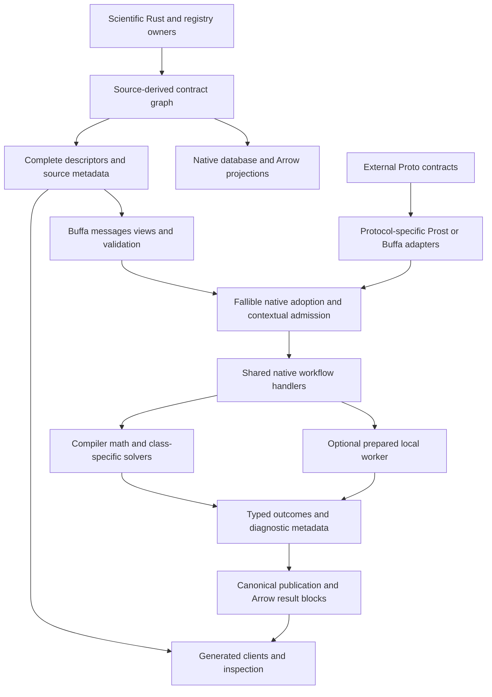

# Codebase-wide Proto target: comparative review

**Proposed target; researched 2026-11-03.** Inspected source
`f55951cfe995a689f9b75185b8e89cb362021616` and the eight supplied dirty reference
documents. Plan64 is being implemented concurrently in another session. This review records
the inspected implementation, not a continuously refreshed completion assessment. Source and
selected exact-library mechanisms are **Interface-checked**. No product, scientific,
interoperability or performance campaign ran; all integration benefits remain **Proposed**.

Inputs: [discovery suite](../../libraries/proto/briefing.md),
[coverage](../../libraries/proto/coverage.md), [focused applicability](../../libraries/proto/applicability.md)
and the existing CBO account, with explicitly dated focused updates to six occurrences.
Criteria: core 3.4, efficient-architecture heuristics 1.0 and process-simulator 1.5 through
the selected standard; base patterns edition 0.2 and additional patterns revision 5.
SurrealDB v4 is excluded. The operator permits any breaking change and selects a local
target with extension seams. Historical canonical-placement/no-daemon assumptions are
comparison premises, not vetoes over a better target. This is comparative advice, not a
formal architectural acceptance or an instruction to change current Plan64 scope.

## Recommended architecture

Adopt an owner-derived hybrid: executable domain declarations generate selected structural
contracts; a complete descriptor corpus feeds interoperable boundary representations,
validation, clients and inspection. Retain library-native numerical representations and
useful native database/Arrow execution. A representation is selected for its operation,
not merely because the same library supplies it everywhere.

The descriptor corpus is a generated interpretation artifact, not another editable scientific
authority. Source-aware generation descriptors and compact runtime pools have different
consumers. Retained records bind their original interpretation; reflection does not authorize
new science or mutate a known schema world in place.

### Contract and interface responsibilities

| Surface | Proposed responsibility and concrete mechanism | Native responsibility retained |
| --- | --- | --- |
| Source definitions and local rules | Explicit tags/versions/options at actual owners; `ProjectionGraph`, `BoundaryRecord`, generated fallible adapters; shared Buffa generation and compatible companions | Physical types, meaning, contextual admission, exact-parent edits and semantic hashing |
| Schema discovery and editing tools | Selected complete descriptor corpus, `DescriptorPool`, `DynamicMessage::from_options`, existing payload inspector and generated clients | Capability authorization, supported interpretation, source-byte provenance and edit semantics |
| Local control and workers | Generated ConnectRPC contracts dispatch shared typed handlers; explicit prepare/evaluate/status/cancel/read operations where the owner actually supports them | Original operation identity, effect authority, CPU/process custody and physical drain |
| Database/query projection | Source-derived field/value mapping with explicit mapping revision; native SurrealDB protocol at its external contract; optional original bytes for genuine forwarding/archive consumers | Transaction guards, exact scalar conversion, pre-allocation admission, commit/recovery and projection freshness |
| Scientific artifacts | Versioned reconstructible source/configuration/capability/outcome contracts; keep exact quantity/datum/precision and derivative demand | Mathematical validity, optimized evaluators, native handles and solver workspaces |
| Diagnostics/results | Owner-derived metadata, typed rich error details, explicit omissions/coverage and protected retained evidence references | Scientific diagnosis, numerical qualification, original causes, canonical publication and Arrow payload admission |

The target distinguishes decoding, local validation, known native adoption and contextual
scientific admission. None implies the next. It also distinguishes request completion,
observed terminal status, durable completion and actual native settlement.

## Complete alternatives and decisions

### Declaration and generation: CBO-195, CBO-042, CBO-040 and CBO-046

**Prefer owner-derived hybrid for first-party scientific/runtime meaning.** Native owner →
source graph → descriptors/adapters → client request → native admission/execution → generated
outcome projection is a complete route with executable domain authority. It can remove
mechanical maps and duplicated schema/rule declarations without making wire syntax the owner
of physical behavior. Buffa `generate_with_diagnostics` and `apply_companions` can share
generation infrastructure where package composition actually fits; separately valid plugin
outputs need not be forced into one tree.

**Retain Proto-first for independent contracts.** External database, OTLP and Perfetto schemas
already have their own authority. A wholly Proto-first simulator would still need executable
quantity, formulation, admission and hashing rules; its apparent simplification can create a
second semantic mirror. It remains eligible for independently governed extension interfaces.

**Do not globally replace this route with `proto_rs`.** Published 0.11.26's native annotations,
schema export and fallible shadows offer a credible local alternative. Its complete replacement
case must also cover registry/Arrow/database projections, maintained validation, reflection and
Connect clients. Development transport features do not establish that released composition.
Retain native-only/Serde for internal or human-authored documents where Proto adds an unused
second path. CBO-196's rustdoc intermediate remains unsettled until typed supplier projection
shows an advantage; wire generation alone does not settle it.

### Storage: CBO-066 and CBO-008

**Prefer explicit queryable native projections, with original bytes only when preservation is
an actual requirement.** Compare native fields, opaque messages and hybrid records per consumer.
An opaque payload alone loses useful database operations; projecting everything can lose
unknown data or exact representation. A hybrid is justified by both consumers, not as a
mandatory copy of every stored value. Bind descriptor/interpretation/mapping revisions and
define which projection is authoritative for each use.

Retain the externally governed SurrealDB Proto route and exact-value codecs until an alternate
route preserves cumulative preflight, rich errors and original statement completion. Public
`encode_proto`/`decode_proto` are useful value primitives, not application mapping, allocation
admission or transaction protocols. The patched local 3.3 server must be considered before
applying claims about unpatched custom APIs or modules. Native graph/changefeed facilities,
Surrealism and standalone KV/MX remain capability candidates; this inquiry establishes no
complete reason to introduce another canonical store or execution owner for them.

Wire package version, scientific interpretation, mapping revision and stored history are
distinct. Replaying changes needs exact cursor/mutation identity, acknowledgement and expiry
recovery. Neither a live notification nor an event payload proves a durable effect exactly once.

### Runtime and science: CBO-094, CBO-110 and CBO-099

**Prefer shared native handlers with optional explicitly prepared local boundaries.** Direct
Rust calls avoid codec/process machinery when independent access or isolation buys nothing.
Generated local services enable useful independent clients; provider workers enable selected
foreign/native isolation. They should share generic transport and contract infrastructure,
not merge scientific sessions or resource owners.

**Keep the numerical core native.** Transport a coherent evaluation batch/demand and exact
capabilities where isolation is worthwhile. Do not serialize closures/workspaces or insert
per-scalar RPC into every solver callback. The current water provider is evidence for a
specific route, not a universal worker implementation. Private root-child source reconstruction
and portable mathematical products deserve generated correspondence where a real consumer
benefits; a universal protobuf mathematical IR has no established complete advantage here.

Borrowed views, `OwnedView`, `ViewEncode`, bounded sinks, size-cache pooling and segmented
encoding are selective physical mechanisms. They must remove producer/materialization work
without prolonging oversized buffers or being flattened/compressed immediately downstream.
Do not credit them with measured zero-copy or whole-solve benefit.

### Diagnostics, results and clients: CBO-045, CBO-084, CBO-013 and CBO-008

**Prefer structured related records and references over one universal result/error envelope.**
ConnectRPC `with_detail`/`ErrorDetail::from_message` can expose independently readable rich
details; local `with_source` retains a Rust cause separately. Generate selected domain metadata
and field/rule attribution while retaining native diagnostic owners. Explicitly communicate
bounded-summary omissions and point to protected complete evidence where available.

Preserve partial-stream data with terminal failure and extent; EOF, health and schema discovery
are insufficient. Keep observation coverage/loss and expiry distinct from scientific progress,
committed results and native release. Retain Arrow for columnar products and external
OTLP/Perfetto contracts for their respective sinks. Optional Tokio-console answers task/runtime
questions; it does not become the operation-completion owner.

Generate independent local clients and reuse the existing schema/payload inspector rather
than writing a new generic decoder. Share reference envelope structure while reference
calculations and expected outputs remain independent. ProtoJSON is useful for inspection,
not an identity-preserving archive. Unknown-field forwarding and known scientific adoption
are different supported operations.

## Extension and failure challenges

| Revealing change or failure | Required property of the proposed route |
| --- | --- |
| Add a provider capability or physical representation | Meaning and admission change at the actual owner; generated projections/clients follow; unsupported old implementations refuse honestly |
| Add a solver outcome or diagnostic | Stable typed meaning and source identities reach readers without another string classifier or success-default enum conversion |
| Add a result product or selected-detail query | Metadata is discoverable; selection reaches the producer; useful Arrow/native payloads retain their physical access model |
| Unknown fields/enums, absence/default/null, integers beyond 2^53, IEEE payloads | Forwarding, native adoption, JSON inspection and database projection each state their fidelity contract; encoded bytes are not semantic identity |
| Wire-compatible change alters rules, units or database mapping | Interpretation/mapping/validation policy changes explicitly; Buf compatibility alone grants no scientific reuse |
| Exact-parent edit deletes a value but inherits another | Native delta semantics, not a generic FieldMask merge, determine intent and admissibility |
| Worker dies or client cancels after an effect but before reply | Original identity and effect owner settle uncertainty; reconnect does not mint a duplicate operation or release native work early |
| Old retained evidence or expired replay cursor | Original descriptor/mapping interpretation stays available where promised, or incompatibility/rebuild is explicit; no silent historical reinterpretation |
| Large views survive async work; stream fails after partial rows | Buffer/resource custody and partial completeness remain visible; transport success does not erase final failure |

These are analytical recommendation controls, not executed product tests. The detailed
briefings identify exact APIs, source links and proposed discriminating checks. Static source
settled the recommendation at this level; no uncertain runtime guarantee was promoted to
**Tested** or **Measured**.

## Integration, deletions and decision handoff

The most valuable integrated first change would extend one source-owned diagnostic/result
contract through generation, local access, retained interpretation and independent inspection.
It exercises more of the proposed architecture than another isolated serializer. Worker
extension should follow a concrete additional scientific implementation and its derivative
demands; storage projection should follow an actual query/history consumer. These are
dependency/value directions, not newly scheduled Plan64 packages.

Once a generated route covers its complete selected population, delete superseded mechanical
maps, repeated scalar rule declarations, duplicate schema walkers and obsolete client-specific
interpretations. Retain contextual constructors, exact-value conversion, transaction-specific
policy, external-protocol adapters and native settlement. Intentional breaking cutovers need
one active target route; retained evidence readers are explicit interpretation consumers rather
than a compatibility production path kept by default.

Changes to D1–D14, hashing/metadata/Python boundaries, crate structure or governing policy
require the existing ADR/design-review route, including the applicable refreshed diagnostic
account when a formal review is initiated. New relation/kernel/backend contracts follow their
applicable decision route. This comparative inquiry does not amend those owners, accept a
new architecture, change dependencies, or qualify concurrent Plan64 work.

Remaining conditional choices are local and explicit: dynamic mutation versus generated
fallible adapters; programmatic generator composition versus existing plugins; which durable
documents deserve binary contracts; which original payloads merit retention; and which
isolated providers justify transfer/preparation costs. Their settling evidence is in the
thematic accounts. None requires choosing a second universal semantic model now.

## Independent challenge and verification

A fresh reviewer read all fourteen research documents, the six focused CBO updates and
selected decisive sources. It found no blocking target-coherence or capability-coverage gap,
and identified one stale occurrence: CBO-110 still described the removed preparation-wire
mirror as current. That manifestation is now explicitly historical, with the generated
replacement and remaining portable/private-child footprint distinguished. This independent
challenge is focused comparative review, not formal architecture acceptance.

The local link-target check found zero missing targets across the fourteen research documents.
The documentation build published 1,054 chapters with scoped search. These checks establish
document linkage and publication only; no product/scientific or performance qualification
was performed. Initial docs/readiness launches failed before work because the tool process
had no systemd user unit; retrying in an owned transient scope succeeded, including `just ready`.
The normal repository-wide formatter was omitted to preserve concurrent source edits;
only the documentation index operation and scoped whitespace checks were selected.
