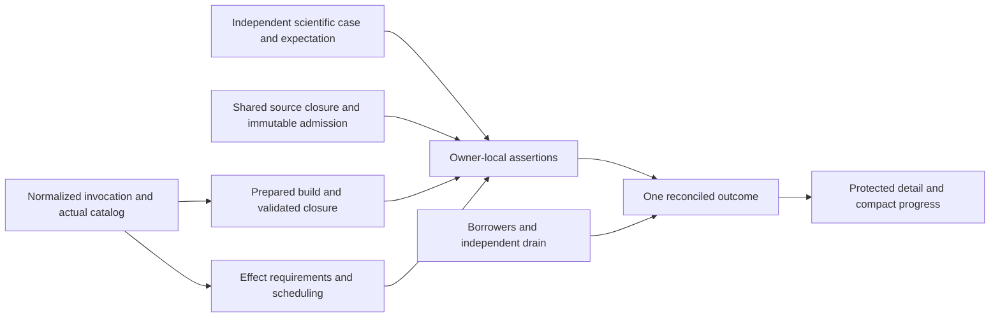

# Plan 53: Test architecture target

## Purpose, scope and authority

**Proposed:** bring the composed test architecture to the target in the [holistic test-architecture review](../design_review/reviews/design_review_test-architecture-target_2026-10-23.md). Preserve federated owner-local tests, independent science, shared conformance, actual native execution, durable lifecycle, installed Python and selected parity. Make their joins consistent: selected work governs preparation, validation, effects, execution and reported assurance; immutable input/detail can be shared while mutable attempts and borrowers remain separately owned.

This series captures all R01–R08, DTA-001–DTA-048, S01–S09, the accepted RC01/RC02, investigations and preservation/deletion obligations. The operator authorized creation of these plan documents, then P00/A01–A04 (integrated into main), and subsequently **all B01–B05 and C01–C05 on main**. Concurrent Plan52 FastMCP work retains its own implementation owner; this session owns the Plan53 invocation and assurance changes. RC01/RC02 were separately explicitly accepted on 2026-10-23. The execution checkpoint below records implemented changes and their bounded evidence; publication of a target alone does not establish product qualification.

This coordinator owns the combined target, shared decisions, cross-plan boundaries, one package-state table, finding dispositions and inquiries. Seven companions own detailed designs and acceptance, linking here for state. Reviews own remedy reasoning, audits own diagnosis, architecture/ADRs own enduring contracts/rationale. Scheduling a finding does not resolve it; a rule decision does not establish implementation. The source review's historical source references attribute evidence, not a commit pin, freeze or ongoing churn-reconciliation obligation.

Use the full selected standard: Core3.4, Efficient Architecture Heuristics1.0, Test Assessment1.2, ProcessSimulator1.5 and the pse-arrow binding in [standard.toml](../design_review/design_principles/standard.toml). Efficiency follows fundamental design: remove accidental dependencies, repeated preparation and growing rewrites while preserving scientific fidelity, authority, consistency, valid recovery and truthful evidence. No exhaustive checklist, cost model, mandatory benchmark/probe campaign or new generic test framework is selected.

## Foundation assessment and current-work reconciliation

**Interface-checked:** one substantive reconciliation against the current checkout on 2026-10-23 informed this plan. It followed the review into the affected existing owners and Plan52's current checkpoints/source; it did not repeat the diagnostic audit, qualify enclosing subsystems or adopt unrelated concurrent changes. Source inspection establishes available contracts, not tested combined behavior.

| Foundation | Current evidence and resulting plan decision |
|---|---|
| Scientific acceptance | Existing independent resolver/unit conversion, analytic primitive Hessians, shared model checks, nonlinear production owners, PID dynamics and durable readback are substantive. Preserve them. Add the named independent regime, variant, integrated composition, nonlinear curvature/covariance and reference-reproduction evidence in 53a. No escaped policy-projection fault was established for DTA-001. |
| Compiler admission | `workspace/modeling.rs::publish_modeling` and `publish_modeling_revision` already support `Arc<ModelingRevision>` reuse with exact context/physical-owner and receiving-budget checks. B05 adopts these operations, retaining fresh mutable attempts and fresh admission/invalidation tests. No new preparation cache is needed. |
| Invocation/build | Ordinary `_rust_capture` retains nextest binaries/Cargo metadata. Existing `arrow_validation.resolve` proves actual selected Arrow leaves. C/D unify their consumers; no replacement runner or feature-name-only proof. Actual catalog and shared requirement correspondence remain target work. |
| Tools/generation | `cargo_tools.selected_identity` plus `.config/diagnostic-tools.toml` authenticate cargo-hack/llvm-cov/mutants/fuzz, but not nextest. `validation_scope.INPUT_SCOPES['generation']` exists but omits consumed selected package/fixture-projection inputs. D01 repairs these specific premises. |
| Feature resume | `validation_feature_campaign` already captures literal cargo-hack argv, ordered complete combinations, tool/compiler/native context, conservative Rust inputs and authenticated passing origins. Standalone campaigns use the retained assessment owner. Preserve failure/interruption history and reused-versus-fresh meaning; do not recreate enumeration/resume or treat this as complete assembled qualification. |
| Installation context | `installation_context` and `surreal_source` now have a closed effective-context owner with fail-closed unknown/shared/dangling-target guards. Plan52d records one actual complete-context build and formatting-equivalence reuse plus changed-context refusal, within that supported server-build domain. This is a useful foundation, not a generic Cargo interpreter or proof that Python preparation inputs are complete. D03 assesses the extension's actual domain. |
| Optional evidence | Plan52c owns coverage, semantic challenges, finite decoder exploration, native diagnostic instrumentation and scientific reduction. Source includes exploration setup/feedback limits and native normal-lifecycle/build-qualification distinctions; checkpoint evidence limits remain narrower than full fuzz/sanitizer/scientific qualification. Concurrent reduction/diagnostic source and 52c edits remain that owner's work. These mechanisms neither replace named independent scientific expectations nor block Plan53 on whole Plan52 completion. |
| Resource/evidence | FileStore declaration/state, pending/uncertain protection, exact borrowers, terminal composer and original result/reuse readers already have real consumers. E preserves them while separating immutable selection/detail from mutable state. Existing aggregate snapshots and scoped combination reuse remain valid, not a general missing-cache defect. |
| Scheduling | Actual pure controls and two local Python consumers have removable accidental dependencies. Per-run exclusivity does not establish service-wide quiet; remaining canonical capacity independence is unproven. F narrows only demonstrated barriers and keeps necessary protection. |

[Plan52](52-agent-effectiveness-and-engineering-workflows.md) retains O08–O17 and its I05–I07/tool capability delivery. Plan53 owns the specific test-architecture corrections and their consumer integration. Share an existing implementation/evidence source when it satisfies both scopes; record distinct acceptance at each owner without duplicating live progress or moving unrelated work. Plan52's scientific reducer/diagnostic changes are not assumed tested by this plan. Plans28/32/40 retain independent scientific/workspace/substrate authority. No dependency on completing an entire other plan is introduced; use an actual needed contract slice or explicitly retain its conservative fallback.

## Combined target and document boundaries



The diagram describes consumed responsibilities, not a full-stack fixture mandated for each test. Reuse production types/admission/library execution where they discharge the intended responsibility. Keep expected science independently justified at the failure mechanism. Share immutable authored input, admitted revisions, compatible build artifacts and protected detail under known premises. Keep mutable workspaces/runtime, new numerical-state feasibility, databases, exact borrowers and cancellation/deadline scope where required.

Maintain selected/executed/assertion-not-reached/not-run, raw child/reconciled assurance/cleanup, historical execution/current applicability, immutable definition/mutable attempt, retained state/live demand and original/projection distinctions. These can be ordinary existing functions/fields, not a new type/service for each phrase. Tool-owned selection, actual Arrow force-validation, clean-room references, exact pins/one Arrow family, original-space checks, Pending-before-authority, unknown retention and terminal immutability remain binding.

| Companion | Owns detailed design | Contract handed to others |
|---|---|---|
| [53a: Scientific assurance and references](53a-scientific-assurance-and-references.md) | R01 science and independent expected properties; reference generators | Discriminating cases and reproducible references; no general oracle |
| [53b: Helpers, inputs and fixtures](53b-test-helpers-inputs-and-fixtures.md) | R02/R03 source-owned refusals, narrow helpers, immutable input/admission | Sufficient consumed scientific closures, stable observations/reasons, intentional support variants, two effect-free consumers |
| [53c: Invocation, requirements and outcomes](53c-invocation-requirements-and-outcomes.md) | R04/R06 one interpretation/catalog, actual requirements/validation, truthful outcomes | Selected identity/effects/roles, actual validation proof and reconciled managed result |
| [53d: Build, discovery and generation](53d-build-discovery-and-generation.md) | R05 consumed identities, retained build, Python preparation, generation/capture | Compatible prepared artifacts and complete conservative inputs |
| [53e: Resource and evidence lifetimes](53e-resource-and-evidence-lifetimes.md) | R07 immutable header, independent cleanup, service access, custody, compact progress | Protected exact association/detail, honest cleanup facts and versioned readers |
| [53f: Effect-scoped scheduling](53f-effect-scoped-scheduling.md) | R08 actual exclusion scope and explicit local settings | Pure controls independent, real service/timing/native/canonical protection retained |
| [53g: Qualification and publication](53g-qualification-and-publication.md) | Joined S01–S09 acceptance, enduring owners and retirement | Assembled evidence with actual support limits, then current contract publication |

Document boundaries group reasoning; packages below group coherent producer/consumer migrations. No companion completion is an automatic whole-system barrier. Shared editing surfaces (manifests/locks, `test_run`/`validation`, nextest/conftest, runtime/conformance fixtures and FileStore/readers) need explicit single writers during execution, even for logically independent packages.

## Accepted rule changes and advance publication

Both source review impacts were **explicitly accepted by the operator on 2026-10-23** during plan preparation. Their acceptance governs the authorized P00/A01–A04 execution; C02/C04 implementation is authorized; F implementation remains unselected.

| Review impact | Accepted target consequence | Publication route and dependent work |
|---|---|---|
| [RC01](../design_review/reviews/design_review_test-architecture-target_2026-10-23.md#rc01) | Public managed correctness exit zero iff complete reconciled Pass; retain raw child return/cancellation and independent cleanup | P00 publishes the command/result contract through blueprint §24.1's design route with revision row and validation/result guide; update the intentional self-test/callers in C04. Supersede any accepted ADR only if its exact contract conflicts; never edit accepted records in place. |
| [RC02](../design_review/reviews/design_review_test-architecture-target_2026-10-23.md#rc02) | One actual effect/requirement interpretation serves managed routes; demonstrably pure cases lose accidental barriers; real canonical/timing/native protection stays | P00 publishes selected-requirement policy through §24.1 and scheduler/agent-environment guidance before C02/F01/F02 behavior changes. nextest/conftest remain execution mechanisms; no exact-name acceptance manifest or global governor. |

<a id="p00"></a>
### P00 — Publish accepted contract slices

At authorized execution, inspect the exact currently governing text and publish each accepted change through its actual route before dependent behavior changes. Use the existing design authorization marker for authoritative edits and a blueprint revision row. The source review already supplies target-tier reasoning; do not restart it as a broad audit. If a governed accepted decision must change, prepare the required superseding ADR/design publication before that change, using normal status/PR rules. Routine implementation under existing contracts needs no speculative ADR. Record resulting references here; `adrs: []` currently invents none.

B02's typed refusal direction fits the existing §23.2 source-owned typed-cause contract on examined evidence. I04 confirms concrete constructor/codec scope; no extra blocking rule impact is established. If an actual incompatible public promise emerges, identify it and seek its specific decision before that incompatible change. Other ready work continues. This plan does not pre-approve unrelated diagnostic, hashing, Python-boundary or governance redesign.

## Package state and execution route

This is the **single package progress owner**. P00, A01–A04, B01–B05 and C01–C05 are authorized; D–G remain planned and require separate execution authorization. Completion means the linked package's producer, actual consumer migrations, replacement deletions and required evidence, not merely an agreed interface. Package acceptance was **Proposed / not_run** at authoring; current execution evidence is recorded below.

| Package | Status | Owner | Completion |
|---|---|---|---|
| P00 | done | [Coordinator](#p00) | Accepted target published in blueprint §24.1, revision 260 and validation/environment guides; C02/C04 delivered below; F remains planned |
| A01 | done | [53a](53a-scientific-assurance-and-references.md#a01) | Tested: independent status inventory and all three local comparison controls; nine selected native-local tests pass |
| A02 | done | [53a](53a-scientific-assurance-and-references.md#a02) | Tested: nine-feed regime journey and wrong-regime controls; solved countercurrent and unequal-pressure mixer; current PID consumer qualification remains A04 |
| A03 | done | [53a](53a-scientific-assurance-and-references.md#a03) | Tested: independent integrated PR root/layout/mixed Hessian and two-point exact/approximate nonlinear publication/readback |
| A04 | in-progress | [53a](53a-scientific-assurance-and-references.md#a04) | I02 resolved; all three independent generators pass; PFR/controller assembled consumers retain failed/inconclusive acceptance below |
| B01 | done | [53b](53b-test-helpers-inputs-and-fixtures.md#b01) | I03 resolved; bound-source helper, stable body-admission counters and complete private query observer; targeted math/compiler controls pass |
| B02 | done | [53b](53b-test-helpers-inputs-and-fixtures.md#b02) | I04 resolved; source-owned typed reasons retain diagnostic identity/location; valid and single-change origin controls pass |
| B03 | done | [53b](53b-test-helpers-inputs-and-fixtures.md#b03) | Unused doubles/devdeps removed; seven support-enabled Rust and five support-absent Python/local controls pass with complete reconciled reports |
| B04 | done | [53b](53b-test-helpers-inputs-and-fixtures.md#b04) | I05 resolved; nineteen families feed runtime/affected/archive consumers; migrated scientific and runtime controls and 162 tooling controls pass |
| B05 | done | [53b](53b-test-helpers-inputs-and-fixtures.md#b05) | Compatible revision reuse and context/owner/budget refusal controls pass; two local Python cases pass with no-allocation guards through the existing result composer |
| C01 | done | [53c](53c-invocation-requirements-and-outcomes.md#c01) | One invocation/config/profile/overlay interpretation with actual tool selection |
| C02 | done | [53c](53c-invocation-requirements-and-outcomes.md#c02) | Actual catalog/requirements/roles and before-effects guard across managed routes |
| C03 | done | [53c](53c-invocation-requirements-and-outcomes.md#c03) | Actual Arrow leaves proved across installer/codegen/routes; stale declaration/check removed |
| C04 | done | [53c](53c-invocation-requirements-and-outcomes.md#c04) | Complete-pass exit and typed setup/assertion-not-reached with separate cleanup |
| C05 | done | [53c](53c-invocation-requirements-and-outcomes.md#c05) | I07 resolved; active Python/peer/optional scope, replaced dead bodies removed |
| D01 | planned | [53d](53d-build-discovery-and-generation.md#d01) | Nextest authenticated by existing owner; consumed generation package inputs complete |
| D02 | planned | [53d](53d-build-discovery-and-generation.md#d02) | Existing retained build/catalog path serves fallback; equivalent correctness preparation shared |
| D03 | planned | [53d](53d-build-discovery-and-generation.md#d03) | I06 resolved; Python ensure/install/stubs/admission split with full known validity inputs |
| D04 | planned | [53d](53d-build-discovery-and-generation.md#d04) | Overlap generated once; scope chosen before byte reads with full required provenance |
| E01 | planned | [53e](53e-resource-and-evidence-lifetimes.md#e01) | One selected header, compact membership and safe stored-state/reader cutover |
| E02 | planned | [53e](53e-resource-and-evidence-lifetimes.md#e02) | Independent sibling cleanup/drain continues within original deadline/cancellation |
| E03 | planned | [53e](53e-resource-and-evidence-lifetimes.md#e03) | Conservative service/generation active-access lookup preserves authority/save ordering |
| E04 | planned | [53e](53e-resource-and-evidence-lifetimes.md#e04) | Custody always retained; nonempty scratch projection alone selects reclaim candidates |
| E05 | planned | [53e](53e-resource-and-evidence-lifetimes.md#e05) | I09 resolved; compact atomic roots/versioned readers preserve original detail and reuse checks |
| F01 | planned | [53f](53f-effect-scoped-scheduling.md#f01) | Shared requirements remove pure/two local Python barriers; necessary protection retained |
| F02 | planned | [53f](53f-effect-scoped-scheduling.md#f02) | I08 resolved; actual chosen service/database scope survives two separate runs |
| F03 | planned | [53f](53f-effect-scoped-scheduling.md#f03) | Explicit sufficient bounded local settings and role premises; canonical barrier retained |
| G01 | planned | [53g](53g-qualification-and-publication.md#g01) | Functional scope/deletions complete, joined S01–S09 and selected scope-end qualification |
| G02 | planned | [53g](53g-qualification-and-publication.md#g02) | Enduring owners/outcomes/current-work/retirement reconciled without other-plan closure |

Start with P00 publication, consequential inquiry decisions and ready independent A01/A03/B01/B03/E02/E04 work. D01 establishes consumed nextest compatibility; C01 establishes the pure interpretation/catalog seam, then C02 the shared requirements/association and C03 actual validation. C04 needs their selected managed-route slices and P00, not whole C05 or E. C05 migrates actual optional/boundary roles through C02. B04's sufficient scientific closure precedes narrowing dependent input capture; B05 can reuse the existing sufficient admitted revision early without waiting for an ideal minimal closure. B03/C01/C03/D01 then allow D02; I06/C03 allow D03; D04 may make conservative correctness repairs before B04 permits narrower scope. E01 consumes actual catalog identity, E03 serves conservative service access, E05 cuts over readers with C04/E04 facts. F01 follows C02/B05; F02 follows I08 and needed E03 protection. E02/E04/F03 need no entire companion barrier. G01 follows all functional migrations/deletions; G02 closes publication/retirement after real evidence. An early slice never marks its enclosing package complete.

## Inquiry outcomes and remaining questions

Each inquiry has a decision product, scoped evidence and explicit dependent behavior. These are bounded execution investigations, not a new audit or indefinite research backlog. Local naming/layout choices remain implementer judgment.

| Inquiry | State | Owner | Decision / completion evidence |
|---|---|---|---|
| I01 | resolved | [A02](53a-scientific-assurance-and-references.md#a02) | Compute independent positive slack and propagated feasibility envelope for selected phase fixture; adopt concrete regime bound or choose a better away-transition case. Blocks that regime assertion, not historical policy or other cases. |
| I02 | resolved | [A04](53a-scientific-assurance-and-references.md#a04) | Locate/recover verifiable three generators or specify independent reduced equations/method/environment; reproduce references or explain reviewed discrepancy before golden migration. No production-output regeneration. |
| I03 | resolved | [B01](53b-test-helpers-inputs-and-fixtures.md#b01) | Existing counters establish no new semantic-body admissions, not exact Salsa memo hits. Other query claims use one private observer with positive cold/invalidation and missing/truncated refusal controls; independent fresh results remain. |
| I04 | resolved | [B02](53b-test-helpers-inputs-and-fixtures.md#b02) | Source-owned reasons fit §23.2; migrated constructors/forwarders preserve ValidationInvariant, ModelingContract, declaration and real source location. Codec/changed-prose controls pass; untouched contracts explicitly remain Unclassified. |
| I05 | resolved | [B04](53b-test-helpers-inputs-and-fixtures.md#b04) | Nineteen declared families use real bounded package/P0/parser closure, exact data/source bytes, directory membership/absence and explicit synthetic substitutions. Drift refuses publication; unknown affected edges broaden. Full sufficient closures adopted without a minimality claim. |
| I06 | open | [D03](53d-build-discovery-and-generation.md#d03) | Establish extension installer/build/stub/native consumed-input and binary-identity domain, mutable boundaries and unknown fallback. Reuse only known complete premises; otherwise prepare conservatively. |
| I07 | resolved | [C05](53c-invocation-requirements-and-outcomes.md#c05) | Public configuration/native-route diagnostics replace dormant harness claims; synthetic schema/NativeReuse combinations retain explicit coverage limits. Separate operator, component overlap and owned restart roles are selected; actual peer acceptance is recorded in C05's Outcome. |
| I08 | open | [F02](53f-effect-scoped-scheduling.md#f02) | Identify true service-quiet versus database-local claims; select once-per-invocation owned service or justified narrower assertion and demonstrate two-run isolation. Retain protection until then; no blanket capacity relaxation. |
| I09 | open | [E01/E05](53e-resource-and-evidence-lifetimes.md#e01) | Establish selected-header/receipt reader and protected-origin inventory plus bounded stored-format transition. Choose authenticated migration or explicit reuse refusal with protected inspection. No missing record becomes empty/pass; no permanent parallel production path. |

## Recommendation and scenario correspondence

The source [review §4](../design_review/reviews/design_review_test-architecture-target_2026-10-23.md#4-scenarios-that-distinguish-this-target) owns S01–S09 definitions. [53g](53g-qualification-and-publication.md#g01) owns joined acceptance detail.

| Recommendation | Primary work and material contributors | Source scenarios |
|---|---|---|
| R01 | A01–A04; B02 typed origin control | S01, S05 |
| R02 | B01–B03; A01 comparator semantics, D02 support variants | S01, S03, S04, S06 |
| R03 | B04/B05; D01/D04 consumed inputs, F01 local consumers | S02, S04, S09 |
| R04 | C01–C03/C05; D01 tool contract, F01 effect scheduling | S03–S05, S09 |
| R05 | D01–D04; C03 actual validation, B03/B04 support/source contracts | S02, S04, S05, S08 |
| R06 | C04/C05; C02 required roles, E02 cleanup | S03, S06, S08 |
| R07 | E01–E05; C01/C02 identity, existing Plan52 resume | S06–S08 |
| R08 | F01–F03; B05 effects, C02 requirements, E03 service protection | S04, S09 |

## Finding dispositions

One primary work owner below coordinates contributors and closes only on actual evidence. Corrective rows record their current scheduled or resolved scope; resolution requires the stated evidence. Disproved/superseded rows record the review's scoped diagnostic correction/withdrawal, not new implementation or portfolio-wide assurance. Each DTA link points to its original diagnostic home.

| Finding reference | Scenario reference | Disposition | Decision/work owner | Evidence or revisit trigger |
|---|---|---|---|---|
| [DTA-001](../design_review/test-audit/oracles-and-acceptance.md#dta-001) | S01 | disproved — examined reuse indictment | [A01](53a-scientific-assurance-and-references.md#a01) | Retain independent resolver/conversion/direct export and parity scale cancellation; no change in examined scope. Revisit only a concrete escaped policy/projection fault, not unexamined breadth. |
| [DTA-002](../design_review/test-audit/oracles-and-acceptance.md#dta-002) | S01 | resolved | [A02](53a-scientific-assurance-and-references.md#a02) | I01 justified phase/slack/feasibility bound plus wrong interior-regime control; historical policy and nested-vapor witness retained. |
| [DTA-003](../design_review/test-audit/oracles-and-acceptance.md#dta-003) | S01 | resolved | [A04](53a-scientific-assurance-and-references.md#a04) | All three committed independent generators reproduce declared frozen claims, without golden migration. A04 retains separate failed/inconclusive production-consumer qualification. |
| [DTA-004](../design_review/test-audit/oracles-and-acceptance.md#dta-004) | S05 | resolved | [A01](53a-scientific-assurance-and-references.md#a01) | Independent declared code/name/category/assurance inventory including limits/unknown; missing or misclassified declared arm fails. |
| [DTA-005](../design_review/test-audit/oracles-and-acceptance.md#dta-005) | S01 | resolved | [A03](53a-scientific-assurance-and-references.md#a03) | Integrated root/key/binding/mixed-second-order discriminator; retain independent primitive Hessians. |
| [DTA-006](../design_review/test-audit/oracles-and-acceptance.md#dta-006) | S01 | resolved | [B02](53b-test-helpers-inputs-and-fixtures.md#b02) | Real admitted quantity/context control succeeds; each single-condition mutation reaches the intended typed inference rule. Targeted quantity test passes. |
| [DTA-007](../design_review/test-audit/oracles-and-acceptance.md#dta-007) | S01 | resolved | [A01](53a-scientific-assurance-and-references.md#a01) | Finite/extent/sample-time and meaningful wrong-result controls in all three helpers; distinct tolerance semantics retained. |
| [DTA-008](../design_review/test-audit/doubles-and-coupling.md#dta-008) | S01 | superseded — withdrawn diagnosis | [B03](53b-test-helpers-inputs-and-fixtures.md#b03) | Retain complementary static Ready and contextual readiness; no repair or blanket wrapper replacement. |
| [DTA-009](../design_review/test-audit/doubles-and-coupling.md#dta-009) | S04 | resolved | [B01](53b-test-helpers-inputs-and-fixtures.md#b01) | Existing counters prove no new body admissions; one complete private query observer handles other claims. Cold/invalidation and missing/truncated controls pass; fresh comparison remains. |
| [DTA-010](../design_review/test-audit/doubles-and-coupling.md#dta-010) | S04 | resolved | [B01](53b-test-helpers-inputs-and-fixtures.md#b01) | SourceBody::prepare replaces ten common math/backend construction paths; caller-owned attribution/cancel/residual differences remain. Targeted math/backend controls pass. |
| [DTA-011](../design_review/test-audit/doubles-and-coupling.md#dta-011) | S06 | resolved | [B03](53b-test-helpers-inputs-and-fixtures.md#b03) | Participation/support scopes documented and separated. Seven support-enabled Rust controls and three complementary support-absent Python reader/drop journeys pass against the current admitted service. |
| [DTA-012](../design_review/test-audit/evidence-routes-and-execution.md#dta-012) | S06 | resolved | [C04](53c-invocation-requirements-and-outcomes.md#c04) | RC01 public zero iff complete Pass; zero child/missing report nonzero, raw child and cleanup retained separately. |
| [DTA-013](../design_review/test-audit/evidence-routes-and-execution.md#dta-013) | S03 | resolved | [C05](53c-invocation-requirements-and-outcomes.md#c05) | Active Python assertions replace inactive Rust bodies; selected component/restart peers have real roles or obsolete unsupported claim retires. |
| [DTA-014](../design_review/test-audit/evidence-routes-and-execution.md#dta-014) | S06 | resolved | [C05](53c-invocation-requirements-and-outcomes.md#c05) | Separate executed opt-in CLI result; selected missing prerequisite fails; API-only scope remains substantive. |
| [DTA-015](../design_review/test-audit/evidence-routes-and-execution.md#dta-015) | S03, S06 | resolved | [C02](53c-invocation-requirements-and-outcomes.md#c02) | Managed affected/native/Python/setup requirements/environment/association/composer agree; C04 outcomes; bare route limits explicit. |
| [DTA-016](../design_review/test-audit/evidence-routes-and-execution.md#dta-016) | S03, S09 | resolved | [C02](53c-invocation-requirements-and-outcomes.md#c02) | Actual catalog and before-effects guard catch stale/missing scheduling facts after rename/new case; F01 consumes RC02. |
| [DTA-017](../design_review/test-audit/evidence-routes-and-execution.md#dta-017) | S05 | resolved | [C03](53c-invocation-requirements-and-outcomes.md#c03) | Installer/codegen/managed actual normal/build/dev target/host Arrow leaves verified; pure/unknown controls; stale metadata/check deleted. |
| [DTA-018](../design_review/test-audit/execution-efficiency.md#dta-018) | S04 | resolved | [B05](53b-test-helpers-inputs-and-fixtures.md#b05) | Compatible immutable revision reuse and two demonstrated local Python migrations pass. Fresh databases, schema/issuer identity, connections and drain controls remain; no blanket template. |
| [DTA-019](../design_review/test-audit/evidence-routes-and-execution.md#dta-019) | S04 | resolved | [B03](53b-test-helpers-inputs-and-fixtures.md#b03) | Actual consumer inventory removed unused FaultStore/FaultPlan/CountingStore, execution/introspection helpers, self-tests and dependencies. NativeFixture/factory/capture and independent fault controls remain. |
| [DTA-020](../design_review/test-audit/oracles-and-acceptance.md#dta-020) | S01 | resolved | [A03](53a-scientific-assurance-and-references.md#a03) | Nonlinear active-constraint sensitivity/value Hessian and covariance publication/readback: exact 1/7 vs GN 1/5, second point 1/25 vs 1/17. |
| [DTA-021](../design_review/test-audit/oracles-and-acceptance.md#dta-021) | S01 | resolved | [A02](53a-scientific-assurance-and-references.md#a02) | Solved countercurrent and unequal-pressure min-vs-max/mean cases; PID nonzero-Td dynamics retained and generator handled by A04. |
| [DTA-022](../design_review/test-audit/test-execution-system.md#dta-022) | S03, S05 | resolved | [C01](53c-invocation-requirements-and-outcomes.md#c01) | Single aliases/env/default/custom-config/profile/report/association interpretation; opaque arguments preserved, unsupported scope refuses. |
| [DTA-023](../design_review/test-audit/test-execution-system.md#dta-023) | S03 | resolved | [C02](53c-invocation-requirements-and-outcomes.md#c02) | Actual selected campaign-role correspondence catches lost member in nonempty union; obsolete recipe references removed. |
| [DTA-024](../design_review/test-audit/test-execution-system.md#dta-024) | S05, S08 | scheduled | [D01](53d-build-discovery-and-generation.md#d01) | Existing tool identity extended to nextest; consumed selected package/fixture generation inputs included; Plan52 combo resume preserved. |
| [DTA-025](../design_review/test-audit/evidence-routes-and-execution.md#dta-025) | S06 | resolved | [C04](53c-invocation-requirements-and-outcomes.md#c04) | Authenticated typed setup failure and assertion-not-reached, no panic parsing; exact-generation preflight bounds repeats without hiding failure. |
| [DTA-026](../design_review/test-audit/test-execution-system.md#dta-026) | S03 | resolved | [C01](53c-invocation-requirements-and-outcomes.md#c01) | Shared pure interpretation and explicit performing composition; C02/C04 migrate consumers/delete reciprocal duplicated meaning, not file-count cleanup. |
| [DTA-027](../design_review/test-audit/doubles-and-coupling.md#dta-027) | S02 | resolved | [B04](53b-test-helpers-inputs-and-fixtures.md#b04) | Nineteen declared family roots/projections derive real package/import/data closure once; actual Rust/Python/conformance/runtime consumers use it. Authentic transport and bounded synthetic meanings remain distinct. |
| [DTA-028](../design_review/test-audit/doubles-and-coupling.md#dta-028) | S01 | resolved | [B02](53b-test-helpers-inputs-and-fixtures.md#b02) | Source-owned typed reasons survive constructors, forwarding and diagnostic codec with declaration/code/actual location. Changed display wording does not own semantic assertions; targeted controls pass. |
| [DTA-029](../design_review/test-audit/execution-efficiency.md#dta-029) | S04 | resolved | [B03](53b-test-helpers-inputs-and-fixtures.md#b03) | canonical-tests selects participation; test-support selects instrumentation/lifetime. Support-enabled Rust and support-absent Python reader/drop selections pass; D02 retains these intentional variants. |
| [DTA-030](../design_review/test-audit/execution-efficiency.md#dta-030) | S04 | resolved | [B05](53b-test-helpers-inputs-and-fixtures.md#b05) | Existing immutable revision reuse retains fresh workspaces; context/physical-owner/budget refusals and independent fresh admission/edit controls pass. |
| [DTA-031](../design_review/test-audit/execution-efficiency.md#dta-031) | S04, S09 | resolved | [B05](53b-test-helpers-inputs-and-fixtures.md#b05) | Two local Python cases pass with collection/group and execution no-allocation guards using ephemeral capabilities and authentic immutable module evidence. C02/F01 broader requirement work remains separate. |
| [DTA-032](../design_review/test-audit/execution-efficiency.md#dta-032) | S04 | scheduled | [D02](53d-build-discovery-and-generation.md#d02) | Actual equivalent correctness closures shared; interactive/support differences and ADR-0122 unification retained. |
| [DTA-033](../design_review/test-audit/execution-efficiency.md#dta-033) | S04, S05 | scheduled | [D03](53d-build-discovery-and-generation.md#d03) | I06 complete known preparation/binary inputs; pure Python no rebuild/stubs, changed/unknown prepares, mutable replacement refuses. |
| [DTA-034](../design_review/test-audit/execution-efficiency.md#dta-034) | S04 | scheduled | [D02](53d-build-discovery-and-generation.md#d02) | Fallback consumes existing retained nextest/Cargo build/catalog with exact graph checks; duplicate path removed, no second cache. |
| [DTA-035](../design_review/test-audit/execution-efficiency.md#dta-035) | S02 | resolved | [B04](53b-test-helpers-inputs-and-fixtures.md#b04) | Invocation-captured science replaces shared package embeddings in migrated consumers; source-only reload controls pass without changing consumer code. True local embeddings and fresh numerical attempts remain. |
| [DTA-036](../design_review/test-audit/execution-efficiency.md#dta-036) | S02 | resolved | [B04](53b-test-helpers-inputs-and-fixtures.md#b04) | One captured closure feeds conservative affected preview for imported source, data, membership and absence. Unknown/new/deleted edges broaden; coverage overlay cannot prune selection. Focused controls pass. |
| [DTA-037](../design_review/test-audit/execution-efficiency.md#dta-037) | S02, S05 | scheduled | [D04](53d-build-discovery-and-generation.md#d04) | Overlapping aggregate generation once with actual roots; independent recipes/Python/native ABI/missing-extra-untracked checks retained. |
| [DTA-038](../design_review/test-audit/execution-efficiency.md#dta-038) | S06, S07 | scheduled | [E01](53e-resource-and-evidence-lifetimes.md#e01) | Immutable selected header; mutable compact members under original locks/deadline/transitions/freeze; interrupt/header mismatch controls. |
| [DTA-039](../design_review/test-audit/execution-efficiency.md#dta-039) | S02, S07 | scheduled | [D04](53d-build-discovery-and-generation.md#d04) | Select scope before byte access; full promised provenance and distinct mutable hashes, symlink/mode/add/delete/absence preserved. |
| [DTA-040](../design_review/test-audit/execution-efficiency.md#dta-040) | S08 | disproved — blanket reuse indictment | [E05](53e-resource-and-evidence-lifetimes.md#e05) | Retain valid aggregate snapshot and scoped reuse/transfer/Plan52 combo resume; historical execution not automatically current. No global redesign selected. |
| [DTA-041](../design_review/test-audit/execution-efficiency.md#dta-041) | S06 | superseded — withdrawn diagnosis | [E01](53e-resource-and-evidence-lifetimes.md#e01) | Retain authenticated pending/uncertain recovery, writer fences/borrowers/late effects/terminal/unknown protection; no disposal-only simplification. |
| [DTA-042](../design_review/test-audit/execution-efficiency.md#dta-042) | S06, S09 | scheduled | [E02](53e-resource-and-evidence-lifetimes.md#e02) | Independent drain/cleanup continues with aggregate errors/original deadline; E03 scoped access and retained-reader/race controls; unknown retained. |
| [DTA-043](../design_review/test-audit/execution-efficiency.md#dta-043) | S09 | scheduled | [F02](53f-effect-scoped-scheduling.md#f02) | I08 actual service-wide isolation or legitimate database-local claim; two separate-run control, ordinary unbounded mode retained. |
| [DTA-044](../design_review/test-audit/execution-efficiency.md#dta-044) | S04, S09 | scheduled — narrow consumers only | [F01](53f-effect-scoped-scheduling.md#f01) | B05 removes two accidental consumers; broad unnecessary-barrier diagnosis unestablished. Retain remaining canonical barrier; revisit only actual wider supported scope with demand/lifetime evidence. |
| [DTA-045](../design_review/test-audit/execution-efficiency.md#dta-045) | S09 | scheduled | [F01](53f-effect-scoped-scheduling.md#f01) | Pure KINSOL/Ipopt controls shed unrelated reservation via C02/RC02; genuine native/thread/timing/heavy requirements stay. |
| [DTA-046](../design_review/test-audit/execution-efficiency.md#dta-046) | S09 | scheduled | [F03](53f-effect-scoped-scheduling.md#f03) | Explicit sufficient local settings, ceilings distinct from demand, 8-GiB functional versus 144-GiB observer role; no OOM inference/planner/blanket parallelism. |
| [DTA-047](../design_review/test-audit/execution-efficiency.md#dta-047) | S06, S07 | scheduled | [E04](53e-resource-and-evidence-lifetimes.md#e04) | Custody/sealing and protected-origin reuse retained; explicit nonempty scratch projection selects reclaim candidates. |
| [DTA-048](../design_review/test-audit/execution-efficiency.md#dta-048) | S07, S08 | scheduled | [E05](53e-resource-and-evidence-lifetimes.md#e05) | Compact atomic root + immutable detail, one versioned reader, crash/corruption/selective hydration/original diagnostic/graph checks preserved. |

## Verification, deletion and closure

**Proposed / not_run:** each linked package carries targeted compile/unit/meaningful wrong-case acceptance, producers and consumer migrations plus deletion of what it replaces. Delete obsolete parsers/tables/declarations, dormant bodies, unused doubles/devdeps, duplicate source lists/embeddings, redundant build/generation paths and repeated payload/readers as their replacements are proven and callers migrate. Keep no compatibility production path solely as history. Immutable support/recovery/reference guarantees are not legacy clutter.

[53g](53g-qualification-and-publication.md) owns assembled acceptance and scope-end checks under the repository rhythm. Required qualification and optional future measured benefit remain separate. A static account of eliminated repeated work establishes the structural correction, not a numeric latency, memory or capacity improvement. Evidence labels and actual command/mode/scope/zero-baseline results belong to closing Verification/Outcome; authoring establishes none of the proposed test outcomes. No all-model/platform/solver qualification, benchmark gate, retired portable campaign or per-package formal audit is added.

Completion requires every required functional migration/deletion and selected assembled evidence, explicit final DTA/inquiry dispositions, published accepted rules and current enduring owner documentation. The coordinator Outcome must explain what was built, a mistake corrected, deliberate deviations and actual not-run limits; then reconcile native bindings/current-work/inbound consumers and retire consumed material under ADR-0096. Other active plans do not close with this series.

## Checkpoint — document creation, 2026-10-23

Eight draft documents now specify the target, coherent packages and their decision/evidence routes. RC01/RC02 acceptance is recorded; their authority publication and behavior changes remain planned. The single current-source reconciliation has been incorporated; no commit pin or ongoing churn ledger is required. All implementation and product qualification remain unexecuted by this plan-writing engagement. The next authorized execution can start with P00, inquiry decisions and independent ready packages described above; this checkpoint itself grants no execution authorization.

## Execution checkpoint — P00/A01–A04, 2026-10-23

Execution is authorized for P00 and the full scientific companion only. Work is isolated on
`53a-scientific-assurance`, based on committed main; uncommitted Plan52 work is not copied.
P00 publishes the accepted target through blueprint §24.1/revision 260 and the command/environment
guides. Existing managed exits and scheduling remain unchanged. A01–A04 implement their owner-local
controls and independent references. Committed main changes will be merged at coherent checkpoints;
return integration into main awaits maintainer go-ahead. Other Plan53 packages remain planned.


### Current acceptance boundary — 2026-10-24

**Implemented:** committed main is integrated through `338856873` (Plan52e closeout). P00
publishes RC01/RC02 as accepted targets in blueprint §24.1/revision 260; it does not implement
C02/C04/F01/F02. A01 replaces the fallback-only status guard and weak local comparator premises.
A02 adds independent phase-regime and solved model-variant witnesses. A03 adds independent
integrated PR curvature and nonlinear sensitivity/covariance publication/readback. A04 commits
three independent reduced-equation generators and verifiable locators, preserving frozen goldens.
The maintainer-selected functional store limit is permanently three; full per-store accounting,
unknown-owner protection and the single timing-store slot remain in force.

**Tested:** all 16 distinct selected native cases have passing results across focused runs,
with zero failures in their final affected retries. This is cumulative targeted evidence, not a
claim that one final invocation ran all 16 or that the repository passed. The nine native-local
status/comparator/projection/dynamics controls, the phase wrong-case control, nine-feed phase
journey, retained analytic sensitivity control, nonlinear sensitivity readback, nonlinear
covariance readback, model-variant journey and integrated PR witness comprise that selection.

The force-validated native command family is:

```bash
scripts/pse-env --recipe-default-class compile --native -- just unit-native-package pse-runtime \
  'pse-runtime/native-solvers,pse-runtime/canonical-tests,pse-tests-conformance/native-acceptance,pse-backend-native/highs' \
  '<selected nextest filter>' -p pse-tests-conformance -p pse-backend-native -p pse-math
```

The final affected filters were
`test(nonlinear_constraint_curvature_sensitivity_and_value_hessian_reopen)` and
`test(nonlinear_state_constraint_exact_and_gauss_newton_covariance_reopen)` (both pass in the
four-case correction run), `test(authored_countercurrent_and_unequal_pressure_variants)`
(pass in the two-case assembly/variant run), and
`test(integrated_pr_two_root_mixed_hessian_has_independent_analytic_oracle)` (final single-case
retry passes). Their initial failing assertions were repaired rather than waived. Earlier
native-local evidence used `just unit-native-capability-package pse-backend-native` with the
same four package roots and `solver,klu,isolation,uno,petsc`; all nine selected controls passed.
All commands use baseline zero and explicit Arrow force-validation.

**Tested:** `just plan53a-reference`, in locked CPython 3.12.3 / NumPy 2.5.3 / SciPy 1.18.1,
passes PFR 7/7, controller 19/19 and decay 25/25 checks. PFR and controller were refreshed after
final authored input changes so their source hashes correspond. The isolated reference Python's
`-m unittest scripts.tests.test_scientific_references -v` passes four controls. Focused Ruff and
Pyrefly checks of the five new Python files passed. Four explicitly selected
`scripts.tests.test_host_admission.HostAdmissionTests` cases pass after final main integration:
`test_declared_store_slots_retain_each_memory_charge_and_original_timeout`,
`test_unknown_store_owner_still_occupies_its_declared_slot`,
`test_timing_store_retains_its_single_declared_slot`, and
`test_store_slot_declarations_are_required_positive_integers`.

**Tested — failed/inconclusive acceptance, baseline zero:**

```bash
scripts/pse-env --recipe-default-class compile -- just modeling-conformance \
  --manifest packages/reference/conformance.toml --run seed \
  --report-dir build/plan53a/reference-consumers-final \
  --fixture f69eda83804949e8a35e9381e30c3fb9 \
  --fixture 7b4665c39e1748cb91118b24f3638f64 \
  --fixture ad7bac7b5fdd495a990a1bdcd920c35e
```

This selected native Python run reports 1,208 checks, three fixtures, `complete=False`,
`coverage=selected`: integrated controller failed on `validation.invariant` (guard or numerical
input absent from complete declared layout); simultaneous controller was inconclusive with
`runtime.resource_limit` / `compiler.limit`; PFR was inconclusive with closure-layer
`math.validity` refusals and a derivative check with 24 suspicious entries among 1,877
comparisons (zero missing sparsity entries). The earlier four-consumer invocation passed decay fixture
`f767847e54e547d396cf0190032aa9d4`; the unchanged decay consumer was not repeated.
These results do not qualify the three remaining consumers, and generator reproduction does
not erase them. Reports and diagnostic logs live under `build/plan53a/`; independent generation
reports live under `build/plan53a-reference-results/`. They remain diagnostic producer artifacts.

### Outcome and handoff — authorized slice

**Implemented/Tested:** P00/A01/A02/A03 are complete within their named obligations. A04's
reference-provenance repair is implemented and independently tested; A04 remains in progress
because the selected production-consumer acceptance is not complete. Its next inquiry is to
separate the declared-layout, compiler-resource and validity causes before selecting any
runtime repair. The maintainer explicitly excludes whole-repository health repair from this
integration request. No further scientific runtime changes, budget widening, tolerance relaxation
or repeat campaign is inferred from these findings.

Mistakes corrected include assuming every solved structural schedule has an outer Native
outcome (native component reports precede original-space reconstruction), assuming selected row
order is returned row order, querying undemanded path aliases, unordered durable-query comparison,
and using loose-default root convergence for a known-point derivative comparison. The PR witness
now uses its independently derived analytic root as a start while retaining actual runtime
isolation, both identities, mixed lower-triangle assembly and caller coordinate permutations.
The earlier arbitrary PFR reproduction precision was corrected to the maintainer-approved
`1e-7 mol/m³` allowance; frozen values and tight cross-method agreement stay unchanged.

Deliberate choices are the production lower-triangle convention, supported water-only new
mixer/exchanger inputs with all original physical checks, exact source-record access for CSTR
initial solvent density, and interior PFR temperature starts without fixing free states or
widening validity. No compatibility helpers, shared tolerance framework, golden regeneration
from production or alternate solver path was added. Replaced weak assertions and stale generator
locator claims were deleted in their owning changes.

The PR matrix witness does not qualify direct weighted-Hessian-action preparation or propagation
of per-inner numerical requirements through Second-order provider preparation. Bounded inspection
exposed limitations in those separate paths; neither was repaired or claimed as covered by this
assembly witness. DTA-006 remains B02. Other Plan53 packages, all-model/platform/solver assurance,
installed parity, benchmarks and whole-repository hygiene are **not_run / outside this request**.
The parent and companion remain active; neither the review series nor the complete Plan53 target
is declared finished. Main integration and owned-service shutdown do not change that boundary.

The owned isolated service was quiesced and stopped with `stop --drained`; its final receipt
reports `active=False`, `admission=quiesced`, `accepting_writes=False`. Existing main/Plan52
services were untouched. Targeted reports are retained in the main checkout before removing
the fully merged worktree. `just turn-end` passed ADR indexing and formatting; unrelated safe
formatter changes were restored. This is process verification, not product qualification.

## B01–B05 execution checkpoint — 2026-10-24

The full 53b scope is authorized on main. The existing 52c/52e mechanisms and their acceptance
limits are inputs, not work to repeat: preserve analytic/stateful controls, typed scientific
causes, deterministic cancellation, coverage correspondence, selected archive/remapping and
deterministic fixture regeneration. Canonical runtime ownership and actual scientific dependency
edges remain distinct obligations. I03–I05 close on their concrete implementation evidence.
A04 remains independently in progress; this execution does not repair its unrelated runtime
acceptance failures or authorize C–G. Current unrelated history/lock/review/library edits remain
outside this session's commits.

**Implemented and Tested — B01–B05 closeout:** all five packages are complete at
[53b's targeted Outcome](53b-test-helpers-inputs-and-fixtures.md#verification-and-outcome--2026-10-24).
The final seven support-enabled Rust controls and five support-absent Python/local controls
passed after operator-authorized regeneration of the selected legacy canonical service. Existing
invocation/result readers report complete seven/five selections with no missing subjects or
report errors. One hundred sixty-two focused tooling controls also pass; immutable input
producer/replay, fresh revision/refusal and scientific controls retain their stated conditions.
No second result ledger, shared mutable workspace/database, broad repository qualification or
measured execution-speed claim is introduced. A04 and C–G keep their existing boundaries.

## C01–C05 execution checkpoint — 2026-10-24

**Implemented and Tested — C01–C04:** one shared native/Python interpretation feeds tool
selection, structured TOML report configuration, actual requirements, before-effects managed
fixture admission and reconciled complete-Pass exit. Installer/codegen and strict producer
selection prove actual target/host Arrow leaves. Stale metadata/governance checks and duplicate
parsers are removed. The focused 318-test tooling matrix, actual correctness-extension install,
native setup payload control and selected setup subprocess pass against zero failures.
[53c's Outcome](53c-invocation-requirements-and-outcomes.md#verification-and-outcome--2026-10-24)
records commands and limits. Required campaign roles survive the observer handoff.

**Implemented and Tested — C05:** four selected public Python
cases pass, including both B05 effect-free cases; five substantive API-only cases and two
separate operator cases pass. The executor is captured before another Cargo feature build can
replace its target alias. I07's diagnostic coverage disposition and supported peer routes are
settled; the Rust/Python overlap journey now passes both actual peers and checks complete
Pass, distinct databases, matching import and removed resources through retained owners.
The owned restart journey also passes its distinct actual Rust/pytest invocations with
authentic child association, complete drain and cleanup, and an observed stopped fresh service.
C05 is complete. The separately maintainer-authorized followup corrected the external server
cache fragmentation exposed by restart acceptance: package selection now reuses verified
completed installations across caller worktree/compiler/loader/cache contexts, without changing
original build provenance. Ordinary setup/tests require an installed package; only explicit
installation may compile. The real installed-artifact control passed all six caller variants
with zero compiler captures/build invocations and unchanged original receipts. The followup
source/context/supervisor controls passed 295 tests against zero failures; the owning
[53c Outcome](53c-invocation-requirements-and-outcomes.md#verification-and-outcome--2026-10-24)
records the evidence and the [substrate guide](../dev/surreal-substrate.md#installed-external-server-reuse)
owns enduring operation. C01–C05 have no remaining implementation or selected acceptance work;
whole-series acceptance remains with G01.

Plan52i–52k retain FastMCP exposure, adaptation and host qualification. No second agent CLI,
result authority, broad repository-health check or measured speed claim is introduced. A04 and
D–G retain their separate scope. The three clean implementation worktrees and their branches
were removed after verifying every patch was integrated into main.
