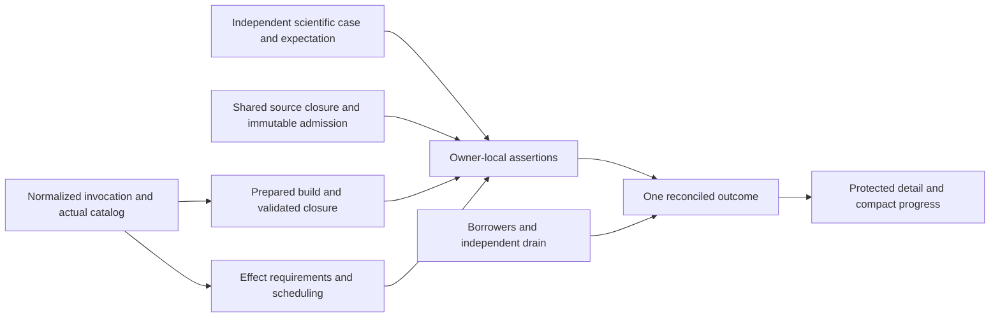

# Plan 53: Test architecture target

## Purpose, scope and authority

**Proposed:** bring the composed test architecture to the target in the [holistic test-architecture review](../design_review/reviews/design_review_test-architecture-target_2026-10-23.md). Preserve federated owner-local tests, independent science, shared conformance, actual native execution, durable lifecycle, installed Python and selected parity. Make their joins consistent: selected work governs preparation, validation, effects, execution and reported assurance; immutable input/detail can be shared while mutable attempts and borrowers remain separately owned.

This series captures all R01–R08, DTA-001–DTA-048, S01–S09, the accepted RC01/RC02, investigations and preservation/deletion obligations. The operator authorized creation of these plan documents, then P00/A01–A04 (integrated into main), and subsequently **all B01–B05 and C01–C05 on main**. Plan52 retains canonical interface ownership. The 2026-10-24 amendment authoring integrates the remaining-architecture review; it did not itself authorize D–G implementation or alter completed P00/A/B/C evidence. The subsequent execution authorization is recorded below. RC01/RC02 were separately explicitly accepted on 2026-10-23. The execution checkpoint below records implemented changes and their bounded evidence; publication of a target alone does not establish product qualification.

This coordinator owns the combined target, shared decisions, cross-plan boundaries, one package-state table, finding dispositions and inquiries. Seven companions own detailed designs and acceptance, linking here for state. Reviews own remedy reasoning, audits own diagnosis, architecture/ADRs own enduring contracts/rationale. Scheduling a finding does not resolve it; a rule decision does not establish implementation. The source review's historical source references attribute evidence, not a commit pin, freeze or ongoing churn-reconciliation obligation.

Use the full selected standard: Core3.4, Efficient Architecture Heuristics1.0, Test Assessment1.2, ProcessSimulator1.5 and the pse-arrow binding in [standard.toml](../design_review/design_principles/standard.toml). Efficiency follows fundamental design: remove accidental dependencies, repeated preparation and growing rewrites while preserving scientific fidelity, authority, consistency, valid recovery and truthful evidence. No exhaustive checklist, cost model, mandatory benchmark/probe campaign or new generic test framework is selected.

## Foundation assessment and current-work reconciliation

**Interface-checked:** the original 2026-10-23 foundation assessment and the 2026-10-24
improvement review support this revision. One focused authoring reconciliation inspected decisive
preparation, requirement, result, resource and capability consumers. Nextest authentication and
B/C delivery are foundations; the authoring baseline exposed the mutable-requirement,
full-before-selected reader and active-discovery work subsequently delivered below. During authoring, 52k closed through `117d62969`; its
[Outcome](52k-unified-entry-point-and-derived-interfaces.md#verification-and-outcome--2026-10-24)
records component and actual-host evidence with support limits. Per the operator, **52k is complete
before actioning remaining Plan53 scope**: consume its delivered target and supported host/restart
contracts without interim interfaces or transferring delivery. That Outcome remains the evidence
owner; it does not establish the remaining F/G/H or Plan53 assembled qualification. No new audit, commit pin, continuing
churn reconciliation, enclosing qualification or benchmark campaign is introduced.

| Foundation | Current evidence and resulting plan decision |
|---|---|
| Scientific acceptance | A01–A03 and independent reference reproduction have selected passing evidence. Preserve those discriminators and DTA-001's scoped no-change judgment. A04 still needs selected PFR/controller consumer acceptance; PI08 separates layout, compiler retention and derivative/domain questions from reference provenance. |
| Compiler admission | `workspace/modeling.rs::publish_modeling` and `publish_modeling_revision` already support `Arc<ModelingRevision>` reuse with exact context/physical-owner and receiving-budget checks. B05 delivered compatible reuse with fresh mutable attempts and context/owner/budget refusal controls; new numerical states still require fresh checks. No new preparation cache is needed. |
| Invocation/build | Ordinary `_rust_capture` retains nextest binaries/Cargo metadata. Existing `arrow_validation.resolve` proves actual selected Arrow leaves. C01–C03 delivered normalized selection, actual catalogue/requirement correspondence and Arrow-leaf proof. D consumes those foundations; no replacement runner or feature-name-only proof. |
| Tools/generation | `cargo_tools.selected_identity` plus `.config/diagnostic-tools.toml` already authenticate nextest 0.9.146 as well as the other selected tools; D01 qualifies consumed metadata compatibility without rebuilding that owner. `validation_scope.INPUT_SCOPES['generation']` exists but omits consumed selected package/fixture-projection inputs. D01 repairs these specific premises. |
| Feature resume | `validation_feature_campaign` already captures literal cargo-hack argv, ordered complete combinations, tool/compiler/native context, conservative Rust inputs and authenticated passing origins. Standalone campaigns use the retained assessment owner. Preserve failure/interruption history and reused-versus-fresh meaning; do not recreate enumeration/resume or treat this as complete assembled qualification. |
| Installation context | `installation_context` and `surreal_source` now have a closed effective-context owner with fail-closed unknown/shared/dangling-target guards. Plan52d records one actual complete-context build and formatting-equivalence reuse plus changed-context refusal, within that supported server-build domain. This is a useful foundation, not a generic Cargo interpreter or proof that Python preparation inputs are complete. D03 assesses the extension's actual domain. |
| Optional evidence | Plan52c/C04 is excluded from this amendment and is neither a prerequisite nor a proposed followup. Existing optional evidence does not replace independent scientific expectations. PI09 is separately selectable under 52f F03, outside original Plan53 completion. |
| Resource/evidence | FileStore declaration/state, pending/uncertain protection, exact borrowers, terminal composer and original result/reuse readers already have real consumers. E preserves them while separating immutable collected selection/requirements and protected detail from mutable membership/progress; derived service/scratch projections make discovery selective. Existing aggregate snapshots and scoped combination reuse remain valid, not a general missing-cache defect. |
| Scheduling | Pure Rust controls retain removable accidental barriers; B05 already removed the two local Python fixture consumers, leaving their residual scheduling coupling for F01. Per-run exclusivity does not establish service-wide quiet; remaining canonical capacity independence is unproven. F narrows only demonstrated barriers and keeps necessary protection. |

[Plan52](52-agent-effectiveness-and-engineering-workflows.md) retains its evidence/trace and
agent-workflow targets. Plan53 owns the test-architecture corrections and actual consumer
migrations. Share implementation/evidence where premises match, with separate acceptance at each
owner. Completed 52k is the operator-selected execution baseline; the rest of Plan52 is not a
whole-series prerequisite. Plans28/32/40 retain independent scientific/workspace/substrate scope.
The separately observed endpoint shutdown concern has a bounded Plan52 inquiry and no Plan53
closure dependency. No unrelated reducer, tracing or repository-health campaign is introduced.

## Combined target and document boundaries



The diagram describes consumed responsibilities, not a full-stack fixture mandated for each test. Reuse production types/admission/library execution where they discharge the intended responsibility. Keep expected science independently justified at the failure mechanism. Share immutable authored input, admitted revisions, compatible build artifacts and protected detail under known premises. Keep mutable workspaces/runtime, new numerical-state feasibility, databases, exact borrowers and cancellation/deadline scope where required.

Maintain selected/executed/assertion-not-reached/not-run, raw child/reconciled assurance/cleanup, historical execution/current applicability, immutable definition/mutable attempt, retained state/live demand and original/projection distinctions. These can be ordinary existing functions/fields, not a new type/service for each phrase. Tool-owned selection, actual Arrow force-validation, clean-room references, exact pins/one Arrow family, original-space checks, Pending-before-authority, unknown retention and terminal immutability remain binding.

| Companion | Owns detailed design | Contract handed to others |
|---|---|---|
| [53a: Scientific assurance and references](53a-scientific-assurance-and-references.md) | R01 science and independent expected properties; reference generators | Discriminating cases and reproducible references; no general oracle |
| [53b: Helpers, inputs and fixtures](53b-test-helpers-inputs-and-fixtures.md) | R02/R03 source-owned refusals, narrow helpers, immutable input/admission | Sufficient consumed scientific closures, stable observations/reasons, intentional support variants, two effect-free consumers |
| [53c: Invocation, requirements and outcomes](53c-invocation-requirements-and-outcomes.md) | R04/R06 one interpretation/catalog, actual requirements/validation, truthful outcomes | Selected identity/effects/roles, actual validation proof and reconciled managed result |
| [53d: Build, discovery and generation](53d-build-discovery-and-generation.md) | R05 consumed identities, retained build, Python preparation, generation/capture | Compatible prepared artifacts and complete conservative inputs |
| [53e: Resource and evidence lifetimes](53e-resource-and-evidence-lifetimes.md) | R07 immutable collected identities/requirements, composed cleanup, selective discovery, custody/readers | Protected exact association/detail, honest cleanup facts and versioned readers |
| [53f: Effect-scoped scheduling](53f-effect-scoped-scheduling.md) | R08 actual exclusion scope and explicit local settings | Pure controls independent, real service/timing/native/canonical protection retained |
| [53g: Qualification and publication](53g-qualification-and-publication.md) | Joined S01–S09 acceptance, enduring owners and retirement | Assembled evidence with actual support limits, then current contract publication |

Document boundaries group reasoning; packages below group coherent producer/consumer migrations. No companion completion is an automatic whole-system barrier. Shared editing surfaces (manifests/locks, `test_run`/`validation`, nextest/conftest, runtime/conformance fixtures and FileStore/readers) need explicit single writers during execution, even for logically independent packages.

## Remaining-architecture amendment integration — 2026-10-24

The operator authorized revising these documents from the
[improvement review](../plan_improvement_reviews/test-architecture-remaining-2026-10-24.md).
**Proposed:** PI01–PI08/PI10 refine the remaining target and packages below; package states and
DTA dispositions remain authoritative at their existing tables. These references identify design
sources, not a second progress register. Existing companions provide coherent boundaries; no new
plan document is required.

| Review amendment | Owning work and integration consequence |
|---|---|
| [PI01](../plan_improvement_reviews/test-architecture-remaining-2026-10-24.md#PI01) | D01/D02/D04: qualify existing tool identity, retain ordinary build/catalogue, complete package inputs, remove specific generation overlap and choose scope before byte reads. |
| [PI02](../plan_improvement_reviews/test-architecture-remaining-2026-10-24.md#PI02) | D03/I06: independent environment/extension/stub/admission operations, supported currency domains and canonical/native consumers. |
| [PI03](../plan_improvement_reviews/test-architecture-remaining-2026-10-24.md#PI03) | E01/I09 with F01/F02: immutable collected identities and semantic requirements, uncollected staging and actual acquired bindings kept distinct. |
| [PI04](../plan_improvement_reviews/test-architecture-remaining-2026-10-24.md#PI04) | E05/I09 with E04 and 52f/52g: complete reader/custody inventory, mandatory summary, selective gate/source detail, full export and explicit section completeness. |
| [PI05](../plan_improvement_reviews/test-architecture-remaining-2026-10-24.md#PI05) | E02: one original settlement clock across actual Rust/Python bridges, independent results and physical drain. Endpoint teardown remains outside this correction. |
| [PI06](../plan_improvement_reviews/test-architecture-remaining-2026-10-24.md#PI06) | E03/E04 with F02: selective service/generation and scratch discovery, known coverage and membership-transition writes. |
| [PI07](../plan_improvement_reviews/test-architecture-remaining-2026-10-24.md#PI07) | F01–F03/I08 with E01: shared exclusion meanings, assertion-led service scope and current role declarations without new capacity policy. |
| [PI08](../plan_improvement_reviews/test-architecture-remaining-2026-10-24.md#PI08) | A04/I10 and G01: bounded selected-consumer layout/retention/derivative-domain correction, separate from reproduced reference provenance. |
| [PI09](../plan_improvement_reviews/test-architecture-remaining-2026-10-24.md#PI09) | [52f F03](52f-evidence-analysis-and-trace-correlation.md#F03): concrete optional finite multi-question operation. Operator selected separate selectability, not required Plan53 delivery. |
| [PI10](../plan_improvement_reviews/test-architecture-remaining-2026-10-24.md#PI10) | G01/G02 with 52g/52h: shared authentic journeys, separate native/scientific/host/custody/cleanup assertions and coordinated publication. |

The amendment changes no accepted rule beyond the already accepted RC01/RC02. Enduring changed
contracts still use their existing design/decision and generator routes before dependent behavior
where required. A new incompatible rule impact, if exposed by I06/I08/I09/I10, requires its exact
operator decision; this authoring does not invent or pre-approve one. AP-04's semantic distinctions,
AP-07's physical work and independent scientific assurance remain joint constraints. There is no
new cache, universal invocation/result type, scheduler, store, numeric cost model or mandatory
benchmark. Library mechanisms and material limits are retained at their package owners.

## Accepted rule changes and advance publication

Both source review impacts were **explicitly accepted by the operator on 2026-10-23** during plan preparation. Their acceptance governs P00 and the subsequently authorized C02/C04/F01/F02 implementation, with acceptance recorded below.

| Review impact | Accepted target consequence | Publication route and dependent work |
|---|---|---|
| [RC01](../design_review/reviews/design_review_test-architecture-target_2026-10-23.md#rc01) | Public managed correctness exit zero iff complete reconciled Pass; retain raw child return/cancellation and independent cleanup | P00 publishes the command/result contract through blueprint §24.1's design route with revision row and validation/result guide; update the intentional self-test/callers in C04. Supersede any accepted ADR only if its exact contract conflicts; never edit accepted records in place. |
| [RC02](../design_review/reviews/design_review_test-architecture-target_2026-10-23.md#rc02) | One actual effect/requirement interpretation serves managed routes; demonstrably pure cases lose accidental barriers; real canonical/timing/native protection stays | P00 publishes selected-requirement policy through §24.1 and scheduler/agent-environment guidance before C02/F01/F02 behavior changes. nextest/conftest remain execution mechanisms; no exact-name acceptance manifest or global governor. |

<a id="p00"></a>
### P00 — Publish accepted contract slices

At authorized execution, inspect the exact currently governing text and publish each accepted change through its actual route before dependent behavior changes. Use the existing design authorization marker for authoritative edits and a blueprint revision row. The source review already supplies target-tier reasoning; do not restart it as a broad audit. If a governed accepted decision must change, prepare the required superseding ADR/design publication before that change, using normal status/PR rules. Routine implementation under existing contracts needs no speculative ADR. Record resulting references here; `adrs: []` currently invents none.

B02's typed refusal direction fits the existing §23.2 source-owned typed-cause contract on examined evidence. I04 confirms concrete constructor/codec scope; no extra blocking rule impact is established. If an actual incompatible public promise emerges, identify it and seek its specific decision before that incompatible change. Other ready work continues. This plan does not pre-approve unrelated diagnostic, hashing, Python-boundary or governance redesign.

## Package state and execution route

This is the **single package progress owner**. P00, A01–A04, B01–B05 and C01–C05 are authorized; D01–D04, E01–E05 and F01–F03 plus applicable G01/G02 integration/publication are now authorized on main by the operator on 2026-10-24. A04/I10 includes bounded investigation and corrections within existing scientific contracts; broader solver/formulation redesign remains separately selected. Completion means the linked package's producer, actual consumer migrations, replacement deletions and required evidence, not merely an agreed interface. Package acceptance was **Proposed / not_run** at authoring; current execution evidence is recorded below.

| Package | Status | Owner | Completion |
|---|---|---|---|
| P00 | done | [Coordinator](#p00) | Accepted target published in blueprint §24.1, revision 260 and validation/environment guides; C02/C04 and F consumers delivered below |
| A01 | done | [53a](53a-scientific-assurance-and-references.md#a01) | Tested: independent status inventory and all three local comparison controls; nine selected native-local tests pass |
| A02 | done | [53a](53a-scientific-assurance-and-references.md#a02) | Tested: nine-feed regime journey and wrong-regime controls; solved countercurrent and unequal-pressure mixer; current PID consumer qualification remains A04 |
| A03 | done | [53a](53a-scientific-assurance-and-references.md#a03) | Tested: independent integrated PR root/layout/mixed Hessian and two-point exact/approximate nonlinear publication/readback |
| A04 | in-progress | [53a](53a-scientific-assurance-and-references.md#a04) | I02 resolved; generators and fresh PFR/integrated-controller consumers pass; simultaneous-controller run left active for later review at the maintainer's request |
| B01 | done | [53b](53b-test-helpers-inputs-and-fixtures.md#b01) | I03 resolved; bound-source helper, stable body-admission counters and complete private query observer; targeted math/compiler controls pass |
| B02 | done | [53b](53b-test-helpers-inputs-and-fixtures.md#b02) | I04 resolved; source-owned typed reasons retain diagnostic identity/location; valid and single-change origin controls pass |
| B03 | done | [53b](53b-test-helpers-inputs-and-fixtures.md#b03) | Unused doubles/devdeps removed; seven support-enabled Rust and five support-absent Python/local controls pass with complete reconciled reports |
| B04 | done | [53b](53b-test-helpers-inputs-and-fixtures.md#b04) | I05 resolved; nineteen families feed runtime/affected/archive consumers; migrated scientific and runtime controls and 162 tooling controls pass |
| B05 | done | [53b](53b-test-helpers-inputs-and-fixtures.md#b05) | Compatible revision reuse and context/owner/budget refusal controls pass; two local Python cases pass with no-allocation guards through the existing result composer |
| C01 | done | [53c](53c-invocation-requirements-and-outcomes.md#c01) | One invocation/config/profile/overlay interpretation with actual tool selection |
| C02 | done | [53c](53c-invocation-requirements-and-outcomes.md#c02) | Actual catalog/requirements/roles and before-effects guard across managed routes |
| C03 | done | [53c](53c-invocation-requirements-and-outcomes.md#c03) | Actual Arrow leaves proved across installer/codegen/routes; stale declaration/check removed |
| C04 | done | [53c](53c-invocation-requirements-and-outcomes.md#c04) | Complete-pass exit and typed setup/assertion-not-reached with separate cleanup |
| C05 | done | [53c](53c-invocation-requirements-and-outcomes.md#c05) | I07 resolved; active Python/peer/optional scope, replaced dead bodies removed |
| D01 | done | [53d](53d-build-discovery-and-generation.md#d01) | Existing tool identity and consumed generation inputs qualified by path/pin drift, package absence/recreation and actual retained execution |
| D02 | done | [53d](53d-build-discovery-and-generation.md#d02) | Actual local, restart and overlap selections consume retained build/catalogue; compatibility refusals and before-observer preparation controls pass |
| D03 | done | [53d](53d-build-discovery-and-generation.md#d03) | I06 resolved; current native sync/repeat and imported-byte admission pass; repeat skips installation/stub generation |
| D04 | done | [53d](53d-build-discovery-and-generation.md#d04) | Aggregate generation and selection-before-read controls pass, including mode/symlink and missing/recreated inputs; the subsequent [52l Outcome](52l-typed-requests-results-and-diagnostics.md#outcome--2026-10-24) extends the complete aggregate to one full closure while retaining narrow recipes |
| E01 | done | [53e](53e-resource-and-evidence-lifetimes.md#e01) | Immutable collected identities/requirements and compact membership serve actual frozen Rust/Python peers; interrupted publication and original authority controls pass |
| E02 | done | [53e](53e-resource-and-evidence-lifetimes.md#e02) | Five Rust bridge/settlement and eight Python adapter controls pass under original clocks; current installed close/reader/admitted-solve consumers pass |
| E03 | done | [53e](53e-resource-and-evidence-lifetimes.md#e03) | Covered service discovery protects foreign creation/readers; real restart and separate Rust/Python database invocations pass |
| E04 | done | [53e](53e-resource-and-evidence-lifetimes.md#e04) | Interrupted scratch membership, late reader and corrupt-candidate continuation controls pass; exact old-origin custody retained |
| E05 | done | [53e](53e-resource-and-evidence-lifetimes.md#e05) | Actual typed selected reads preserve original failure/reference/custody, reject missing/oversized detail and retain explicit full export |
| F01 | done | [53f](53f-effect-scoped-scheduling.md#f01) | Actual three pure backend cases retain local requirements and pass without canonical/native reservations; local Python cases and requirement/refusal controls pass, real protection retained |
| F02 | done | [53f](53f-effect-scoped-scheduling.md#f02) | I08 resolved: justified database-local assertions pass actual separate-invocation overlap; authenticated owned restart and foreign borrower guards preserve genuine maintenance scope |
| F03 | done | [53f](53f-effect-scoped-scheduling.md#f03) | Explicit local settings reach passing installed consumers; owned pytest scratch preserves global ownership guards, role ceilings and canonical protection |
| G01 | in-progress | [53g](53g-qualification-and-publication.md#g01) | D–F joined acceptance and two selected scientific consumers pass; final simultaneous-controller acceptance remains pending, with whole-repository health checks outside the maintainer-selected scope |
| G02 | in-progress | [53g](53g-qualification-and-publication.md#g02) | Enduring contracts and workflow guides published; final scientific disposition and retirement remain pending without closing other-plan consumers |

The remaining route starts from delivered P00/A01–A03/B/C and completed 52k. Resolve shaping
contracts/inquiries early: I06 preparation domain; I09 reader/custody transition; E01/F01/F02
semantic requirement and exclusion meaning. D01's existing-tool compatibility and sufficient
package-input repair, D04 capture/generation changes and E02's bridge correction can proceed
without whole-companion barriers. A04/I10's selected scientific inquiry is independent where its
actual prerequisites permit.

D02 consumes delivered C01/C03/B03 and relevant D01 compatibility; D03 conditionally skips only
after I06/C03 support it. E01 migrates immutable facts and actual readers; E04/E05 coordinate
custody and reader cutover through I09 rather than leaving consumers for a later inventory phase.
E03 supplies covered service discovery before F02 relaxation. F01 uses agreed exclusion meanings;
F02 uses I08's assertion decision and implemented protection. F03 consumes current role settings.
G01 joins actual migrated/deleted capabilities with separate scientific/host/custody assertions;
G02 publishes enduring meaning and retires only material whose readers release it. Optional 52f
F03 can join the comparison consumer when separately selected; it is not a barrier. These are
contract dependencies, not a requirement to finish entire documents in order.

## Inquiry outcomes and remaining questions

Each inquiry has a decision product, scoped evidence and explicit dependent behavior. These are bounded execution investigations, not a new audit or indefinite research backlog. Local naming/layout choices remain implementer judgment.

| Inquiry | State | Owner | Decision / completion evidence |
|---|---|---|---|
| I01 | resolved | [A02](53a-scientific-assurance-and-references.md#a02) | Compute independent positive slack and propagated feasibility envelope for selected phase fixture; adopt concrete regime bound or choose a better away-transition case. Blocks that regime assertion, not historical policy or other cases. |
| I02 | resolved | [A04](53a-scientific-assurance-and-references.md#a04) | Locate/recover verifiable three generators or specify independent reduced equations/method/environment; reproduce references or explain reviewed discrepancy before golden migration. No production-output regeneration. |
| I03 | resolved | [B01](53b-test-helpers-inputs-and-fixtures.md#b01) | Existing counters establish no new semantic-body admissions, not exact Salsa memo hits. Other query claims use one private observer with positive cold/invalidation and missing/truncated refusal controls; independent fresh results remain. |
| I04 | resolved | [B02](53b-test-helpers-inputs-and-fixtures.md#b02) | Source-owned reasons fit §23.2; migrated constructors/forwarders preserve ValidationInvariant, ModelingContract, declaration and real source location. Codec/changed-prose controls pass; untouched contracts explicitly remain Unclassified. |
| I05 | resolved | [B04](53b-test-helpers-inputs-and-fixtures.md#b04) | Nineteen declared families use real bounded package/P0/parser closure, exact data/source bytes, directory membership/absence and explicit synthetic substitutions. Drift refuses publication; unknown affected edges broaden. Full sufficient closures adopted without a minimality claim. |
| I06 | resolved | [D03](53d-build-discovery-and-generation.md#d03) | Independent ordinary editable environment/extension/stub/admission stages bind actual installed bytes, supported source/tool/config/native inputs and worker admission. Actual separate native sync/repeat passed; repeat skipped installer/stub generation while fresh import retained the same digest. Named session/direnv bookkeeping is excluded only from preparation, unknown inputs remain conservative and scientific provenance is unchanged. No strict producer campaign or whole-host precision claim. |
| I07 | resolved | [C05](53c-invocation-requirements-and-outcomes.md#c05) | Public configuration/native-route diagnostics replace dormant harness claims; synthetic schema/NativeReuse combinations retain explicit coverage limits. Separate operator, component overlap and owned restart roles are selected; actual peer acceptance is recorded in C05's Outcome. |
| I08 | resolved | [F02](53f-effect-scoped-scheduling.md#f02) | Assertion inventory justifies database-local scope for the migrated cases. Actual independent Rust/Python invocations use distinct databases and finish complete Pass with removed resources; the owned restart passes under genuine maintenance exclusion. Real FileStore/process controls reject foreign creation, retained readers and changed bindings before maintenance; no index-absence shortcut or blanket capacity relaxation. |
| I09 | resolved | [E01/E05](53e-resource-and-evidence-lifetimes.md#e01) | Immutable collected objects and compact assessment v6 have one current production layout, selected/full/original readers and custody. Actual v2-to-v3 conversion completed with all original hashes and terminal content verified; historical policy/codec grants no current automatic reuse. MCP presence is not a conversion condition. Selected unit and actual assessment/Python consumers pass; enclosing joined acceptance remains G01. |
| I10 | open | [A04](53a-scientific-assurance-and-references.md#a04-consumer-integration) | Complete-layout and bounded receiving corrections pass discriminating controls; fresh PFR/integrated consumers pass with unchanged references/tolerances. Simultaneous consumer remains active for later review; do not infer its result from compiler controls or elapsed preparation. Broader remedies remain separately selectable. |

## Recommendation and scenario correspondence

The source [review §4](../design_review/reviews/design_review_test-architecture-target_2026-10-23.md#4-scenarios-that-distinguish-this-target) owns S01–S09 definitions. [53g](53g-qualification-and-publication.md#g01) owns joined acceptance detail.

| Recommendation | Primary work and material contributors | Source scenarios |
|---|---|---|
| R01 | A01–A04; B02 typed origin control | S01, S05 |
| R02 | B01–B03; A01 comparator semantics, D02 support variants | S01, S03, S04, S06 |
| R03 | B04/B05; D01/D04 consumed inputs, F01 local consumers | S02, S04, S09 |
| R04 | C01–C03/C05; D01 tool contract, F01 effect scheduling | S03–S05, S09 |
| R05 | D01–D04; C03 actual validation, B03/B04 support/source contracts | S02, S04, S05, S08 |
| R06 | C04/C05; C02 required roles, E02 cleanup | S03, S06, S08 |
| R07 | E01–E05; C01/C02 identity, existing Plan52 resume | S06–S08 |
| R08 | F01–F03; B05 effects, C02 requirements, E03 service protection | S04, S09 |

## Finding dispositions

One primary work owner below coordinates contributors and closes only on actual evidence. Corrective rows record their current scheduled or resolved scope; resolution requires the stated evidence. Disproved/superseded rows record the review's scoped diagnostic correction/withdrawal, not new implementation or portfolio-wide assurance. Each DTA link points to its original diagnostic home.

| Finding reference | Scenario reference | Disposition | Decision/work owner | Evidence or revisit trigger |
|---|---|---|---|---|
| [DTA-001](../design_review/test-audit/oracles-and-acceptance.md#dta-001) | S01 | disproved — examined reuse indictment | [A01](53a-scientific-assurance-and-references.md#a01) | Retain independent resolver/conversion/direct export and parity scale cancellation; no change in examined scope. Revisit only a concrete escaped policy/projection fault, not unexamined breadth. |
| [DTA-002](../design_review/test-audit/oracles-and-acceptance.md#dta-002) | S01 | resolved | [A02](53a-scientific-assurance-and-references.md#a02) | I01 justified phase/slack/feasibility bound plus wrong interior-regime control; historical policy and nested-vapor witness retained. |
| [DTA-003](../design_review/test-audit/oracles-and-acceptance.md#dta-003) | S01 | resolved | [A04](53a-scientific-assurance-and-references.md#a04) | All three committed independent generators reproduce declared frozen claims, without golden migration. A04 retains separate failed/inconclusive production-consumer qualification. |
| [DTA-004](../design_review/test-audit/oracles-and-acceptance.md#dta-004) | S05 | resolved | [A01](53a-scientific-assurance-and-references.md#a01) | Independent declared code/name/category/assurance inventory including limits/unknown; missing or misclassified declared arm fails. |
| [DTA-005](../design_review/test-audit/oracles-and-acceptance.md#dta-005) | S01 | resolved | [A03](53a-scientific-assurance-and-references.md#a03) | Integrated root/key/binding/mixed-second-order discriminator; retain independent primitive Hessians. |
| [DTA-006](../design_review/test-audit/oracles-and-acceptance.md#dta-006) | S01 | resolved | [B02](53b-test-helpers-inputs-and-fixtures.md#b02) | Real admitted quantity/context control succeeds; each single-condition mutation reaches the intended typed inference rule. Targeted quantity test passes. |
| [DTA-007](../design_review/test-audit/oracles-and-acceptance.md#dta-007) | S01 | resolved | [A01](53a-scientific-assurance-and-references.md#a01) | Finite/extent/sample-time and meaningful wrong-result controls in all three helpers; distinct tolerance semantics retained. |
| [DTA-008](../design_review/test-audit/doubles-and-coupling.md#dta-008) | S01 | superseded — withdrawn diagnosis | [B03](53b-test-helpers-inputs-and-fixtures.md#b03) | Retain complementary static Ready and contextual readiness; no repair or blanket wrapper replacement. |
| [DTA-009](../design_review/test-audit/doubles-and-coupling.md#dta-009) | S04 | resolved | [B01](53b-test-helpers-inputs-and-fixtures.md#b01) | Existing counters prove no new body admissions; one complete private query observer handles other claims. Cold/invalidation and missing/truncated controls pass; fresh comparison remains. |
| [DTA-010](../design_review/test-audit/doubles-and-coupling.md#dta-010) | S04 | resolved | [B01](53b-test-helpers-inputs-and-fixtures.md#b01) | SourceBody::prepare replaces ten common math/backend construction paths; caller-owned attribution/cancel/residual differences remain. Targeted math/backend controls pass. |
| [DTA-011](../design_review/test-audit/doubles-and-coupling.md#dta-011) | S06 | resolved | [B03](53b-test-helpers-inputs-and-fixtures.md#b03) | Participation/support scopes documented and separated. Seven support-enabled Rust controls and three complementary support-absent Python reader/drop journeys pass against the current admitted service. |
| [DTA-012](../design_review/test-audit/evidence-routes-and-execution.md#dta-012) | S06 | resolved | [C04](53c-invocation-requirements-and-outcomes.md#c04) | RC01 public zero iff complete Pass; zero child/missing report nonzero, raw child and cleanup retained separately. |
| [DTA-013](../design_review/test-audit/evidence-routes-and-execution.md#dta-013) | S03 | resolved | [C05](53c-invocation-requirements-and-outcomes.md#c05) | Active Python assertions replace inactive Rust bodies; selected component/restart peers have real roles or obsolete unsupported claim retires. |
| [DTA-014](../design_review/test-audit/evidence-routes-and-execution.md#dta-014) | S06 | resolved | [C05](53c-invocation-requirements-and-outcomes.md#c05) | Separate executed opt-in CLI result; selected missing prerequisite fails; API-only scope remains substantive. |
| [DTA-015](../design_review/test-audit/evidence-routes-and-execution.md#dta-015) | S03, S06 | resolved | [C02](53c-invocation-requirements-and-outcomes.md#c02) | Managed affected/native/Python/setup requirements/environment/association/composer agree; C04 outcomes; bare route limits explicit. |
| [DTA-016](../design_review/test-audit/evidence-routes-and-execution.md#dta-016) | S03, S09 | resolved | [C02](53c-invocation-requirements-and-outcomes.md#c02) | Actual catalog and before-effects guard catch stale/missing scheduling facts after rename/new case; F01 consumes RC02. |
| [DTA-017](../design_review/test-audit/evidence-routes-and-execution.md#dta-017) | S05 | resolved | [C03](53c-invocation-requirements-and-outcomes.md#c03) | Installer/codegen/managed actual normal/build/dev target/host Arrow leaves verified; pure/unknown controls; stale metadata/check deleted. |
| [DTA-018](../design_review/test-audit/execution-efficiency.md#dta-018) | S04 | resolved | [B05](53b-test-helpers-inputs-and-fixtures.md#b05) | Compatible immutable revision reuse and two demonstrated local Python migrations pass. Fresh databases, schema/issuer identity, connections and drain controls remain; no blanket template. |
| [DTA-019](../design_review/test-audit/evidence-routes-and-execution.md#dta-019) | S04 | resolved | [B03](53b-test-helpers-inputs-and-fixtures.md#b03) | Actual consumer inventory removed unused FaultStore/FaultPlan/CountingStore, execution/introspection helpers, self-tests and dependencies. NativeFixture/factory/capture and independent fault controls remain. |
| [DTA-020](../design_review/test-audit/oracles-and-acceptance.md#dta-020) | S01 | resolved | [A03](53a-scientific-assurance-and-references.md#a03) | Nonlinear active-constraint sensitivity/value Hessian and covariance publication/readback: exact 1/7 vs GN 1/5, second point 1/25 vs 1/17. |
| [DTA-021](../design_review/test-audit/oracles-and-acceptance.md#dta-021) | S01 | resolved | [A02](53a-scientific-assurance-and-references.md#a02) | Solved countercurrent and unequal-pressure min-vs-max/mean cases; PID nonzero-Td dynamics retained and generator handled by A04. |
| [DTA-022](../design_review/test-audit/test-execution-system.md#dta-022) | S03, S05 | resolved | [C01](53c-invocation-requirements-and-outcomes.md#c01) | Single aliases/env/default/custom-config/profile/report/association interpretation; opaque arguments preserved, unsupported scope refuses. |
| [DTA-023](../design_review/test-audit/test-execution-system.md#dta-023) | S03 | resolved | [C02](53c-invocation-requirements-and-outcomes.md#c02) | Actual selected campaign-role correspondence catches lost member in nonempty union; obsolete recipe references removed. |
| [DTA-024](../design_review/test-audit/test-execution-system.md#dta-024) | S05, S08 | resolved | [D01](53d-build-discovery-and-generation.md#d01) | Existing nextest identity retained and metadata compatibility qualified; consumed package/fixture generation inputs complete; Plan52 combination resume preserved. |
| [DTA-025](../design_review/test-audit/evidence-routes-and-execution.md#dta-025) | S06 | resolved | [C04](53c-invocation-requirements-and-outcomes.md#c04) | Authenticated typed setup failure and assertion-not-reached, no panic parsing; exact-generation preflight bounds repeats without hiding failure. |
| [DTA-026](../design_review/test-audit/test-execution-system.md#dta-026) | S03 | resolved | [C01](53c-invocation-requirements-and-outcomes.md#c01) | Shared pure interpretation and explicit performing composition; C02/C04 migrate consumers/delete reciprocal duplicated meaning, not file-count cleanup. |
| [DTA-027](../design_review/test-audit/doubles-and-coupling.md#dta-027) | S02 | resolved | [B04](53b-test-helpers-inputs-and-fixtures.md#b04) | Nineteen declared family roots/projections derive real package/import/data closure once; actual Rust/Python/conformance/runtime consumers use it. Authentic transport and bounded synthetic meanings remain distinct. |
| [DTA-028](../design_review/test-audit/doubles-and-coupling.md#dta-028) | S01 | resolved | [B02](53b-test-helpers-inputs-and-fixtures.md#b02) | Source-owned typed reasons survive constructors, forwarding and diagnostic codec with declaration/code/actual location. Changed display wording does not own semantic assertions; targeted controls pass. |
| [DTA-029](../design_review/test-audit/execution-efficiency.md#dta-029) | S04 | resolved | [B03](53b-test-helpers-inputs-and-fixtures.md#b03) | canonical-tests selects participation; test-support selects instrumentation/lifetime. Support-enabled Rust and support-absent Python reader/drop selections pass; D02 retains these intentional variants. |
| [DTA-030](../design_review/test-audit/execution-efficiency.md#dta-030) | S04 | resolved | [B05](53b-test-helpers-inputs-and-fixtures.md#b05) | Existing immutable revision reuse retains fresh workspaces; context/physical-owner/budget refusals and independent fresh admission/edit controls pass. |
| [DTA-031](../design_review/test-audit/execution-efficiency.md#dta-031) | S04, S09 | resolved | [B05](53b-test-helpers-inputs-and-fixtures.md#b05) | Two local Python cases pass with collection/group and execution no-allocation guards using ephemeral capabilities and authentic immutable module evidence. C02/F01 broader requirement work remains separate. |
| [DTA-032](../design_review/test-audit/execution-efficiency.md#dta-032) | S04 | resolved | [D02](53d-build-discovery-and-generation.md#d02) | Actual equivalent correctness closures shared; interactive/support differences and ADR-0122 unification retained. |
| [DTA-033](../design_review/test-audit/execution-efficiency.md#dta-033) | S04, S05 | resolved | [D03](53d-build-discovery-and-generation.md#d03) | I06 complete known preparation/binary inputs; pure Python no rebuild/stubs, changed/unknown prepares, mutable replacement refuses. |
| [DTA-034](../design_review/test-audit/execution-efficiency.md#dta-034) | S04 | resolved | [D02](53d-build-discovery-and-generation.md#d02) | Fallback consumes existing retained nextest/Cargo build/catalog with exact graph checks; duplicate path removed, no second cache. |
| [DTA-035](../design_review/test-audit/execution-efficiency.md#dta-035) | S02 | resolved | [B04](53b-test-helpers-inputs-and-fixtures.md#b04) | Invocation-captured science replaces shared package embeddings in migrated consumers; source-only reload controls pass without changing consumer code. True local embeddings and fresh numerical attempts remain. |
| [DTA-036](../design_review/test-audit/execution-efficiency.md#dta-036) | S02 | resolved | [B04](53b-test-helpers-inputs-and-fixtures.md#b04) | One captured closure feeds conservative affected preview for imported source, data, membership and absence. Unknown/new/deleted edges broaden; coverage overlay cannot prune selection. Focused controls pass. |
| [DTA-037](../design_review/test-audit/execution-efficiency.md#dta-037) | S02, S05 | resolved | [D04](53d-build-discovery-and-generation.md#d04) | Overlapping aggregate generation once with actual roots; independent recipes/Python/native ABI/missing-extra-untracked checks retained. |
| [DTA-038](../design_review/test-audit/execution-efficiency.md#dta-038) | S06, S07 | resolved | [E01](53e-resource-and-evidence-lifetimes.md#e01) | Immutable collected identities/semantic requirements; compact members, Python staging/nested subsets and original locks/deadline/transitions/freeze; interrupted publication/header mismatch controls. |
| [DTA-039](../design_review/test-audit/execution-efficiency.md#dta-039) | S02, S07 | resolved | [D04](53d-build-discovery-and-generation.md#d04) | Select scope before byte access; full promised provenance and distinct mutable hashes, symlink/mode/add/delete/absence preserved. |
| [DTA-040](../design_review/test-audit/execution-efficiency.md#dta-040) | S08 | disproved — blanket reuse indictment | [E05](53e-resource-and-evidence-lifetimes.md#e05) | Retain valid aggregate snapshot and scoped reuse/transfer/Plan52 combo resume; historical execution not automatically current. No global redesign selected. |
| [DTA-041](../design_review/test-audit/execution-efficiency.md#dta-041) | S06 | superseded — withdrawn diagnosis | [E01](53e-resource-and-evidence-lifetimes.md#e01) | Retain authenticated pending/uncertain recovery, writer fences/borrowers/late effects/terminal/unknown protection; no disposal-only simplification. |
| [DTA-042](../design_review/test-audit/execution-efficiency.md#dta-042) | S06, S09 | resolved | [E02](53e-resource-and-evidence-lifetimes.md#e02) | Independent drain/cleanup crosses Rust/Python bridges with aggregate errors and one outer deadline; E03 covered scoped discovery and retained-reader/race controls preserve unknowns. |
| [DTA-043](../design_review/test-audit/execution-efficiency.md#dta-043) | S09 | resolved | [F02](53f-effect-scoped-scheduling.md#f02) | I08 justified database-local claims pass distinct Rust/Python invocations; actual owned restart and foreign creation/reader controls retain maintenance exclusion. Ordinary unbounded mode and remaining canonical protection are unchanged. |
| [DTA-044](../design_review/test-audit/execution-efficiency.md#dta-044) | S04, S09 | resolved — narrow consumers only | [F01](53f-effect-scoped-scheduling.md#f01) | B05 removed two accidental fixture consumers and F01 removes their residual scheduling coupling; actual local Python acceptance passes. Broad unnecessary-barrier diagnosis remains unestablished. Retain remaining canonical barrier; revisit only actual wider supported scope with demand/lifetime evidence. |
| [DTA-045](../design_review/test-audit/execution-efficiency.md#dta-045) | S09 | resolved | [F01](53f-effect-scoped-scheduling.md#f01) | Three actual pure KINSOL/Ipopt cases pass with local requirements and no canonical/native reservation; thirteen requirement controls retain genuine native/thread/timing/heavy demand and refuse unsupported quiet scope. |
| [DTA-046](../design_review/test-audit/execution-efficiency.md#dta-046) | S09 | resolved | [F03](53f-effect-scoped-scheduling.md#f03) | Explicit sufficient local settings consume current role declarations; host/store demand and ceilings remain distinct, without copied historical envelopes, OOM inference, planner or blanket parallelism. |
| [DTA-047](../design_review/test-audit/execution-efficiency.md#dta-047) | S06, S07 | resolved | [E04](53e-resource-and-evidence-lifetimes.md#e04) | Custody/sealing and origins retained; selective nonempty scratch discovery avoids full active scans/prefix starvation, with protective membership-transition publication. |
| [DTA-048](../design_review/test-audit/execution-efficiency.md#dta-048) | S07, S08 | resolved | [E05](53e-resource-and-evidence-lifetimes.md#e05) | Compact root and protected immutable detail; one coordinated reader/custody cutover, summary/gate/source/full-export views, independent section completeness and original diagnostic/native graph checks. |

## Verification, deletion and closure

**Proposed / not_run:** each linked package carries targeted compile/unit/meaningful wrong-case acceptance, producers and consumer migrations plus deletion of what it replaces. Delete obsolete parsers/tables/declarations, dormant bodies, unused doubles/devdeps, duplicate source lists/embeddings, redundant build/generation paths and repeated payload/readers as their replacements are proven and callers migrate. Keep no compatibility production path solely as history. Immutable support/recovery/reference guarantees are not legacy clutter.

[53g](53g-qualification-and-publication.md) owns assembled acceptance and scope-end checks under the repository rhythm. Required qualification and optional future measured benefit remain separate. A static account of eliminated repeated work establishes the structural correction, not a numeric latency, memory or capacity improvement. Evidence labels and actual command/mode/scope/zero-baseline results belong to closing Verification/Outcome; authoring establishes none of the proposed test outcomes. No all-model/platform/solver qualification, benchmark gate, retired portable campaign or per-package formal audit is added.

Completion requires every required functional migration/deletion and selected assembled evidence, explicit final DTA/inquiry dispositions, published accepted rules and current enduring owner documentation. The coordinator Outcome must explain what was built, a mistake corrected, deliberate deviations and actual not-run limits; then reconcile native bindings/current-work/inbound consumers and retire consumed material under ADR-0096. Other active plans do not close with this series.

## Checkpoint — document creation, 2026-10-23

Eight draft documents now specify the target, coherent packages and their decision/evidence routes. RC01/RC02 acceptance is recorded; their authority publication and behavior changes remain planned. The single current-source reconciliation has been incorporated; no commit pin or ongoing churn ledger is required. All implementation and product qualification remain unexecuted by this plan-writing engagement. The next authorized execution can start with P00, inquiry decisions and independent ready packages described above; this checkpoint itself grants no execution authorization.

## Execution checkpoint — P00/A01–A04, 2026-10-23

Execution is authorized for P00 and the full scientific companion only. Work is isolated on
`53a-scientific-assurance`, based on committed main; uncommitted Plan52 work is not copied.
P00 publishes the accepted target through blueprint §24.1/revision 260 and the command/environment
guides. Existing managed exits and scheduling remain unchanged. A01–A04 implement their owner-local
controls and independent references. Committed main changes will be merged at coherent checkpoints;
return integration into main awaits maintainer go-ahead. Other Plan53 packages remain planned.


### Current acceptance boundary — 2026-10-24

**Implemented:** committed main is integrated through `338856873` (Plan52e closeout). P00
publishes RC01/RC02 as accepted targets in blueprint §24.1/revision 260; it does not implement
C02/C04/F01/F02. A01 replaces the fallback-only status guard and weak local comparator premises.
A02 adds independent phase-regime and solved model-variant witnesses. A03 adds independent
integrated PR curvature and nonlinear sensitivity/covariance publication/readback. A04 commits
three independent reduced-equation generators and verifiable locators, preserving frozen goldens.
The maintainer-selected functional store limit is permanently three; full per-store accounting,
unknown-owner protection and the single timing-store slot remain in force.

**Tested:** all 16 distinct selected native cases have passing results across focused runs,
with zero failures in their final affected retries. This is cumulative targeted evidence, not a
claim that one final invocation ran all 16 or that the repository passed. The nine native-local
status/comparator/projection/dynamics controls, the phase wrong-case control, nine-feed phase
journey, retained analytic sensitivity control, nonlinear sensitivity readback, nonlinear
covariance readback, model-variant journey and integrated PR witness comprise that selection.

The force-validated native command family is:

```bash
scripts/pse-env --recipe-default-class compile --native -- just unit-native-package pse-runtime \
  'pse-runtime/native-solvers,pse-runtime/canonical-tests,pse-tests-conformance/native-acceptance,pse-backend-native/highs' \
  '<selected nextest filter>' -p pse-tests-conformance -p pse-backend-native -p pse-math
```

The final affected filters were
`test(nonlinear_constraint_curvature_sensitivity_and_value_hessian_reopen)` and
`test(nonlinear_state_constraint_exact_and_gauss_newton_covariance_reopen)` (both pass in the
four-case correction run), `test(authored_countercurrent_and_unequal_pressure_variants)`
(pass in the two-case assembly/variant run), and
`test(integrated_pr_two_root_mixed_hessian_has_independent_analytic_oracle)` (final single-case
retry passes). Their initial failing assertions were repaired rather than waived. Earlier
native-local evidence used `just unit-native-capability-package pse-backend-native` with the
same four package roots and `solver,klu,isolation,uno,petsc`; all nine selected controls passed.
All commands use baseline zero and explicit Arrow force-validation.

**Tested:** `just plan53a-reference`, in locked CPython 3.12.3 / NumPy 2.5.3 / SciPy 1.18.1,
passes PFR 7/7, controller 19/19 and decay 25/25 checks. PFR and controller were refreshed after
final authored input changes so their source hashes correspond. The isolated reference Python's
`-m unittest scripts.tests.test_scientific_references -v` passes four controls. Focused Ruff and
Pyrefly checks of the five new Python files passed. Four explicitly selected
`scripts.tests.test_host_admission.HostAdmissionTests` cases pass after final main integration:
`test_declared_store_slots_retain_each_memory_charge_and_original_timeout`,
`test_unknown_store_owner_still_occupies_its_declared_slot`,
`test_timing_store_retains_its_single_declared_slot`, and
`test_store_slot_declarations_are_required_positive_integers`.

**Tested — failed/inconclusive acceptance, baseline zero:**

```bash
scripts/pse-env --recipe-default-class compile -- just modeling-conformance \
  --manifest packages/reference/conformance.toml --run seed \
  --report-dir build/plan53a/reference-consumers-final \
  --fixture f69eda83804949e8a35e9381e30c3fb9 \
  --fixture 7b4665c39e1748cb91118b24f3638f64 \
  --fixture ad7bac7b5fdd495a990a1bdcd920c35e
```

This selected native Python run reports 1,208 checks, three fixtures, `complete=False`,
`coverage=selected`: integrated controller failed on `validation.invariant` (guard or numerical
input absent from complete declared layout); simultaneous controller was inconclusive with
`runtime.resource_limit` / `compiler.limit`; PFR was inconclusive with closure-layer
`math.validity` refusals and a derivative check with 24 suspicious entries among 1,877
comparisons (zero missing sparsity entries). The earlier four-consumer invocation passed decay fixture
`f767847e54e547d396cf0190032aa9d4`; the unchanged decay consumer was not repeated.
These results do not qualify the three remaining consumers, and generator reproduction does
not erase them. Reports and diagnostic logs live under `build/plan53a/`; independent generation
reports live under `build/plan53a-reference-results/`. They remain diagnostic producer artifacts.

### Outcome and handoff — authorized slice

**Implemented/Tested:** P00/A01/A02/A03 are complete within their named obligations. A04's
reference-provenance repair is implemented and independently tested; A04 remains in progress
because the selected production-consumer acceptance is not complete. Its next inquiry is to
separate the declared-layout, compiler-resource and validity causes before selecting any
runtime repair. The maintainer explicitly excludes whole-repository health repair from this
integration request. No further scientific runtime changes, budget widening, tolerance relaxation
or repeat campaign is inferred from these findings.

Mistakes corrected include assuming every solved structural schedule has an outer Native
outcome (native component reports precede original-space reconstruction), assuming selected row
order is returned row order, querying undemanded path aliases, unordered durable-query comparison,
and using loose-default root convergence for a known-point derivative comparison. The PR witness
now uses its independently derived analytic root as a start while retaining actual runtime
isolation, both identities, mixed lower-triangle assembly and caller coordinate permutations.
The earlier arbitrary PFR reproduction precision was corrected to the maintainer-approved
`1e-7 mol/m³` allowance; frozen values and tight cross-method agreement stay unchanged.

Deliberate choices are the production lower-triangle convention, supported water-only new
mixer/exchanger inputs with all original physical checks, exact source-record access for CSTR
initial solvent density, and interior PFR temperature starts without fixing free states or
widening validity. No compatibility helpers, shared tolerance framework, golden regeneration
from production or alternate solver path was added. Replaced weak assertions and stale generator
locator claims were deleted in their owning changes.

The PR matrix witness does not qualify direct weighted-Hessian-action preparation or propagation
of per-inner numerical requirements through Second-order provider preparation. Bounded inspection
exposed limitations in those separate paths; neither was repaired or claimed as covered by this
assembly witness. DTA-006 remains B02. Other Plan53 packages, all-model/platform/solver assurance,
installed parity, benchmarks and whole-repository hygiene are **not_run / outside this request**.
The parent and companion remain active; neither the review series nor the complete Plan53 target
is declared finished. Main integration and owned-service shutdown do not change that boundary.

The owned isolated service was quiesced and stopped with `stop --drained`; its final receipt
reports `active=False`, `admission=quiesced`, `accepting_writes=False`. Existing main/Plan52
services were untouched. Targeted reports are retained in the main checkout before removing
the fully merged worktree. `just turn-end` passed ADR indexing and formatting; unrelated safe
formatter changes were restored. This is process verification, not product qualification.

## B01–B05 execution checkpoint — 2026-10-24

The full 53b scope is authorized on main. The existing 52c/52e mechanisms and their acceptance
limits are inputs, not work to repeat: preserve analytic/stateful controls, typed scientific
causes, deterministic cancellation, coverage correspondence, selected archive/remapping and
deterministic fixture regeneration. Canonical runtime ownership and actual scientific dependency
edges remain distinct obligations. I03–I05 close on their concrete implementation evidence.
A04 remains independently in progress; this execution does not repair its unrelated runtime
acceptance failures or authorize C–G. Current unrelated history/lock/review/library edits remain
outside this session's commits.

**Implemented and Tested — B01–B05 closeout:** all five packages are complete at
[53b's targeted Outcome](53b-test-helpers-inputs-and-fixtures.md#verification-and-outcome--2026-10-24).
The final seven support-enabled Rust controls and five support-absent Python/local controls
passed after operator-authorized regeneration of the selected legacy canonical service. Existing
invocation/result readers report complete seven/five selections with no missing subjects or
report errors. One hundred sixty-two focused tooling controls also pass; immutable input
producer/replay, fresh revision/refusal and scientific controls retain their stated conditions.
No second result ledger, shared mutable workspace/database, broad repository qualification or
measured execution-speed claim is introduced. A04 and C–G keep their existing boundaries.

## C01–C05 execution checkpoint — 2026-10-24

**Implemented and Tested — C01–C04:** one shared native/Python interpretation feeds tool
selection, structured TOML report configuration, actual requirements, before-effects managed
fixture admission and reconciled complete-Pass exit. Installer/codegen and strict producer
selection prove actual target/host Arrow leaves. Stale metadata/governance checks and duplicate
parsers are removed. The focused 318-test tooling matrix, actual correctness-extension install,
native setup payload control and selected setup subprocess pass against zero failures.
[53c's Outcome](53c-invocation-requirements-and-outcomes.md#verification-and-outcome--2026-10-24)
records commands and limits. Required campaign roles survive the observer handoff.

**Implemented and Tested — C05:** four selected public Python
cases pass, including both B05 effect-free cases; five substantive API-only cases and two
separate operator cases pass. The executor is captured before another Cargo feature build can
replace its target alias. I07's diagnostic coverage disposition and supported peer routes are
settled; the Rust/Python overlap journey now passes both actual peers and checks complete
Pass, distinct databases, matching import and removed resources through retained owners.
The owned restart journey also passes its distinct actual Rust/pytest invocations with
authentic child association, complete drain and cleanup, and an observed stopped fresh service.
C05 is complete. The separately maintainer-authorized followup corrected the external server
cache fragmentation exposed by restart acceptance: package selection now reuses verified
completed installations across caller worktree/compiler/loader/cache contexts, without changing
original build provenance. Ordinary setup/tests require an installed package; only explicit
installation may compile. The real installed-artifact control passed all six caller variants
with zero compiler captures/build invocations and unchanged original receipts. The followup
source/context/supervisor controls passed 295 tests against zero failures; the owning
[53c Outcome](53c-invocation-requirements-and-outcomes.md#verification-and-outcome--2026-10-24)
records the evidence and the [substrate guide](../dev/surreal-substrate.md#installed-external-server-reuse)
owns enduring operation. C01–C05 have no remaining implementation or selected acceptance work;
whole-series acceptance remains with G01.

Plan52i–52k retain FastMCP exposure, adaptation and host qualification. No second agent CLI,
result authority, broad repository-health check or measured speed claim is introduced. A04 and
D–G retain their separate scope. The three clean implementation worktrees and their branches
were removed after verifying every patch was integrated into main.

## Remaining-architecture execution checkpoint — 2026-10-24

The operator authorized the conversational execution approach on main after Plan52k delivery.
The selected scope is all D/E/F, bounded A04 investigation and repair, and applicable joined
qualification/publication. PI09/52f F03, endpoint inquiry I14, 52c/C04 and unrelated Plan52 work
remain unselected. Root owns shared format/custody/contracts, integration, plans and commits.
Preparation, complete fixture settlement and selected scientific corrections have bounded owners;
shared Cargo preparation is serialized and stored-state activation waits for its combined
converter/readers and authenticated writer preflight.

D01/D04's first delivered corrections select source scope before bytes, include generation package
inputs and remove only aggregate physical/Rust-contract duplication. Existing full provenance and
independent generation routes remain. Real tool/version and unsupported-shape controls exercise
the existing nextest owner. D02/D03 and E/F work remain in progress; no aggregate qualification,
numeric speed claim or storage activation is established by these initial controls.


### Integration checkpoint — retained-format and installed-boundary acceptance

D01/D02/D04 and the bounded compiler-layout/PFR corrections are committed. The installed native
correctness extension and actual API stubs have been rebuilt. E02 independent settlement and
E05 explicitly bounded native evidence questions have targeted passing controls; the latter is
committed separately. The compact assessment owner and selected/full/historical consumers,
immutable invocation objects, covered service/candidate projections, current requirements and
assertion-shaped scheduling are implemented and undergoing joined acceptance. Restore/backup
integration now establishes fresh destination registry coverage and verifies it before existing
recovery/backup mutations; 262 focused supervisor controls pass.

The first actual native repeat exposed an admission lookup mismatch and session-bookkeeping
identity drift. Both were corrected. I06 is resolved by focused controls and two subsequent actual
separate native sync calls: the second skipped Maturin installation and stub generation, with fresh
import admission of the same installed binary. At that checkpoint the shared registry remained version 2.
The completed activation checkpoint below supersedes the subsequent blanket endpoint-presence
restriction; original metadata and terminal identities are preserved. No isolated result registry substitutes for actual
canonical acceptance. The metadata-only suites use the existing light allocation; heavier launch
attempts blocked by current host memory pressure establish no test result. No whole-repository
health campaign, measured speed claim, registry reset, unrelated service shutdown or enclosing
Plan52 qualification is inferred.


### Verification of implemented mechanisms — partial acceptance

**Implemented:** D/E/F production changes and the bounded A04 corrections are committed in
coherent slices. Replaced duplicate scheduling expressions, mutable full invocation payloads,
full-before-selected assessment reads and routine whole-active cleanup discovery are removed.
Native preparation uses authenticated scoped or unscoped operation admission consistently;
allocation/drain authority still requires its actual scope. Three integration omissions found by
independent review were corrected: preterminal known-empty selection, current assessment codec
attribution, and selected reused-artifact inode/no-follow custody. Restore coverage is established
for a fresh destination and verified before existing recovery/backup mutation.

**Tested:** these focused commands completed against a zero failure baseline. Overlapping test
populations are not additive and establish only the named contracts.

| Command and mode | Actual result and boundary |
|---|---|
| `scripts/pse-env --resource-class light -- .venv/bin/python -m unittest scripts.tests.test_run_inspection scripts.tests.test_evidence_projection scripts.tests.test_resource_store scripts.tests.test_test_resources` | 113 passed, 0 failed: current immutable/compact metadata, selective readers, projections and lifetime controls |
| `scripts/pse-env --resource-class light -- .venv/bin/python -m unittest scripts.tests.test_surreal_server.SurrealSupervisorTests` | 262 passed, 0 failed: supervisor/restore registry coverage and retained existing lifecycle controls; synthetic services, not canonical product qualification |
| `scripts/pse-env -- .venv/bin/python -m unittest scripts.tests.test_resource_conversion` | 21 passed, 0 failed: explicit v2 conversion, originals, refusal fencing, interrupted recovery, supported reader/process cohort controls; actual shared registry not activated |
| `scripts/pse-env --resource-class light -- .venv/bin/python -m unittest scripts.tests.test_test_requirements scripts.tests.test_native_tests scripts.tests.test_fixture_settlement scripts.tests.test_python_extension scripts.tests.test_assessment_store scripts.tests.test_validation_result scripts.tests.test_capability_qualification scripts.tests.test_test_archives scripts.tests.test_surrealkit` | 157 passed, 0 failed at the recorded mechanism baseline; later native-currency-specific suite separately passed 22 |
| `scripts/pse-env --resource-class light -- .venv/bin/python -m unittest -f scripts.tests.test_test_run scripts.tests.test_efficiency_applicability scripts.tests.test_resource_conversion scripts.tests.test_evidence_sources` | 47 passed, 0 failed after compact-state test consumer migration; original terminal, reuse and projection meanings preserved |
| `scripts/pse-env --resource-class light -- .venv/bin/python -m unittest scripts.tests.test_validation.ValidationTests.test_reuse_and_transfer_preserve_original_observation scripts.tests.test_evidence_sources scripts.tests.test_assessment_store` | 23 passed, 0 failed: sealed selected artifact replacement/symlink refusal, source codec and compact detail custody |
| `scripts/pse-env --resource-class light -- .venv/bin/python -m unittest scripts.tests.test_python_extension` | 22 passed, 0 failed: independent currency, actual authenticated owner reuse, session metadata classification, unknown-input invalidation and installed identity |
| `scripts/pse-env -- just py-sync-native-correctness` (two separate calls after final currency correction) | Both exited 0; first installation/stub publication and second preparation reuse with fresh imported-byte admission. Same extension SHA-256 `85d7ccedef9efe5db08e20d901041903f0e5a167f575cb3d7f37ae146d2cc7fb`; force-validate/native-solvers/solver-highs. The second invoked neither Maturin installation nor xtask stub generation. Existing cached provider preparation remains. |
| `scripts/pse-env -- .venv/bin/python -m scripts.arrow_validation test --locked -p pse-runtime --lib workflow::local_caller_tests::fixture_snapshot_refuses_open_or_active_callers_and_allows_closed_empty -- --exact` | 1 passed, 0 failed, 953 unselected, actual Arrow-consuming force-validation: open/active caller refusal and closed snapshot |

The committed native evidence-query, physical lifetime/setup and adapter ownership controls
retain their recorded selected counts and conditions. Existing feature-specific dead-code
warnings remain visible; these checks are not described as warning-free whole-repo health.

An expanded `scripts.tests.test_native_operation` run entered broader real host/cancellation
journeys, showed three failures and four errors, and was interrupted (exit 130) while awaiting a
selected composer. It is **not** a passing or complete suite. Inspection identified compact-state
consumer assumptions; their three terminal readers and the shared `test_test_run` reader are
migrated without weakening assertions. Selected reruns determine their specific acceptance;
no unverified environment explanation or whole-module pass is inferred. Earlier supervisor and
surrealkit fixture failures were corrected and their selected suites now pass. Startup admission
refusals (125) and the deliberately bounded 600-second controller inquiry establish no scientific
result. No broader repository-health repair is selected.

**Not_run / pending:** joined canonical Rust/Python fixture, retained-reader,
two-invocation/restart, same-cut evidence and selected PFR/controller acceptance at that checkpoint.
Shared-registry activation subsequently completed without stopping MCP servers; original metadata,
existing reports and canonical payloads remain intact. G01/G02 and dependent package acceptance remain
in progress. Source/consumer structure establishes removed repeated work; no measured speedup,
whole-product/solver qualification, current scientific Pass or plan-series retirement is claimed.


### Bounded scientific consumer investigation

**Implemented and Tested:** the ignored-formal implicit layout now preserves the complete
input arity. `scripts/pse-env -- .venv/bin/python -m scripts.arrow_validation test --locked -p
pse-compiler --lib nested_implicit_keeps_complete_layout_for_an_ignored_function_argument --
--exact workspace::modeling::tests::nested_implicit_keeps_complete_layout_for_an_ignored_function_argument`
passed 1/1. Envelope rejection is associated with the bound original source and member;
the exact runtime control `workflow::modeling::conformance::tests::envelope_rejection_matches_bound_original_source_and_member`
passed 1/1 through the corresponding force-validated runtime lib route. The PFR derivative
sampling declaration uses a resolvable normalized central step of `1e-4`; the backend control
`derivative_diagnostics::tests::declared_step_resolves_offset_cancellation_without_hiding_wrong_derivatives`
passed 1/1. Independent wrong-derivative controls still reject a one-percent error at both
`5e-5` and `1e-4`. Reference values, physical inputs and acceptance tolerances are unchanged.

**Investigated, not established:** a compiler-only simultaneous-controller census was bounded
at 600 seconds and stopped/drained before it produced the required frontier size. No typed byte
requirement, retained-memory fix or solver result follows from process RSS. Temporary
instrumentation was removed; no retention budget increase, generic workspace rotation or broad
solver/formulation change was adopted. The selected native conformance consumers still require
actual fresh acceptance; reproduced generators and these local discriminators alone cannot
close A04 or I10. The owning inquiry retains that boundary.


### Scope-end integration and activation evidence

**Tested:** the six actual composer/signal controls below passed (6/6, zero failures/errors)
with ordinary build admission for the outer test driver and each fixture's original 512 MiB
light allocation. An outer-light attempt first exhausted the independently acquired fixture
slots and timed out before composer publication; changing the outer role did not enlarge or
bypass fixture admission. The separate actual nested-assessment cancellation/retained-storage
control passed 1/1. The old unresolved allocation encountered during diagnosis predates this run
(2026-10-22); its original v2 registry and unacknowledged guard were preserved, not manually
released or converted as part of this work.

```bash
env -u PSE_MEMORY_MAX PSE_RESOURCE_CLASS=build scripts/pse-env -- .venv/bin/python -m unittest -v -f \
  scripts.tests.test_native_operation.NativeOperationTests.test_real_uninterrupted_selected_composer_owns_one_durable_terminal \
  scripts.tests.test_native_operation.NativeOperationTests.test_real_unacknowledged_composer_is_killed_without_fabricated_terminal \
  scripts.tests.test_native_operation.NativeOperationTests.test_real_selected_terminal_survives_native_scope_signal_and_opaque_child_drain \
  scripts.tests.test_native_operation.NativeOperationTests.test_real_selected_terminal_survives_outer_native_owner_signal \
  scripts.tests.test_native_operation.NativeOperationTests.test_real_selected_terminal_survives_outer_pse_env_entry_signal \
  scripts.tests.test_native_operation.NativeOperationTests.test_real_entry_cancellation_without_inherited_manager_environment
```

**Tested after owned formatting:** `scripts/pse-env -- just check-package pse-py` passed the
force-validated all-target check with zero errors. The 193-control selected Python run reached
192 passes and one subprocess fixture-registry error; the corrected exact
`ValidationTests.test_assessment_recipe_preserves_reason_and_output_arguments` then passed 1/1.
The unit subprocess now explicitly selects its temporary fixture registry; actual product
acceptance still uses the canonical registry. The subsequent
`scripts/pse-env --resource-class light -- .venv/bin/python -m unittest scripts.tests.test_resource_store scripts.tests.test_resource_conversion scripts.tests.test_python_extension`
passed 68/68, zero failures. No all-193 single-run pass is claimed.

**Process/static boundary:** `scripts/pse-env -- just turn-end` exited 1 before any gate: report
registration correctly refused the still-v2 shared registry. Owned Rust/Python files received
scope-end formatting and safe Ruff fixes directly; no unrelated file was formatted. A scoped
Ruff check over the 57 owned Python files reported 153 diagnostics against zero before three
bounded cleanup corrections; it is not a clean lint result. Per the maintainer's explicit waiver,
whole-repository hygiene/health repair was not selected. Full hygiene, native/powerset matrices,
docs/governance bundles and the turn-end gates are not represented as passed. Formatting changed
supported Rust preparation inputs; the installed native extension/stubs were then rebuilt
successfully from the final source. A separate repeat again skipped installation and stub
generation while freshly admitting the same binary. Prior currency evidence retains its original
source condition.

**Updated direction:** the operator rejected blanket protection of the FastMCP implementation
and explicitly instructed registry conversion, forced as needed, with the servers left running.
Endpoint presence is no longer a conversion condition. Actual recorded registry ownership,
exact metadata exclusion and durable transition recovery retain their own roles. Joined
canonical/scientific acceptance and dependent finding closure remain separate from activation.


**Final current-source preparation check:** after commit `99a65868d` and scope-end formatting,
`scripts/pse-env -- just py-sync-native-correctness` completed installation and actual API stub
generation (exit 0). A separate identical call exited 0 with no Maturin installation and no
xtask/stub generation. Both freshly observed SHA-256
`78830ff5c2388c4c094d492aebfa1c1397e11a71c7926277e008f3319c01f784`, with force-validate,
native-solvers and solver-highs. Generated stubs remain unchanged after the refresh.
The actual read-only shared-registry preflight refused live endpoint pid 2236276/start22796106;
activation bytes remained identical and no pending transition file was created. Endpoint
2817395/start22495502 was separately observed in the same supported cohort. No process belonging
to an ambiguous or concurrent session was signalled. This was the earlier guard baseline,
superseded by the operator-directed conversion below; no endpoint retirement is required.


### Completed registry conversion — 2026-10-24

**Implemented and Tested:** commit `037c42703` removes the blanket capability-process guard and
its obsolete process-name grammar controls. Twenty focused conversion controls pass against zero
failures; ordinary conversion does not census unrelated MCP processes, while actual recorded
registry owners, exact locks, originals and interruption recovery remain validated. The mistake
was making MCP process presence a registry-format prerequisite without establishing actual
registry activity; the operator's explicit direction corrected that excessive coupling.

The actual shared registry at `/home/paul/.local/state/pse-arrow/test-resources` is now active in
version 3 (`exact-resource-files`), conversion
`d95fe19f0bb998a50884a73ff0b8aaaa13fc01a103b7c852667f709b1eada41a`.
The first explicit conversion reached its 180-second deadline during resource publication;
resuming the same fenced transition with `--seconds 600` completed successfully (exit 0):

```bash
PSE_TEST_RESOURCE_STATE=/home/paul/.local/state/pse-arrow/test-resources scripts/pse-env --resource-class light -- .venv/bin/python -m scripts.test_resources convert --seconds 600
```

Final readback verified all **5,071 retained original file hashes**, all **565 invocation terminal
identities**, and exact retained content for all **500 original terminal documents**. All **3,762
resource records** are converted. The original migration identity is unchanged, and the transition
phase is `complete`. Existing databases and payloads were not reset or deleted. Both MCP processes
remained running with their same observed start identities (2236276/22796106 and
2817395/22495502); neither was stopped or restarted. No separate MCP repair or reload was a
conversion prerequisite.

**Tested:** `scripts/pse-env -- just turn-end` now completes with both ADR indexing and formatting
qualified, exit 0, baseline zero, through the activated registry and compact assessment owner.
The receipt is `build/assessment/20261024T124011.970909Z-turn-end-2085058-a503b5`. Its four deferred
cleanup diagnostics refer to retained resources on historical unsupported server profiles;
activation did not discard their evidence or reset those services. Formatter collateral in the
previously clean unrelated `test_surreal_source.py` was restored. This is successful process and
registry integration, not full product/scientific qualification or a clean scoped lint claim.


**Tested after activation:** installed Python acceptance uses the actual canonical results registry
and the current force-validated native extension. The two B05 local controls passed 2/2 in
invocation `0f1b644ed7b645308f36283b6975fcae`; the five selected canonical close/retained-reader,
admitted-solve, cancelled-waiter and authored solve/join controls passed 5/5 in
`80f763516dcb43ffb464e51424879f2a`, including fixture teardown (119.18 seconds). Public invocation
inspection confirms both selections are collected and frozen with complete Pass, workload exit 0,
no missing subjects and no report errors. Source-only helpers still create no canonical test
allocation in the two local cases. The original temporary-directory ownership refusal and the
missing explicit local `batch_size` caused earlier assertion-not-reached errors; their failed
invocations remain recorded. A fresh owned pytest scratch directory preserves the global `/tmp`
ownership guard, and commit `ff11a6375` supplies `batch_size=7` in the local role settings.
Neither correction changes MCP, canonical service contents, result ownership or the extension.

These runs use `scripts/pse-env --native=solver,klu,isolation,uno,petsc --store -- .venv/bin/python
-m scripts.native_tests python`, explicit selected node IDs, a fresh owned `--basetemp`, and the
normal report/invocation owners. Their JUnit outputs are `build/plan53/python-local-acceptance.xml`
and `build/plan53/python-fixture-acceptance.xml`; canonical invocation handles above own terminal
truth. Registry conversion and selected consumer followthrough are complete; full Plan53/scientific
qualification and the other explicitly pending G01 journeys are not claimed by this checkpoint.

### Follow-through alongside 52l — 2026-10-24

The operator authorized the remaining execution approach: complete D01–D04, E01–E05,
F01–F03 and applicable G01/G02, with bounded A04/I10 consumer work, alongside active
52l on the same main checkout. Delivered mechanisms and authenticated unchanged-input
evidence remain the starting point; this is not another audit or registry conversion.

52l retains ownership of public typed contracts, capability adapters, native workflow/result
inspection, its workspace wiring, manifests and generated outputs. Plan53 owns test-resource
and protected evidence semantics, build/discovery acceptance and selected scientific consumer
repairs. Shared files have one writer and overlapping Cargo/install operations are serialized.
The earlier installed-extension acceptance records its original inputs; current 52l native edits
require current admission/preparation before claiming current-source installed acceptance.

First acceptance work is actual two-invocation creation/retained-reader/maintenance and an
owned-service restart, remaining bounded registration/scratch/settlement controls, retained
Rust local/canonical execution and preparation invalidation. E05 supplies the original selected
reader to 52l CON02 and compares answers at the same source cut; unrelated 52l packages are
not prerequisites. A04 retains unchanged independent references and tolerances, with no blind
repeat of the earlier inconclusive retention census or separately unselected solver redesign.

#### Verification and outcome — independent follow-through

**Implemented and Tested, baseline zero:** `2e5c13508` adds selected-tool path/pin drift,
retained canonical-catalogue-before-observer ordering, missing-inventory before-effect refusal,
and tracked package deletion/absence/recreation controls. The light `scripts/pse-env` unittest
selection of `test_cargo_tools`, `OrdinaryRustScientificInputTests`, scoped-generation controls,
`ManagedRustSelectionTests` and `test_python_extension` passed **62/62**. Existing mechanisms
required no production change. Ordinary actual local/canonical retained execution remains
separate acceptance, not inferred from these adapter controls.

**Implemented and Tested, baseline zero:** `7e5c00bd3` adds five actual-file/process controls:
interrupted service marker publication/departure, foreign creation and retained-reader exclusion,
interrupted scratch membership, a reader acquired after eligibility, and corrupt-first-candidate
continuation to independent compaction. The five selected `test_resource_store`/`test_test_resources`
unittests passed **5/5** through `scripts/pse-env` in light/2 GiB mode. Service configuration is an
explicit filesystem fixture; actual lifecycle exclusion, FileStore authority, subprocess ownership,
publication and reclamation are exercised. This does not establish live-service restart acceptance.
The unchanged Python fixture-settlement adapter's eight focused tests also passed **8/8** in
light mode, retaining sibling failures, original expiry and independent receiver progress.

**Implemented and Tested, baseline zero:** `scripts/pse-env --resource-class light --
.venv/bin/python -m unittest -v scripts.tests.test_assessment_boundary` passed **4/4** at
`511941101`. Actual MCP selection/read and its advertised output schema preserve complete
selected answers, failed native outcomes, exact source references and sealed custody while
large unrelated detail remains unopened. Missing selected detail refuses; oversized explicit
source detail refuses without truncation; native full export retains exact detail. The actual
reuse owner establishes older-origin protection before consumer publication, and both reports
remain borrowed through the typed read. The fixture's missing required provenance was corrected;
its directory field was also renamed to avoid shadowing `unittest.TestCase.run`.

**Tested — retained report read, not fresh qualification:** the native reader and actual MCP
`assessment_read` selected `adr-index` from the previously sealed turn-end report
`20261024T124011.970909Z-turn-end-2085058-a503b5`. Both returned the same source reference
`54c935a3ebf39fcd9091573d376cfb4a2f0a485a5363e18beb9af323b1f6e1db`, with the original
resource `ce934012ba254b08905ed0e291cc37a2` borrowed while each selected detail was read.
No source or unrelated gate detail was hydrated. This confirms current selected reader
integration with the canonical resource registry, not current-source validity of that old run.

#### Verification and outcome — preparation and lifecycle follow-through

**Implemented and Tested, baseline zero:** the bounded owned-frontier correction separates
live LRU capacity from complete retained-entry count/bytes. A fitting incoming frontier may rebuild
its receiving workspace once after immutable-environment checks; it preserves escaped products,
original cancellation/refusal and unchanged limits. Fresh receiving inventory and post-materialization
extents must still fit. The independent implementation review exposed omitted receiving inventory
and a masked original refusal; both were corrected before acceptance. Commit `33d98f8b8` repairs
the test premises using actual normalized frontier extents rather than authored equation count.
The force-validated `scripts.arrow_validation test --locked -p pse-compiler --lib owned_frontier_`
selection passed **12/12**; the exact `live_root_admission_refuses_oversize_without_invalidating_escaped_products`
control passed **1/1**. Blueprint §14.3, revision 263, publishes this bounded contract. These controls
do not establish selected scientific consumer acceptance.

**Tested:** `scripts/pse-env -- just py-sync-native-correctness` completed installation, actual
stub generation and fresh imported-byte admission after the current schema publication. A separate
identical call passed without Maturin installation or stub generation. Both freshly admitted
extension SHA-256 `6121eabddc78a3055748db66c461fadcd751d03f4376da05889f6d4456646426`, with
force-validate/native-solvers/solver-highs. A stale generated description/fingerprint mismatch
initially refused import; regenerating through the schema owner and then the normal sync fixed
the source/output mismatch without weakening admission or changing identity serialization.

**Tested, baseline zero:** the five `testing::setup_observation_unit` Rust controls passed
through `scripts/pse-env -- .venv/bin/python -m scripts.arrow_validation test --locked -p
pse-operations --lib --features canonical-tests setup_observation_unit`. Blocked bridge I/O,
expiry-before-spawn, cancelled joins, independent sibling settlement and typed setup identity
retain the original clock. Current installed Python close/idempotent-cache-clear,
independent-retained-reader and admitted-solve cases passed **3/3**, including teardown, via
`scripts.native_tests python` with the native solver environment, canonical store, `-n 0`
and owned `build/plan53/python-lifetime-current-tmp` scratch. Invocation
`c2b0552f6c2b44d9b49b91c518a1988d` is complete Pass, exit 0, with three reported subjects,
zero unreported subjects and no report errors. Its JUnit artifact is
`build/plan53/python-lifetime-current.xml`; earlier cancellation/authored-join evidence retains
its original conditions.

**Implemented and Tested:** `6f92e5c65` prepares the default restart initializer through the
existing correctness-aware Cargo JSON artifact owner before freezing/capture/service effects.
Explicit missing custom artifacts still refuse. The restart cohort uses the actual detached
FileStore snapshot API within the original lifecycle clock. The real FileStore contract regression
and preparation/restart adapters passed **60/60** in light mode. `2af8cab57` gives the overlap
Python peer fresh driver-owned pytest scratch, preserving the global temporary-directory guard;
its focused routing control passed **1/1**.

**Tested — actual joined lifecycle:**

| Actual command and scope | Outcome against zero failures |
|---|---|
| `scripts/pse-env -- .venv/bin/python scripts/select.py --execution-effects native-local unit pse-quantity unit_product_identity_is_the_frozen_vector` | 1 passed, 76 unselected; retained catalogue invocation `17ce0f194c654a55818104ca8e87265c` |
| `scripts/pse-env --recipe-default-class compile -- just unit-native-capability-package pse-backend-native native-solvers solver,klu,isolation,uno,petsc 'test(native_profile_identity_) \| test(status_scope_and_finite_infinity_are_not_conflated)'` | 3 passed, 814 unselected; invocation `e7a41ae316d247a6ad4a943fa71f8ff8`. Explicit adapter build features expose the cases, whose semantic demand remains local. Thirteen `scripts.tests.test_test_requirements` controls also pass in light mode. |
| `scripts/pse-env --native=solver -- .venv/bin/python -m scripts.tests.canonical_boundary_run restart build/plan53/owned-restart-default-preparation-20261024` | Default initializer prepared without `--executor`; Python parent `3b2963a5cc5649b1802e097fb75307e3` and Rust peer `69c5b6167cfc4ec59f7ce09673631343` each pass their one selected case. Both are complete Pass/exit 0 with no unreported subjects or report errors; owned service stopped. |
| `scripts.tests.plan30_context_overlap_run prepare/run build/plan53/context-overlap-followthrough-joined-20261024`, sequentially inside one `surreal_server.observer(..., profile='exclusive-observer')` under `scripts/pse-env --resource-class build --native=solver,klu,isolation,uno,petsc --store` | Actual Rust `7e201048d9b649d49b4d34b124400b8e` and Python `0f38621abc3445a9802bc20274460f96` invocations each pass one case, use distinct databases and retain the same imported extension identity. Both resources are removed normally with complete Pass; composed original `result.json` reports passed. |

The maintainer's `cargo clean` removed main's build artifacts during acceptance. The first restart
therefore failed before service creation; the on-demand initializer change removes that manual
build prerequisite. A subsequent run exposed the stale snapshot signature, correctly retained
parent/peer failures and left unknown creation evidence protected. Its exact owned service was
stopped through the supported abrupt-stop route; no drain was fabricated or original failure
rewritten. Overlap preparation outside the observer lifetime correctly refused changed environment;
the accepted run prepares and executes inside one admitted lifetime. A too-narrow outer host lane
and the global pytest scratch refusal were corrected through the proper outer build role and
owned scratch, without changing resource ceilings, guard policy or Rust environment exclusions.

52l cancelled its two Cargo checks and moved to its separate worktree; overlapping main Cargo
drivers are no longer active. All selected lifecycle results remain in the canonical v3 registry.
The actual pending-run typed read reported partial/unknown rather than Pass; the four protected
assessment read controls also passed against the current generated contracts. No full-repository
qualification or numeric speed/capacity claim follows from these focused results.

#### Scientific follow-through and maintainer-directed handoff

**Tested, baseline zero:** the actual PFR and integrated-controller selection completed with
`passed=True`, `complete=True`, selected coverage and exactly two passed fixtures, run
`01a16e57202375e8aa71d7d2dccf23c7`. The six original Arrow reports at
`build/plan53a/reference-consumers-after-receiving-fix/seed*.arrow` contain **1,768 passed checks,
two explicitly not-applicable rows and zero findings**. The latter rows represent the selected
package-coverage boundary and the integrated fixture's lack of explicit `expect` statements;
its authored reference annotations are exercised and pass at all four sample times.
PFR's 1,877 derivative comparisons and each integrated sample's 689 comparisons have no suspicious
or missing entries. PFR's three frozen expectations and the eight integrated reference annotation
checks pass. Physical inputs, reference values and acceptance tolerances remain unchanged.

```bash
scripts/pse-env --recipe-default-class compile -- just modeling-conformance \
  --manifest packages/reference/conformance.toml --run seed \
  --report-dir build/plan53a/reference-consumers-after-receiving-fix \
  --fixture f69eda83804949e8a35e9381e30c3fb9 \
  --fixture 7b4665c39e1748cb91118b24f3638f64
```

**Pending, not a scientific result:** the maintainer explicitly requested leaving the simultaneous
controller run active and finishing normal closeout instead of waiting. No process was cancelled
and no limit was raised. The unchanged manifest/default contracts provide separate finite
600-second preparation and solve budgets; elapsed preparation is not a solver verdict.

```bash
scripts/pse-env --recipe-default-class compile -- just modeling-conformance \
  --manifest packages/reference/conformance.toml --run seed \
  --report-dir build/plan53a/controller-after-receiving-fix \
  --fixture ad7bac7b5fdd495a990a1bdcd920c35e
```

The ongoing run's handoff is execution session **37066**, outer PID **1421026**/start **24092361**,
consumer PID **1483275**/start **24093777**, native operation
`/home/paul/.cache/pse-arrow/native/.operations/6868b9c131b84a5eb7fd7c46b48feac4.json`, allocation
`f597a4e8c11b468cbe000511b54d7c57` and scope
`pse-cmd-50dddcf695ac435780ff96fa89e740ed.scope`. The captured scientific input is
`build/scientific-inputs/1792852721970270378.json`; the selected installed extension is SHA-256
`6121eabddc78a3055748db66c461fadcd751d03f4376da05889f6d4456646426`.
On return, observe the existing operation/session and its original exit/output, then read the
six `seed*.arrow` reports in that directory. Verify exact fixture identity, completeness and
original typed findings before changing A04/I10/G01. Do not launch a duplicate run or treat a
missing report, elapsed time or process exit alone as scientific acceptance.

**Tested — closeout, baseline zero:** `scripts/pse-env -- just turn-end` exited 0 with ADR indexing
and formatting qualified at `build/assessment/20261024T144542.328384Z-turn-end-3764334-b72ea9`.
Only owned formatting was retained; 34 formatter-only collateral files were restored and unrelated
`history.txt` changes preserved. Four deferred cleanup diagnostics concern historical unsupported
server profiles; their evidence was retained. After owned formatting, the light unittest selection
`scripts.tests.test_native_tests scripts.tests.test_canonical_boundary_run scripts.tests.test_assessment_boundary`
passed **64/64**, zero failures/errors. Full hygiene, whole-repository health, feature/powerset and
solver-fleet qualification were not selected or claimed. The numerical runs retain their captured
pre-format native source/binary conditions; Rust formatting changes require normal native currency
preparation before any later claim of current-source installed acceptance.

**Remaining:** review the already-running simultaneous consumer and reconcile its actual outcome,
then the constrained A04/I10 and final G01/G02 dispositions. The active plan and source reviews
remain: scientific acceptance is unfinished and other Plan52 consumers retain their own references.
No plan-series retirement, whole-product qualification or measured speedup is claimed.
