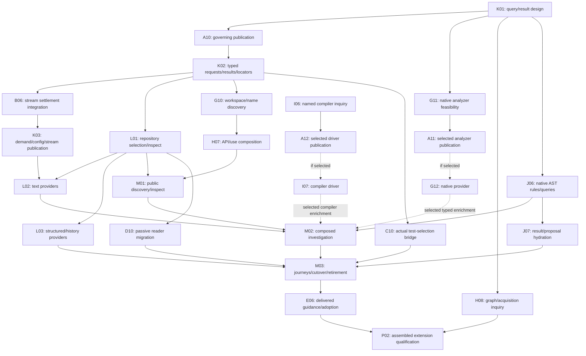

# Agent-first `pse` CLI

## Purpose, scope and basis

Today agents drive the Rust system with hand-assembled commands:
- raw cargo/nextest/`scripts/pse-env` invocations;
- inline `PSE_*` fixture variables and receipt paths kept in `/tmp`;
- background runs watched by `tail` and `ps`;
- repeated reads of the `justfile` and orientation files.

The Python CLI, MCP and `pse-py` boundary that used to front this work retired on 2026-10-29.

This series gives agents one Rust front door, `pse`, inside the existing `pse-host` crate. Built
on clap, it routes each verb to the owner that already does the work:
- `pse-host` for environment, placement, admission and processes;
- the correctness adapter for Cargo and nextest;
- xtask for heavy development composition;
- product binaries for workers and services.

It adds these capabilities:
- a versioned, summary-first output contract;
- owned runs with a ledger;
- intent-level test and check verbs;
- fixture resolution;
- knowledge and workflow verbs;
- product-owned simulation inspection, follow and explicit diagnostic investigation;
- the host-tool and worktree environment changes that make agents effective.

**Audience and adoption.** The users are capable agents, chiefly Claude and Codex, who judge for
themselves which tool to use. `pse` is the strongly recommended agent interface and is adopted by
being the easiest path and by being clearly communicated. No hook enforces it. When agents bypass
`pse` for some task, that marks a capability to improve.

**Basis.**
- Source: the
  [agent-first Rust CLI functional review](../functional_reviews/rust-agent-cli-2026-10-29.md),
  revisions `0df43e599`, `41a9d953a`, `d223d029e` and `68e075493`. Opportunity references `O01`–`O25`
  mean anchors in that review. Its [integrated clap capabilities](../functional_reviews/rust-agent-cli-2026-10-29.md#clap-capabilities)
  section is this series' clap usage contract.
- Baseline: `68e075493`, inspected 2026-10-29.
- Standard: core 3.4, efficient-architecture heuristics 1.0, test assessment 1.2 and
  process-simulator 1.5, under the pse-arrow binding.
- Amendment basis: the [observability review](../functional_reviews/agent-cli-and-simulation-observability-2026-10-29.md)
  and [Plan59 improvement review](../plan_improvement_reviews/plan59-cli-and-observability-2026-10-29.md),
  published at `e907d8a1f`, inspecting `890aa07f76fac5739cfc9811a47e823c326be663`.
- Status: **Prior selected deliveries retain their recorded qualification; the search extension
  below is planned and E01's removal scope decision remains open.** The current checkpoint and
  companion Outcomes own evidence, limits and conditional non-adoptions. Prior completion does
  not qualify the new query, provider and migration packages.

**Reading route.**
1. This coordinator: target, shared decisions, rule changes, dependencies, completion.
2. [59a CLI foundation](59a-cli-foundation.md): the front door, output contract, catalog, state
   store, host tools, and the rule-change edits.
3. [59b Runs and continuity](59b-runs-and-continuity.md): synchronous foreground, explicit
   detached continuity, capture/results, wait/cancel and session identity.
4. [59c Tests and fixtures](59c-tests-and-fixtures.md): `test`, `check`, `tests`, fixtures, and the
   reconciled verdict.
5. [59d Knowledge and workflow verbs](59d-knowledge-and-workflow-verbs.md): focused `changes`,
   `dep`, `api`, `probe`, `outline`/`show`, `owner` and `docs check`; wrappers/commit deferred.
6. [59e Environment and adoption](59e-environment-and-adoption.md): worktrees, harness surfaces,
   communication and recipe migration.
7. [59f Simulation observability and diagnostics](59f-simulation-observability-and-diagnostics.md):
   product delegation/correlation, passive inspection, follow, study history and selected investigation.
8. [59g Rust semantic intelligence](59g-rust-semantic-intelligence.md): reusable sessions,
   source semantics, candidates, provenance and semantic edit proposals.
9. [59h API and dependency intelligence](59h-api-and-dependency-intelligence.md): capability
   discovery, examples, dependency explanations and migration briefs.
10. [59i Compiler investigations](59i-compiler-investigations.md): selected original evidence,
    ownership/async, representation and code-generation investigations.
11. [59j Source queries and change proposals](59j-source-queries-and-change-proposals.md):
    server-free addressed reads, structural queries, common proposals and contributor navigation.
12. [59k Query and result foundations](59k-query-and-result-foundations.md): shared source/query
    meaning, compact addressed answers, demand, configuration and streaming contracts.
13. [59l Repository discovery and content search](59l-repository-discovery-and-content-search.md):
    source selection, native text search, structured content and historical inspection.
14. [59m Composed Rust investigations](59m-composed-rust-investigations.md): name-first discovery,
    typed refinement, proposal/test handoff and public migration journeys.

## Rust-centered search target — 2026-10-31

**Proposed extension:** integrate the [Rust-centered search review](../functional_reviews/rust-centered-search-and-investigation-cli-2026-10-31.md)
published at `9dd0f472a`, following implementation `81c2759d8`. Its O01–O14 references are
qualified to that review. The source review's capability and current-code assessments supply
the foundation; this amendment adds no production, ADR, architecture or agent-setting changes.
Core3.4 and efficiency heuristics1.0 apply through the repository binding. Existing physical
and scientific authority remains with its current owners.

Agents should be able to start with a partial name, file family, text, syntax shape or original
diagnostic, obtain a useful bounded answer, inspect the exact source, and refine or propose a
change. Use three public passive/query intents: `search`, `inspect` and `propose`. Known file,
range, index/revision, symbol and original-evidence locators can be inspected directly. Keep
preparation, acquisition, tests, probes, execution and lifecycle control explicit. Consolidation
must preserve useful capabilities rather than hide missing ones behind a smaller parser.

K owns shared meaning and representation; L owns repository selection and content providers;
M composes public questions. G/H/I/J keep semantic, API, compiler and syntax/proposal authority.
B owns actual child/stream settlement; C owns actual test selection; D owns passive workflow
readers; E owns guidance/adoption. F's impact assessment adds no package unless the settled
contract actually changes a product-consumed view. Source discovery requires neither analyzer
preparation nor a database. A future provider extends the shared contracts and its native owner,
not a parallel query language, orchestration service or result store.

K01 settles source universes, predicate scopes and relationships, answer demand, unknown versus
false, and result/provenance lifetimes. K02 implements one typed interpretation for Clap and
JSON with directional Serde/Schemars schemas. K03 and B06 publish complete streamed records and
terminal coverage; providers honor early-stop demand before unnecessary work. Exact counts may
require completion, deterministic order may require buffering, and lexical observations require
exact-source hydration before a guarded preview. Partial examination cannot become a complete
negative answer. Compact provenance must still identify source, configuration and original facts.

Choose native library mechanisms where they answer the question: ignore/grep crates for source
selection and text, gix for supported Git semantics, native AST rules and Tree-sitter captures
for structure, and current LSP/rustdoc/compiler owners for their respective facts. Preserve
explicit managed rg/Git alternatives where a material capability is better delegated. G11 and
I06 investigate deeper native HIR/IDE and compiler capabilities early against named useful
questions; implementation remains conditional on a coherent, maintainable provider choice.
Do not parse hover/debug strings into authoritative types or treat source spellings as resolved
identity. Offline snapshots, API dependency graphs and SSR accessors retain explicit feasibility
decisions. Indexed services, embeddings, automatic preparation and source application are not
selected defaults. Library rationale, exact API mechanisms, limits and negative controls live
with the consuming package, linked to the source review.

The maintainer confirmed these rule impacts during plan creation on **2026-10-31**:

| Impact | Confirmed decision and consequence | Publication/work route |
| --- | --- | --- |
| S-RC01 | accepted: consolidate search/read/query interactions around search / inspect / propose; migrate capabilities and delete replaced routes/callers after targeted acceptance; retain distinct effectful and control operations | K01 settles the mapping; A10 publishes governing command changes before K02/M cutover; D10/E06 migrate guidance and readers |
| S-RC02 | accepted: compact shared provenance/results and real streaming may change immature wire shape; preserve identity, outcome, coverage, exact bytes and scientific meaning | K01 → A10 normal decision/architecture route → K02/B06/K03; regenerate schemas/reference outputs through their generators |
| S-RC03 | accepted: bounded native HIR/IDE/compiler investigations and conditional implementations may explore a concrete valuable question without a recurring-use prerequisite | G11/I06 select or reject branches; A11 and A12 independently publish required governing changes before their respective G12/I07 implementations; no blanket native-family migration |

These confirmations select the planning target. Later architectural changes use the normal
decision route; plan authoring does not accept or amend ADRs. Deeper library research, pinned
API checks and bounded prototypes belong to the packages that need them. No upstream contact
or additional service deployment follows merely from this amendment.

<a id="search-extension-dispositions"></a>
## Search extension dispositions

Each row refers only to the 2026-10-31 search review. **Scheduled** selects work or a decision
investigation; it establishes no implementation, test pass or performance benefit. Companion
package tables own status; this table owns opportunity disposition. Conditional non-adoption
must describe the lost capability and useful revisit condition rather than claim delivery.

| Opportunity | Disposition | Work owner | Required evidence or trigger |
| --- | --- | --- | --- |
| O01 | scheduled | L01 | Shared filesystem/Git/Cargo selection, useful path discovery and direct inspection; ignored/generated/index-only/revision-only cases |
| O02 | scheduled | L02 | Native literal/regex/context/count/exists search, exact reads and no-match semantics; unsupported regex modes fail explicitly |
| O03 | scheduled | M01; G10/H07 | Name-first source/workspace/API candidates with qualified identity and contextual inspection; no implicit semantic preparation |
| O04 | scheduled | J06; M02 | Native Boolean/relational AST rules, reusable captures and scoped composition; same-file is distinct from same-node |
| O05 | scheduled | K02; J07 | Compact result/provenance/locator views, direct inspection and guarded expansion; Unicode/raw paths and exact evidence |
| O06 | scheduled | K03; L02/J06/B06 | Demand reaches native producers; first witness, exhaustive no-match, exact counts, cancellation and consumer close remain distinct |
| O07 | scheduled | G11/G12; M02 | Early native AnalysisHost/HIR/IDE/SSR/snapshot investigation, selected conditional provider and typed relationships; unavailable facts remain unknown |
| O08 | scheduled | L03; D10 | Historical/change-centered source and ownership drill-through; working, index and revision context never silently coalesce |
| O09 | scheduled | L03 | Bounded JSON/TOML/YAML field/content queries and mixed-source scope; existing domain owners retain interpretation |
| O10 | scheduled | H07/H08; M02 | API/dependency/use/importability and selected diagnostic/candidate joins; generic constraints and destination context limits explicit |
| O11 | scheduled | J07 | Hydrated search-to-proposal flow with native syntax/semantic contracts, exact source and trivia; apply remains separately conditional |
| O12 | scheduled | I06/I07; M02 | Named ownership/async/dataflow compiler inquiry, conditional pin-specific driver and original-versus-current evidence; explicit probe execution |
| O13 | scheduled | K01/K02/K03; A10 | One typed flag/JSON/config interpretation, scoped diagnostics, source precedence and directional generated schemas |
| O14 | scheduled | K03; B06 | Actual work/progress and effective-query explanation on stderr; no invented totals, cancellation acknowledgement or cache/speed claims |

## Runtime and test target decisions — 2026-10-30

The [CLI, test and runtime review](../functional_reviews/cli-test-and-runtime-workflows-2026-10-30.md)
was published at `c8244cff5`, inspecting `26ac0b893`. Its O01–O14 are qualified to that review.
All fourteen are accounted for below; selection/scheduling is not implementation acceptance.
The operator explicitly confirmed the following during plan creation on 2026-10-30:

| Change | Decision and consequence | Publication route |
| --- | --- | --- |
| RT01 | accepted: native completed reports replace independent test event verification; retain exact selection, native exit, setup/capture/drain and incomplete refusal | A09 → blueprint §24.1/§24.2 and affected Plan53/59 consumers; C02/B02 implement |
| RT02 | accepted: synchronous foreground and one-service explicit detach; lose generic foreground reconnect/history and independent nested CLI subtree control | A09 → proposed ADR-0233/0234, blueprint §21.7 and operating guidance; B01/B03 implement |
| RT03 | accepted: remove automatic host-generation collection; retain immutable tools until explicit administrative cleanup | A09 → proposed ADR-0233/0234, blueprint §21.7/§24.1; A05/E01 consumers. No current data deletion |
| RT04 | accepted: defer D08 transaction; ordinary Git does not supply its shared-index concurrency guarantee | A09 schedules R5/guidance correction; D09 evidence remains complete; D08 awaits actual consumer need |

Automatic stale-host refresh remains selected. Generic briefs and mandatory session context
assembly leave required scope; useful focused source/diagnostic capabilities remain. R1/R2/R4/R6
retain their substantive meanings. RT02 replaces R3's universal per-invocation supervisor;
RT04 defers R5's specialized interface, not permission for agents to commit owned changes.
A09 owns publication of this wave's contract changes; A07/A08 completion remains historical.
Publication and focused implementation do not enlarge prior physical/numerical qualification.

<a id="runtime-test-dispositions"></a>
## Runtime and test dispositions

Every opportunity below refers to the CLI/test/runtime review linked above. Companion package
tables own execution evidence. Conditional library candidates need their stated question, not
blanket adoption or a mandatory measurement campaign.

| Opportunity | Disposition | Work owner | Required evidence or trigger |
| --- | --- | --- | --- |
| O01 | complete | D01/D05/D08, B05, E02/E03; G/H/I consumers | Generic brief/packet requirements removed; no production composer/hooks existed to retain. Citation/scaffold/commit conveniences stay explicitly deferred; useful focused queries remain. |
| O02 | complete | C02; B02/A03 | Private native completed reports, exact identities, native exit and required setup/capture/drain are integrated/tested; independent event proof intentionally removed. |
| O03 | complete | C02/C05; B02 | Original failure text/pages and explicit fresh-source exact reruns pass. Native recordings remain conditional on an actual diagnostic need. |
| O04 | complete | C04/C05/C07 | Selected existing-owner preparation, both fixture modes and pure reader isolation pass actual and negative controls. |
| O05 | complete | C07/C09 | Native scheduling owns group membership; only incompatible contexts sharing exclusion sequence. Independent case identities and integrated controls pass. |
| O06 | complete | C09 | Actual CLI assertions use assert_cmd, typed JSON checks and reviewed snapshots; no wholesale harness conversion. |
| O07 | complete | C08 | Named pure reader target replaces public unit copies; private invariants and independent framing/identity tests remain. |
| O08 | complete | C06/C04 | Selective construction retained by bounded decision; native runtime BIN_EXE mapping binds immutable, named source captures with exact original Cargo provenance. |
| O09 | complete | A09; B01/B03 | Actual foreground/death and ordinary/finite detached exit/cancel/crash controls pass; one native service replaces universal subtree/recovery machinery. |
| O10 | complete | B01/B03 | Async joined child ownership, independent cleanup failures and actual native startup/stop acknowledgement are tested; no ceremony-only supervisor remains. |
| O11 | complete | A09/A05/E01 | Host GC-only claim/promotion/transfer/finalizer protocols deleted. Automatic collection remains absent and existing unknown files untouched. |
| O12 | complete | C08; A05/A06 | Original phase/context/wall durations and mutable native timing links delivered. Two-stage cold bootstrap retained with publication duties; no cache/speedup claim. |
| O13 | complete | F02/F03/F05/F06; B03 | Selected calculation inspection/follow/history and explicit investigation consumers pass. Optional backends and MCP retain F06's non-adoption triggers. |
| O14 | complete | C09 | Independent byte/chunk/EOF properties and real CLI/kernel expectations pass. Model/UI/profiling tools remain conditional, not new gates. |

## Earlier library integration basis — 2026-10-30

**Original amendment basis.** The [library integration review](../plan_improvement_reviews/plan59-library-integration-and-target-design-2026-10-30.md)
published at `0c8c17ebf` assesses production `09e878957`. Its I01–I16/RC01–RC04 references below
are qualified to that review, not the earlier reviews' similarly named findings. The full
selected standard and library evidence inform this amendment; no new diagnostic audit or
production qualification is claimed. The operator selected all sixteen recommendations for
planning and explicitly accepted these impacts on2026-10-30:

| Impact | Decision and consequence | Publication/work route |
| --- | --- | --- |
| RC01 | accepted: effect-shaped scoped protection for passive reads; durable custody before retained paths/children/finalizers; old unknown claims remain protected | A08 → A05/B03; amend proposed ADR-0233/0234 and applicable blueprint §21.7/§24.1 through their decision route |
| RC02 | accepted: independent raw stdout/stderr files replace encoded merged retention; compact offset index only for an actual observation-order consumer | A08 → B01/B02 and A03/A04 consumers; direct format migration with original-byte retention |
| RC03 | accepted: intentional immature wire/schema changes for owned pages and shared proposals; migrate consumers directly without compatibility shims | A08 → A03/J02 and affected producers; explicit versions/schema identity and preservation of unique original evidence |
| RC04 | accepted: syntax-only queries/previews do not require semantic preparation | G07/J03/G08 and native dependency bindings; semantic operations retain G01/G03 |

A08 owns new governing publication obligations; A07's prior completion remains historical.
No ADR/architecture amendment or production change occurs merely by revising these plans.

The combined target is an owned parser/intent → resolved/admitted stage → captured execution
route. Explain and execution use the same stage premises; explain never fabricates a prepared
fixture or actual test population. B's performing owners share result meaning, not scientific authority; RT02 replaces the
universal service topology. Passive readers and reusable analyzer sessions retain independent
lifetimes. Product scientific inspection, canonical state and units stay with their owners.

A03's typed producer views and directional Serde/Schemars contracts replace shape-blind detail
truncation as the means of obtaining useful bounded answers. Generic projection remains
mechanical. B finalizes authoritative terminal results from actual evidence before projecting
an envelope. A04 distinguishes protected local publication, artifacts, authored inputs and
original diagnostic evidence. A05 retains identity/provenance and actual resource protection. RT03 removes automatic
collection and its exclusive promotion/retirement obligations; unknown existing claims stay protected.

[59j: Source queries and change proposals](59j-source-queries-and-change-proposals.md) adds
J01 addressed source/pages, J02 shared proposals, J03 syntax queries/previews, J04 declared
generated-source navigation and J05 integrated consumer acceptance. D03's implemented reader
is the basis, G07 supplies semantic proposals, and G08 separately decides filesystem application.
D08 is deferred under RT04; D09 retains its original evidence. No proposal mechanism implies multi-file atomicity.

<a id="library-integration-dispositions"></a>
## Library integration dispositions

The adopted targets below are resolved by their companion Outcomes and actual consumers,
not by authoring this table. Automatic-collection coordination was superseded by RT03;
unknown historical resources remain protected. E01's additional removal feature remains open
and is not advertised. Conditional absent capabilities retain their companion-owned triggers.

| Finding reference | Scenario reference | Disposition | Decision/work owner | Evidence or revisit trigger |
| --- | --- | --- | --- | --- |
| [I01](../plan_improvement_reviews/plan59-library-integration-and-target-design-2026-10-30.md#I01) | explain→selected execution with unchanged premises | resolved | A06/C07; B/D02/F/G–I consumers | Same-stage value; unavailable preparation causes no effects |
| [I02](../plan_improvement_reviews/plan59-library-integration-and-target-design-2026-10-30.md#I02) | foreground/detached nested payload settlement | resolved | B01/B03, A05/C04/G02 | Actual original drain, custody transfer and release |
| [I03](../plan_improvement_reviews/plan59-library-integration-and-target-design-2026-10-30.md#I03) | scoped status/follow under reset/lag | resolved | B03, F02/F03 | Native reconciliation, incarnation fence and gap handling |
| [I04](../plan_improvement_reviews/plan59-library-integration-and-target-design-2026-10-30.md#I04) | killed passive read and retained child/path | resolved | A05/A08, B03/E01/G02 | Actual resource protection retained; collection-specific target superseded by RT03; no old-claim deletion |
| [I05](../plan_improvement_reviews/plan59-library-integration-and-target-design-2026-10-30.md#I05) | stalled stream sink and independent extractor | resolved | B01/B02/B03 | Exact raw files, independent failures and flush/drain |
| [I06](../plan_improvement_reviews/plan59-library-integration-and-target-design-2026-10-30.md#I06) | exact healthy ID plus unrelated corrupt history | resolved | A04/A06, B01/B03 | Direct lookup; prefix ambiguity and incomplete latest/history |
| [I07](../plan_improvement_reviews/plan59-library-integration-and-target-design-2026-10-30.md#I07) | nested outline budget and stale continuation | resolved | A03/A06; J01 and D/F–I producers | Producer pages, indivisible records and source premises |
| [I08](../plan_improvement_reviews/plan59-library-integration-and-target-design-2026-10-30.md#I08) | structural and semantic preview without conflation | resolved | J02/J03, G07/G08 | Shared proposal, explicit authority, no session barrier for syntax |
| [I09](../plan_improvement_reviews/plan59-library-integration-and-target-design-2026-10-30.md#I09) | staged/working/blob source navigation | resolved | J01, D01/D08/D09/E01 | Exact source kinds, paths, supported Git policy |
| [I10](../plan_improvement_reviews/plan59-library-integration-and-target-design-2026-10-30.md#I10) | original failure→useful next action | resolved | B02/F/G09/H06/I producers | Focused next action without implicit compilation/preparation |
| [I11](../plan_improvement_reviews/plan59-library-integration-and-target-design-2026-10-30.md#I11) | two observers, failed science, missing live numerics | resolved | F01–F06 | Original statements/units/clocks, passive detachment |
| [I12](../plan_improvement_reviews/plan59-library-integration-and-target-design-2026-10-30.md#I12) | tail/range/export versus protected local writes | resolved | A03/A04; B/D02/F05/H/I | Backend limits, retention classes, original evidence protection |
| [I13](../plan_improvement_reviews/plan59-library-integration-and-target-design-2026-10-30.md#I13) | valid wire view versus invalid domain finality | resolved | A03; B01/B03 and F/G/H/I adapters | Checked owner construction, directional schemas and raw fidelity |
| [I14](../plan_improvement_reviews/plan59-library-integration-and-target-design-2026-10-30.md#I14) | actual producer→consumer journey plus failure | resolved | coordinator and all companions | Scope-specific targeted evidence and deletion after migration |
| [I15](../plan_improvement_reviews/plan59-library-integration-and-target-design-2026-10-30.md#I15) | compatible/incompatible multi-root tests | resolved | C07/C01/C02/C05, H03 | No repeated compatible graph admission; preserve negative features |
| [I16](../plan_improvement_reviews/plan59-library-integration-and-target-design-2026-10-30.md#I16) | generated hit→declared emitter/regeneration | resolved | J04, D06/G05/D01 | Declared contributor lineage; unknown source stays unknown |

## Scope decisions

### Code-intelligence amendment basis

The [Rust code-intelligence review](../functional_reviews/rust-code-intelligence-cli-2026-10-29.md)
at `a569b52e4` adds the G–I companions below. Its O01–O16 identities are scoped to that review,
not the original O01–O25 or observability review. Source assessment and library research remain
Interface-checked at their recorded limits; new targets were Proposed at that amendment.
Current package Outcomes own delivered execution and its limits. A01/E05 and the concluded
D02 trial keep their original evidence.

- [59g semantic intelligence](59g-rust-semantic-intelligence.md): reusable analysis sessions,
  semantic reading/navigation, candidate tests/completion, macros and semantic edit proposals.
- [59h API/dependency intelligence](59h-api-and-dependency-intelligence.md): capability search,
  examples, dependency explanations, API evolution and rustdoc diagnostics over D02 acquisition.
- [59i compiler investigations](59i-compiler-investigations.md): selected ownership/async,
  representation and code-generation investigations, with conditional pin-specific drivers.

### Code-intelligence rule decisions

The operator explicitly confirmed all five review impacts during preparation on 2026-10-29.
These decisions select planning scope; governing publication is scheduled in A07 before any
dependent implementation. Existing R1–R6 are unchanged.

| Review impact | Confirmed decision | Route |
| --- | --- | --- |
| RC01 | Extend the CLI/output scope using existing envelope, store and discovery owners. | A03/A04/A06; D01–D03; G–I consumers. |
| RC02 | Target reusable owned analyzer sessions beyond individual queries, with explicit preparation/status/teardown. | A05/B03 operating slices and G01–G03; A07 routes any enduring contract/service change. |
| RC03 | Preserve C07 selection, C05 actual tests and F scientific evidence authority. | C05/C07, B02, F01/F02 and corresponding G/H/I adapters. |
| RC04 | Retain MCP/editor/Codex configuration exclusions; CLI may use stdio LSP. | Clarify D/E guidance; do not revive rejected servers. |
| RC05 | Edits/probes/generation/compiler preparation are explicit effects under current ownership and qualification rules. | G07/G08, D02, H/I; ordinary dependency policy and scoped decision routes. |

The operator additionally selected **preview plus conditional apply**: G07 delivers previews;
G08 must settle concurrency, protected paths and partial-failure behavior before application.
A proportionate failure to establish that route retains useful previews, not an invented
multi-file atomicity promise. No installation or runtime configuration change follows here.

<a id="code-intelligence-dispositions"></a>
## Code intelligence dispositions

All references in this table address the [code-intelligence review](../functional_reviews/rust-code-intelligence-cli-2026-10-29.md).
Companion Outcomes resolve the selected deliveries. Unsupported native fields and conditional
driver/embedding/index/application capabilities remain explicitly unavailable or deferred;
resolution does not claim those absent capabilities were implemented.

| Opportunity | Disposition | Work owner | Required evidence or trigger |
| --- | --- | --- | --- |
| [O01](../functional_reviews/rust-code-intelligence-cli-2026-10-29.md#O01) | resolved | G01/G04; D03 | Resolve actual use sites, preserve ambiguity and retain cheap syntax reads. |
| [O02](../functional_reviews/rust-code-intelligence-cli-2026-10-29.md#O02) | resolved | G04 | Selected annotations/types/captures with backend-supported fields and explicit unknowns. |
| [O03](../functional_reviews/rust-code-intelligence-cli-2026-10-29.md#O03) | resolved | G05; D01/C03 | Scoped references plus separately conservative impact selection. |
| [O04](../functional_reviews/rust-code-intelligence-cli-2026-10-29.md#O04) | resolved | G05 | Bounded calls/impl neighborhoods without exhaustive runtime claims. |
| [O05](../functional_reviews/rust-code-intelligence-cli-2026-10-29.md#O05) | resolved | H01; D02 | Usable public paths, constraints and capability search in exact documentation context. |
| [O06](../functional_reviews/rust-code-intelligence-cli-2026-10-29.md#O06) | resolved | H02; D02 | Authored example/setup/mode; explicit probe execution, extraction not execution. |
| [O07](../functional_reviews/rust-code-intelligence-cli-2026-10-29.md#O07) | resolved | G06; C05/C07 | Related-test candidates handed to actual selection/listing owner. |
| [O08](../functional_reviews/rust-code-intelligence-cli-2026-10-29.md#O08) | resolved | G06 | Useful method/import candidates; synthesis conditional on an actual expected-type need. |
| [O09](../functional_reviews/rust-code-intelligence-cli-2026-10-29.md#O09) | resolved | G07/G08 | Revision-bound previews first; conditional apply only after its publication decision. |
| [O10](../functional_reviews/rust-code-intelligence-cli-2026-10-29.md#O10) | resolved | B02; G04/G09; H05 | Original compiler facts, separate IDE diagnostics, scoped rustdoc diagnostics. |
| [O11](../functional_reviews/rust-code-intelligence-cli-2026-10-29.md#O11) | resolved | H03; D02/C07 | Declarations, metadata, unit plans and observed artifacts stay distinct. |
| [O12](../functional_reviews/rust-code-intelligence-cli-2026-10-29.md#O12) | resolved | H04 | Context-matched API evolution using native compatibility tools and selected consumers. |
| [O13](../functional_reviews/rust-code-intelligence-cli-2026-10-29.md#O13) | resolved | G05; D06 | Expansion/origin with honest mapping limits and actual generator ownership. |
| [O14](../functional_reviews/rust-code-intelligence-cli-2026-10-29.md#O14) | resolved | I01/I02/I05 | Selected ownership/async explanations; driver only when I05 establishes its need/fit. |
| [O15](../functional_reviews/rust-code-intelligence-cli-2026-10-29.md#O15) | resolved | I03–I05 | Selected constants/layout/instances; context-bound evidence, no portable ABI/performance proof. |
| [O16](../functional_reviews/rust-code-intelligence-cli-2026-10-29.md#O16) | resolved | B02; G09/H06; F02 | Focused next actions composed from available original sources; no automatic enrichment. |

Review capability families not selected as ordinary delivery retain their companion-owned
triggers: static indexes/term search in G, archives/Guppy/scraping in H, driver/Polonius in I.
Tiny editor actions, a replacement checker, custom compiler passes, eager corpora and routine
build monitoring are not adopted. A conditional inquiry may close with a reasoned deferral;
it cannot claim the deferred capability was delivered.

## Retained scope decisions

**Operator directions, 2026-10-29:**
- **Direnv changes are on hold.** A separate environment effort is changing uv and environment
  handling around `.envrc.local`. Excluded: O09 (direnv output quieting) and any direnv step in
  O23. `pse worktree new` copies `.envrc.local` and keeps its current propagation behaviour.
- **Codex changes are limited to what Codex needs to call the CLI**, which is only the shell and
  the shared AGENTS.md guidance. Codex works differently from Claude and its setup stays as is.
  Excluded:
  - O10 item 1 (generating role contracts into Codex `developer_instructions`);
  - O10 item 4 (Codex `exec` habits);
  - Codex hooks in O20 and O25;
  - the rust-analyzer MCP for Codex (O08, O11);
  - the `rustdoc-mcp` trial for Codex (O15).

  Ledger session grouping uses Claude's hook-provided session ID or an explicit
  `--session`/`PSE_SESSION`, with no Codex configuration change.
- **Enablement over governance.** Where a current rule costs agents effort, the series changes
  the rule (see [Rule changes](#rule-changes)). It does not preserve ceremony.
- **Concurrent agents use separate worktrees.** Each worktree has its own `target/` and
  `target/host-tools`, so one agent's in-progress change cannot break another's `pse` verbs. The
  isolation protects other checkouts, but cannot make the owning checkout's broken source
  buildable. Existing-work control is therefore exempt from new-work rebuilding under amended R3.

<a id="opportunity-dispositions"></a>
## Opportunity dispositions

| Opportunity | Disposition | Work owner | Required evidence or trigger |
| --- | --- | --- | --- |
| O01 | complete | [59a](59a-cli-foundation.md) | Agents run the fixture episode and common work through `pse` verbs; one library `Cli` behind thin bins |
| O02 | complete | [59a](59a-cli-foundation.md) | Structured surfaces validate against their directional schemas; declared raw/native adapters retain their own byte/exit protocols under A03 |
| O03 | complete | [59b](59b-runs-and-continuity.md) | Actual detached test→wait, original failure pages and incomplete/crash cases pass; observation cannot manufacture subject success |
| O04 | complete | [59c](59c-tests-and-fixtures.md) | Native test/check selection, capabilities, filters, completed verdicts and common changed-source integration delivered and tested |
| O05 | complete | [59c](59c-tests-and-fixtures.md) | Declared fixture owners receive selected inputs; actual integration cases pass without caller fixture variables or temporary receipt selection |
| O06 | complete | [59a](59a-cli-foundation.md) (catalog, explain, provenance); [59d](59d-knowledge-and-workflow-verbs.md) (generated reference) | `pse commands --json` with `valid_values`; `pse explain` matches what runs |
| O07 | complete | D01 | Selected Git/source facts remain; generic `brief` is superseded by runtime O01. |
| O08 | complete | [59d](59d-knowledge-and-workflow-verbs.md) | `pse dep`, `outline` and `show` used in place of registry greps and `sed` ranges. Rust-analyzer MCP for Codex excluded. |
| O09 | deferred | Operator's environment work | Direnv quieting on hold by operator direction |
| O10 | superseded (brief portion); retained index delivered | E04 | Current-work index remains; mandatory session brief removed under runtime O01. Codex exclusions remain. |
| O11 | complete | [59c](59c-tests-and-fixtures.md) (fixtures), [59a](59a-cli-foundation.md) (host ceiling), [59e](59e-environment-and-adoption.md) (start routes) | Items land with their owning packages; the clap overview is already corrected. Rust-analyzer MCP for Codex excluded. |
| O12 | complete | [59e](59e-environment-and-adoption.md) | Edit guidance in AGENTS.md and the tooling rule |
| O13 | complete | [59a](59a-cli-foundation.md) | Immutable image/source checks, stale refresh and compatible existing control are delivered. GC-only protection is superseded by RT03; broader producer/worktree integration stays with A05/E01. |
| O14 | deferred | D05 | Revisit citation/scaffold wrappers for a demonstrated repeated navigation/authoring need. Existing native routes remain. |
| O15 | complete | [59d](59d-knowledge-and-workflow-verbs.md) | `pse api` and `pse probe` answer exact pinned-API questions; rustdoc-mcp trialled for Claude only |
| O16 | complete | [59d](59d-knowledge-and-workflow-verbs.md) | `pse owner` and guard context; documents inform instead of block ([R4](#rule-changes)) |
| O17 | complete | [59d](59d-knowledge-and-workflow-verbs.md) | `pse docs check --changed` before document commits |
| O18 | deferred | D08 | RT04: actual shared-index transaction consumer need; D09 investigation stays complete. |
| O19 | complete | [59c](59c-tests-and-fixtures.md) | Native inventory exposes actual target/features, capabilities, fixture demand and exact rerun identities; public discovery/page/rerun controls pass |
| O20 | deferred | B05 | Automatic handoff hooks await a demonstrated context-loss consumer; preserve authored notes and session identity. |
| O21 | deferred | This coordinator | Adopt soft claims at the first concurrent-edit collision, recorded in the checkout store |
| O22 | complete | [59e](59e-environment-and-adoption.md) (continuing) | Start route, guides, roles/skills and `next` hints point to `pse` as each verb ships |
| O23 | in-progress (without direnv) | [59e](59e-environment-and-adoption.md) | Actual `new`/`list` and source-aware tool copy pass; project warming is explicit. Removal awaits the E01 scope choice; no selected deferral is inferred |
| O24 | complete | [59a](59a-cli-foundation.md) (resolver and store), [59b](59b-runs-and-continuity.md) (runs) | One state resolver; per-run directories replace `/tmp` logs |
| O25 | superseded | E02 | Mandatory session-start brief/status line removed under runtime O01; useful passive native status remains. |

## Simulation observability dispositions

These O01–O08 refer only to the new [observability review](../functional_reviews/agent-cli-and-simulation-observability-2026-10-29.md),
not the original O01–O25 above. Scheduled means selected work, never implementation acceptance.
Conditional portions retain the stated trigger; companions own package progress.

| Opportunity | Disposition | Work owner | Required evidence or trigger |
| --- | --- | --- | --- |
| [O01](../functional_reviews/agent-cli-and-simulation-observability-2026-10-29.md#O01) | complete | A03; B01; F01/F02 | Existing identity associations and cross-checkout copied process/operation discovery; unknown associations stay unknown. |
| [O02](../functional_reviews/agent-cli-and-simulation-observability-2026-10-29.md#O02) | complete | F02 | Owner statements, phases and relationships explain actual evidence without invented hang/convergence diagnoses. |
| [O03](../functional_reviews/agent-cli-and-simulation-observability-2026-10-29.md#O03) | complete | F03/F04; B output | Bounded follow, gaps/resets and retained history; additional live publication is gated by F04's explicit decision. |
| [O04](../functional_reviews/agent-cli-and-simulation-observability-2026-10-29.md#O04) | complete | F05 | Selected actual capture/analysis/export consumer with original identity, coverage and collector settlement. |
| [O05](../functional_reviews/agent-cli-and-simulation-observability-2026-10-29.md#O05) | complete | A03/A06; B02 | Original typed facts/causes, honest provenance and shared resolved operation; secrets redacted. |
| [O06](../functional_reviews/agent-cli-and-simulation-observability-2026-10-29.md#O06) | complete | C07/C01–C05; A05 | Exact native selection, both fixture modes and immutable named binaries pass actual journeys without manual input assembly. |
| [O07](../functional_reviews/agent-cli-and-simulation-observability-2026-10-29.md#O07) | complete | D02/D04/D06/D07; E03 | API/probe and scoped documentation remain; briefing/handoff superseded and specialized commits deferred by runtime O01/RT04. |
| [O08](../functional_reviews/agent-cli-and-simulation-observability-2026-10-29.md#O08) | complete | A06; F03/F06 | Human presentation and scoped discovery selected; RMCP deferred until an actual client needs tools/resources/subscriptions beyond shell access. |

## CLI improvement dispositions

These I01–I11 refer to the [new improvement review](../plan_improvement_reviews/plan59-cli-and-observability-2026-10-29.md).
The dispositions below distinguish delivered work from remaining proposals; scheduling alone
resolves no finding.

| Improvement | Disposition | Work owner | Required evidence or trigger |
| --- | --- | --- | --- |
| [I01](../plan_improvement_reviews/plan59-cli-and-observability-2026-10-29.md#I01) | resolved | A03/A07; B01; F01 | Distinct invocation/scientific/observation identities, explicit existing-fact associations and independent outcome dimensions. |
| [I02](../plan_improvement_reviews/plan59-cli-and-observability-2026-10-29.md#I02) | resolved | A07/A05; B03 | Control works with broken current sources; new-work rebuild identity remains coherent and fail-closed. |
| [I03](../plan_improvement_reviews/plan59-cli-and-observability-2026-10-29.md#I03) | complete | A03/A07; B01–B04; C02 | Actual foreground/detached tests preserve acknowledgement, child outcome, lost evidence and independently observed native settlement. |
| [I04](../plan_improvement_reviews/plan59-cli-and-observability-2026-10-29.md#I04) | resolved | A03; B02; F02 | TypedDiagnostic facts, error causes/related failures, Unicode source locations and settlement leaves preserved. |
| [I05](../plan_improvement_reviews/plan59-cli-and-observability-2026-10-29.md#I05) | resolved | A03; B01/B02; F03 | Typed summaries versus opaque raw records; framed/projection-aware output and independent required result completeness. |
| [I06](../plan_improvement_reviews/plan59-cli-and-observability-2026-10-29.md#I06) | resolved | F01–F06 | Prepared product reader, passive local evidence, retained studies and explicit escalation; conditional bridge/backend choices recorded. |
| [I07](../plan_improvement_reviews/plan59-cli-and-observability-2026-10-29.md#I07) | complete | C07/C01–C05; A05 | Exact binary/feature/filter and original Cargo provenance, absence controls and both fixture owners are qualified. |
| [I08](../plan_improvement_reviews/plan59-cli-and-observability-2026-10-29.md#I08) | in-progress | A04/A05; B03; E01 | Runtime/fixture ownership and partial/successful creation pass; GC-only gates are superseded by RT03. E01 removal remains unavailable pending its scope choice |
| [I09](../plan_improvement_reviews/plan59-cli-and-observability-2026-10-29.md#I09) | resolved | A02/A04/A06; D01/D02/D07 | Native parser/owning configuration retained. A separate Figment CLI layer is not adopted without a repeated shared-configuration consumer; no second settings authority |
| [I10](../plan_improvement_reviews/plan59-cli-and-observability-2026-10-29.md#I10) | resolved | D02/D04/D06/D07; E03 | API/probe identity and scoped checks remain; Git transaction and handoff portions deferred under RT04/runtime O01. |
| [I11](../plan_improvement_reviews/plan59-cli-and-observability-2026-10-29.md#I11) | resolved | A02/A03/A06; D07 | Scoped candidate discovery, honest incompleteness and early parsing that cannot consume a child argument tail. |

<a id="rule-changes"></a>
## Rule changes

The earlier decisions below retain their history. RT01–RT04 above own the current changes;
R3's universal supervisor and R5's required transaction interface are superseded/deferred.
A09 schedules publication before dependent implementation.

The operator accepted each of these on 2026-10-29. Each is scheduled in
[59a A01](59a-cli-foundation.md#a01) before the packages that depend on it. A01's original
completion is retained; [A07](59a-cli-foundation.md#a07) schedules the newly confirmed amendments
and contract publication before dependent implementation. Formal ADR status is unchanged.

| Change | Decision | Route |
| --- | --- | --- |
| **R1.** `pse` is the strongly recommended agent interface. Its catalog is derived from the parser, not authored, so Plan58 I09's "universal catalogue" concern does not apply. This replaces Plan58 §Purpose's "CLIs are optional conveniences". | Directed by the operator | Amend Plan58 §Purpose and its Outcome wording; `docs/plans/README.md` |
| **R2.** Supervising runs that agents start (wait, result, cancel) is allowed. Build-stage telemetry and alerts stay retired. | Accepted | Amend the Plan58 target row on build observation, 58b's and 58h's wording, and the environment guide §Detached watches |
| **R3.** New-work verbs rebuild a stale host and fail on rebuild error. Existing-invocation control uses its compatible prepared generation without rebuilding current sources; recorded identity and actual settlement remain mandatory. RT02 selects native synchronous foreground and a service only for explicit detachment. | Accepted; control exception confirmed 2026-10-29 and lifetime simplification 2026-10-30 | A07/A09 publication is delivered through proposed ADR-0233/0234 and blueprint315–319; formal ADR acceptance remains separate. |
| **R4.** Protected documents inform instead of block. The edit guard keeps blocking generated paths and other non-authored outputs; for architecture sections and accepted ADRs it adds route context. `.design-edit` and `PSE_DESIGN_EDIT` retire. | Accepted | `crates/pse-host/src/agent_hooks.rs`, AGENTS.md "Off-limits", CLAUDE.md, the `.claude/settings.json` deny list, and `.claude/rules/decisions.md` immutability wording (supersession stays the route for accepted ADRs) |
| **R5.** Any agent may commit its own paths through `pse commit`, which uses a private index. Files committed whole are formatted at commit. | Accepted | AGENTS.md checkout workflow ("coordinator owns the shared index") and execution-rhythm formatting wording |
| **R6.** Managed command success is separate from subject state. Launch acknowledgement and an expired observation wait may exit0 while explicitly reporting launched/running; a completed pass requires reconciled outcome evidence. Exec adapters retain child exits. | Explicitly confirmed 2026-10-29 | A07 schedules §24.1 wording; A03/B01–B03/C02 implement the distinction without treating acknowledgement as scientific or test success. |

## Target

`pse` remains one Clap tree in the native host, with thin `pse`, `pse-host` and
`cargo-pse-correctness` binaries. It routes to actual native/test/product owners and stays free
of scientific/Arrow/database policy. Products remain independently callable. The selected
runtime simplification is a target, not the behavior of the paused source baseline.

| Contract | Owner | Selected behavior |
| --- | --- | --- |
| Parsing, output and selection | A02/A03/A06; C07 for tests | One owning parser; typed directional Serde/Schemars views; exact selected context; explain never fabricates build, fixture or execution evidence. |
| Synchronous foreground | B01/B02 | Existing native foreground ownership through child wait, required capture and actual settlement. No generic reconnectable foreground history or crash-written foreground finalizer guarantee. Operation-specific test/scientific artifacts remain useful. |
| Explicit detached execution | B03 | One transient user service contains its fixed wrapper, payload and ordinary descendants. Authenticated compatible recorded controls support wait/result/log/cancel independently of current-source builds. |
| Nested work | B01/B03 | Ordinary descendants inherit the admitted aggregate; no independently cancellable generic CLI subtrees. Explicit detach requires an admitted placement/lifetime and cannot escape finite constraints. Scientific operation cancellation retains its actual owner. |
| Completed test outcome | C02/C05 with B02 | Native exit, exact context/binary/test inventory and privately produced JUnit, plus actual required setup/capture/drain. No independent start/terminal event proof. Missing evidence is incomplete, not pass. |
| Prepared tools | A05 | Immutable selected generations and coherent stale-host refresh. No automatic collection. Explicit administrative cleanup requires its own authorization and actual safety assessment; existing unknown claims remain protected. |
| Scientific observation | F01–F06 | Product owns schemas, units and interpretation; invocation/scientific/process/observation identities stay distinct. Native status, optional rendering and diagnostic attachments confer no scientific or cancellation authority. |

Launch acknowledgement and expired observation wait may succeed with an explicitly nonterminal
subject. A zero-exit child is not a completed correctness pass. Raw exec adapters retain their
exit/signal forwarding. Original output, observation completeness, physical settlement and
scientific acceptance remain separate. No default restart, watchdog, result database or second
resource governor is selected. Ordinary 32-job/16-lane unbounded work, explicit finite choices,
force-validation, exact pins and independent science retain their meanings.

Generic brief/delegation packet assembly, mandatory session briefs/status-line work and
collection-only recovery leave the target. Citation/scaffold wrappers, automatic handoff hooks
and D08's specialized commit transaction are deferred. Focused source/dependency/API queries,
generator navigation, diagnostics and explicit failure next actions remain selected. Existing
native Git, document and recipe routes remain valid for deferred convenience commands.

A future runner adds a native result adapter to its operation owner; it does not automatically
need a generic event extractor or foreground service. A future diagnostic consumer reads the
original addressed evidence and may deepen one selected question without creating a brief.
Reusable analyzer sessions retain their own actual process lifetime and source synchronization;
a request is not automatically an independently supervised CLI subtree.

## Dependencies and route

Packages are responsibility groups, not serial lanes. A09 publishes approved contract changes
before dependent implementation; research and target assessment may proceed before publication.
A working prerequisite means its performing consumer and targeted evidence exist, not merely
an agreed interface. The native lifecycle bindings mirror these dependencies.

| Consumer / change | Minimum prerequisite | Independent work / boundary |
| --- | --- | --- |
| A03/A04/A05 changed contracts; B01/B03 and C02 cutover | A09 governing publication | Preserve existing primitives and historical A07/A08 completion. No automatic pruning package remains. |
| Foreground B01/B02 | Existing native foreground owner, A03 results and selected capture | Add capture/result composition without another foreground service. |
| Detached B03 | A03/A04 identity/store and A05 immutable tools; A09 | Qualify one-service placement, finite sharing, raw bytes and kill/drain. No dependency on full test parsing. |
| C02 native completed reports | C07 admitted selection, C05 actual listing/capture and report-isolation/reader decision | The report investigation can proceed independently of B topology; actual foreground/detached consumers need their working B mode. |
| C04 selected fixtures | C01/C07 demand and existing performing fixture owners; A05 immutable capture | Source build precedes creation. Both owned and borrowed modes; listing needs inputs, not a running service. |
| C06 helper composition inquiry | C04 input contract and correctness artifact-edge evidence | Compare selective construction; helper preparation for pure tests is a rejection condition. No universal helper edge. |
| C08 reader feedback | Existing public reader contract and actual target/dependency assessment | No whole B, service or analyzer prerequisite for pure protocol tests. |
| C09 CLI/test assurance | Each actual operation under test | Real binary/result semantics; targeted generators and test utilities, not a universal framework. |
| C03 affected execution | D06 actual generated contributor map and C07/C02 | No generic briefing or commit dependency. |
| F01/F02 | A03 product transport, explicit product preparation and existing reader | Base checkpoint/inspection works independently of B history; invocation associations consume actual B evidence when available. |
| F03/F04/F05/F06 | Respective working F producers | Follow, history and selected capture develop independently. No collector/backend or extra live-publisher prerequisite. |
| G02/G03 | Working owned analyzer placement from B03, A03/A04/A05 and selected C07 context | Sessions outlive queries; no test-fixture or generic packet gate. |
| G04–G07; H01–H05; I01–I04 | Their actual semantic, documentation, selected diagnostic/probe producers | Preserve each companion's bounded prerequisites. Original compiler facts do not require live analysis or generic D01 composition. |
| G09/H06 and failure next actions | Their available original producers and A03 views | Direct consumer integration; no base brief/packet prerequisite. |
| J01–J05; G07/G08 | Existing D03 source, A03 addressed views; J02 proposals for edit producers | Entire J scope is authorized in the remaining-series wave. Syntax has no semantic-session or D08 transaction gate. |
| E01 / E03 | Actual worktree users / each delivered verb | Worktree removal still requires genuine user safety; no generation-GC qualification gate. Guidance and deletions accompany migrated callers. |

The foundation and testing wave is delivered. The earlier remaining-series wave consumed those owners
for product, source, semantic, API and compiler capabilities; package tables own readiness and
acceptance. Delete replaced mechanisms with migrated consumers and targeted acceptance; do not
preserve compatibility paths or port tests for mechanisms deliberately removed. Final assembled
checks run at scope end.

### Search extension dependencies

The native lifecycle graph records consumer→prerequisite edges. The diagram shows production
flow in the opposite, prerequisite→consumer direction. An early investigation consumes a settled
design or existing owner; final integration consumes a working producer. New A10/A11/A12 are
publication packages, not a second audit or authority to bypass the governing decision route.



| Consumer / delivery | Readiness product | Parallel work and conditional boundary |
| --- | --- | --- |
| A10 → K02 | K01 settled shared meaning, then required governing publication | G11/J06 and H08 design research can start from K01; I06 uses existing compiler owners independently |
| B06 → K03 | Working K02 event contract, then actual stream settlement | Event types precede the writer; K03 must not be a prerequisite of B06 |
| L01 → L02; L01 → L03 | Shared locators/selection supply text and structured/history providers; L02 also consumes K03 streaming | Direct reads need no semantic session. Exact fields/history reuse their domain owners independently of lexical delivery |
| G10/H07 → M01 | Existing session/API owners adapted to K02, plus working L01 | Source-only discovery is explicit. G11/G12 never gate this base slice |
| G12 or I07 | Their independent G11/I06 decision, A11/A12 publication and K02 | Investigate named useful questions early; only selected implementations gate their dependent facts |
| M02 | Working M01, K03/L02 and J06 | G12/I07 are conditional enrichment, not false AND gates on all composed search |
| J07/C10/D10 → M03 | Checked proposal hydration, real retained-population/test-selection bridge and passive-reader mapping | M03 retires each replaced branch only after its actual consumer passes; E06 can follow each usable slice |
| P02 | M03 and final E06; settled G11/H08/I06 decisions; selected conditional branches complete | E01 remains a separate decision. Plan58 H scientific/deployment qualification is not a search prerequisite |

This is not an alphabetic document sequence. Existing A–J package prerequisites remain in
their owners; native bindings carry the new necessary edges and omit conditional branches as
universal gates. Revisit the affected edges when a feasibility decision selects a new provider.

<a id="foundation-state"></a>
## Foundation state

| Package | Status | Owner | Completion |
| --- | --- | --- | --- |
| P01 | in-progress | 59 | Selected feature deliveries and qualification below are complete. E01's removal scope choice remains open; no full-series completion is asserted until that choice and its resulting obligations are settled |
| [P02](#p02) | planned | 59 | Assembled search-extension consumer acceptance, selected conditional branch outcomes and delivered guidance; prior qualification gives no acceptance credit to new packages |

<a id="p02"></a>
### P02 — Qualify the integrated search extension

**Consumes:** M03, E06 and K03; G11/H08/I06 decision outcomes and every selected conditional
implementation's targeted acceptance. Confirm all fourteen source-qualified dispositions and
the eight M03 journeys through the public CLI, with native/independent expectations and revealing
negative cases. Confirm passive/effectful separation, original evidence, source/configuration
guards, demand-driven producer behavior and actual cancellation/drain. Delete replaced routes,
callers, obsolete fixtures/tests and duplicate interpretation paths with their accepted consumers.
Update enduring contracts and generated references through their owners; reconcile guidance and
conditional lost-capability/revisit decisions. Run relevant scope-end hygiene, docs/governance and
assembled checks once implementation is complete, following AGENTS.md and reporting the zero
baseline. Focused unit/help/schema passes alone do not establish public usability or native
lifetime behavior. Quantitative latency/answer-size claims require representative conditions and
measurements; a mandatory benchmark campaign is not selected. No new scientific qualification
is claimed. E01's removal decision remains independently owned by P01/59e.

## Completion and verification

Code-intelligence completion additionally requires the G/H/I consumer scenarios and explicit
conditional decisions. Native inference, API projection, compiler verdicts and runtime evidence
retain separate provenance and coverage. Structured-field availability is checked against the
selected provider; no hover/debug-string parser may invent authoritative structure. Source
generations, Unicode positions, dirty edits, pending preparation and stale proposals receive
revealing negative cases. The full review disposition table and all conditional branches must
have an owner and outcome; merely recording an API inventory does not establish usable delivery.

The series completes when Codex and Claude use the delivered verbs in ordinary work in place of
the hand-built forms the review recorded. That is a functional judgment by the agents using the
tools, not a measurement campaign.

During implementation each package runs its targeted unit and parser tests, as AGENTS.md
describes:
- `Cli::command().debug_assert()`;
- `try_parse_from` cases for argument groups and pass-through;
- `insta` snapshots of help and envelopes;
- schema validation of envelopes;
- the focused behavioural controls each package names.

At scope end, run once: `just hygiene`, `just docs`, `just governance` and the integration
journeys the packages name, reported against the zero baseline. No benefit quantification is
required.

Completion also requires an actual product-reader/inspection/follow journey and selected F05
capture→analysis/export use, with coverage/loss and independent scientific ownership preserved.
Cross-source timestamps are not global causal order; solver status is not a CLI success code.
The new reviews' closure scenarios belong to their named packages: broken-source cancellation,
supervisor crash/unknown drain, immutable old-tool retention without automatic collection, changed tool generations, both
fixture modes, feature-absence/duplicate test identities, output pressure, diagnostic causes and
applicable native ownership operations. D08 concurrent Git acceptance is deferred. Local snapshots alone cannot qualify physical or scientific lifetimes.

## Current state and next step

**2026-10-31 search-extension planning amendment:** K/L/M and affected A–J packages now capture
all fourteen search-review opportunities, governing publication, parallel native investigations,
consumer migration and assembled P02 acceptance. All new work remains **Proposed/planned**;
documentation authoring establishes no new runtime delivery. Next execution can start with K01
and the independent I06 inquiry, then A10/K02 and the first L01/G10/H07→M01 discovery-to-inspection
slice. G11 proceeds from K01 alongside ordinary providers; deeper conditional work does not block
that first useful slice. Existing Outcomes below remain historical evidence for their exact scope.

**2026-10-31 adoption amendment:** the `pse-cli` skill, native PATH exposure and shared
advisory tooling hook are implemented. [59e's adoption outcome](59e-environment-and-adoption.md#cli-adoption-amendment--2026-10-31)
owns verification and the remaining fresh-client discovery/delivery check, including Codex's
native hook trust review. This does not settle E01's separate removal choice.

**Remaining-series implementation and qualification — 2026-10-30.** The maintainer authorized the
entire remaining series, including J03–J05. Earlier exclusions below describe the
completed simplification/testing wave, not the boundary of this new execution.
D05/D08 remain deferred and E02 superseded; conditional investigations keep their
recorded adoption criteria. The existing B/C owners remain the runtime/test foundation.

The F product, G semantic, H API/dependency, I compiler and J source/query/preview consumers are
integrated and tested within their companion-owned scope. Semantic preparation now fences effective
workspace/configuration and compiled macro inputs; independent source review found no remaining
material issue in those corrections. Original compiler diagnostics offer an explicitly fresh-source
continuation rather than relabelling current source as original evidence. Compiler probes retain
durable managed-run references, and original compiler files remain readable after safe probe removal.
Parser-derived references and source-generation declarations have been regenerated.

E01's worktree creation/listing and guidance are delivered; its removal/admission scope decision
remains with the maintainer. Safe removal would require a checkout-wide admission barrier across
readers, runs and retained evidence. The pending question selects between that broader implementation
and retaining native Git administrative removal. No answer, deletion feature or selected deferral is
implied. All independent work selected for that earlier wave and the qualification below are
complete. E01 and its resulting obligations remain independently open under P01; new extension
execution follows the amendment above. No measured performance benefit
or full scientific qualification is claimed.

### Remaining-series outcome and qualification — 2026-10-30

**Implemented:** callable local product inspection/follow/history and explicit investigation;
owned native semantic sessions with freshness fences; pinned API/example acquisition and selected
dependency/compatibility consumers; compiler investigations and retained original artifacts;
server-free syntax queries and immutable shared proposals; generated-origin navigation;
worktree creation/listing; and their operating guidance. Companion Outcomes retain conditional
non-adoptions, exact consumer evidence and limits. D05/D08 remain deferred, E02 superseded,
semantic apply remains conditional, and no MCP bridge or private compiler driver was introduced.

**Tested**, local Linux, pinned toolchain, zero failure/warning baseline:

| Command or selected journey | Result and limits |
| --- | --- |
| `scripts/pse test pse-host --all-targets --format json` | 678/678 passed, zero failures, incomplete test records or retries. Required capture and native settlement complete; invocation `01a18f5b-9d6a-7158-9440-1f7ba6170bf7`. |
| Public product-reader journeys | Four selected inspection/follow/ownership cases passed; the separate canonical retained-history case passed. After the final private frozen-document allocation change, the four public cases passed again (`01a18f67-b740-73f4-a6bd-7d6fd84328fd`), alongside 18 focused force-validating reader/frozen-document tests. These do not qualify unselected scientific workflows. |
| Public source/API/compiler consumers | Actual source addressing/query cases, API failure→declaration constraint→corrected probe, retained compiler-file reads and protected probe removal passed. Package G–J Outcomes own exact contexts and negative controls; missing original source identity stays unknown. |
| `scripts/pse run-all clippy-default clippy-no-default --format json` | Both workspace/all-targets/locked/keep-going modes passed with `-D warnings`; zero warnings/errors. |
| `just lint-solver-contracts` | Native-feature workspace/all-targets/locked/keep-going Clippy passed with `-D warnings`; zero warnings/errors. Native environment selected solver, KLU, isolation, Uno and PETSc. |
| `just hygiene` and failing-recipe corrections | Every selected recipe is passing after repair. The initial aggregate failed license coverage, generated drift, Clippy and rustdoc; unaffected recipes passed. License/rustdoc corrections and the final strict Clippy modes passed separately; full generation and drift comparison passed. The original failed aggregate is not reported as a passing run. |
| `just governance` and generated-drift correction | Governance tests and dependency-family checks passed; the initial aggregate failed generated drift. `just codegen` regenerated all nine targets, then `just codegen-check` passed. The original aggregate retains its failure. |
| `just ready`; `just docs` | Preparation/doctor passed; documentation publication built 951 chapters with scoped search. No oracle, scientific campaign or deployed-service change is implied. |
| Final `just turn-end`, `just codegen-check`, `just docs` | All passed after integration. Formatting changed layout only; full generated-output comparison found no drift, and the updated plans published with 951 chapters. |
| Scoped feature combinations through `cargo hack --keep-going check` and the correctness adapter | Host check passed (the host declares no features). Runtime depth-two selection passed all 19 combinations of `product-reader,product-operators,canonical-tests,native-study-tests,force-validate,diagnostic-taskdump`, including no-default/default runs. This is the changed CLI/reader footprint, not a full workspace powerset. |

The feature commands used `CARGO_HACK_CARGO_SRC="$PWD/scripts/cargo-bin/cargo-pse-correctness"`,
`--locked --feature-powerset --depth 2`, with `-p pse-host` or `-p pse-runtime` and the runtime
`--include-features` list above; runtime checks selected the prepared native provider environment.
The broader `just features-powerset` traversal was deliberately interrupted after expanding into
untouched solver combinations. Its interruption has no acceptance credit. Full native Clippy
does not substitute for the unrun solver feature combinations.

**Mistakes made and corrected:** the first assembled host run completed 673 cases with eight
failures. Seven exposed logical-checkout inference from relocated captured executables; protected
capture records now validate both retained and actually executing image bytes before resolving
the original checkout, without cwd/environment authority or weakening foreign-root refusal.
The eighth test supplied the executable name twice when following a structured next action;
it now checks the executable and forwards only its argument tail. The corrected 678-case run
includes the added controls. Parser annotation mutation had also reordered positional arguments;
ordered argument mutation and full command-tree consistency coverage corrected generated help.
Strict Clippy findings were fixed structurally, including one private frozen-document allocation
and a documentation regex compiled once outside its loop; no allowances or warning baseline were added.

**Deliberate boundaries:** selected consumer coverage and scoped feature checking establish the
delivered CLI surface, not Plan58 H scientific/reference/performance or deployment qualification.
No benchmark, cache-hit rate, speedup or external collector ingestion claim is made. Unknown
historical claims remain protected; automatic collection remains absent. This wave's three worker
checkouts were merged, their conflicts resolved, their owned workloads drained and their retained
evidence verified outside the checkouts before removal. Three older protected worker checkouts
were preserved. No push was performed. The series remains active only for E01's unresolved scope
choice and resulting work; highest-numbered plan retention and native dependency bindings remain.

### First remaining-feature integration outcome — 2026-10-30

**Implemented:** addressed source reads, nested pages and continuations; syntax queries,
immutable previews and declared generated-origin navigation; isolated probes; version-checked
API acquisition/search with explicit external-reexport preparation; scoped documentation
checking and captured native forwarding; parser-derived Markdown publication. Provider/source
context survives payload projection. New exact dependencies are `rustdoc-types =0.61.0`,
`ast-grep-core =0.51.0` and `tree-sitter-rust =0.24.2`; existing locked package versions did not
move. The runtime observation slice and its remaining obligations are owned by 59f's Outcome.

**Tested:** the following native-boundary focused command passed 65/65 tests, zero failures
against the zero baseline, with no compiler warnings:

```sh
scripts/cargo-bin/cargo-pse-correctness nextest run -p pse-host --lib --test source_addressing --test source_queries -E 'binary(source_addressing) | binary(source_queries) | test(source_read::) | test(source_proposal::) | test(source_command::) | test(source_query::) | test(probe::) | test(api::) | test(cli::changes::) | test(cli::docs::) | test(catalog::markdown::) | test(prepared_xtask::) | test(cli::tests::command_tree_is_consistent) | test(cli::tests::help_snapshots) | test(cli::tests::managed_response_snapshots)' --locked --no-fail-fast
```

Help/response snapshots were intentionally regenerated and reviewed for the new parser/source
contracts. `just codegen` published nine schema targets; the documentation-only producer then
republished its two targets after correcting native help's trailing layout padding in the
renderer. Generated outputs were never edited by hand. This is functional generation evidence,
not a scope-end hygiene or assembled-series result.

**Limits and next work at this first slice:** final captured Docs/API reexport journeys and F05's portable capture
composition remain open, alongside semantic sessions/consumers, wider API/dependency/compiler
investigation, worktree integration and remaining foundation/adoption obligations. G01's
initial convenient client route failed exact initialization-capability inspection; its owning
package records the comparison rather than treating source signatures as working integration.
E01's removal/admission tradeoff is with the maintainer; creation/listing proceed independently.
No whole-series completion or measured performance benefit follows from this slice.

**Implemented and Tested — simplification and testing wave complete, 2026-10-30.**
The authorized A09/necessary A03–A06 foundations, B01–B05, C02–C09 and required D/E consumer
and guidance slices are delivered. C01 retains its existing evidence. Unrelated replacement
features, broader F/G/H/I work, the new worktree CLI and J03–J05 remain outside this wave;
their native package tables own next work. Do not resume superseded event reconciliation,
generic briefing/packet prerequisites or automatic host-generation collection.

Publication is in `f00637621` and `54406e5fe` (proposed ADR-0233/0234, blueprint318/319).
Implementation and integrated corrections are in `e321c2f89`, `414e5b951`, `8f610ba31` and
`0a0da8f14`. Native completed reports, current-source exact failed reruns, bounded original
failure/test pages, explicit fixture preparation and mapped immutable executable inputs now
use the existing owners. Synchronous work uses native foreground capture; explicit detached
work uses one service and original native settlement. Composite recipe runs preserve every
child outcome under one enclosing owner. Replaced event, subtree/recovery, GC-claim and recipe
mechanisms are deleted; old unknown files were not deleted. Generic brief/packet mechanisms
were absent from production, so their requirements were removed rather than replaced.

### Verification and outcome of this wave

**Tested**, local Linux and the pinned toolchain, zero failure/warning baseline:

| Command or selected journey | Result and limits |
| --- | --- |
| `scripts/cargo-bin/cargo-pse-correctness nextest run -p pse-host --all-targets --locked --no-fail-fast` | 579/579 passed across 16 binaries. The one ignored `native_lock_holder` is a subprocess fixture exercised by its cancellation test, not omitted product or parity coverage. |
| `just clippy` | Both workspace/all-target default and no-default-feature modes passed with `--keep-going -D warnings`; zero warnings/errors. The same default closure covers the native contract/data lint package roots, not every opt-in solver feature. |
| `just hygiene` and failing-recipe corrections | Initial collection exposed ADR index, legitimate spelling vocabulary, a source header/snapshot artifact, missing reference environment, host Clippy and rustdoc findings. Their owning recipes passed after correction; other aggregate members passed. No baseline allowance or ignored diagnostic was introduced. |
| `just ready`, `just governance`, `just docs` | Passed preparation/doctor, governance/generated equivalence/family checks and publication of 950 chapters with scoped search. Restored only the declared reference environment for static typing; no scientific oracle campaign ran. |
| Host `cargo hack --keep-going check -p pse-host --all-targets --feature-powerset --depth 2 --locked` through the correctness adapter | Passed the selected host feature closure; no complete workspace powerset or other-platform claim. |
| Public native workflows and fixture owners | Foreground test/list/check, native timings, failed→fresh-source exact rerun, source-bound pages and session associations passed. Borrowed and target-owned canonical cases, worker lifecycle, recorded-study before-claim cancellation and mapped native-service stop each passed their selected case with complete required capture/settlement. Capture/mapping/fixture controls passed 15/15; the product-reader target compiled with its required feature. |
| Public detached `pse test` → `pse wait` | Selected/completed 1/1, native exit0 and actual service settlement complete. The earlier original report still records its pending native lifetime; observation reconciles it without rewriting evidence. |

The full host run includes ordinary/finite detached completion, cancellation, wrapper crash,
pre-dispatch allocation failure and live-gate retention, original byte/cwd transport, independent
stream/framing properties and real concurrent report/tool producers. Required missing evidence
remains incomplete. The installed telemetry startup correction uses native `Type=exec` job
completion, while authenticated already-running units remain inspectable/stoppable; it claims
no collector ingestion readiness and changed no deployed telemetry configuration.

Earlier cold/source-construction, ENOSPC, flat-capture and test/quality failures were retained
as failures and corrected; they receive no acceptance credit. Phase wall times and native Cargo
timing links are exposed, with no measured speedup/cache-hit claim. Full scientific/reference,
performance, deployment and complete powerset qualification remain separate, including Plan58 H.
No new worktree was created; user library documents remain untouched. Formal ADR acceptance
is separate from this implementation. Completed companion packages remain referenced by the
active series and its native dependency bindings; the series and unresolved reviews are not retired.

### Historical operator-requested closeout and handoff — before this cutover

The integrated scope now includes public managed test/check/list execution, detached workflow
launches, passive captured-test pages, process-held passive generation guards, durable promotion
before effects, the native ignored-suite reconciliation correction, canonical retained-history
readers and exact finalizer-local claim retirement. The finalizer retires only its own current
context claim after its actual native resource and publication duties. Original launcher,
supervisor, trampoline and entry claims remain protected; failed required publication retains
the local claim. Original lost reaping/capture stays unknown. Pruning remains disabled.

**Tested**, zero failure baseline: `just clippy` completed both workspace/all-target default
and no-default-feature modes with `--keep-going -D warnings`, with zero warnings/errors.
Explicit runtime all-target Clippy with `canonical-tests,product-reader` also completed with
zero warnings/errors. The joined host correctness/nextest filter covering generation, managed
ownership, extraction, workflows, inventory, CLI, dependency, edit routing and proposals passed
155/155 tests; 365 tests were outside that selection. Actual native normal completion, SIGKILL
and immutable-publication-collision cases verified local-claim retirement/retention while
preserving original performing claims. The selected runtime native-fixture reader filter
passed 18/18 tests (1211 outside the selection), including the real failed-attempt/retry
history and cursor journey after the fallible helper corrections. This used `just native-test`
with the selected ABI2 module receipt and `canonical-tests,product-reader`; the prepared
fixture owner completed its lifecycle.

The final public regression also exposed and corrected the performing reply adapter: it had
emitted a successful generic result-read envelope around the original test outcome. Performing
commands now preserve the original command, outcome, child status and coverage at the top level;
their public schema describes both actual launch acknowledgements and terminal views. The
CLI/envelope regression filter passed 30/30 tests. Both workspace Clippy modes were rerun after
this correction and again reported zero warnings/errors. The prepared public `pse test pse-host
-E 'test(managed::workflow::tests)'` journey then returned exit0, top-level `test/success`, actual
selected2/completed2, complete required capture and payload settlement, and no finalizer failures.
Read-only `pse result` remains an explicitly separate observation. End-of-turn formatting and
retained Python source lint passed; checkout-local captures are excluded from source tooling,
and all 62 archived finalizer evidence digests were verified unchanged.

The former package-wide public test invocation remains recorded as incomplete: pinned nextest
emits starts for ignored tests but may aggregate their terminal state at suite completion.
The corrected interpreter uses the captured suite population and original native counters,
retaining strict selected-test results and missing-evidence refusal. The focused correction
passed 11/11 controls, including the actual package-wide selected-test workflow. Native public
check and detached zero-match→independent wait journeys also completed with complete capture;
zero match returns a nonpass. Original failed attempts retain their original evidence.

All useful tracked changes from the three older Plan59 worktrees are already integrated or
superseded in main; no conflicting production delta remains from that comparison. Their sole
untracked argument-provenance prototype was preserved byte-for-byte in the main checkout's
`.local/plan59-worktree-audit/`. The directories remain because their durable generation-use
claims are unresolved; observing no process references is not release authority.

Remaining work stays with the companion package tables, including C03 changed-selection
execution (not started), C04 actual fixture owner integration, richer discovery/exact reruns,
retirement of collection-only machinery (without old-resource deletion), canonical captured-reader CLI integration and the other open
A–I consumers. No whole-series, scientific, performance or deployment qualification is claimed.

### Earlier native consumer integration checkpoint — 2026-10-30

The current bounded integration includes the fixed managed test/check helper and public
`tests`, `test` and `check` commands. The helper authenticates its original native payload
identity and exact protected input before compiler effects. Its required single terminal frame
is bound to the original invocation/action, waited child status and complete durable report
bytes; generic commands cannot claim a native reconciled verdict. The actual prepared public
listing journey completed with complete raw capture and an addressed original inventory.
Selected test/check execution, detach and richer listing/rerun consumers remain under active
integration; missing fixture lifecycle readiness and shared named groups across independent
runner contexts remain explicit pending obligations. Source changes during concurrent host
preparation can refuse refresh; those interrupted attempts receive no functional credit.

Original nested admission now authenticates the entire live ancestor chain and reuses actual
parent containment. Native ordinary and finite crash controls verified original subgroup
retirement while retaining the active parent's charge; lost reaping/capture remains unknown.
Canonical product history now preserves distinct failed/retry attempts and reconnect cursors,
including a real source-built canonical fixture test. The newer captured-reader CLI history
journey is still required. Existing checkpoints suffice for the selected passive consumer;
no additional live-numerics publisher has been selected and unavailable live data stays explicit.

A05 is integrating process-held passive generation guards and durable promotion before
retained effects. Original-finalizer claim binding and actual settlement are separate remaining
work; pruning stays disabled, and old or unknown claims stay protected. None of these bounded
results closes the series or establishes scope-end qualification.

Compatible multi-root Cargo selection now preserves target and feature policies, splits only
typed feature-absence conflicts and reuses metadata within the invocation. Native nextest
reconciliation binds the captured population and exact binary identities; retries, ignored
policy, setup exit105, missing records and ambiguous protocol identities retain separate outcomes.
No result here certifies external fixture readiness or physical settlement.

`pse history`, `pse result` and bounded `pse log` read the original protected ledger without
new-work admission. History retains per-source failures and avoids terminal payload reads;
missing terminal evidence remains unknown completion. Stream windows retain original offsets
and non-UTF8 bytes. Native xtask parser discovery works outside a checkout, before owner effects;
generated federation/forwarding is still open. `pse dep` provides exact locked source-qualified
facts and lazy candidates, preserving metadata-context limits and name/version ambiguity.
Protected immutable launch/custody/settlement records, private consumed request transport and
an opaque held parent-launch exclusion are integrated prerequisites, not process authority.

Focused checks against zero failure baseline passed: compatible-root/metadata controls18;
correctness adapter27; extraction12 including actual pinned nextest; native notify/descendant
controls7; invocation/view/CLI controls30; dependency/catalog/CLI controls27; xtask discovery1.
The prepared CLI history/result/schema routes and built xtask discovery outside the checkout
were also exercised. The original native cleanup failure exposed a departed-main drain bug and
premature test-directory disposal; both were corrected, and that exact failed unit/cgroup is
confirmed absent. Its failed attempt remains failed evidence.

Actual original notify-service payload placement now passes an ordinary and finite-admission
component journey: byte-exact capture, child status3, resource drain/release and opaque terminal
publication. The first attempt exposed a notify readiness/After ordering cycle; the service
bootstrap now retains BindsTo and its closed payload gate without that cycle. Existing scope
ordering is preserved. Generic envelopes can no longer publish terminal evidence; private
request transport and diagnostics preserve platform bytes and original native error causes.

Source-audited fixture declarations and explicit-checkout/environment test/check stages are
integrated. Compiler observation retains original diagnostic addresses, while the producer owns
its non-deserializable verdict. Default CLI explain selects actual roots and capability closure;
explicit full detail retains the reached graph. Aggregate regeneration publishes the output
ownership map, and generated-owner reads/guard routing use it. Source/document federation remains
in progress. The edit guard's accepted advisory design/ADR target is implemented; governing
revision and immutability requirements still apply.

Concurrent first generation users now tolerate another reader creating the same private
directory, and construction exclusion is separate from publication exclusion so passive entry
protection remains available during a cold build. Existing claims remain protected; pruning is
disabled. Revealing concurrency/parser/envelope controls passed31 with zero failures.

The prepared generic CLI now launches the original supervisor/finalizer, returns child status3,
retains byte-exact stdout/stderr and records payload settlement plus independently attributed
finalization without failures. An initial default-state namespace mode refusal occurred before
payload effects; explicit initialization now establishes private permissions on that owned
namespace while passive readers remain unchanged. Ledger controls passed18 against zero.
Independent recorded service control also passes9 native controls, including a launching
process exiting after detach, bounded observation that leaves work running, and cancellation
of an escaped session descendant. It grants no original-client reference authority. The
record-validation generation claim is released before native observation; it does not release
the original performing owner's claim.

The affected-source backend uses Gitoxide for base/HEAD/index/worktree reach and captured
Cargo declarations for conservative consumer selection. Missing consumers widen explicitly;
native integration targets retain their own required-feature admission. Six focused controls
pass; the prepared CLI preview also works and replaced xtask code, tests and recipe are
deleted. Changed-source test/check execution remains open. Native product
reader and transport controls pass7 and9 respectively, and the existing product-operators
binary still compiles. CLI parser/schema/help/delegation controls pass15. The published CLI
detach→bounded wait→independent cancel journey retains original child143 and complete payload
settlement with separate finalization and exact raw bytes. Waiting on the earlier completed
invocation also reads its original child3 without rebuilding. Product preparation's first actual
attempt exposed missing capture-mode admission: the compiler exited0 but no original artifact
manifest was produced, so preparation refused publication. The corrected capture invocation
passes10 focused controls, including a real captured-adapter build. Published preparation,
discovery, both directional schemas and delegated checkpoint inspection now work; direct and
delegated product payloads agree, original checkpoint bytes remain unchanged, and an unknown
product operation returns its native refusal with exit2. Finished `wait` now also returns the
original managed failure code1 for the retained child3, rather than treating readable evidence
as success. Dependency readiness completed successfully after the existing pinned strum edge
was added for producer-owned operation discovery. These results do not
qualify canonical study reads, live publication, capture/export, semantic intelligence or the
whole CLI. Nested custody, crash recovery, original generation release and managed test/check
execution remain open. Scope-end qualification has not run; execution remains active.

### Foundation execution checkpoint — 2026-10-30

A08 has published the accepted Proposed amendments in ADR-0233/0234 and blueprint317.
Independent focused governing-target advice found no required correction; it is not a formal
Accept verdict and does not extend A07's earlier review footprint. Formal ADR status is unchanged.

**Implemented:** exact invocation lookup bypasses unrelated history, prefix ambiguity precedes
chosen-record decoding, and collection reads retain typed row failures. Global latest refuses
incomplete history with original diagnostic children. Brief status skips retained results;
full reads avoid allocating opaque payloads. Candidate providers preserve partial coverage.
Response schema preparation is reused once while remaining before artifact retention; native
Schemars reference decoding and raw lexical fidelity are preserved.

Independent raw capture replaces the merged codec, with confirmed per-stream prefixes and
separate write/flush/sync uncertainty. The minimal replacement-only source/proposal contract
retains immutable working text, checked Unicode ranges, candidate/selected distinctions and
stale/overlap refusal. It performs no application and does not complete full J01/J02 or G07.

**Tested:** `just unit-package pse-host 'test(cli::tests) | test(invocation::tests) |
test(status::tests) | test(catalog::tests) | test(source_proposal) |
test(managed::streams::tests)'` passed61 selected tests with zero failures against baseline zero
(312 unselected) on the integrated tree. ADR lint passed162 records. Scope-end static checks
and assembled managed/product/semantic journeys have not run; their packages remain open.

Next connect actual notify-service/finalizer custody to B01/B03 and migrate C07/B02's
implemented selection/reconciliation into their CLI consumers. Current producer
tests are not evidence of a joined run/test journey or physical resource settlement.

### Library integration authoring checkpoint — 2026-10-30

**Proposed:** all sixteen review recommendations are scheduled in the targets, packages and
native bindings. A08 owns the four operator-accepted rule amendments; J01–J05 add source
queries/proposals without semantic preparation. Existing D03/A07 completion retains its
original scope; new extensions are open work. Independent integration reading corrected the
stale live execution-status sentence and added missing I09 Git history/rename and supported
hook/filter qualification obligations. No runtime or formal decision status changed.

**Tested (documents only):** `target/debug/xtask lifecycle validate` validated1,720 scope items
with zero errors against baseline zero. A focused read-only link/dependency check found no
missing local Plan59 references and no cycle across121 Plan59 dependency edges. `just turn-end`
and `git diff --check` passed. No product test, provider build or performance campaign ran;
the historical runtime results below keep their original evidence and conditions.

### Authorized entire-series execution — 2026-10-29

The operator authorized the prepared full Plan59 execution approach. A02's shared clap tree
and three binaries are integrated and their targeted parser/protocol and bootstrap tests pass.
A04's captured-environment path resolver and existing consumer migration are integrated;
invocation-history acceptance remains with B01. A07's target amendments are published in
proposed ADR-0233 and blueprint315, with independent scoped acceptance at Proposed strength.
D09 selected the Git publication strategy after eleven disposable-repository probes; D08 is
still implementation work. Existing A01/E05 completion and the D02 trial are preserved.

E04 is complete: the index is a compact current-work route, with status retained at its owning
plans. **Tested (documents only):** `scripts/pse-env -- target/debug/xtask lifecycle validate`
reported 1,698 scope items and zero errors after the index change. No scientific campaign,
provider rebuild, new datastore or measured benefit is established.

### Paused integration checkpoint — 2026-10-30

**Implemented:** all handed-off worker changes are integrated in the main checkout. A03 has
typed envelopes, native diagnostic causes, directional schemas and bounded projections that
retain full artifacts. A06 now exposes parser-derived command/help/catalog/schema and passive
status composition through the public CLI. Native `gix` observation supplies byte-preserving
Git facts without rewriting the index. Configuration provenance, shared resolved explain and
owner federation remain unfinished. An unexported, uncompiled provenance draft is preserved
locally at `.local/plan59-handoff/provenance-parser-draft.rs`; it is not delivered functionality.

A05 has immutable three-binary publication, source/build fingerprints, actual entry pins,
eligible stale top-level rebuild/re-exec and authenticated matching-generation cold copy.
The fixed source helper copies without destination Cargo; a source mismatch requires the
destination's own seed rather than letting an old helper build changed target policy. The
genuinely absent-target parent failure is fixed. Main host preparation also repaired the
legacy tool-directory permissions through the validating bootstrap owner. Positive
descendant/finalizer-based retirement of unresolved generation claims and pruning remain
pending; generation deletion is not enabled.

B01's immutable checkout-bound selection/result ledger and independently drained stdout/stderr
tee are integrated. B02's strict native Cargo-message extraction retains original diagnostic
spans, byte origins and completeness independently of child status. C01's actual unit-graph
capability join, C07's resolved selection foundations and C05's source-built immutable binary/test
inventory are integrated. Listing is not execution or setup; nextest population/setup/terminal
reconciliation and the joined run/test CLI consumers remain unfinished.

B03 has actual root/member separation, delegated controller-free payload subgroup capabilities,
authenticated service-main readiness notifications and cooperative task supervision. Native
fixtures exercise gated child attachment, nested/escaped descendants, original inode cleanup
and finite allocation inheritance. Serialized subgroup recovery remains test-only until a
protected production ledger owns adoption. The existing raw foreground root has not yet opted
into the delegated creation path. Proposed ADR-0234 and blueprint316 describe the shared
foreground/detached service supervisor and finalizer target; the actual supervisor, origin
lease, launch cutoff, original resource/permit settlement and wait/cancel controls remain pending.
Cooperative task completion and leader exit do not establish external descendant settlement.

D03 is complete within its selected scope: native `outline`/`show` and the shared `lib-outline`
route use lossless error-tolerant Rust syntax and CommonMark section structure, preserve exact
source ranges and ambiguity, and expose typed schemas. Batch reads use shared Rayon through
`tokio-rayon`, retain order and task ownership through cancellation, and preserve redacted
panic causes. `artifact read` uses the existing `object_store` local backend for bounded
continuations and native conditions, preserves opaque bytes, and does not claim an atomic
local snapshot. G07/G08 semantic editing remains planned; the reviewed AST-grep, tree-sitter
and typed fragment libraries are mechanism candidates, not implemented refactoring services.

**Tested:** `just unit-package pse-host 'all()'` ran 351 host library tests with 351 passing,
zero failures and zero skips in the default native correctness route, including the repaired
real inventory listing and native subgroup cleanup fixtures. `just test-package pse-host
--test catalog --test cli_output --test source_commands --test artifact_commands` ran 19
public CLI tests with 19 passing and zero failures/skips. `scripts/bootstrap-host` prepared
and probed all three main-checkout binaries. An actual disposable checkout then passed
`scripts/bootstrap-host --from <prepared-source>` from an absent target directory: no
destination `target/debug`, all copied binaries executable, byte-identical manifest and clean
Git state. The disposable checkout was removed. `just clippy` passed both workspace/all-target
`--keep-going --locked` modes (default and `--no-default-features`, each `-D warnings`) with
zero warnings/errors. `just family-check`, `just turn-end` and
`just adr-frontmatter-check adr-index-check` passed. All failure baselines are zero. These
are host/CLI and static checks, not full product/scientific qualification.

All workers have stopped; no owned test/build sessions, native services or finalizers remain.
The three integrated worker checkouts (`pse-plan59-clap`, `pse-plan59-selection`,
`pse-plan59-state` under the local cache) retain protected generation-use records. They are
preserved rather than removed: absent original PIDs and clean Git trees do not prove actual
descendant settlement. Their branches and the local draft remain available for handoff.
No generation pruning or push was performed during this closeout.

Next authorized implementation should join B01/B03 into one actual foreground invocation
under the shared service owner, then add detached/control journeys and B02's reconciled test
consumer. Complete A05 claim retirement only with that real lifetime evidence. Other A–I
packages and full-series integration/scientific/performance qualification remain outstanding;
no measured performance benefit is claimed by this checkpoint.

### Code-intelligence planning checkpoint — 2026-10-29

**Proposed:** G–I and the affected A–F slices schedule the code-intelligence review. RC01–RC05,
reusable sessions and preview plus conditional apply were explicitly confirmed. Document
authoring changes no runtime, tool preparation, formal ADR status or prior qualification.
Existing execution remains stopped; no production package has resumed. Begin with the existing
foundation route or G01's read-only capability investigation when execution is later selected.

**Tested (document amendment only):** `scripts/pse-env -- target/debug/xtask lifecycle validate`
validated 1,698 scope items with zero errors against baseline zero. A scoped document check
covered ten Plan59 documents, 299 local file/anchor references, all sixteen new opportunity
dispositions and acyclic dependency relationships; the final binding has 101 Plan59 dependency
edges after removing an unnecessary optional-lookup prerequisite. `just turn-end` completed.
Independent integration reading corrected an unqualified availability claim and kept H05
independent of optional API acquisition. These checks establish document integration only;
no new runtime capability, product test, preparation or performance benefit is established.

**2026-10-29 — execution stopped by the operator; production code reverted.** The rule changes
(A01) and the edit guidance (E05) remain. The code from A02 (the clap tree), C01 (capability
derivation) and D03 (the outline library) was reverted to the pre-execution tree at the
operator's request, and those packages are planned again. The D02 trial outcome is kept. No
package is in progress. Further execution needs new operator authorization.

### Review integration checkpoint — 2026-10-29

**Proposed:** the two new reviews are integrated as scheduled work and bounded investigations
across A–F. R3's existing-work exception and R6's command/subject distinction were explicitly
confirmed during preparation. A07 schedules their actual authority publication; no ADR/architecture
or production edits are part of this authoring change. All other accepted R1–R5 decisions remain.
Existing A01/E05 completion and the D02 trial retain their original evidence. This amendment does
not resume the stopped execution or qualify any new package. Review opportunities are not defects
by definition, and scheduling does not resolve a finding. No performance benefit is measured.

**Tested (document amendment only):** `scripts/pse-env -- target/debug/xtask lifecycle validate`
validated 1,662 native scope items with zero errors. A bounded `uv run --no-sync python` check
covered these seven Plan59 documents, all19 new source dispositions, local links/package anchors
and50 declared dependency edges with zero errors/cycles against baseline0. `git diff --check`
and `scripts/pse-env -- just turn-end` passed. Independent read-only integration advice found no
material omission/contradiction in the assessed drafts. These process/document checks do not
establish runtime implementation, scientific qualification or measured benefit. No product test,
native-provider preparation or service change was performed for this authoring task.
