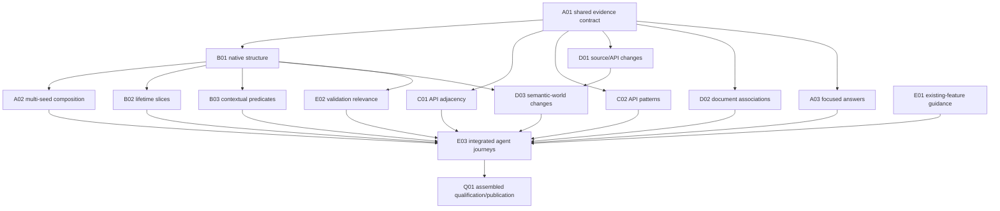

# Engineering code intelligence

## Purpose and current baseline

**Proposed:** extend the delivered CLI with compact, challengeable evidence for engineering
decisions: trace responsibilities and boundaries, compare a change, investigate library fit,
connect code to original contracts and select revealing validation. The source is the
[engineering-workflow functional review](../functional_reviews/engineering-workflow-code-intelligence-2026-10-31.md).
This is a new series; it neither supersedes Plan59 nor reopens its completed packages.
Plan59 [P01/E01](59-agent-cli.md#current-state-and-next-step) retains its separate worktree-removal
decision. Its [P02](59-agent-cli.md#p02) records prior qualification, not acceptance of Plan60.

Authoring baseline: review commit `5e96ed601`, following implementation/documentation baseline
`9d5dcf27c`. Current `investigation::model::Request` already separates selection, predicates,
demand and presentation. Scoped All/Any/Not, guarded Refine, bounded Related, saved queries,
directional schemas, grouping, streamed records and final coverage exist. Related currently
names Definition, References, Calls and Implementations. Native HIR snapshots, live semantic
operations, acquired API patterns/comparison, source history, original diagnostic reads and
current test selection are working foundations with different context premises. None is a
missing feature to recreate.

The governing owner is [blueprint §21.7](../authoritative_design/sections/workflows-and-results.md#section-21-7).
Core3.4, Efficient Architecture1.0 and the pse-arrow binding shape this plan; Test Assessment1.2
applies to validation evidence and Process Simulator1.5 limits scientific interpretations.
This focused foundation assessment uses the source review and current owners, without a new
diagnostic audit. No code graph establishes scientific validity, solver correctness or runtime
completion. Capabilities below remain Proposed until exercised through their actual consumers.

## Combined target and responsibility boundaries

An agent starts from a name, source location, original failure, API shape or document reference.
It obtains a bounded answer with typed relationships, original witnesses, context and omissions;
then expands one useful part without reconstructing coordinates. Facts remain distinct from
agent interpretations. The CLI supplies evidence; process skills own judgment, recommendations,
accepted scope and publication.

Extend existing owners rather than create a universal graph, a process-specific query language
or a new result service. The shared query/result owner defines relation direction, evidence
meaning, compatible context, unknown answers and expansion. Native HIR owns resolved Rust
facts; acquired rustdoc owns artifact-local API relationships. Document/lifecycle interpreters
retain status and section authority. Test-selection/report owners retain execution and outcomes.
The resulting views are question-shaped projections, not new authorities over those records.

| Document | Responsibility and delivered boundary |
| --- | --- |
| [60a: Evidence contracts and query composition](60a-evidence-contracts-and-query-composition.md) | Shared typed evidence, multi-seed composition, useful compact views and query assistance |
| [60b: Native relationships and lifetime evidence](60b-native-relationships-and-lifetime-evidence.md) | Resolved structure, bounded captures/effects and explicitly named contextual predicates |
| [60c: Library API and compatibility evidence](60c-library-api-and-compatibility-evidence.md) | Acquired API adjacency and richer structural signature/generic patterns |
| [60d: Change and document evidence](60d-change-and-document-evidence.md) | Original source/API/context comparisons and qualified code/document associations |
| [60e: Validation relevance and workflow adoption](60e-validation-relevance-and-workflow-adoption.md) | Test/setup relevance, targeted skill guidance and actual engineering journeys |

One future relation kind should extend the native relation owner and shared representation,
then become available to existing grouping/inspection. A new API shape should extend the
existing matcher, not create a spelling query. A new process example should normally be a
small skill reference using those capabilities. A future independent remote client can reopen
transport only through the separate trigger below. These variation cases explain the boundaries;
they do not add another implementation lane.

## Opportunity dispositions

This table alone owns disposition of source O01–O11. Companion package tables own execution
state. A scheduled recommendation is not implemented; a package pass does not resolve an
opportunity whose other contributors or assembled acceptance remain open.

| Opportunity | Disposition | Work owner | Required evidence or trigger |
| --- | --- | --- | --- |
| O01 — Typed structural relationships | scheduled | [A01](60a-evidence-contracts-and-query-composition.md#a01), [B01](60b-native-relationships-and-lifetime-evidence.md#b01) | Qualified declaration/type/field relationships; namesake and callback counterexamples; explicit-call/reference distinction |
| O02 — Multi-seed responsibility questions | scheduled | [A02](60a-evidence-contracts-and-query-composition.md#a02) | Actual multi-seed consumer, shared neighbors, cycles and traversable out-of-scope intermediates with bounded frontier |
| O03 — Captures and lifetime slices | scheduled | [B02](60b-native-relationships-and-lifetime-evidence.md#b02) | Selected-body facts and unknown boundaries; cancellation signal cannot establish CPU settlement |
| O04 — Change/context comparison | scheduled | [D01](60d-change-and-document-evidence.md#d01), [D03](60d-change-and-document-evidence.md#d03) | Source/API comparison plus separately qualified semantic worlds; cfg-only and ambiguous correspondence cases |
| O05 — Library-fit adjacency | scheduled | [C01](60c-library-api-and-compatibility-evidence.md#c01), [E01](60e-validation-relevance-and-workflow-adoption.md#e01) | Artifact-qualified links/bounds/impls/use navigation; guidance first for delivered queries; missing definition stays unknown |
| O06 — Code/document connections | scheduled | [D02](60d-change-and-document-evidence.md#d02) | Declared ownership, explicit citation, resolved relation and heuristic nomination stay distinguishable; original status retained |
| O07 — Parameterized inquiry and guidance | scheduled | [E01](60e-validation-relevance-and-workflow-adoption.md#e01), [A02/A03](60a-evidence-contracts-and-query-composition.md#work-packages) | Demonstrate useful existing composition before new bindings; focused examples rather than briefs or mandatory procedures |
| O08 — Evidence-sized progressive answers | scheduled | [A03](60a-evidence-contracts-and-query-composition.md#a03), [E03](60e-validation-relevance-and-workflow-adoption.md#e03) | Compact selection and guarded expansion preserve provenance/coverage; conditional local-error enrichment needs a consumer |
| O09 — Validation relevance | scheduled | [E02](60e-validation-relevance-and-workflow-adoption.md#e02) | Original outcome/setup/test links distinguished from assertion, adequacy and oracle-independence judgments |
| O10 — Bulk views and shared delivery | deferred | [B04](60b-native-relationships-and-lifetime-evidence.md#b04); coordinator for transport | Repeated extraction or one genuinely global question may earn batch evaluation; actual independent/remote consumer separately triggers transport decision |
| O11 — Rich API shapes/contextual predicates | scheduled | [C02](60c-library-api-and-compatibility-evidence.md#c02), [B03](60b-native-relationships-and-lifetime-evidence.md#b03) | Binder/constraint-aware matching and exact named predicate/context; no generic guarantee inferred from existential applicability |

## Shared decisions and rule routes

Keep one typed request validator, one result identity model and original owner-specific facts.
Do not equate display names, source ranges, monikers or rustdoc IDs across unrelated contexts.
Missing artifacts, unsupported predicates and unexamined frontiers remain unknown, not false.
Passive search/inspection never prepares an analyzer, acquires APIs, compiles or runs tests.
Existing explicit preparation, compiler probes and source-only alternatives remain available.

The operator selected code/document associations and targeted skill guidance as legitimate
outcomes. On 2026-10-31 the operator selected **retain explicit triggers** for conditional
index/compiler/remote options: capture their decision criteria without mandatory feasibility
studies, prototypes or adoption. They do not block completion while their triggers are absent.

No governing rule change is selected by this authoring. A01 must identify whether a concrete
shared-contract extension needs the existing ADR/schema/publication route before implementing
it. A compiler component, protocol cutover, persisted index or service would likewise require a
selected decision and lifecycle acceptance. Obtain explicit operator disposition for any actual
rule change that emerges; review recommendations and plan publication do not supply it. Keep
architecture amendments in their normal decision route and accepted ADRs immutable.

## Dependencies and execution route

These are package prerequisites, not alphabetical document barriers. Contract publication
supports producer design; a consumer requires working producer behavior and targeted evidence.
An agreed schema is not an implemented dependency. Table bindings in `docs/lifecycle.toml`
derive the same package relationships without becoming another status ledger.

| Work | Required readiness and reason | Available independent work |
| --- | --- | --- |
| E01 and A01 | Delivered Plan59 interfaces and source review; no new implementation prerequisite | Existing-feature guidance and shared design can proceed together |
| B01, C01/C02, D01/D02, A03 | Published A01 semantics for design; implemented shared representations for integration | Native, API, document and source producers can progress independently, coordinating shared files |
| A02 | Working B01 declaration/containment edges and A01 validation; only consumed relations are needed | Do not wait for lifetime, compatibility, all B01 relations or conditional indexing |
| B02/B03 | B01 identity/context and relevant native facts; each adds its own revealing checks | Captures and contextual predicates are separate consumers |
| D03 | D01 original comparison plus B01 relevant observations in two explicitly prepared worlds | Basic D01 comparison needs no second semantic world |
| E02 | B01 relevant source relations plus existing native test inventory/setup/outcome owners | No new runner, compiler extraction or cross-document join prerequisite |
| E03 | Working selected A–D consumers and E01/E02; integrate useful examples incrementally | Early guidance/basic comparisons/associations need not wait for final journeys |
| Q01 | E03 complete and all selected nonconditional packages integrated | One scope-end static/integrated campaign; B04 and other dormant options excluded |

Start with E01 plus A01, then deliver a small B01 responsibility trace and A02 consumer while
API and document work use the same contract. Expand through named engineering questions rather
than extracting every native fact upfront. Reconcile shared model/CLI/schema editing with one
integration owner; a package boundary is not automatically an agent assignment or worktree.

## Conditional investigations

| Option and owner | Observable trigger | Decision evidence and dependent work |
| --- | --- | --- |
| Native batch projection — B04 | Repeated extraction, or one global investigation for which batching removes scalar coordination | Compare request-local multi-seed/resident Analysis with exact pinned StaticIndex; preserve selected-crate omissions and owner confinement. Measure only claimed speed benefits |
| Compiler-private facts — B02 | A concrete decision needs loans, initialization or liveness at a MIR location that existing diagnostics/HIR/probes cannot answer | Exact pinned query timing/component lifecycle and independently checked fact meaning; only that consumer waits |
| Persistent index — coordinator/B04 | An identified consumer needs retained cross-request materialization beyond current helper reuse | Explicit authority, freshness/invalidation, schema and resource obligations; bulk export alone is not this trigger |
| Shared remote delivery — coordinator | An actual independent or remote client needs a shared delivery contract | Compare local complete records with pinned Prost/Tonic, admission/authentication, cancellation/drain and schema evolution; no service merely for sharing a result |
| Query-name catalog — E01/A02 | Discovering existing shared queries/scopes creates a demonstrated recurring burden | Compare passive discovery with concise documentation; no second registry or DSL |
| Search-local correction detail — A03 | A concrete invalid query lacks useful location or correction context in existing diagnostics | Extend existing ErrorRecord/TypedDiagnostic only where needed; no parallel error protocol |

When a trigger fires, record the selected decision and affected prerequisites at these owners.
Absence of a trigger is a valid deferred disposition; do not invent a prototype to close it.

## Verification and completion

**Proposed acceptance:** targeted compile/unit checks accompany each changed mechanism and its
actual public consumer. Retire replaced scalar assembly, duplicated mappings or obsolete
response paths once migrated callers and revealing tests pass. Do not remove complementary
source-only, original-artifact or explicit probe routes. Package evidence belongs in its
Outcome, not per-command checkpoint logs.

E03 exercises responsibility tracing, library-fit investigation, change-footprint planning,
lifetime reasoning, cross-document association and original failure-to-validation. Include
an unfamiliar subsystem and negative witnesses: namesakes, callback references, interior
mutation, cfg-only change, absent API definition, historical blob and misleading document
mention. These establish useful evidence, not automated architectural or scientific verdicts.

### Q01 — Assembled qualification and durable publication

Consumes E03 and all selected package obligations. Run relevant CLI/host/native-helper
integration and documentation/skill journeys after functional scope is integrated; select
tests for the changed surfaces, not unrelated scientific campaigns. Run `just hygiene` once
at scope end, repair actual failures and rerun affected recipes; run applicable governance,
documentation and native/powerset checks under repository policy. Preserve zero failure and
warning targets and report command, mode, scope and result. No new performance target is
claimed. Measure latency/output/memory only if making a numerical benefit claim, with a named
baseline and workload; lack of such measurement does not block functional completion.

Move enduring contracts to blueprint §21.7 and workflow guidance through their existing
decision/publication owners. Reconcile source opportunity dispositions, active dependencies
and retention before retiring this series or its review. Closing records must label evidence
and distinguish implemented behavior, actual acceptance and unmeasured benefit. Document a
mistake made/corrected and deliberate deviations in the final Outcome.

## Package state

| Package | Status | Owner | Completion |
| --- | --- | --- | --- |
| Q01 | planned | Plan60 coordinator | Assembled acceptance, scope-end checks, opportunity dispositions and durable publication |

## Current checkpoint

Planning documents are authored; implementation has not started under this series. The next
execution scope is E01 plus A01 and the B01/A02 prerequisite slice they enable. All new
capability/benefit claims remain Proposed. Existing Plan59 evidence retains its original scope;
publishing these documents does not implement their target or resume independent Plan58/59 work.
