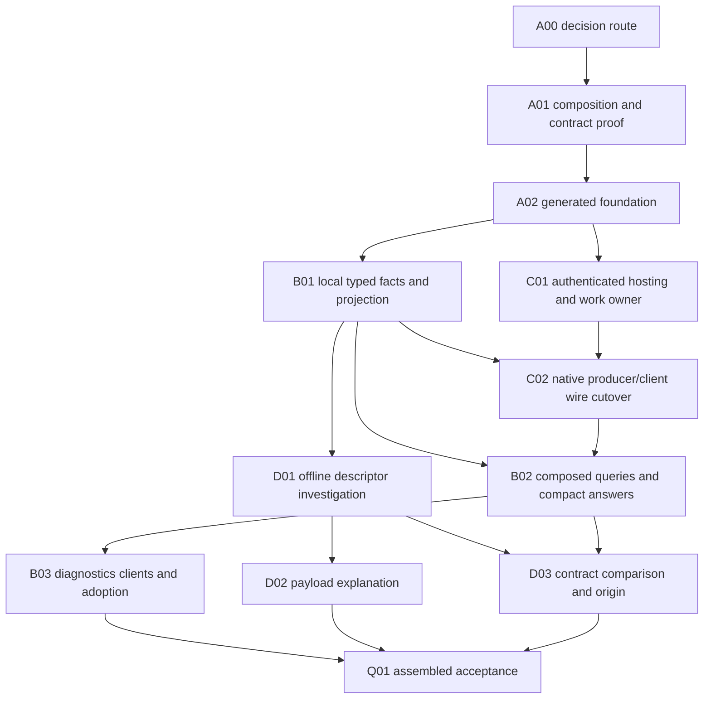

# Code-intelligence foundations

## Purpose, baseline and ownership

**Proposed:** deliver typed code-intelligence evidence, generated local RPC and useful schema/
payload investigation through a hard cutover. The source is the
[integrated functional review](../functional_reviews/code-intelligence-protobuf-foundations-2026-10-31.md).
This coordinator owns O01–O13 dispositions, shared decisions and assembled completion;
companion tables own package progress. Existing plans and their status are not amended or
superseded. Plan60 is neither a prerequisite nor a source of implementation credit here.

Inspected baseline is `e71efd849`. Existing investigation requests separate selection, predicates,
demand and presentation; original source/context guards, three-valued truth, count precision,
stream finality and generated-origin inspection already exist. Native snapshots and live LSP
have different capabilities. At that baseline the semantic helper used authenticated UDS, JSON-line replies and
a cancellation byte with actual CPU settlement. API qualification binds original artifacts,
source bytes and Cargo contexts. These are foundations to migrate, not missing capabilities.

The current contract owner is [blueprint §21.7](../authoritative_design/sections/workflows-and-results.md#section-21-7).
Core3.4, Efficient Architecture1.0 and the binding apply; Test Assessment1.2 informs acceptance.
Process Simulator1.5 limits interpretation: no schema or source graph proves scientific validity.
This focused foundation assessment uses current sources and the review, without a new broad
audit. No new product behavior is implemented, tested or measured by publishing this plan.

| Companion | Responsibility |
| --- | --- |
| [61a](61a-contracts-generation-and-validation.md) | Authority, exact composition, generated contracts/descriptors and compiled constraints |
| [61b](61b-typed-investigation-and-agent-answers.md) | Typed local evidence, query composition, compact answers, diagnostics and clients |
| [61c](61c-local-rpc-and-native-completion.md) | Authenticated helper RPC, transport-independent work ownership and integrated wire cutover |
| [61d](61d-schema-payload-and-contract-investigation.md) | Offline schema/payload investigation, change comparison and generated Rust associations |

## Target and confirmed rule decisions

One authored wire meaning produces Buffa messages, eager views, selected compiled validators,
ConnectRPC bindings and a complete descriptor bundle. Original providers retain native semantic
authority; typed evidence exposes consumed facts without category-sensitive JSON interpretation.
Generated RPC crosses the existing helper boundary. Source-only operations and offline descriptor
inspection remain local. Serde/Schemars own deliberate CLI presentation, not a second wire model.

On 2026-10-31 the operator explicitly accepted RC01 and RC02, and reconfirmed unrestricted
breaking changes and hard cutover for RC03:

| Rule impact | Decision and consequence | Route before dependent implementation |
| --- | --- | --- |
| RC01 — scoped declaration authority | Accepted: new code-intelligence wire contracts are authored in proto; existing product-registry meanings derive proto; native presentation remains Serde/Schemars | A00 publishes the scoped contract through the applicable decision/architecture route |
| RC02 — generated helper protocol | Accepted: replace JSON lines/control bytes with generated RPC and typed Start/Cancel/Terminal, preserving custody and real completion | A00 records the protocol/control realization for blueprint §21.7; C implements it |
| RC03 — cutover and retained interpretation | Accepted direction: migrate affected inputs/outputs/callers and delete replaced paths together | Classify retained evidence/authored inputs in packages; no deletion authorization or blanket reinterpretation follows |

These operator decisions do not mark an ADR accepted or amend the architecture. Any additional
concrete rule impact discovered during execution needs its own disposition. No crate split is
assumed; use existing module/feature isolation unless a justified new crate follows its ADR route.

The reviewed starting family is Buffa0.9.2, ConnectRPC0.9.1 with compatible0.9 generation,
and protovalidate-buffa0.7.2. A01 qualifies the exact resolved composition before consumers
depend on it. The selection is justified by a real shared reflection/projection consumer in
B01/D01/D02, not small-request decode speed or multi-protocol feature count. Retain owned
messages by default; eager views/owning handles serve actual lifetime/access needs. Lazy views,
custom storage and kernel zero-copy are conditional, not foundations.

Prost/Tonic remains the documented alternative if the chosen release composition cannot preserve
authenticated UDS, actual settlement and useful direct reflection without substantial bridging.
Such a result requires a coherent target revision before dependent implementation, never silent
runtime fallback. Existing unrelated Prost/Tonic integrations are outside this cutover.

## Opportunity dispositions

The source review's opportunity identifiers retain their meanings. All selected capabilities
are scheduled; conditional branches inside them retain explicit triggers. Scheduling is not
resolution. The work owners below link the only execution-status tables.

| Opportunity | Disposition | Work owner | Required evidence or trigger |
| --- | --- | --- | --- |
| O01 — typed evidence | complete | B01, C02 | Typed local/native consumers and qualified original evidence exercised |
| O02 — compact answers | complete | B02 | Bounded projection/guarded expansion preserve context, coverage and finality in actual journeys |
| O03 — generated local communication | complete | C01, C02 | Authenticated connection/reconnect, Start/Cancel/Terminal and actual native drain exercised |
| O04 — one declaration | complete | A00, A02 | Authored/derived ownership and generated outputs agree; formal ADR acceptance remains separate |
| O05 — descriptors/discovery | open — partial | A02, D01 | A02 complete; useful offline schema inspection remains D01 |
| O06 — declarative validation | complete | A01, A02, C02 | Selected owned/view and stream-item validation preserves violations versus validator defects |
| O07 — external diagnostics | open — partial | D02, B03 | B03 complete; descriptor/payload-specific external-tool workflows remain D02 |
| O08 — explicit evolution/cutover | open — partial | A02, Q01 | Helper hard cutover complete; full-series retirement and qualification remain Q01 |
| O09 — schema/Rust investigation | scheduled | D01, D03 | Descriptor relationships and qualified generated-origin navigation |
| O10 — payload explanation | scheduled | D02 | Exact descriptor/payload binding, selective inspection and malformed/unknown distinctions |
| O11 — contract comparison | scheduled | D03 | Binary/JSON/Rust/constraint changes distinguished; native links retain independent qualification |
| O12 — query diagnostics/observation | complete | B03, C02 | Original phase/cause, validation locations, settlement and original outcome preserved |
| O13 — batch/typed clients | complete | B02, B03, C02 | Grouped intent, request-local proof/connection reuse and checked generated caller exercised; remote deployment conditional |

## Dependencies and execution route

Dependencies identify working products, not alphabetical document barriers. An agreed interface
permits design; integration requires implemented producers and revealing checks. The lifecycle
bindings encode the same package edges. Package state is not duplicated here.

| Ready work | Required product and why |
| --- | --- |
| A00/A01 | Confirmed direction plus exact source mechanisms; publish required governing decisions before affected production changes |
| B01 and C01 | A02's working contract/generation; local typed facts and authenticated hosting can progress independently |
| D01/D02 | B01's compact projection slice and A02 descriptors; offline workflows need no RPC completion |
| C02 | C01 custody/retention plus B01 reusable fact constructors; this package owns native provider AND actual helper caller migration |
| B02/B03 | Source-only portions can use B01 early; complete native composition consumes C02, never a temporary adapter |
| D03 | D01 schema identity plus B02 qualified evidence/expansion for Rust consumer associations |
| Q01 | All selected package acceptance and deletions integrated; dormant branches do not block closure |

The key cycle avoidance is that B01 migrates local source/API evidence and shared constructors;
C02 owns the native helper's complete producer-to-caller wire cut. B02 consumes that cut for
native composition. Do not declare B01 to require all RPC, or RPC to require all presentation.
Coordinate shared model/schema/CLI edits under one integration owner rather than adding shims.

## Conditional work and scope boundaries

Lazy decoding requires demonstrated selective-access benefit and qualified error timing;
custom storage requires actual representation costs. Runtime-acquired schema validation requires
a real dynamic-constraint consumer; it is not needed for ordinary compiled contracts. Remote
listeners, browser gateways, hosted registries, durable resumability and embedded granc-core
require their own consumers and decision. Health/reflection expose actual registered services
and readiness where useful, without starting a service for offline inspection. Existing external
tools remain first-class; no installation quota, benchmark campaign or new generic test runner.

## Verification and package state

**Proposed:** package checks compile touched owners and exercise revealing unit/public-consumer
behavior. Run generation when declarations change; remove replaced code/callers/tests at the
same integrated boundary once tests pass. No whole-suite or mid-plan hygiene campaign per package.

### Q01 — Assembled hard-cutover acceptance and publication

Consumes B03, D02 and D03 (including their prerequisites). Exercise actual source-only search,
native fact/refinement and cancellation, acquired API qualification, original diagnostics,
source-bound proposals, offline schema/payload workflows, typed clients and output schemas.
Include raw path bytes, namesakes, stale contexts, unknown predicates, missing artifacts,
descriptor conflicts/options, invalid field combinations and interrupted delivery. A transport
pass does not qualify native semantic or CPU-settlement behavior.

After functional integration, run relevant CLI/host/helper integration, explicit generation
comparison, `just hygiene` and applicable manual governance/docs/native/powerset checks. Fix
actual failures against zero, reporting command, mode, scope and results. Select affected
journeys rather than unrelated scientific campaigns. Numerical context/latency/memory claims
need a named measured baseline; no such claim is required for functional completion.

Audit the migrated consumers and delete remaining replaced routes before completion. Publish
enduring contracts/guidance through their normal owners, reconcile dependencies and apply
retention policy. Final Outcome labels evidence and records a mistake corrected and deliberate
deviations. Plan61 authoring does not itself amend other plans or perform those runtime changes.

## Package state

| Package | Status | Owner | Completion |
| --- | --- | --- | --- |
| Q01 | planned | Plan61 integration owner | Actual assembled acceptance, complete hard cutover, scope-end checks and durable publication |

## Current checkpoint

A00/A01's bounded investigation is complete: exact generated owned/eager-view/VTable/validation
and local RPC composition passed 22 targeted host tests, with generator comparison and xtask
compile checks. [61a's investigation outcome](61a-contracts-generation-and-validation.md#investigation-outcome--2026-10-31)
owns commands, evidence limits and the retained stack decision. [61c](61c-local-rpc-and-native-completion.md#bounded-transport-investigation--2026-10-31)
and [61d](61d-schema-payload-and-contract-investigation.md#investigation-findings--2026-10-31)
retain transport/custody and descriptor/payload qualifications.

A02 is complete: ADR-0235 and the scoped review establish the production declaration route;
host-local typed contracts, shared-input generation, full descriptors/origins and maintained
CEL preflight/lowering are implemented. The [61a Outcome](61a-contracts-generation-and-validation.md#outcome)
owns the current commands and limits: 22 host tests, six generator tests, 146 vendor library
tests plus one CLI test, selected comparison and full normal generation passed. The earlier
panic/misclassification observations remain A01 history, not current supported behavior.
Unsupported dynamic numeric representations and oneof/WKT CEL emission refuse explicitly;
no blanket CEL conformance is claimed.

B01–B03 and C01/C02 are complete. [61b's Outcome](61b-typed-investigation-and-agent-answers.md#outcome)
owns typed source/API/native consumers, compact answers and diagnostics;
[61c's Outcome](61c-local-rpc-and-native-completion.md#outcome) owns authenticated generated
local RPC and transport-independent work settlement. The real prepared helper, ordinary public
native/API/LSP callers, explicit cancellation, same-client reconnect and original stop/drain
are exercised. Controlled transport and composite native evidence retain their stated limits.
New/helper protocol consumers moved together; replaced framing/category decoders were deleted.

D01 is now ready from the completed A02/B01 foundation; D02/D03 follow its actual products.
Those packages and Q01 assembled/static qualification remain open and are not actioned by this
B/C execution. The completed companions remain retained dependencies. ADR-0235 remains proposed
pending its governing PR; its review remains A02-scoped. No measured benefit or whole-product
qualification follows from package acceptance.
