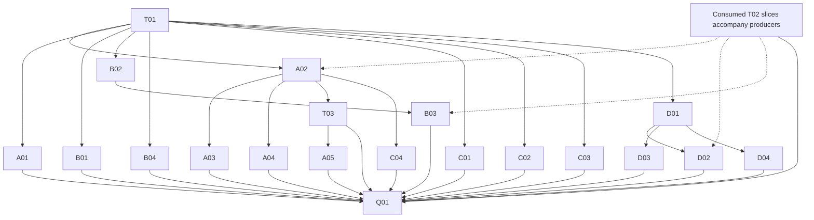

# Code-intelligence capability expansion

Selected implementation and conditional assessments are complete. The [Outcome](#outcome)
records local Linux acceptance, exclusions and retained limits; it does not accept proposed ADRs
or qualify scientific workflows. Companion tables own their completed package state.

## Purpose, baseline and ownership

**Proposed:** extend the underlying intelligence system to explain more Rust meaning, select
contextually applicable APIs, connect qualified evidence into focused investigations and produce
more precise source transformations. The CLI is the access surface; commands should express
useful questions rather than mirror every library API. The
[source review](../functional_reviews/code-intelligence-capability-expansion-2026-11-01.md)
supplies O01–O13 and their value arguments, mechanisms, corrections and conditional alternatives.
This coordinator owns their disposition, shared design and assembled acceptance. Companion
package tables own execution state. No existing plan is amended or superseded; Plan60 is excluded.

Baseline `4b2f8df34` includes the completed protobuf foundation, typed source/API/native facts,
authenticated local helper RPC, original work settlement, offline descriptor/payload investigation,
native/LSP sessions, API and compiler acquisition, guarded proposals and composed queries. The
operator's twelve modified analyzer overviews and new cargo_metadata overview are research inputs,
not changes authored by this plan. Existing qualification is not newly certified here.

Current contracts remain in [blueprint §21.7](../authoritative_design/sections/native-host-and-engineering-tools.md#section-21-7)
and §23.2. Core3.4, the selected efficient-architecture heuristics and repository binding shape
this focused foundation assessment. Scientific validity is outside this extension's claims.
There is no new broad diagnostic audit. Publication implements no product capability.

| Companion | Owned design |
| --- | --- |
| [62a](62a-native-context-and-semantic-explanations.md) | Context/preparation, semantic roles/captures/obligations, contextual candidates, layout and retrieval |
| [62b](62b-source-investigations-and-transformations.md) | Interpreted source, consolidated selection, grammar/semantic previews and exact generated origins |
| [62c](62c-api-cargo-and-validation-evidence.md) | API contracts/examples, package/unit context and validation relevance |
| [62d](62d-compiler-backed-explanations.md) | Selected capture/suspension, destruction/unwind and conditional borrow facts |

## Combined target and confirmed decisions

Keep source, native semantic world, API artifact, Cargo unit, descriptor declaration and compiler
body as distinct qualified identities. Compose them through evidence-backed correspondences.
Spelling, display type, field number or session-local ID is insufficient. A physical file can
belong to several crate contexts; generated code and embedded literals can have multiple origins.
Historical artifacts never silently inherit today's source or world.

Extend existing question, demand, relationship, fact, projection and expansion owners. Native
values remain local where no boundary is needed; consumed helper meanings are authored in proto.
The generated contract must preserve native distinctions, not just attach domain names to opaque
category blobs. Keep deliberately shaped Serde/Schemars presentation independent from wire encoding.
No universal HIR algebra, ontology, query language, global lineage registry or new result service
is required. Whole-record budgets and native scoping reduce useful work where supported;
truncation after full computation is not producer-demand propagation.

| Decision | Operator choice on 2026-11-01 | Integration route |
| --- | --- | --- |
| RC01 — extended native preparation | Include explicit build-generated/proc-macro support beyond today's restricted snapshot | T01 records the changed preparation contract in the applicable ADR/blueprint route before A01 implementation |
| RC02 — compiler depth | Include a narrow pinned producer after bounded feasibility when artifacts are insufficient | T01 classifies placement/binding changes; D01 settles exact interfaces before D02/D03 depend on them |
| Cutover | Replace affected implementation and consumers together; no compatibility machinery for replaced paths | Each package deletes its replaced code/callers/tests after targeted replacement checks |

These are planning choices, not formal ADR acceptance, permission to contact upstream or permission
to install/run new components during plan creation. No new crate is assumed. Explicit preparation,
original custody, CPU/child drain, source-only independence and passive previews remain preserved.
The existing ADR-0233/0234/0235 records are proposed with bounded prior realizations, not automatic
authorization for every future extension. Additional actual rule changes require explicit disposition.

Retain Buffa/ConnectRPC and the existing explicit generated foundation. Use direct generated
reflection/VTable access for known values, dynamic reflection for external descriptors, owned
small facts by default and borrowed/owning views where a real read-mostly consumer benefits.
Original large compiler/provider artifacts remain separately addressed rather than copied into
every answer. Views defer work and do not establish eager validation or zero allocation.
Compiled schema validation enforces structure/constraints, not truth of a native conclusion.
Required CEL rules retain preflight, exact error/arithmetic semantics and atomic publication;
unsupported lowering must not silently skip validation or add an encode/decode bridge fallback.

## Opportunity dispositions

Every source opportunity is selected for implementation or a named conditional assessment.
Conditional sub-options are not silently mandatory, nor does mentioning them discharge the
assessment. This table owns disposition; linked package tables own implementation progress.

| Opportunity | Disposition | Work owner | Required evidence or trigger |
| --- | --- | --- | --- |
| O01 | resolved | [A01](62a-native-context-and-semantic-explanations.md#a01--context-identity-extended-preparation-and-world-comparison) | Extended/test worlds, provenance, failures and real drain exercised; [Outcome](#outcome) |
| O02 | resolved | [A02](62a-native-context-and-semantic-explanations.md#a02--role-operation-capture-and-obligation-explanations) | Typed roles, implicit operations, captures and callsite anchors exercised |
| O03 | resolved | [A02/A03](62a-native-context-and-semantic-explanations.md#a03--contextual-callable-discovery-and-bounded-synthesis), C01 | Actual-call inference and qualified candidates delivered; arbitrary-goal synthesis remains conditional |
| O04 | resolved | A04 | Fallible full/prefix layout and original compiler association exercised; recursive display adapter unselected |
| O05 | resolved | [D01–D04](62d-compiler-backed-explanations.md#package-state) | Selected typed compiler facts delivered; D04 loan trigger assessed as absent |
| O06 | resolved | B01/B02 | Interpreted literals/docs/attributes and shared demand-aware source selection exercised |
| O07 | resolved | B03 | Native grammar/SSR guarded previews exercised, including selected CRLF/Unicode intervals |
| O08 | resolved | C01/C02 | Rich API contracts and original/native-transformed examples delivered; conditional modes retain triggers |
| O09 | resolved | C03 | Real Cargo unit/feature contexts exercised; graph replacements unselected |
| O10 | resolved | C04 | Native runnable/cfg/target/snapshot intent and guarded existing test-selection route exercised |
| O11 | resolved | T03 and all contributing packages | Distinct use sites, unknown composition, compact evidence and public expansion exercised |
| O12 | resolved | A05 | Direct scoped query/prepared-world reuse selected; corpus indexing/export await recorded consumers |
| O13 | resolved | T02; B04; all boundary producers | Typed generated consumers and authenticated exact proto source-byte navigation exercised |

## Shared packages

### T01 — Establish consequential design and preparation routes

Classify changes against §21.7 and the decision table before implementing affected contracts.
Publish the RC01 preparation amendment through the applicable proposed ADR/architecture workflow;
record the narrow compiler producer's isolation and any new binding/crate requirement before its
dependent implementation. Ordinary fact adapters/query cleanup within contracts need no invented
rule-change ceremony. No new broad audit or reopening of old reviews follows automatically.

Settle supported preparation effects, source/world identity, public failure semantics and consumer
placement with the first packages. Compare existing owners before selecting new infrastructure.
Readiness means the necessary design/decision route is actually recorded; it is not a successful
runtime preparation or a claim that every future fact schema is finished.

### T02 — Deliver consumed typed fact slices with their first consumers

This is a continuing integration responsibility, not a complete-platform-first barrier. Extend
the authored helper schema only for roles, adjustments/captures/obligations, context coverage,
candidate applicability, layouts, runnable relevance and compiler facts actually consumed by a
selected package. Use generated enums/oneofs/checked construction to preserve distinctions that
matter, rather than new string categories or independently writable mirror DTOs.

Migrate provider extraction, native/wire projection, direct reflection, public answer consumers,
diagnostics and declaration-driven generation together for each slice. Keep `Holds/NotProven/
Invalid/Unsupported`, absent versus zero layout, source versus stored capture type, established
versus candidate relation and separate original evidence. Carry correspondence qualification and
many-to-many mappings only where a consumer needs them. Local values need no RPC round trip.

Run `just codegen` for declaration/generator changes, including compiled required-rule preflight.
Targeted round trips and reflection tests must exercise the actual consumer, context mismatch,
unsupported producer and validation defect distinctions. Preserve existing Start/Cancel/Terminal,
peer authentication and actual settlement; this scope does not redesign their protocol.

T02 completes only when every selected producer/consumer has migrated and lossy replaced paths
are deleted. Its early role/capture slice becomes available before layout/compiler slices exist.

### T03 — Compose useful questions and progressive evidence

Start with A02 and its T02 slice: ask for constructors/implicit uses of a selected item, explain
relevant captures/adjustments, and expand only selected evidence. Add B/C/D contributors as they
land. Reuse current relation/demand/three-valued composition; different use sites must not collapse
because they resolve to the same declaration. Missing semantic coverage stays unknown under
negation. Positive witnesses and global absence/exact counts need different examination.

Provide compact typed findings, explicit omissions and guarded expansion into original source,
provider documents, compiler artifacts or authored origins. Whole records remain indivisible.
Choose detail based on the question; do not run all enrichment for every result. Existing query
configuration, parser and typed request routes must agree. Update focused CLI help/schema/skill
guidance only for delivered interaction changes; do not invent a command per new fact family.

Acceptance: one multi-provider question retains each world/use-site/source premise; an unavailable
world cannot become false; first-witness demand stops unnecessary work; expansion rejects stale
premises. A generated field can expand into exact proto origin after B04; compiler detail remains
explicitly acquired after D. Test actual public consumers, not only internal projection snapshots.

### Q01 — Assembled acceptance, guidance and completion

After selected functional scope, run relevant integration journeys and scope-end `just hygiene`
with zero warnings/errors target, documentation/governance and applicable native/powerset checks.
Choose checks by changed closure; do not trigger unrelated scientific/reference campaigns.
Exercise source→semantic→API refinement→preview, actual extended macro preparation and failure/drain,
compiler selected-body→typed answer→original artifact, and generated field→authored proto.
Include stale contexts, unsupported macros/body shapes, cancellation/disconnection and output loss.

Separate completed implementation, targeted checks, assembled qualification and benefit evidence.
No mandatory broad performance campaign: measure only where a decision or quantitative claim
needs it. Record actual commands/modes/scope/zero baseline and results at completion. Transfer
enduring contracts through their authority route, update useful operating guidance and apply
ADR-0096 retirement only after dependent owners are reconciled. Plan publication does not retire
prior completed plans or their evidence.

## Dependencies and execution route

Edges identify required capability slices, not whole-document barriers. For example A02 needs
only its consumed T02 facts, and T03 can begin with A02 before compiler/layout support. A01's
extended preparation is required by generated-code questions, not by every native explanation.

| Prerequisite | Readiness supplied | Dependent use |
| --- | --- | --- |
| T01 | Recorded applicable decision route, preserved owners and confirmed scope | Consequential implementation; not proof that preparation works |
| T02 slice | Implemented generated/native facts with first consumer and targeted controls | Only consumers of that slice; not all facts at once |
| A02 | Working qualified semantic explanation surface | A03/A04, semantic C04 and first T03 question |
| B02 | Working demand-aware selection/projection contract | B03 candidates and syntax composition, without duplicate traversal |
| C01 | Working rich API artifact interpretation | API-backed A03 refinement; local candidates remain independent |
| A01 | Actually prepared extended world, provenance and settlement controls | Macro/generated-code scenarios; never inferred from flags alone |
| D01 | Exact pinned acquisition feasible for the chosen question | D02/D03; a failed premise leaves dependent delivery unresolved |
| T03 | Actual repeated/global question with direct-query baseline | A05 reuse decision; not an automatic indexing requirement |

Recommended first execution wave: T01, the first A02/T02 slice and a small working T03 answer.
B02/B04 and structural C01 work can proceed independently with available contracts. Investigate
A01/D01 early enough to change dependent design before elaboration. Shared proto/fact projections,
preparation configuration and generator files need coordinated ownership even where logical work
is parallel. Preserve workstation capacity settings; no additional CPU partitions or serial test cap.

## Package state

| Package | Status | Owner | Completion |
| --- | --- | --- | --- |
| T01 | complete | Coordinator | Proposed ADR-0233 preparation/compiler extension and blueprint327 precede implementation; formal acceptance unchanged |
| T02 | complete | Coordinator with each producer | Selected typed native/wire/public consumers, generation and negative controls migrated; lossy predicate path removed |
| T03 | complete | Coordinator | Public composition preserves worlds/use sites/unknowns, original context addressing and guarded expansion |
| Q01 | complete | Coordinator | Local Linux assembled checks and closure recorded in Outcome; copyright-header check excluded at operator direction |

Companion state is linked above and is not duplicated here. Native lifecycle relationships derive
from these owners; index inclusion is not implementation authorization.

## Conditional choices and research corrections

| Choice/lead | Required treatment |
| --- | --- |
| Recursive IDE layout | A04 checks actual public .358 adapter; prefer fallible HIR layout where sufficient |
| Term synthesis | A03 evaluates bounded native search; no complete synthesis guarantee or mandatory new subsystem |
| Index/SCIP/LSIF/type-sitter | A05 selects only for a concrete retrieval consumer; wrapper/runtime compatibility must be established |
| Borrow/Polonius extraction | D04 evaluates a concrete unanswered question, not a general loan database |
| Guppy/CargoSet/Determinator | C03 assesses graph value and modeling limits; actual unit context remains authoritative |
| Native SSR captures | Public .358 `SourceChange` supports previews; private capture fields cannot supply addressed inventory |
| ast-grep insertion helpers | .51 named helpers are `todo!()`; choose implemented RA editing instead |
| Literal offsets | Quote-free spelling maps differ from decoded-character escape maps |
| StaticIndex | .358 has folds/tokens, no indexed hints; analysis-bound and incomplete for ordinary external roots |
| Compiler documentation | Stable1.99.1 overviews are leads; actual1.101 nightly c1070d693 sources govern |
| precise_liveness | Not in inspected pinned exports; not an available prerequisite without deliberate toolchain work |
| Buffa text readers | Unknown names can be skipped; preserve the qualified strict route until a replacement is established |
| Proto alternatives | Prost/Tonic/Rust-first alternatives need a concrete advantage; no second decoder/gateway is scheduled |

Use all thirteen analyzer overviews and relevant proto generation/reflection/validation/RPC
documents through the source review's coverage/source map. Retain concrete APIs and exact-version
limitations in companion packages. No empty search establishes capability absence. No runtime
fallback, parser/borrow-checker reimplementation, unsafe HIR garbage collection or automatic
build/cache/test controller is selected. Additional worthwhile improvements may enter through a
coherent target amendment with corresponding consumers, dependencies and evidence.

## Verification and implementation record

The following investigation and implementation checkpoints retain their original scope. They
precede production completion; the [Outcome](#outcome) supersedes their next-step statements.

### Conditional assessment: representation and protocol — 2026-11-01

**Interface-checked:** retain owned small facts and direct generated VTable reflection as the
default. `code_intelligence_contracts/local.rs::project_declaration` already borrows name/kind
through `ReflectMessage::get`/`ValueRef`; no dynamic transcode is needed for this actual consumer.
Future capture/candidate facts must keep their native meaning rather than acquire a representation
rewrite merely because additional view APIs exist.

Select eager views or `OwnedView::reborrow` only for a concrete binary consumer retaining input
past a handler. Exact installed Buffa0.9.2 `src/view.rs` and ConnectRPC0.9.1 `src/request.rs`
establish owning-buffer lifetime support. `ServiceRequest::to_owned_view` rebuilds the view with
a decode walk; `to_owned_message` still allocates strings/repeated fields. Neither warrants a
claim of allocation-free whole requests. No current inspected declaration projection needs
ownership beyond its borrowed message, so no new owning adapter is selected in this wave.

Do not select lazy views for the consumed reflected/validated fact surface: the documented .9.2
lazy family lacks reflection and OwnedView integration and defers nested failures. Reconsider
only for a separately qualified, sparsely accessed large nested body whose consumer tolerates
those semantics. Custom Bytes storage, boxing and Rope/segmented output remain unselected:
the existing compiler/provider artifact owner addresses large bodies separately, while current
fact consumers need small selected records. Rope only removes copying if the downstream path
retains segments; flattening to a contiguous transport body can eliminate that benefit. A future
large binary in-message consumer or demonstrated enum/allocation problem is the revisit trigger.
No benchmark benefit, view lifetime integration or new storage configuration was executed here.

No concrete contract, validation or authenticated local transport gap was identified in these
inspected consumers. The trigger for Prost/Tonic/Rust-first replacement is therefore absent;
retain Buffa/ConnectRPC without building a second decoder, generator or service. Context7 main
examples supplied leads; the versioned installed sources and reviewed release limitations govern.
T02 production migration remains open, and these choices confer no new RPC acceptance.

**Proposed verification:** package compile checks and revealing targeted tests accompany functional
changes; Q01 owns integrated checks after selected scope. Research source checks are Interface-checked
only for their named APIs. Publication checks establish document usability, not delivered features.
Investigations may complete with supported rejection/defer decisions; unresolved selected delivery
cannot be labeled complete because feasibility work finished. Conditional mechanisms require
explicit outcome, consequence and observable revisit trigger at their owning package.

### Investigation-wave checkpoint — 2026-11-01

The authorized conditional investigations are complete within their recorded evidence limits:

| Decision | Outcome and authoritative detail |
| --- | --- |
| Synthesis | A03 selects existing hole-oriented term-search assist reuse; separate arbitrary-goal surface deferred; no observed exhaustion API |
| Recursive layout | A04 inferred adapter compiles; fallible, explicitly qualified HIR remains structured authority |
| Native retrieval/export | A05 selects direct scoped queries; corpus index/export await their distinct repeated/global or external-consumer triggers |
| Typed wrappers | A05 rejects adding runtime0.26 bridge to current0.27 merely for accessors; compatible substantive extraction consumer required |
| Compiler depth | D01 narrow capture/coroutine query producer feasible; selected cleanup questions use native artifacts |
| Loans/Polonius | D04 trigger absent for demonstrated question already answered by diagnostics/witnesses/MIR |
| Dependency graphs | C03 keeps existing petgraph/Cargo owners; modeled graph/impact alternatives require their named counterfactual or set-query consumers |
| Example modes | C02 separately identifies scraped reverse-dependency usages and standalone Markdown transformation; acquisition triggers not met in this wave |
| Generated annotations | B04 selected four plugins emit no generated annotations; retain typed/authenticated association route |
| Representations and proto alternatives | T02 keeps owned facts/direct reflection, limits optional views/storage to actual consumers; no stack-replacement trigger |

**Tested, bounded:** compiler callback/MIR probes and positive/negative external layout compiles
settled the key interfaces; plugin response emission was exercised. Matching rustc-dev preparation
and `just ready` succeeded. These are investigation evidence, not delivered production answers or
performance measurements. Source-only decisions were not turned into mandatory prototypes.

T01's investigation-readiness classification required no new production binding/crate or metadata
contract: isolated test inputs suffice. RC01's governing preparation amendment and RC02's eventual
producer integration still precede their production changes. The retained compiler probe sources
are fixtures, not an automatically installed backend. No public CLI/wire API, root manifest, pin,
production consumer or generator output was changed. Relevant companion sections own the exact
decision, failure/negative-control distinctions, unexercised breadth and revisit condition.

All production packages remain open, including D01's production preparation seam. The conditional
assessment portions are settled; that does not close their enclosing delivery/migration obligations.
The next implementation scope remains T01 and the first A02/T02/T03 slice, using these outcomes
to avoid redundant synthesis, ambiguous layout projections or premature indexing. Existing
qualification retains its original limits; Plan62 Q01 has not run or been claimed complete.

### Historical remaining-scope implementation checkpoint — 2026-11-01

T01's production preparation/compiler-stage target is recorded in proposed ADR-0233 and
blueprint revision327 (`18164ed4e`); this does not change the ADR's formal acceptance status.
Typed API contracts, native example acquisition and Cargo/native-world evidence are committed
as `b3b6bb42f`; interpreted source facts, shared source selection and grammar previews are
committed as `d2170bc04`. Their dedicated targeted controls passed. B04's exact field origins
and the shared native/compiler contracts are being integrated with their generated outputs.

The native implementation now includes explicit build-generated/proc-macro preparation,
separate test-context selection, semantic roles/captures/callable candidates, fallible layout
and guarded association with original compiler layout evidence. The compiler stage is an
explicit optional source-built target, with demand-selected capture/suspension/cleanup
extraction, native move-path initialization observations and success-only artifact publication.
Compact views address the full original context instead of repeating its transitive unit graph.
These remain implementation in progress until their actual public journeys pass.

T03 integration corrects use-site collapse and propagation of uncertain candidate/membership
evidence through conjunction and negation. Dedicated source/API checks and the earlier bounded
compiler-feature checks do not establish this assembled behavior. Current native journey
feedback is being resolved; preparation attempts rejected because sources changed during
construction supply no acceptance credit. The next work is stable-source native/composed and
compiler acquisition journeys, completion of shared generation and operating guidance, then
Q01's assembled acceptance and scope-end static checks. No series completion or performance
benefit is claimed at this checkpoint.

## Outcome

**Implemented, 2026-11-01:** selected T01–T03, A01–A04, B01–B04, C01–C04 and D01–D03 are
integrated. A05 and D04 complete their conditional assessment with the direct-query and no-loan
decisions recorded in their companions. O01–O13 have no remaining selected delivery. Commit
`83908f17c` carries the integrated native/compiler foundation; `7cc70e201` bounds selected-node
previews; `244e86e9f` completes contextual candidates, runnables, exact origins and final repairs.
Earlier API/source/composition commits retain their scoped evidence. Enduring contracts are in
blueprint §21.7, qualification in §24.2, and operating guidance in the `pse-cli` reference.
ADR-0233/0235 remain proposed; this outcome is not formal decision acceptance.

The result extends existing native sessions, source selection, API/Cargo and compiler owners.
It does not introduce a second analyzer, semantic protobuf compiler, result service or test
executor. Native helper protocol4 and generated typed consumers replace the affected lossy
predicate projection; the old boolean/FactTruth path is removed. Obsolete compiler feasibility
fixtures are removed after production regression replacement. Buf owns compiled schema identity;
Syn recognizes generated Rust structure and native proto syntax supplies authenticated original
byte intervals. All generated changes came through the declared generation route.

### Verification

**Tested, local Linux:** all tests below target zero unexpected failures. Commands use the pinned
toolchain, locked dependency graph and existing correctness/force-validation owner. Tests retain
16 physical lanes and builds 32 jobs; no new machine memory cap was introduced. Different
selections overlap and are not summed into a fictional full-workspace population.

| Command and selected scope | Actual result and original invocation |
| --- | --- |
| `pse test pse-host --lib -E 'test(source_read::) \| test(source_query::) \| test(schema::) \| test(api::) \| test(dependency::) \| test(investigation::) \| test(compiler_investigation::facts::) \| test(plan61_rpc_) \| test(code_intelligence_contracts::) \| test(semantic::protocol_facts::) \| test(cli::code::semantic::)'` | Initial 174 passed, 2 failed of176; `01a1969d-85e3-74c7-85c9-e550d5b418a3`. Origin/raw-path and moved-library assumptions were repaired; this original run is not reported green. Includes actual RPC cancellation/output-loss/settlement controls. |
| `pse test pse-host --lib -E 'test(schema::) \| test(dependency::) \| test(source_command::)'` | Corrected affected population 32/32 passed; `01a196d2-4aff-7189-8d92-5ce40a3b80eb`. |
| `pse test pse-host --lib --features native-hir -E 'test(native_runnables_public_classify_cfg_targets_and_passive_snapshot_intent) \| test(native_ssr_public_excludes_same_matching_node_outside_selected_original_lines) \| test(native_contextual_candidates_public_preserve_adjustments_substitutions_and_obligations) \| test(native_operations_capture_roles_predicates_layout_and_assists_keep_their_meaning) \| test(semantic::wire::tests::) \| test(runnable_routes_bind_current_source_and_ignore_analyzer_argv)'` | Final 14/14 passed, 762 unselected,27.501s; `01a196e6-0795-7151-87db-f785fcf2c3be`. Helper explicitly prepared for that feature closure; all original sessions drained. |
| `pse test pse-host --lib -E 'test(actual_pinned_facts_preserve_capture_suspension_cleanup_and_constant_boundaries) \| test(runtime_alias_retarget_refuses_even_when_original_image_digest_is_unchanged) \| test(actual_cargo_contexts_preserve_renames_feature_policy_and_host_target_test_units)'` | 3/3 passed,145.276s; `01a1969d-27c8-73c4-8248-44a282babbe5`. Actual locked Cargo and compiler observations, not only projection fixtures. |
| `pse test xtask --bin xtask -E 'test(codegen::code_intelligence::associations)'` | 6/6 passed,84 unselected; `01a196c0-2009-73b5-a847-0dc19ba02e6e`. Actual Buf/native syntax controls include source-info removal, nested namesakes, Unicode/display-width cases and LF/CRLF. |
| Earlier revealing source/API/composition/native populations through `pse test pse-host --lib -E <selected-filterset>` and explicit native preparation | Source31/31, API21/21, composition13/13 and native18/18 passed respectively under `01a1961f-fcf8-721d-a41b-319b3aca8455`, `01a1961f-f54c-70d8-bbdc-2ef3a723203f`, `01a19665-7a4d-75b4-a4ab-15e6e106f62a`, `01a19667-6ee6-76b1-887e-910fbf2aba8a`. These retain their original revision/scope; final changed consumers have the affected controls above. |

The original `pse inspect tests INVOCATION` records retain exact filters, populations and failures.
Actual public journeys additionally exercised:

- Explicit native tool/world preparation in the real checkout with `--backend native-snapshot
  --test-context`, direct runnable inspection and consolidated `inspect --source --view tests`
  at an exact identifier interval. Both returned guarded `inspect test-selection --from-result`
  actions that succeeded (`01a196ef-81fc-74fb-8842-bba4a7d8babe`,
  `01a196ef-86ce-75da-b6b4-49a62604bac0`); original stop
  `01a196ef-88ec-75f6-afa6-16b6b7681dc4` drained the session. An earlier whole-line request
  correctly refused an ambiguous token witness; it is not counted as a successful answer.
- `inspect origin` on generated `NativeTestCandidate.snapshot_update` and its guarded authored
  source expansion passed (`01a196c7-1c0b-778a-9229-7b260d671be7`,
  `01a196c7-242e-7300-886e-8f51344ebc84`), returning exact field13 bytes.
- Explicit `pse tools prepare compiler-analysis`, then `pse compiler probe plan62-compiler-facts
  --kind facts --fact-focus all --body cases --question <selected-question>` acquired original
  `01a196f2-e1d2-73ab-8820-192fdc7a4084`. `inspect compiler-facts INV --max-bytes 1048576`
  returned the selected families with explicit partial CTFE coverage. Unmatched body and failed
  full compilation produced no successful index. A passive original-body cleanup read after
  source changes passed. Separate `--max-bytes 1` whole-body omission and unacquired-focus
  refusal controls passed against original capture `01a1964d-022c-724b-9d67-909eee1c74a0`.
- A04 actual host8/i6864 layout comparison, nested enum and unsized-prefix journey used original
  compiler artifact `01a19648-70d5-73ff-a928-99d37b990d05`; mismatch and unsupported premises
  remain explicit. Native and compiler worlds are not declared numerically equivalent.

**Tested, scope-end static/tooling:** `just clippy-default`, `just clippy-no-default`, and
`just clippy-default --features pse-host/native-hir,pse-host/compiler-analysis` each passed with
`--keep-going --workspace --all-targets --locked -- -D warnings`: zero warnings/errors.
Host powerset `scripts/pse-env -- env CARGO_HACK_CARGO_SRC="$PWD/scripts/cargo-bin/cargo-pse-correctness"
cargo hack --keep-going check -p pse-host --all-targets --feature-powerset --depth 2 --locked`
passed all 4 combinations. It preceded the last common routing guard; final Clippy configurations
and the 14 native cases cover that final source. `just audit-shear` passed zero findings after
removing obsolete fixtures. Normal `just codegen` published all 10 generators successfully;
`just ready` passed after the exact tree-sitter-proto0.6.0 addition. Final `just governance`
passed its governance tests, codegen-check and family-check
(`01a196f7-9b8d-70eb-81e2-c4fedc52202e`).

The scope-end `just hygiene` aggregate initially had 15 passing and 4 failing recipes. Shear and
both Clippy failures were repaired and their affected recipes rerun successfully. The copyright
header lint was excluded at the operator's explicit direction; it was not fixed or passed.
Consequently the full hygiene aggregate is **not** labeled green. The passing aggregate recipes
included agent/ADR/register checks, Python/type/lint and boundary/solver/family/codegen/rustdoc
checks. `just turn-end` passed (`01a196fc-bb8f-715a-b65e-2adec44ed00b`), and final `just docs`
published/indexed 993 chapters successfully. These establish formatting and document usability,
not additional product qualification.

### Corrections, deliberate choices and limits

A mistake made and corrected was overlapping Cargo drivers in this checkout during final
qualification. Dirty feature graphs produced native archive failures despite fine-grain locking.
All owned drivers were stopped and drained, then the affected checks passed under one Cargo
driver at a time, preserving full compiler/test width. Interrupted runs receive no acceptance
credit. Native preparation rejected during changed-source construction likewise established no
successful world; final stable-source native populations and public sessions passed.

Other corrected mistakes were generic/name-based context association, external-project routing
guarded at only one public entry, root-only library overview discovery, descriptor-column byte
conversion and logical raw identifiers parsed as written type syntax. The selected consumers
now share identity/guard owners, exact basename discovery and authenticated native byte ranges.

Deliberate choices retain direct scoped native queries, owned small facts and the existing
Buffa/ConnectRPC stack. No general synthesis engine, corpus index/SCIP export, loan/Polonius
database, new graph solver, standalone Markdown/scraped-use acquisition or alternate proto stack
was selected without its named consumer trigger. Those assessments are complete, not claims of
delivered conditional features. Undeclared external macro I/O, unsupported native predicates,
ambiguous contexts and CTFE bodies remain explicit limits. Saved coroutine storage is not dynamic
liveness/Send, may-initialization is not loans or reachability, and static cleanup is not physical
resource release. No benchmark gain, universal compiler/protobuf support, remote deployment or
new scientific/reference qualification is claimed.

The completed highest-numbered series and supporting review remain retained while depended on.
No Plan60 scope was implemented or credited. Concurrent operator library-document edits were
preserved. No worktree was needed and no push was performed.
