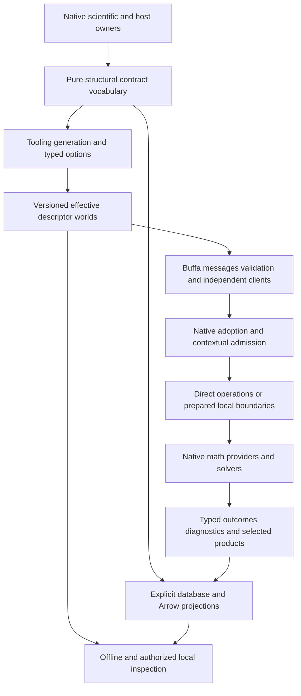

# Integrated Proto target alongside Plan64

## Purpose and authorization

The operator authorized execution of the entire Plan65 series on 2026-11-04 while Plan64
remains incomplete, including replacement of overlapping mechanisms and any breaking changes
needed for the selected target. Actual working capabilities replace the original blanket
completed-Plan64 prerequisite throughout this series. This execution instruction takes
precedence over historical post-Plan64 starting assumptions in companions. Formal ADR acceptance
remains a separate decision route. No scope or ownership is assigned to legacy plans.

Local execution with deliberate extension seams is the target. Remote deployment, distributed
solving and SurrealDB v4 are not delivery requirements. New scientific capabilities may justify
an extension without an existing caller; library availability alone does not justify machinery.

## Baseline and integral foundation assessment

Inspected source `f61286a5fa5894b480efe8584c8b3d9b76d1b1fb` on 2026-11-03, including
concurrent dirty projection/codegen changes as observations only. Plan64 remains in progress.
Its eventual implementation and qualification were original assumed prerequisites, superseded
by the 2026-11-04 execution instruction above. P01 reconciles actual capabilities. The supplied
eight reference documents were read end to end, including original sections, addenda and
source appendices; SurrealDB v4 was not read. The
[discovery suite](../library_leverage/libraries/proto/briefing.md),
[applicability](../library_leverage/libraries/proto/applicability.md) and
[comparative review](../library_leverage/reviews/proto/README.md) retain their original dates.

Criteria: core 3.4, efficient-architecture heuristics 1.0 and process-simulator 1.5 through
`standard.toml`, including independent evidence and local testability. Mechanisms below are
**Interface-checked** by source; the resulting design and benefits are **Proposed**.

The present graph in `pse-model`, owner macros, generated adapters, local-rule generation and
independent host inspector are useful foundations. The host cannot consume product-heavy
science merely to reuse a structural contract. The selected target therefore extracts the
pure declaration/adoption vocabulary into `pse-contract`, with scientific adapters remaining
at scientific owners and generators remaining tooling. A01 supplies the required crate and
dependency-placement decision before implementation; a crate name is not an accepted ADR.

Fresh inspection found three refinements beyond the comparative review:

- The custom projection generator passes full descriptor bytes to
  `shared_descriptor_root_module`; upstream compaction is not automatically applied. Owner
  facets/version/direction currently appear partly in `SourceCodeInfo` comments and effects
  in documentation/sidecars. A compact runtime corpus must first retain required machine
  meaning in typed options. Effective feature overrides must match reflected semantics.
- Schema identity alone is insufficient for retained adoption. Validation policy, physical
  interpretation and database mapping can evolve independently. Historical forwarding,
  known adoption and current admission require different operations.
- The local database is patched 3.3.4 with SurrealMX 1.0 and explicit lifecycle/error/rollback
  behavior. Upstream unpatched descriptions cannot define the local target. The source recipe
  and actual codec/transport owners are the storage baseline.

These are design inputs, not repairs to concurrent work. Relevant source owners are
`pse-codegen::boundary_projection`, `pse-model::boundary_projection`,
`pse-host::schema::payload`, `pse-host::server`, the canonical codec/client, and native
engineering/worker/diagnostic/result owners. Blueprint §4/§6, §14, §18–§21 and §23 describe
current contracts; revisions follow the later decision route.

## Combined target

### Integrated revision from the improvement review

This revision consumes the [improvement review](../plan_improvement_reviews/plan65-integrated-proto-and-simulation-extensibility-2026-11-03.md)
at source `0d9e921cf0c87b8a688a4cd96b68ca1f7f0001d5`. It adds scientific operation/product
semantics and developer evidence as first-class consumers of the structural foundation.
The original baseline above remains historical evidence; concurrent Plan64 edits are not
claimed complete. Core 3.4, heuristics 1.0, process-simulator 1.5 and test-assessment 1.2
govern this revision. All revised deliveries remain **Proposed**.

An executable scientific operation connects its formulation, physical/data context, route,
inputs, provider demands, preparation and products. Native authored guards and constructors
govern those meanings. Generated metadata exposes their relationships without becoming a
second scientific policy table. Scientific selectors distinguish raw evidence, local validity,
coverage, governing completion and final selected attempt; a readable product does not alone
permit scientific use. Scientific preparation dependencies, boundary admission, generated
artifacts and mutable handles have distinct invalidation contracts.

Developer evidence includes native list/check/rustdoc/test actions, selected and executed
populations, fixture/capture failures and exact failed-case rerun. Generated adoption has
owner-declared directions: contextual request, decodable observation or sealed native capability.
Neither historical scientific completion nor a decoded test report grants current authority.
Retained reads resolve the original context and interpretation required by that family and
report absent, expired, incomplete, incompatible or corrupt evidence truthfully.

The extension target is process-system breadth: thermo/reactions/equipment, supported steady,
dynamic and spatial formulations, fitting, studies, control and optimization. Future workflows
reuse owner composition and the same projection/admission/inspection machinery. New physics
still needs executable equations, validity and independent evidence; extensible schemas do not
establish support. No molecular/atomistic engine or universal simulator ontology is implied.

Material library functionality must be explained in the relevant target and package body,
including API/configuration, applicable release, composition, retained responsibilities,
limits and a precise characterization source. Existing content is additive to this requirement:
neither a link list nor a capability name replaces design, migration or acceptance reasoning.
Source-specific uncertainty is an explicit bounded investigation, not assumed functionality.

One executable owner defines each domain meaning. A pure shared structural vocabulary
describes selected records, alternatives, rules, methods and effects without depending on
scientific execution or a wire runtime. Tooling derives effective descriptor worlds, Buffa
representations, checked mechanical adoption, supported validators and independently usable
client/inspection contracts. Independently governed external schemas remain Proto-first.
Native computation and useful Arrow/database representations remain operation-shaped.

### Shared contracts

| Contract | Selected target and preservation duty |
| --- | --- |
| Declaration and metadata | Stable tags/reservations and interpretation at actual owners; typed versioned custom options carry semantic links, local rules and method/effect facts. Comments are documentation, real source relationships establish provenance. |
| Contract world | Complete generation corpus, effective runtime corpus and intentionally disclosed inspection corpus have explicit relations. Feature semantics, import/options closure and pool generation are bound; no universal mutable global pool. |
| Interpretation | Distinguish wire major, semantic interpretation, validation policy and mapping revision. Retained artifacts bind the needed originals. Descriptor digests and encoded bytes do not replace semantic hashing. |
| Adoption | Decode, enforce selected local policy, construct a known native interpretation, then perform contextual admission. Carry established immutable properties where premises survive; recheck when trust or meaning changes. |
| Operations | One native operation/effect owner serves direct calls and useful independent local boundaries. Binary gRPC is the initial first-party effectful wire profile; extra codecs/protocols require their own complete admission controls. |
| Lifetime | Request, observation, native execution, durable effect and physical process lifetimes remain separate. Lost acknowledgement is settled against original identity; retry permission is not inferred from a transport error. |
| Products | Typed metadata and protected references accompany Arrow/native bulk data. Selection reaches the producer. Partial results, omitted evidence and observation coverage are explicit. |
| Scientific portability | Exchange reconstructible source/configuration/capability/outcomes, never closures or native workspaces. Batch operations preserve state/context, derivative demand and per-point outcomes. |

No new universal simulator IR, descriptor registry service, management daemon or dynamic CEL
engine is required. These remain eligible only for an independently useful operation. The
chosen pure shared vocabulary avoids repeatedly importing product semantics into generic tools.

## Alternatives and intentional breaks

A global Proto-first model would still need executable dimensional, formulation, admission,
hashing and lifecycle behavior; making it the sole source now creates more interpretation
than it removes. Native-only contracts preserve simple local use but repeat mechanical client,
storage and diagnostic projections. Rust-first `proto_rs` is credible for narrow contracts;
its complete replacement case must supply the selected validation/reflection/generation
ecosystem and cannot rely on development-only transport features. The selected hybrid gives
host and science one pure structural vocabulary without moving either domain's behavior.

Prost/Tonic remains appropriate for independently owned database, telemetry and other external
protocols. First-party Buffa/Connect is selected for its complete composition, not as a rule
against alternatives. Runtime D02 compares any genuinely simpler released hosting route while
preserving authenticated custody. Native math and Arrow remain because they serve the actual
operation, not because current file formats are immutable.

Breaking changes include pure graph dependency placement, typed metadata publication, selected
host/private wire mappings, explicit validation-policy interpretation, diagnostic detail and
worker session/batch contracts. Each complete population cuts over together. Historical readers
exist only for promised retained interpretations; they are not a second production compatibility
path. Design-phase reconstruction may rebuild disposable data; protected/user-retained inputs
require explicit migration or an explicit incompatibility result.

## Documents and package ownership

| Companion | Resulting responsibility |
| --- | --- |
| [65a Contracts and generation](65a-contract-foundations-and-generation.md) | Pure declarations, typed metadata, descriptors and generation/adapters |
| [65b Representation and validation](65b-representation-validation-and-interpretation.md) | Fidelity, rules, validation/adoption and retained interpretation |
| [65c Storage and history](65c-storage-projections-and-history.md) | Exact mappings, query/graph projections, history and recovery |
| [65d Local operations](65d-local-operations-and-services.md) | Hosting, identity/effects, clients, streams and settlement |
| [65e Scientific execution](65e-scientific-portability-and-execution.md) | Portable artifacts, provider demands, batching and placement |
| [65f Diagnostics and results](65f-diagnostics-and-result-delivery.md) | Structured evidence, selected production and protected readback |
| [65g Intelligence and tooling](65g-code-intelligence-and-client-tooling.md) | Host adoption, offline inspection, generated clients and references |
| [65h Integrated acceptance](65h-integration-and-qualification.md) | Cross-domain extension/failure controls, benefit evidence and handoff |
| [65i Scientific semantics](65i-scientific-operations-and-product-semantics.md) | Executable scientific operation/product-use contracts and dependency validity |
| [65j Workflow evidence](65j-workflow-lifecycle-and-developer-evidence.md) | Developer evidence semantics, construction authority, retained-read and rerun lifecycle |

Companion package tables own their native progress. This coordinator owns only P packages,
the combined target and source dispositions. Documentation boundaries are not synchronization
barriers and not automatic agent assignments.

## Source recommendation dispositions

| Source responsibility or investigation | Disposition and work route |
| --- | --- |
| CBO-195 native fact correspondence; generation infrastructure | A/G: pure annotations and fallible generated maps; migrate semantic checks deliberately |
| CBO-196 rustdoc JSON intermediate | G: bounded typed-projection comparison with explicit retain/remove outcome; Proto alone is no remedy |
| CBO-042 document envelopes; CBO-040 registry products | A/B/C: consumer-specific source projections, retain useful native/Arrow forms |
| CBO-046 canonical request/value declarations | C: generated signature/mapping correspondence; native transaction predicates remain executable |
| CBO-066 response representations/preflight | B/C: exact codec and cumulative admission; replace only on equivalent complete evidence |
| CBO-110/CBO-099 portable math and native child | E: source-derived reconstructible records and actual receiving-context qualification |
| CBO-094 operation languages | D/G: shared native operations and generated independent consumers |
| CBO-008 seeds/progress/completion | C/E/F: classify each retained product; exact-bit binary/Arrow comparison, explicit loss/acknowledgement semantics |
| CBO-045/CBO-084/CBO-013 diagnostic vocabulary/sinks | F/G: typed meaning, source attribution, full evidence and bounded projections |
| Corpus composition, companions, source-info and feature overrides | A: effective corpus and typed metadata first; compatible package composition, visible warnings |
| Binary/JSON/text fidelity, Proto2/editions/WKT/Any/extensions | B/G: selected supported populations and format-specific controls, no blanket remapping |
| Generated/static versus dynamic validation, clocks, filtered validation | B: static selected rules by default, closed dynamic worlds only for selected runtime schemas; exact policy/coverage |
| Public violations, truncation, debug redaction | B/F/G: separate full native evidence from bounded public details and safe routine rendering |
| Views, custom storage, caches, segmented encoding and compression | B/D/F: selected physical routes after producer selection; matched whole-lifetime measurement |
| Graph pair/occurrence identity, freshness, replay and history | C: explicit dependencies, identities, expiry and rebuild; no notification-to-durability inference |
| Surrealism execution/cache and custom HTTP APIs | C: bounded placement comparison for a selected mapping/validation consumer, patch-aware complete obligations |
| Standalone KV/MX, Kafka, GraphQL/GQL and alternate database codecs | Retain as candidates; C records concrete triggers rather than introducing a second store/broker/API for uniformity |
| Health/reflection, rich errors, Router/dispatch and socket lifecycle | D/F/G: authorized existing boundaries and offline artifacts; readiness and capability remain native facts |
| Additional providers, action products, batching and session multiplicity | E: coherent generic demand/session contract and revealing non-water controls; science requires independent evidence |
| External Perfetto/OTLP/Prost protocols and optional Tokio console | F: retain external standards; prepare local task diagnostics only where an operation benefits |
| Rust-first/global Proto-first alternate authority | A: reasoned comparative branch; reopen on complete consumer evidence, not abbreviated examples |
| Browser/public gateways, remote/distributed solving, xDS, no_std/MessageSet | Not delivery requirements; extension seams retained, reconsider on a concrete useful consumer |

These are dispositions of meaningful responsibilities, not an API-adoption quota. Additional
improvements discovered during implementation update the owning target, affected consumers,
dependencies and acceptance together. A changed source premise is corrected at its research
home; the old account remains in Git rather than becoming a competing target.

## Decision and rule impacts

### Improvement recommendation dispositions

The following table owns scheduled disposition of review I01–I11. Its source identifiers
refer to the improvement review; `65i I01` is a different package identity.

| Recommendation | Disposition | Work owner | Completion or settling evidence |
| --- | --- | --- | --- |
| I01 | scheduled | 65i I01/I02; A02/A05; E01/E02/E06 | Supported operation composition and explicit unsupported-formulation refusal survive reconstruction |
| I02 | scheduled | 65i; E02/E06; F01/F04; C03 | Raw read versus governing scientific-use selection, coverage and final-attempt controls |
| I03 | scheduled | 65i; A03/A06; B01; C04; E04 | Scientific versus artifact/admission/handle differential invalidation |
| I04 | scheduled | 65j; A05; F01/F03; G01/G02 | Native action/inventory/report/fixture/rerun population fully migrated |
| I05 | scheduled | A01/A05; B01/B02; 65i/65j; D04/D05 | Observation decode cannot construct sealed native verdict, permission or settlement |
| I06 | scheduled | 65j; C03/C04; F03; G02 | Complete family-specific retained context and truthful missing/expired/corrupt outcomes |
| I07 | scheduled | A02–A04; B05/B07; G02 | Independently specified options survive actual acquisition and publication chains |
| I08 | scheduled | A02–A04; B01/B07; G02; C01/D03 | One native semantic checker and independent wire-compatible semantic-change controls; optional Buf adapter explicitly selected or declined |
| I09 | scheduled | A05/A07; B07; G01/G02; 65j | Bounded generated cases have explicit assurance role and reproducible original failure identity |
| I10 | scheduled | B02/B06; G02; H02/H03 | Released strict-JSON comparison with retain/simplify outcome; no main-only dependency or mandatory upgrade |
| I11 | scheduled | P02/P03; 65i I01; 65j J01; A01/A02; H01 | Early semantic agreement and two complete working slices precede broad migration |

Scheduling is not resolution. H02 owns assembled evidence across these contributors. I10's
investigation is scheduled, while adoption remains conditional and cannot block the core target.

### Proposed rule changes

| Item | Proposed change | Execution prerequisite |
| --- | --- | --- |
| R01 | Add pure `pse-contract` and move generic graph/adoption dependencies | A01: proposed crate/dependency-placement ADR and applicable independent design review before implementation |
| R02 | Typed semantic/effect options, directional construction, shared semantic checking and explicit interpretation/validation/mapping policy | A/B/I/J: metadata and sealed-authority contract decision before affected publication; no replacement of semantic hashing by wire digest |
| R03 | Scientific operation/product-use, dependency-validity, batch/session or backend binding contracts | I/E: applicable kernel/binding ADR and scientific support/refusal decision before activation |
| R04 | Intentional durable/external major breaks and retained-read disposition | B/C/D/G: affected readers/writers and migration/rebuild/activation decision before cutover |

The operator permits proposing any breaking change (2026-11-03). These concrete authority
changes are **proposed**, not individually accepted records. No accepted ADR is edited and
no architecture is amended by this plan. P02 obtains the specific applicable decisions; a
rejected item revises dependent design rather than permitting a hidden fallback or second
production foundation. Ordinary dependency moves remain ordinary pinned changes.

## Package state

| ID | Status | Prerequisites | Completion |
| --- | --- | --- | --- |
| P01 | in-progress | Current native implementation and its actual support/evidence limits; Plan64 completion is not required | Reconcile actual consumer populations and delivered mechanisms against the target; identify draft/missing prerequisites per operation without claiming untested scope |
| P02 | in-progress | P01 current baseline; 65i I01 and 65j J01 owner/design agreement; applicable A/B/C/D/E decisions | R01 foundation delivered under proposed ADR-0241 and independent scoped assessment; R02 typed options/checker underway; proposed ADR-0242/0243 own worker/batch direction. Remaining decisions precede their actual cutovers without a complete-Plan64 barrier |
| P03 | planned | P02; working narrow A/B generation/adoption and G02 inspection slices | Deliver both scientific admission→partial products→qualification→publication/readback and developer execution→full failed report/inventory→readback→exact rerun slices; include original cancellation/lost-ACK settlement; remove replaced maps/interpretations. Existing diagnostic slice is included, not dropped |
| P04 | planned | Ready per-consumer contracts, not completion of every companion | Integrate all selected storage/runtime/scientific/host migrations, reconcile every companion and source disposition; no exemplar-only completion |
| P05 | planned | All functional scope integrated, decisions settled, replacements deleted | Complete H qualification/benefit accounting, enduring architecture/operator guidance and retirement preflight; proposed benefits remain qualified by actual measurements |

Early owner/design agreement requires existing native semantics, not the new crate or complete
65i/65j implementation. Working narrow A/B contracts then support I/J's first complete consumers;
their integration informs broad A05/E/F/G migrations. H01 reconciles the final population rather
than discovering semantic requirements for the first time. Narrow G02 inspection need not await
all G01 families; developer private report readback need not await all canonical storage or D.
C can develop exact mapping
against a ready record contract without waiting for all services. E consumes common wire and
custody capabilities without depending on an engineering dispatcher. Shared declarations,
manifests, generated inventory and integration have one coordinated writer. No full-catalogue
or whole-plan barrier replaces these actual dependencies.

## Execution checkpoint — 2026-11-04

Execution starts from `d63fcbb11`. Source-owned projection, exact physical values, passive
scientific metadata, original report/rerun and prepared water transport are existing foundations;
their historical tests retain their original scope. Expanded generation still has a recorded
`HighsSettings.sparse_start` CEL preflight refusal. Generic output direction currently filters
descriptor participation without prohibiting inverse adoption; worker Stop/Close still clear
all sessions. These are concrete implementation deltas, not reasons to wait for complete Plan64.

The coordinator performs integration and verification on `main` in the ordinary checkout;
three isolated executor checkouts own foundation, scientific and developer-evidence changes.
Shared generator/adoption changes have one continuing foundation owner; the coordinator owns
shared publication and integration. Completed coherent commits are integrated into main promptly.
First work repairs shared maintained-validator lowering, makes governing scientific permission
lookup unambiguous and consolidates observation-only retained developer report interpretation.
The new pure crate and typed metadata still require their recorded decision routes before
affected implementation. P03's two generated slices remain dependent on working narrow A/B.

Missing Plan64 scientific families constrain their specific positive acceptance, not independent
platform work. No Plan64 scientific obligation is closed by a wire schema or this checkpoint.
Package tables and this coordinator remain the sole progress/disposition owners.

The first integrated foundation removes the old model-owned graph and all temporary forwarding
aliases. Its snapshot passed 8 pure, 27 moved model, 25 codegen and 2 diagnostic controls plus
workspace all-target compilation with zero errors/warnings. The expanded descriptor population
passed full `just codegen` (11 targets); a subsequent ownership repair preserves engineering
docs during Markdown regeneration. Native developer report controls passed 4/4, rustdoc G05
comparison controls 4/4, scientific native controls 5/5 and real worker controls 4/4. Each owning
companion retains its exact command, source snapshot, exclusions and conditions. These results
do not close the complete scientific population or H qualification.

## Verification boundary

**Proposed verification:** package-local compile/targeted tests during implementation, explicit
Arrow force-validation in consuming closures, actual code generation when declarations change,
and integrated native/service/database/reference/performance journeys plus hygiene/manual
checks once functional scope ends. H owns the assembled scope and zero-failure accounting.
No source-generated expected value substitutes for independent scientific evidence.

This publication implements planning documents only. Product implementation, scientific
qualification, measured benefit and Plan64 completion are not established. Documentation
validation and independent plan review are reported separately from the proposed campaigns.
