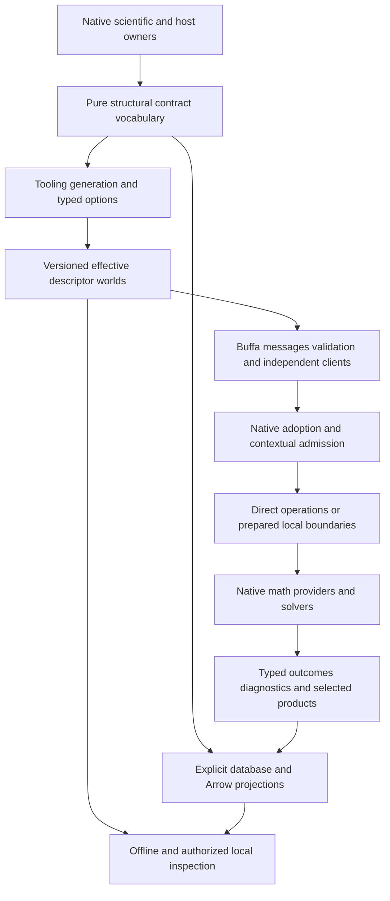

# Integrated Proto target alongside Plan64

## Purpose and authorization

**Temporary execution pause — November 6:** the maintainer requested an immediate pause
for approximately forty minutes. Root and all three executors have stopped or confirmed
settlement of their builds/tests; resume requires the maintainer's instruction. Worktrees,
caches, original artifacts and unfinished edits are retained. No scope is completed by this
pause, and no formatting/hygiene or new qualification runs are started during it.

Main integrates generic reentrant supervision, unique surrogate retirement, retained compiler
cache bridges, duplicate IPC metadata protection, descriptor-search selection, aggregate
fixture prerequisite reporting, selected-result source context and original fixture inspection
source. The KINSOL/compiled-evaluator retirement selection passes 44/44 at its earlier source
boundary (`01a1b182-2bda-7281-bc6b-6ea03cdd2f0c`). The later main host/columnar receiving run
finished successfully before cancellation arrived (`01a1b18f-f6bc-701c-82e1-12152fe78520`,
capture and physical settlement complete). These receipts do not qualify the unfinished
generated/scientific consumers below.

Resume from the existing workstream table, in this order where dependencies apply:

- Contracts worktree: preserve its uncommitted single-world recorded-result adapter split
  in `xtask/src/codegen/engineering.rs`. The latest generation retry refused before effects
  on compiler-cache bridge context. Resolve the exact selected compiler context, then
  regenerate against original source `8a23783dc` and `a860539c9`. Prior `1e0acb390` is the
  older generated population; it excludes the new inspection fields and adapter split.
- Persistence worktree: its uncommitted default-feature recorded-result facade/Arrow
  exporter/portable-reader cutover needs that matching generated adapter. Do not compile
  against mismatched artifacts or claim acceptance. Source, duplicate IPC and prerequisite
  reporting commits are already integrated on main. ADR-0250 precedes the metadata cutover.
- Science worktree: retain the uncommitted FeedFlash source and six controls. The latest
  native discovery build failed with exit101 before test execution and settled completely
  (`01a1b18d-d2ff-7592-a100-4c250321a9cd`); diagnosis remains for resume. Earlier one-pass/four-fail
  physical selection drove constructor and exact-fixture repair, whose acceptance remains
  open. Preserve both source-built capsules. Original fixture-inspection source is on main;
  generated/independent-reader acceptance remains open. The E03 aqueous spatial inventory
  feasibility is the next substantive science slice; no E03 implementation has begun.
- Root: integrate matching generator/consumer contributions on main, receive affected
  default/service/scientific consumers, and implement the separately decided ADR-0251 native
  provider-observation seam. No kernel code for ADR-0251 has been changed. Continue the full
  dependency-ordered Plan64/65 workstreams; only remove worktrees once fully integrated.

The operator authorized execution of the entire Plan65 series on 2026-11-04 while Plan64
remains incomplete, including replacement of overlapping mechanisms and any breaking changes
needed for the selected target. Actual working capabilities replace the original blanket
completed-Plan64 prerequisite throughout this series. This execution instruction takes
precedence over historical post-Plan64 starting assumptions in companions. Formal ADR acceptance
remains a separate decision route. No scope or ownership is assigned to legacy plans.

Local execution with deliberate extension seams is the target. Remote deployment, distributed
solving and SurrealDB v4 are not delivery requirements. New scientific capabilities may justify
an extension without an existing caller; library availability alone does not justify machinery.

## Baseline and integral foundation assessment

Inspected source `f61286a5fa5894b480efe8584c8b3d9b76d1b1fb` on 2026-11-03, including
concurrent dirty projection/codegen changes as observations only. Plan64 remains in progress.
Its eventual implementation and qualification were original assumed prerequisites, superseded
by the 2026-11-04 execution instruction above. P01 reconciles actual capabilities. The supplied
eight reference documents were read end to end, including original sections, addenda and
source appendices; SurrealDB v4 was not read. The
[discovery suite](../library_leverage/libraries/proto/briefing.md),
[applicability](../library_leverage/libraries/proto/applicability.md) and
[comparative review](../library_leverage/reviews/proto/README.md) retain their original dates.

Criteria: core 3.4, efficient-architecture heuristics 1.0 and process-simulator 1.5 through
`standard.toml`, including independent evidence and local testability. Mechanisms below are
**Interface-checked** by source; the resulting design and benefits are **Proposed**.

The present graph in `pse-model`, owner macros, generated adapters, local-rule generation and
independent host inspector are useful foundations. The host cannot consume product-heavy
science merely to reuse a structural contract. The selected target therefore extracts the
pure declaration/adoption vocabulary into `pse-contract`, with scientific adapters remaining
at scientific owners and generators remaining tooling. A01 supplies the required crate and
dependency-placement decision before implementation; a crate name is not an accepted ADR.

Fresh inspection found three refinements beyond the comparative review:

- The custom projection generator passes full descriptor bytes to
  `shared_descriptor_root_module`; upstream compaction is not automatically applied. Owner
  facets/version/direction currently appear partly in `SourceCodeInfo` comments and effects
  in documentation/sidecars. A compact runtime corpus must first retain required machine
  meaning in typed options. Effective feature overrides must match reflected semantics.
- Schema identity alone is insufficient for retained adoption. Validation policy, physical
  interpretation and database mapping can evolve independently. Historical forwarding,
  known adoption and current admission require different operations.
- The local database is patched 3.3.4 with SurrealMX 1.0 and explicit lifecycle/error/rollback
  behavior. Upstream unpatched descriptions cannot define the local target. The source recipe
  and actual codec/transport owners are the storage baseline.

These are design inputs, not repairs to concurrent work. Relevant source owners are
`pse-codegen::boundary_projection`, `pse-model::boundary_projection`,
`pse-host::schema::payload`, `pse-host::server`, the canonical codec/client, and native
engineering/worker/diagnostic/result owners. Blueprint §4/§6, §14, §18–§21 and §23 describe
current contracts; revisions follow the later decision route.

## Combined target

### Integrated revision from the improvement review

This revision consumes the [improvement review](../plan_improvement_reviews/plan65-integrated-proto-and-simulation-extensibility-2026-11-03.md)
at source `0d9e921cf0c87b8a688a4cd96b68ca1f7f0001d5`. It adds scientific operation/product
semantics and developer evidence as first-class consumers of the structural foundation.
The original baseline above remains historical evidence; concurrent Plan64 edits are not
claimed complete. Core 3.4, heuristics 1.0, process-simulator 1.5 and test-assessment 1.2
govern this revision. All revised deliveries remain **Proposed**.

An executable scientific operation connects its formulation, physical/data context, route,
inputs, provider demands, preparation and products. Native authored guards and constructors
govern those meanings. Generated metadata exposes their relationships without becoming a
second scientific policy table. Scientific selectors distinguish raw evidence, local validity,
coverage, governing completion and final selected attempt; a readable product does not alone
permit scientific use. Scientific preparation dependencies, boundary admission, generated
artifacts and mutable handles have distinct invalidation contracts.

Developer evidence includes native list/check/rustdoc/test actions, selected and executed
populations, fixture/capture failures and exact failed-case rerun. Generated adoption has
owner-declared directions: contextual request, decodable observation or sealed native capability.
Neither historical scientific completion nor a decoded test report grants current authority.
Retained reads resolve the original context and interpretation required by that family and
report absent, expired, incomplete, incompatible or corrupt evidence truthfully.

The extension target is process-system breadth: thermo/reactions/equipment, supported steady,
dynamic and spatial formulations, fitting, studies, control and optimization. Future workflows
reuse owner composition and the same projection/admission/inspection machinery. New physics
still needs executable equations, validity and independent evidence; extensible schemas do not
establish support. No molecular/atomistic engine or universal simulator ontology is implied.

Material library functionality must be explained in the relevant target and package body,
including API/configuration, applicable release, composition, retained responsibilities,
limits and a precise characterization source. Existing content is additive to this requirement:
neither a link list nor a capability name replaces design, migration or acceptance reasoning.
Source-specific uncertainty is an explicit bounded investigation, not assumed functionality.

One executable owner defines each domain meaning. A pure shared structural vocabulary
describes selected records, alternatives, rules, methods and effects without depending on
scientific execution or a wire runtime. Tooling derives effective descriptor worlds, Buffa
representations, checked mechanical adoption, supported validators and independently usable
client/inspection contracts. Independently governed external schemas remain Proto-first.
Native computation and useful Arrow/database representations remain operation-shaped.

### Shared contracts

| Contract | Selected target and preservation duty |
| --- | --- |
| Declaration and metadata | Stable tags/reservations and interpretation at actual owners; typed versioned custom options carry semantic links, local rules and method/effect facts. Comments are documentation, real source relationships establish provenance. |
| Contract world | Complete generation corpus, effective runtime corpus and intentionally disclosed inspection corpus have explicit relations. Feature semantics, import/options closure and pool generation are bound; no universal mutable global pool. |
| Interpretation | Distinguish wire major, semantic interpretation, validation policy and mapping revision. Retained artifacts bind the needed originals. Descriptor digests and encoded bytes do not replace semantic hashing. |
| Adoption | Decode, enforce selected local policy, construct a known native interpretation, then perform contextual admission. Carry established immutable properties where premises survive; recheck when trust or meaning changes. |
| Operations | One native operation/effect owner serves direct calls and useful independent local boundaries. Binary gRPC is the initial first-party effectful wire profile; extra codecs/protocols require their own complete admission controls. |
| Lifetime | Request, observation, native execution, durable effect and physical process lifetimes remain separate. Lost acknowledgement is settled against original identity; retry permission is not inferred from a transport error. |
| Products | Typed metadata and protected references accompany Arrow/native bulk data. Selection reaches the producer. Partial results, omitted evidence and observation coverage are explicit. |
| Scientific portability | Exchange reconstructible source/configuration/capability/outcomes, never closures or native workspaces. Batch operations preserve state/context, derivative demand and per-point outcomes. |

No new universal simulator IR, descriptor registry service, management daemon or dynamic CEL
engine is required. These remain eligible only for an independently useful operation. The
chosen pure shared vocabulary avoids repeatedly importing product semantics into generic tools.

## Alternatives and intentional breaks

A global Proto-first model would still need executable dimensional, formulation, admission,
hashing and lifecycle behavior; making it the sole source now creates more interpretation
than it removes. Native-only contracts preserve simple local use but repeat mechanical client,
storage and diagnostic projections. Rust-first `proto_rs` is credible for narrow contracts;
its complete replacement case must supply the selected validation/reflection/generation
ecosystem and cannot rely on development-only transport features. The selected hybrid gives
host and science one pure structural vocabulary without moving either domain's behavior.

Prost/Tonic remains appropriate for independently owned database, telemetry and other external
protocols. First-party Buffa/Connect is selected for its complete composition, not as a rule
against alternatives. Runtime D02 compares any genuinely simpler released hosting route while
preserving authenticated custody. Native math and Arrow remain because they serve the actual
operation, not because current file formats are immutable.

Breaking changes include pure graph dependency placement, typed metadata publication, selected
host/private wire mappings, explicit validation-policy interpretation, diagnostic detail and
worker session/batch contracts. Each complete population cuts over together. Historical readers
exist only for promised retained interpretations; they are not a second production compatibility
path. Design-phase reconstruction may rebuild disposable data; protected/user-retained inputs
require explicit migration or an explicit incompatibility result.

## Documents and package ownership

| Companion | Resulting responsibility |
| --- | --- |
| [65a Contracts and generation](65a-contract-foundations-and-generation.md) | Pure declarations, typed metadata, descriptors and generation/adapters |
| [65b Representation and validation](65b-representation-validation-and-interpretation.md) | Fidelity, rules, validation/adoption and retained interpretation |
| [65c Storage and history](65c-storage-projections-and-history.md) | Exact mappings, query/graph projections, history and recovery |
| [65d Local operations](65d-local-operations-and-services.md) | Hosting, identity/effects, clients, streams and settlement |
| [65e Scientific execution](65e-scientific-portability-and-execution.md) | Provider demands, mutable sessions, batching, placement and E01/E06 integration; E02/E03 artifact ownership is in 65k |
| [65f Diagnostics and results](65f-diagnostics-and-result-delivery.md) | Structured evidence, selected production and protected readback |
| [65g Intelligence and tooling](65g-code-intelligence-and-client-tooling.md) | Host adoption, offline inspection, generated clients and references |
| [65h Integrated acceptance](65h-integration-and-qualification.md) | Cross-domain extension/failure controls, benefit evidence and handoff |
| [65i Scientific semantics](65i-scientific-operations-and-product-semantics.md) | Executable scientific operation/product-use contracts and dependency validity |
| [65j Workflow evidence](65j-workflow-lifecycle-and-developer-evidence.md) | Developer evidence semantics, construction authority, retained-read and rerun lifecycle |
| [65k Scientific artifacts](65k-scientific-artifacts-and-native-reconstruction.md) | E02/E03 immutable exchange, receiving reconstruction and narrow original-parent native delegation; sole package/evidence ownership extracted from 65e |

Companion package tables own their native progress. This coordinator owns only P packages,
the combined target and source dispositions. Documentation boundaries are not synchronization
barriers and not automatic agent assignments.

## Source recommendation dispositions

| Source responsibility or investigation | Disposition and work route |
| --- | --- |
| CBO-195 native fact correspondence; generation infrastructure | A/G: pure annotations and fallible generated maps; migrate semantic checks deliberately |
| CBO-196 rustdoc JSON intermediate | G: bounded typed-projection comparison with explicit retain/remove outcome; Proto alone is no remedy |
| CBO-042 document envelopes; CBO-040 registry products | A/B/C: consumer-specific source projections, retain useful native/Arrow forms |
| CBO-046 canonical request/value declarations | C: generated signature/mapping correspondence; native transaction predicates remain executable |
| CBO-066 response representations/preflight | B/C: exact codec and cumulative admission; replace only on equivalent complete evidence |
| CBO-110/CBO-099 portable math and native child | E: source-derived reconstructible records and actual receiving-context qualification |
| CBO-094 operation languages | D/G: shared native operations and generated independent consumers |
| CBO-008 seeds/progress/completion | C/E/F: classify each retained product; exact-bit binary/Arrow comparison, explicit loss/acknowledgement semantics |
| CBO-045/CBO-084/CBO-013 diagnostic vocabulary/sinks | F/G: typed meaning, source attribution, full evidence and bounded projections |
| Corpus composition, companions, source-info and feature overrides | A: effective corpus and typed metadata first; compatible package composition, visible warnings |
| Binary/JSON/text fidelity, Proto2/editions/WKT/Any/extensions | B/G: selected supported populations and format-specific controls, no blanket remapping |
| Generated/static versus dynamic validation, clocks, filtered validation | B: static selected rules by default, closed dynamic worlds only for selected runtime schemas; exact policy/coverage |
| Public violations, truncation, debug redaction | B/F/G: separate full native evidence from bounded public details and safe routine rendering |
| Views, custom storage, caches, segmented encoding and compression | B/D/F: selected physical routes after producer selection; matched whole-lifetime measurement |
| Graph pair/occurrence identity, freshness, replay and history | C: explicit dependencies, identities, expiry and rebuild; no notification-to-durability inference |
| Surrealism execution/cache and custom HTTP APIs | C: bounded placement comparison for a selected mapping/validation consumer, patch-aware complete obligations |
| Standalone KV/MX, Kafka, GraphQL/GQL and alternate database codecs | Retain as candidates; C records concrete triggers rather than introducing a second store/broker/API for uniformity |
| Health/reflection, rich errors, Router/dispatch and socket lifecycle | D/F/G: authorized existing boundaries and offline artifacts; readiness and capability remain native facts |
| Additional providers, action products, batching and session multiplicity | E: coherent generic demand/session contract and revealing non-water controls; science requires independent evidence |
| External Perfetto/OTLP/Prost protocols and optional Tokio console | F: retain external standards; prepare local task diagnostics only where an operation benefits |
| Rust-first/global Proto-first alternate authority | A: reasoned comparative branch; reopen on complete consumer evidence, not abbreviated examples |
| Browser/public gateways, remote/distributed solving, xDS, no_std/MessageSet | Not delivery requirements; extension seams retained, reconsider on a concrete useful consumer |

These are dispositions of meaningful responsibilities, not an API-adoption quota. Additional
improvements discovered during implementation update the owning target, affected consumers,
dependencies and acceptance together. A changed source premise is corrected at its research
home; the old account remains in Git rather than becoming a competing target.

## November 5 improvement dispositions

This revision integrates the [November 5 review](../plan_improvement_reviews/plan65-proto-capabilities-and-codebase-integration-2026-11-05.md)
at clean source baseline `1230a7e833fe31a809a077107bf2943cef3fc255`. The operator selected
integration of all twelve recommendations and **decision packages first** for broader
opportunities. Source findings are Interface-checked; revised designs and benefits remain
Proposed. Authoring performs no product implementation or qualification and does not resume
the stopped native-lane/test campaign. Earlier evidence retains its original conditions.

The combined target is native scientific authority with operation-shaped generated contracts,
transactional worker handoff, result-bearing physical finish, explicit complete preparation,
demand-shaped inspection and protected original evidence acquisition. Generated schemas do
not replace the domain model; semantic distinctions need not become physical tasks or stores.
Exact existing positive scientific consumers are specified in 65i, with new scientific
support distinguished from migration and extension discriminators.

[65k](65k-scientific-artifacts-and-native-reconstruction.md) now owns E02/E03. Their original
IDs, substantive assessments, status and evidence moved once; 65e retains provider sessions,
batching and links at old anchors. This separates independent receiving reconstruction,
durable evidence and one live original-parent delegation. It does not choose a new numerical
IR or activate protobuf/native transfer on the strength of passive generation.

The following I IDs refer only to the November 5 review. The November 3 table below retains
its own namespace and dispositions. Contributions are linked; package progress remains at
one owning companion rather than repeated in this table.

| Recommendation | Disposition | Work owner | Completion or settling evidence |
| --- | --- | --- | --- |
| I01 | scheduled | 65i I01–I06; E01/E06; 65k E02; A/B/C/F/G consumers | Selected material coordinates, phase/regularity/stability, initial-interval fit meaning and experiment/trajectory product references govern actual native adoption and independent readback |
| I02 | scheduled | 65e E04; D04/D05 | Queue reservation and reversible admission commit without suspension; definite abandoned Prepare is retired; unrelated sessions survive a lost waiter on a live connection; parent loss retains its distinct containment |
| I03 | scheduled | 65j J01/J03/J05; G02/G04/G06 | Conditional versus exact all-missing prerequisite account, explicit preparation and complete-context invocation-local helper reuse with distinct group attribution |
| I04 | scheduled | 65a A04; A03/A07; B03/B07 | Select plugins, reduced repeated plugin preparation or typed in-process composition after complete generated output/diagnostics/dependency/isolation comparison |
| I05 | scheduled | 65b B01–B07; A02/A05/A06 | Each boundary enforces its supported format/rule/context/interpretation contract; retained original-world, strict-JSON and Edition limits remain explicit |
| I06 | scheduled | 65f F04; C01–C06; B06/G/I/J | Selected intent reaches producer/storage, coverage and terminal extent stay distinct, and protected readers preserve exact values/history/release |
| I07 | scheduled | 65d D05; 65e E04; F01/F02 | Native placement exposes explicit typed finish; every independent teardown is attempted and uncertain physical settlement retains custody/admission |
| I08 | scheduled | 65g G03/G04; D/F/I/J | Independent discovery/explanation/native submission/selected readback journey, generated route facts, authenticated reconnect and attributable partial failure |
| I09 | scheduled | 65k E02/E03; E06/I/C/H | Per-consumer transfer decision preserves original scientific admission, supplier prerequisites and parent verification; no competing production route or unqualified binary activation |
| I10 | scheduled | 65g G02/G06; A04 | Payload/exact inspection avoids full presentation while required semantic checks, exhaustive counts and cursor ordering remain correct |
| I11 | scheduled | 65g G02; A03/B | Shared typed effective-world recognition ignores only genuine SourceCodeInfo and selects exactly that world's compiled validation |
| I12 | scheduled | 65j J02/J04; F03/G02/G04 | Offline original-commitment bundle with incremental protected member acquisition; >64 MiB closure, interruption, missing member and publication controls; no assumed prune owner |

### Cross-contract readiness and library realization

I01's native meanings precede new generated fields; I11 can reuse current effective-world
semantics before broad migration. I02/I07 and J's preparation can proceed against existing
owners without awaiting all A/B work. I04 is a bounded tooling decision, not a barrier to
current generated consumers. J's offline evidence acquisition does not require D06 or a new
canonical store. H reconciles each actual migration population and the complete assembled
journeys; no whole-document completion barrier replaces these prerequisites.

Each target and package body names the concrete library calls/configuration, release or
maintained patch, composition, preservation limits and a precise characterization source.
This is additive to design, migration and acceptance content. For example, Tokio 1.53.3
`Sender::reserve_owned`/`OwnedPermit::send` separates cancellable capacity acquisition
from native handoff; `JoinSet` retains results, while tokio-util 0.7.19 `TaskTracker`
does not replace admission closure or result collection.
[Queue source/API](https://docs.rs/tokio/1.53.3/tokio/sync/mpsc/struct.Sender.html#method.reserve_owned),
[task tracking](https://docs.rs/tokio-util/0.7.19/tokio_util/task/struct.TaskTracker.html).
Buffa 0.9.2, typed Connect codegen 0.9.0 and the maintained validator composition remain at
A/B; checked numerical packing remains conditional at K. No source-list appendix substitutes
for these explanations.

### Broader opportunities: bounded decisions, not implied delivery

P06–P09 own the decision outcomes below. A decision can adopt a bounded Plan65 amendment,
defer with an observable trigger, reject with a reason, or identify principal work requiring
a separately selected plan. A positive feasibility observation is not delivery completion.
Only a selected concrete consumer extends dependent P04/H acceptance. Deciding these routes
does not force multi-host scheduling, plugin unloading, broker delivery or new physical laws
into the local core.

| Decision | Concrete first consumer and comparison | Evidence and selection boundary |
| --- | --- | --- |
| P06 | Repeated independent local engineering client using an explicitly installed service/worker; compare current per-journey preparation with existing authenticated manager/systemd custody | Installation/update identity, reconnect/lost ACK, original readiness, activation result and drain; select a finite installed profile only if it improves this workflow. Fleet scheduling/credentials/distributed custody are separate principal work |
| P07 | External reader of selected scientific result/provenance; compare current protected export/query with a continuity-bearing exporter | Establish whether snapshot access suffices. Durable change export requires event/cursor identity, acknowledgement, expiry/resync and native query freshness; no broker is a prerequisite |
| P08 | One independently distributed provider implementation using current process isolation versus a versioned native ABI | Establish actual distribution need, physical/derivative contract, allocator/callback/thread/panic and unload lifetime. Proto supplies data contracts, not an ABI; defer ABI machinery without this consumer |
| P09 | A chemical workflow beyond current migrated science using existing owner composition where possible | Separate new equations, applicability, derivatives and independent physical expectations from boundary migration. New temporal closure, electrochemistry or molecular algorithms require explicit scientific selection; do not infer support from generic records |

### Decision routes and preservation

Existing R01–R04 and proposed ADR-0241–0246 retain their actual statuses. Stronger queue
handoff, explicit finish, lazy presentation and helper reuse preserve existing contracts;
they do not by themselves need a governing rule change. Any actual change to product
interpretation/construction, historical-read promise, metadata, hashing, kernel contract or
ADR-0246 recipient scope is specified under P02 before dependent activation. Existing
breaking-change authorization permits proposing replacements, not editing accepted ADRs.
No additional rule waiver or scientific support is inferred by this revision.

## Decision and rule impacts

### Improvement recommendation dispositions

The following table owns scheduled disposition of review I01–I11. Its source identifiers
refer to the improvement review; `65i I01` is a different package identity.

| Recommendation | Disposition | Work owner | Completion or settling evidence |
| --- | --- | --- | --- |
| I01 | scheduled | 65i I01/I02; A02/A05; E01/E02/E06 | Supported operation composition and explicit unsupported-formulation refusal survive reconstruction |
| I02 | scheduled | 65i; E02/E06; F01/F04; C03 | Raw read versus governing scientific-use selection, coverage and final-attempt controls |
| I03 | scheduled | 65i; A03/A06; B01; C04; E04 | Scientific versus artifact/admission/handle differential invalidation |
| I04 | scheduled | 65j; A05; F01/F03; G01/G02 | Native action/inventory/report/fixture/rerun population fully migrated |
| I05 | scheduled | A01/A05; B01/B02; 65i/65j; D04/D05 | Observation decode cannot construct sealed native verdict, permission or settlement |
| I06 | scheduled | 65j; C03/C04; F03; G02 | Complete family-specific retained context and truthful missing/expired/corrupt outcomes |
| I07 | scheduled | A02–A04; B05/B07; G02 | Independently specified options survive actual acquisition and publication chains |
| I08 | scheduled | A02–A04; B01/B07; G02; C01/D03 | One native semantic checker and independent wire-compatible semantic-change controls; optional Buf adapter explicitly selected or declined |
| I09 | scheduled | A05/A07; B07; G01/G02; 65j | Bounded generated cases have explicit assurance role and reproducible original failure identity |
| I10 | scheduled | B02/B06; G02; H02/H03 | Released strict-JSON comparison with retain/simplify outcome; no main-only dependency or mandatory upgrade |
| I11 | scheduled | P02/P03; 65i I01; 65j J01; A01/A02; H01 | Early semantic agreement and two complete working slices precede broad migration |

Scheduling is not resolution. H02 owns assembled evidence across these contributors. I10's
investigation is scheduled, while adoption remains conditional and cannot block the core target.

### Proposed rule changes

| Item | Proposed change | Execution prerequisite |
| --- | --- | --- |
| R01 | Add pure `pse-contract` and move generic graph/adoption dependencies | A01: proposed crate/dependency-placement ADR and applicable independent design review before implementation |
| R02 | Typed semantic/effect options, directional construction, shared semantic checking and explicit interpretation/validation/mapping policy | A/B/I/J: metadata and sealed-authority contract decision before affected publication; no replacement of semantic hashing by wire digest |
| R03 | Scientific operation/product-use, dependency-validity, batch/session or backend binding contracts | I/E: applicable kernel/binding ADR and scientific support/refusal decision before activation |
| R04 | Intentional durable/external major breaks and retained-read disposition | B/C/D/G: affected readers/writers and migration/rebuild/activation decision before cutover |

The operator permits proposing any breaking change (2026-11-03). These concrete authority
changes are **proposed**, not individually accepted records. No accepted ADR is edited and
no architecture is amended by this plan. P02 obtains the specific applicable decisions; a
rejected item revises dependent design rather than permitting a hidden fallback or second
production foundation. Ordinary dependency moves remain ordinary pinned changes.

## Package state

| ID | Status | Prerequisites | Completion |
| --- | --- | --- | --- |
| P01 | in-progress | Current native implementation and its actual support/evidence limits; Plan64 completion is not required | Reconcile actual consumer populations and delivered mechanisms against the target; identify draft/missing prerequisites per operation without claiming untested scope |
| P02 | in-progress | P01 current baseline; 65i I01 and 65j J01 owner/design agreement; applicable A/B/C/D/E decisions | R01 pure foundation and R02 typed metadata publication/shared checker delivered under proposed ADR-0241/0244 and bounded assessments; common crossing and consumer migration continue. Proposed ADR-0242/0243 govern worker lifecycle and batching. Remaining decisions precede actual cutovers without a complete-Plan64 barrier |
| P03 | planned | P02; working narrow A/B generation/adoption and G02 inspection slices | Deliver both scientific admission→partial products→qualification→publication/readback and developer execution→full failed report/inventory→readback→exact rerun slices; include original cancellation/lost-ACK settlement; remove replaced maps/interpretations. Existing diagnostic slice is included, not dropped |
| P04 | planned | Ready per-consumer contracts, not completion of every companion | Integrate all selected storage/runtime/scientific/host migrations, reconcile every companion and source disposition; no exemplar-only completion |
| P05 | planned | All functional scope integrated, decisions settled, replacements deleted | Complete H qualification/benefit accounting, enduring architecture/operator guidance and retirement preflight; proposed benefits remain qualified by actual measurements |
| P06 | planned | Current native installation/manager ownership and one independent local client | Decide the finite installed-worker/service consumer above; record outcome, actual custody/activation/readiness guarantees, conditional delivery or separate-plan boundary |
| P07 | planned | C/F protected result/query contracts and an external reader | Decide snapshot/export versus continuity delivery with event/ACK/expiry semantics; record selected integration or revisit trigger |
| P08 | planned | E provider capability and a concrete external distribution consumer | Decide process isolation versus ABI integration, including callback/release/unload duties; select no plugin framework by default |
| P09 | planned | 65i scientific operation/product semantics and a candidate new chemical workflow | Decide existing composition versus new scientific work with independent evidence and explicit acceptance/support limits |

Early owner/design agreement requires existing native semantics, not the new crate or complete
65i/65j implementation. Working narrow A/B contracts then support I/J's first complete consumers;
their integration informs broad A05/E/F/G migrations. H01 reconciles the final population rather
than discovering semantic requirements for the first time. Narrow G02 inspection need not await
all G01 families; developer private report readback need not await all canonical storage or D.
C can develop exact mapping
against a ready record contract without waiting for all services. E consumes common wire and
custody capabilities without depending on an engineering dispatcher. Shared declarations,
manifests, generated inventory and integration have one coordinated writer. No full-catalogue
or whole-plan barrier replaces these actual dependencies.

## Execution checkpoint — 2026-11-04

Execution starts from `d63fcbb11`. Source-owned projection, exact physical values, passive
scientific metadata, original report/rerun and prepared water transport are existing foundations;
their historical tests retain their original scope. At entry, expanded generation had a
`HighsSettings.sparse_start` CEL preflight refusal, generic output direction did not prohibit
inverse adoption, and worker Stop/Close cleared all sessions. The delivered foundation and
native lifecycle changes below replace these mechanisms; full Plan64 completion was no barrier.

The coordinator performs integration and verification on `main` in the ordinary checkout.
The original Plan65 checkout and the foundation, scientific and developer-evidence worker
worktrees have been consolidated and removed at the operator's request. Their required source,
tests and decisions are integrated on main; branch history and original evidence outside the
checkouts are retained. Shared generator/adoption and publication work now continues from main.
Shared maintained-validator lowering, unique governing scientific permission lookup and passive
retained-report interpretation are integrated. Proposed ADR-0241–0244 and bounded assessments
preceded the affected foundation, worker and shared-adapter changes. Proposed ADR-0245 and
the independent Accept-scoped prerequisite assessment now precede native recipe membership
work; full protobuf recipe activation remains withheld. P03 now consumes working
typed publication; complete scientific and developer readback slices remain in progress.

Missing Plan64 scientific families constrain their specific positive acceptance, not independent
platform work. No Plan64 scientific obligation is closed by a wire schema or this checkpoint.
Package tables and this coordinator remain the sole progress/disposition owners.

The first integrated foundation removes the old model-owned graph and all temporary forwarding
aliases. Its snapshot passed 8 pure, 27 moved model, 25 codegen and 2 diagnostic controls plus
workspace all-target compilation with zero errors/warnings. The expanded descriptor population
passed full `just codegen` (11 targets); a subsequent ownership repair preserves engineering
docs during Markdown regeneration. Native developer report controls passed 4/4, rustdoc G05
comparison controls 4/4, scientific native controls 5/5 and real worker controls 4/4. Each owning
companion retains its exact command, source snapshot, exclusions and conditions. These results
do not close the complete scientific population or H qualification.

The combined main-branch publication includes typed options across engineering, scientific-worker,
reference, native-child and developer-evidence worlds, all selected native facet keys, and genuine
native batch framing. Full `just codegen` publishes all 13 targets, with the native-count
rename and scoped generated roots resolving the earlier developer accessor/visibility warnings.
It removes synthetic machine-policy
comments and the redundant action-effects sidecar. The shared
lossless descriptor adapter has moved from product-dependent codegen into `pse-contract-proto`;
consumer-local source/domain policies and the pure semantic checker retain their authority.
The nine selected actual worker/batch controls passed on main with zero failures or build
warnings and complete original capture/settlement. The first selection failed discovery on a
test-only nonexistent method and qualification warning; the corrected assertion requires both
native admission counters to be present and zero. This targeted delivery leaves the broader
portable, storage, reporting, domain-extension and H obligations open.

The expanded retained-result slice has source-owned run/attempt and set/batch/manifest/block/
output metadata, plus a borrowed protected-reader snapshot with no inverse constructor.
Native value/semantic controls and the actual constant-completion protected readback pass on
main; 65c owns their conditions and complete-population obligations. A03 now references the
five byte-identical descriptor sidecars instead of repeating escaped Rust literals; effective
feature handling and full/runtime world separation remain open. Complete C/F delivery,
scientific recipe cutover and H qualification remain in progress. The interpretation-three
developer dependency closure is integrated on main, including the correction retaining exact
authenticated startup input bytes across execution; 65j owns its tests and remaining lifecycle
population. Completion-owned permission observations and their independent readback are
integrated as the narrow F/I slice, with exact conditions and limits in 65f.

### Consolidated handoff — 2026-11-04

Joint execution of both remaining series is authorized from this handoff. One coordinator
owns integration on main, with Proto delivery first. Scientific/input repairs necessary for
Proto acceptance and the finite population census may progress alongside shared contracts,
Recipe qualification and protected capture. Broader Plan64 scientific expansion follows the
working Proto milestone; final assembled qualification covers both series after functional
delivery. Temporary isolation is used only for actual concurrent edit conflicts.

The final seven-file scientific handoff is integrated as `f0cba8780`, preserving main's
formatting and earlier improvements. It completes the passive native Recipe source graph;
65e owns the two passing main-branch compiler controls and the remaining codec/qualification
work. Clean foundation and developer-evidence worktrees were reconciled against their actual
main implementations, including transformed historical commits. Superseded bootstrap outputs
were not copied over the newer generated worlds. No unresolved merge conflicts remain.

At that initial consolidation, regeneration (`just codegen`) passed all thirteen targets
with zero errors or warnings, configured unbounded placement, cache off and prepared native
providers. Original capture and native settlement completed; published outputs were unchanged.
The compiler's two targeted controls passed on main with the conditions retained in 65e.

All four checkouts were removed only after their required changes were integrated and their
current users were quiescent. Their rebuildable tools, environments and build targets were
retired with them; retained invocation stores and the full developer evidence export outside
the checkouts were preserved. Historical incomplete/unavailable custody records keep that
meaning. Administrative cleanup does not close product lifecycle or qualification obligations.

Main now publishes that graph through one shared output/configuration in `3865ba77c` and
integrates the independently reviewed native membership prerequisite in `f3e298eea`.
[65e](65e-scientific-portability-and-execution.md#native-membership-prerequisite-integration)
owns its targeted evidence and limits. The prerequisite checkout was removed after exact
content reconciliation. Study lifecycle/keeper integration is now on main through
`4bf4ff32b`; the independently reviewed library-owned pre-growth prerequisite is on main
as `44708962e`. Their clean checkouts matched all owned files before quiescent removal;
original invocation evidence remains outside them. The complete source-generated lazy
Recipe decode probe is integrated as `d1e597de1`; actual physical-context preparation,
native SelectedColumns and authored steam-source corrections are integrated as
`165faf093`. All required owned content was reconciled before removing their quiescent
checkouts. The generated ownership manifest preserves the union of both generators.
At that consolidation only main remained; integration and final acceptance continue there.

Main `c9cfe6a8d` bounds shared native clock/settlement composition. The current
[G08 checkpoint](64g-analyses-studies-and-applications.md#g08--atomic-capture-and-unrelated-liveness)
selects and tests the existing authored-transaction alternative after the writable
module failed its fixed clock. All 22 selected capture/append/lifecycle controls now
pass, including the actual 10,000-member capture. Pure module artifact/admission
controls pass 11/11; full generation publishes all 14 targets. These scoped results
do not close migration, complete G08 or either plan's assembled acceptance.

Final generation after both source integrations passed all 14 targets and left main's
published outputs unchanged. An earlier storage exhaustion interrupted pending main
keeper/predecessor and worker scientific tests; those interrupted builds establish no
test result. Removing only the reviewed, integrated and quiescent worker checkouts
recovered approximately 137 GiB. Retained invocation stores and main build output were
preserved. Post-recovery `just ready` passed. Main's 44 runtime controls, three actual-process
worker controls, 19 Study keeper/coordinator controls, 15 compiler Recipe controls and the
feature-selected bundle control now pass in their native owners' recorded scope. The two
remaining predecessor controls and corrected fixture preflight also pass; 64g owns their
historical receipt/current-readiness distinctions. These are targeted results, not assembled
series qualification.

The retained-evidence/action-population package is integrated as `86c566810`; its three source
files matched main before quiescent checkout removal, with original evidence preserved.
Semantic RPC failure fidelity/redaction is integrated as `0e36b4863`; all nineteen files
matched main before its clean, quiescent checkout removal. The later F04
`plan65-inspection-projection` checkout is also integrated as `648b0b7db`. All seventeen
owned files matched main before its clean, quiescent removal; original invocation stores
remain outside the checkout. Only main remains, with no unresolved merge conflicts.
F02 owns the selected native-detail dispositions, original causes, canonical corrections
and recursive privacy. Its twenty-one focused controls and host all-targets check passed
before integration. Full main generation now passes all fourteen targets, and the later
sixteen-control receiving selection covers the additional opaque-data disclosure repair and
typed dependency-usage consumer. The main host all-targets check also passes; F02 retains those
bounded scopes. The original Study
images and reference allocation are explicitly prepared. Main
`b8018039a` adds the fixed application launcher after native shell exports were correctly
refused: shared protected capture checks and typed arguments, completed SDK selection, and
`exec` in the original application scope, retaining coordinator cleanup and detachment guards.
The first launcher selection then refused a compiler-cache context mismatch before fixture
creation. With matching `--cache off`, the real keeper/database/worker/frontend started;
Submit's client build then failed because the detached service inherited the user manager's
smaller open-file default. Shared transient-service caller-limit inheritance and the typed
cancelled-original drain repair address the two observed mismatches. The failed fixture and
original reports remain preserved. 64j owns that attempt and the fresh-image/live-journey
obligations. A subsequent fresh protected four-image capture
completed, and all nineteen final keeper/coordinator controls pass. The next live attempt
expired before keeper readiness while its native boundary refreshed the cold host; it did
not submit a Study. Separate readiness investigation exposed a compiler-provider reuse bug:
an old derived CMake cache bridge could be copied into an explicitly cache-off preparation.
Main `dfc98ee02` checks effective caller context before copying selections and uses the same
full compatibility result for reuse. Nineteen provider controls pass, and explicit preparation
now produced matching compiler/isolation receipts without changing KLU/solver selections.
The fresh live Study composition subsequently passed Submit, Recover and Complete against one
original keeper, with authenticated frontend replacement and actual gated-worker completion.
All three original single-test populations succeeded with complete capture, no pending/failing
tests, and independently observed native settlement. Keeper drain and final disposal completed.
64j owns the exact captured-image scope and remaining simulation/fit/horizon journey; this
bounded assembled Study pass does not establish final-source series qualification.
Main `178ddaa2a` now attributes scientific step failures only to the performing owner's recorded
target, retaining completed results, unattempted absence and aggregate task/cleanup failure.
The native three-step regression passes after its non-capacity fixture pool was sized for its
actual preparations; mathematical limits and assertions are unchanged. The default runtime
all-targets closure and the kinsol/root-isolation receiving closure both check without warnings
or errors. The original regression build's unused-helper warning is retained in its evidence;
`27eb44d1e` fixes that helper's exact Ipopt/POUNCE availability, followed by the clean receiving
check. F/I/J populations and full scientific qualification remain separate.

F04 now hydrates selected protected readable values before array construction. Proposed
ADR-0224 and blueprint revision 353 preserve complete source/schema/block protection, all
scalar keys and original relation predicates while narrowing local-value checking to retained
roots. Full IPC/scientific admission is unchanged. Version-three inspection roots expose that
observational coverage; no arbitrary-subset `FieldCheckedBatch` is minted. Existing scientific
permission inputs are included in the same pre-read closure. Metadata views keep their existing
behavior. Independent review found no remaining P1/P2 issues at the receiving baseline, and
all 26 selected columnar/relation/runtime controls passed on main with zero failures or build
warnings. [65f](65f-diagnostics-and-result-delivery.md) owns exact coverage and limits: whole IPC
blocks are still read, selected arrays may retain the original backing allocation, and no memory
or throughput improvement has been measured.

A03's effective/runtime and source-aware descriptor worlds are integrated as `e1f524ccd`.
All six source-owned worlds now publish compact runtime and source-aware artifacts with the
same effective feature semantics and preserved typed/unknown options. Seventeen selected
generator/independent-host controls passed, followed by fourteen-target generation. A03/A04
remain open for their remaining consumers and composition obligations. A04's supplier assessment
retains separate plugin layouts; no speculative companion migration was implemented. Proposed
ADR-0246 concludes the native-body delegation investigation; its implementation remains future
E02 work and the current JSON-v3 route remains active.

At the operator's requested consolidation boundary, current worker source tasks are finished
on main. `430387b1f`, `7603342cb` and `770923209` remove the flagged patterns in generators
and native owners: direct fallible conversion results, type-aware borrowed views, one typed
decode-resource classification, domain-owned declaration/document/execution selections,
and concrete original action/drain failure ownership. Replaced tuple/argument/getter surfaces
and every caller were migrated without compatibility shims. Both workspace all-target Clippy
modes pass with warnings denied. The receiving cleanup also deletes three mechanical
engineering response maps in favor of the existing generated adapters, shares original native
operation owners, removes the duplicate scientific fixture inclusion and water-preparation
wrapper, and propagates typed reader/fixture errors through independent settlement. Supplier
schema names retain their meaning under a conditional owned/view style exception rather than
renaming scientific vocabulary for a lint. The
[bounded qualification checkpoint](65h-integration-and-qualification.md#consolidation-qualification--2026-11-04)
owns final commands, results and exclusions. This requested checkpoint does not advance H02–H04
or close either plan series.

Continue with actual canonical/private receiving integration and original workspace
admission/restoration before activating the protobuf Recipe. A05/E02/E03,
the remaining C/D/F/G/I/J populations and H assembled qualification retain their native owners;
this handoff does not mark the Plan65 series complete.

**Operator-requested stopping point — 2026-11-05:** current source tasks and all required
worktree integrations are committed on main; only the main worktree remains. Receiving
workspace Clippy passed in both modes, changed-feature Clippy passed, and selected component
and supplier controls passed 244/244 and 2/2 respectively, with zero failures/build warnings.
The final test-only parsed-field assertion adjustment postdates the static passes. The
87-test runtime selection compiled but did not execute because explicit scientific-input
and native-lane prerequisites were absent. Scientific inputs are now prepared; the native-lane
build was cancelled at the operator's request with exit 130 and its compiler processes exited.
Further qualification stopped. H's bounded checkpoint owns the exact source limits, remaining
runtime/reader/service/scientific checks, fresh four-phase Study composition and readiness work;
resume from those prerequisites rather than treating discovery or interruption as a pass.

## Resumed execution — 2026-11-05

The operator authorized execution of the remaining A–K series. Work resumed on clean main
`b37400610`. Initial changes integrated directly there; the concurrent kernel/backend/worker
retirement migration was committed as `797d9beb3` and merged onto main as `386e1557b` without
conflicts. Its clean, fully merged worktree was removed after checking process departure;
receiving-main integration and functional acceptance continue here. The operator's Cargo cleanup removed build
outputs, so the native host was explicitly bootstrapped and native compiler/KLU/solver/isolation
profiles explicitly reselected/prepared before consuming them. Earlier captures retain their
original scope; neither a fresh build nor preparation establishes scientific qualification.

The first integrated source changes address J01/J03's complete missing **explicit-selector**
preflight and invocation-local immutable worker capture sharing, G02's typed world binding and
deferred presentation, A03's actual code-intelligence runtime descriptor publication, E04's
transactional native queue handoff and definite method-departure handling, and I01/I03's borrowed
original fit-trajectory observation. Source-aware code-intelligence `descriptor.bin` remains
unchanged; the generated shared-pool artifact is published separately as `descriptor-runtime.bin`,
with exact non-source descriptor agreement checked at generation. Required broader populations
and original-policy obligations remain in their companions.

Independent static review corrected two worker races: a successful local channel send could
precede observer departure, and pending Hyper method tasks could retain reply custody while
native join waited. Guarded local consumption and transport-runtime destruction before native
join now express those boundaries. Their targeted controls and actual process qualification
remain distinct. E04 still requires result-bearing provider finish through the actual CaseWorker,
retained adapter and process/I/O owners; normal session close alone cannot discharge it.

Generation completed all fourteen targets. The resumed host selection passed 61 controls,
the descriptor-publication selection passed its one control, and the worker/proxy/fitting/
completion selection passed 15 controls, all against zero failures with complete native
settlement. The initial host test build exposed the missing compact code-intelligence artifact
and prompted the generator correction rather than a hand-edited output. The initial runtime
test build caught attempted mutation through an Arc; controlled owned observations now preserve
the original joined result. These component results do not establish H02–H04 or full-series
completion. Next work follows complete consumer migrations and the separate K receiving-admission
and supplier-transfer prerequisites.

A04's admitted validator preparation now shares its scan/schema between admission and emission
within each process. All 161 standalone controls pass, the plugin was explicitly rebuilt and
receiving generation completed all fourteen targets without changing validators. The new test
retains both original missing-field diagnostic causes. This preserves current plugin composition;
final supplier selection and complete facade migration remain open.

Proposed ADR-0247 records the consuming kernel/native retirement target before interface
activation, including actual retained callbacks and scratch ownership. Formal ADR acceptance
remains separate. J03's explicit `fixture prepare runtime` now composes captured capsule and
native-lane builders, checks the complete current scientific-source closure and normalized
compiler context, and atomically publishes a fully checked selection. Explicit environment
selectors retain precedence; passive `fixture show runtime` prepares nothing. The expanded
host selection passed 68 controls and the scientific-input check passed its targeted control.
Actual managed preparation and passive readback succeeded. Those prepared inputs then allowed
the previously blocked 87-test runtime selection to execute: 85 passed and two failed against
zero. The original drain-error source correction subsequently passed both project/drain controls.
The conditional reference control now declares its scientific-input prerequisite and explicit
finite full-closure body/scratch allowances; its targeted native run passes. The whole 87-test
selection has not been rerun as a population after those corrections.
This is component evidence, not H qualification or full-series completion.

The integrated retirement source covers the kernel bank, math worker, exact retained finisher,
native oracle callbacks, conditional and dynamic owners, fit/shooting teams, remote handles,
actual child reap and explicit HTTP/2 task/driver joins. Local constant, original, output,
screening, fitting and sample assessments consume evaluators before publishing results.
Partial construction and panic paths retain original refusal plus independent cleanup
failures; ordinary Drop cannot close that obligation. Independent static review also moved
startup deadline validation ahead of actual child spawn. Ten kernel controls, the native-free
math/backend all-target check and 46 selected functional controls passed against zero errors,
warnings and test failures. Generated worker failure correspondence is published. Subsequent
native controls caught duplicated trait-object vtable assumptions, repeated keyed attribution,
panic-payload disposal and a scratch fixture relying on Drop. Concrete-type admission, single
bank-owned attribution and explicit consuming fixture finish correct those causes. Expanded
fitting controls then identified stale support retention in executable reuse; shared arithmetic
now binds only to equal current compiler-issued support and its original descriptor lease.
The exact mechanism and conservative batch retention are recorded in 65e.

**Operator-requested wrap-up:** A04's typed source-world supplier composition and B01/B02's
request-owned passive payload admission are merged on main. Receiving generation completed
all fourteen targets; the schema/evidence/help selection passed 47 controls against zero
failures. Their adopted library APIs, references and remaining boundary/feature obligations
stay in 65a/65b. All three source worktrees were committed, merged without conflicts and
removed after process departure; only main remains. All agent assignments are concluded.

Clippy repairs preserve typed action/retirement failures, replace the retained finisher's
erased downcast/closure pair with one typed owner and migrate the missed analytic conformance
oracle to explicit finish. No blanket lint exemption or quality baseline is introduced.
An actual-child stress failure exposed a Hyper `BrokenPipe` during sender-led shutdown;
the completed native Shutdown now initiates peer-led graceful drain, with typed original
connection errors and parent sender custody through driver completion. Startup and unacknowledged
cancellation retain their abrupt path. The dedicated real-child control challenges that ordering.
The [receiving wrap-up qualification](65h-integration-and-qualification.md#source-integration-wrap-up--2026-11-05)
owns command scopes and results. At the operator's latest request, verification stopped after
removing the competing evaluation RPC timer: that final correction remains functionally and
statically unverified. The preceding peer-drain regression passed; the original scientific
deadline control drives the remaining acceptance work. All source assignments are concluded,
with the final native corrections committed on main as `8c41b0e11` and `3041e2fb4`,
but E04, A04, B01/B02, H and the full series remain open. Resume with that targeted verification,
then companion package tables and K's receiving/supplier prerequisites when requested.

## Joint execution resumed after the stop checkpoint

Execution of the entire remaining Plan64/65 scope is authorized. The current receiving
baseline is main `85868b3b4`; the preceding stopped qualification remains historical evidence.
Complete the final scientific-deadline/retirement verification first, alongside the ready
contract-generation, reconstruction-prerequisite and finite reference-population work.
The resumed expanded native workspace Clippy selection passed with zero errors/warnings.
The targeted population then passed 214/217, including the original scientific deadline;
three actual-child controls exposed a remaining H2 peer-close race. The receiving socket
custody correction and targeted verification are tracked in
[65h](65h-integration-and-qualification.md#resumed-joint-receiving-verification).
The symmetric peer-EOF correction now passes all thirteen selected receiving controls,
including unchanged scientific deadline and independent-failure assertions. The twenty-iteration
stress selection passed all 160 executions with unchanged assertions, followed by the broader
262-control native/receipt/ingress receiving selection. No whole-series acceptance follows.

Generated host dispatch and both physical/mathematical consuming receipt-replay cutovers
are now merged on main. Original complete-population and ownership controls pass in their
implementation checkouts and the receiving selection above. Replay deletes the initial
deep copies and their copy-only pricing rather than allocating another admitted copy.
The required scientific configuration/input crosswalk has resolved its seven bounded remaining
source groups under the existing packet owner. Missing artifacts, ordinary scientific/native
cases, exact executable/data identity, compatibility and coordinator dispositions remain explicit;
H01 is open. See [65a](65a-contract-foundations-and-generation.md#a04-complete-supplier-decision--november-5-revision)
for the generated facade and its receiving 30/30 schema pass; see
[65k](65k-scientific-artifacts-and-native-reconstruction.md#reconstruction-population-and-native-mathematics-limit)
for receipt ownership and remaining receiving admission.
Integrate coherent changes on main and retain actual per-packet acceptance limits.
Plan64e's storage/distributed-physics E02/E03 remain distinct from Plan65k's portability E02/E03.

J04's original-file directory export/independent reader is also integrated on main. Receiving
controls pass 97/97 and a moved actual bundle preserves all eighteen original files and its
complete 97-test population; [65j](65j-workflow-lifecycle-and-developer-evidence.md#original-file-directory-delivery)
owns the acquisition/publication mechanisms and remaining lifecycle boundary. Compact remains
explicitly bounded; this adds no pruning lease or snapshot guarantee. The fully merged clean
implementation worktree is removed.

For E03, the refined proposed ADR-0246/65k target transfers the parent's already prepared
Value/First execution closure rather than reconstructing and compiling source in the child.
The passive supplier packing inspector is integrated and its seventeen receiving controls
pass. Execution-attribution extraction passes eleven receiving controls while preserving the
original weak-source checks. Numerical frame extraction is merged and its receiving selection
passes 102/102. The checked supplier f64 loader is merged with its narrow source-backed profile
and twelve-control acceptance. Root-core/backend extraction is also merged; its receiving
selection passes 101/101 after the closed independent review finding.
The preceding scientific/runtime selection passes 111/111 with matching four-profile fixture
preparation and complete capture/settlement. Complete native template snapshot/restoration is
merged and its receiving selection passes 43/43; independent review found no material issues.
Root-definition/attribution restoration and the generated private NativeRoot v4 crossing are
now integrated on main. The child restores the parent's existing compiled execution under an
attempt-bound actual parent-pool grant; source/receipt replay and its production process-message
authority are removed. The targeted receiving selection passes 76/76, including actual
self-executable solve/refusal, wire-depth and allocation/cancellation controls. The subsequent
November 6 receiving selection also passes the actual deployed-lane control under matching
four-profile fixtures and ordinary incremental/sccache defaults. The detailed mechanisms, evidence limits and remaining admission
obligations stay in [65k](65k-scientific-artifacts-and-native-reconstruction.md#integrated-compiled-root-handoff).

Authored Buf worlds also use the same typed Buffa/Connect/validator composition as source-owned
worlds; duplicate plugin/preflight/module-extraction paths and inert configurations are removed.
The isolated host selection passes 102/102 after correcting a source-coordinate assumption
against actual pinned compiler output; [65a](65a-contract-foundations-and-generation.md#a04-complete-supplier-decision--november-5-revision)
owns remaining consumer/option adoption. Both completed implementation worktrees are merged and
removed. The numerical worktree's current ordinary scientific comparisons establish:
canonical intake/protected report readback passes, three of five comparisons pass and two expose
genuine caloric/output disagreements under unchanged allowances. Original comparison and numerical
review context are retained; [64h](64h-reference-coverage-and-qualification.md#receiving-scientific-comparison-checkpoint--november-5)
owns those obligations. The reviewed correction `d4f2cdd4e` is now merged on main: actual
feasible constant-reconstruction coordinates and original observations enter the existing
selected-output accuracy assessment and admitted refinement. Exchanger caloric resolution
goals are declared before execution from the original power/flow allocation; physical residual
and independent comparison allowances are unchanged. Its actual original-square/reconstruction
control now passes. The source checker also checks every present steady-goal member independently
of optional sample time; three physical typing/goal controls pass. The complete exchanger rerun
still withholds output accuracy as `regularity`, so those scientific cases remain unaccepted;
[64h](64h-reference-coverage-and-qualification.md#receiving-scientific-comparison-checkpoint--november-5)
owns the original evidence and remaining correction. All three implementation worktrees are fully merged and removed; delegated tasks have
concluded. An intervening full filesystem stopped combined test discovery before test bodies
and initially prevented Git merge. The maintainer supplied space with `cargo clean`; source
integration then completed. New verification uses normal incremental/compiler-cache defaults,
with explicit cold-host/fixture reconstruction where required.

The next integration milestone is the scientific admission/execution/selected-read journey
and developer failed-report/export/exact-rerun journey, followed by complete selected Proto
consumer migration and Plan64 family expansion. Keep receiving reconstruction and native-body
transfer inactive wherever their supplier or admission prerequisites remain unqualified.
The finite reference crosswalk retains all held required inputs in its denominator; source
enumeration does not close ordinary-science authoring, loaded-data realization or qualification.

## Verification boundary

### November 6 execution of the remaining-scope approach

The approved conversational approach is being implemented and integrated on `main`. Only
Plan64/65 own remaining work. Concurrent caching-library documentation, the storage review
and the expanded Symbolica reference are preserved. Initial slices used distinct source
ownership in the shared checkout; the whole-scope continuation below now uses three isolated
implementation worktrees. Normal incremental compilation, the selected compiler cache,
configured host width and explicit native fixture contexts remain active.

Ready slices now include composed character/UTF-8 validation, the narrower descriptor-aware
JSON token preflight, per-operation large-response client limits, binary-only private worker
ingress, and result-bearing native pool/surrogate ownership. Existing package tables retain
the full migration populations. The initial representation selection passes 28/28; subsequent
backend accuracy/public-response controls pass 44/44, and generation passes fourteen targets
plus Ipopt bindings. [65h](65h-integration-and-qualification.md) owns receiving accounting;
these component results do not complete A/B/D/H or either whole series.

Scientific execution refines the approved reduction approach through
[proposed ADR-0248](../adr/0248-affine-constant-output-accuracy.md): source-anchored constant
coordinates can enter a private Estimated output-accuracy frame while the full original
Jacobian, residual defects, uncertainty and row-work demands remain in the existing estimator.
This avoids additional numerical lifting/reconstruction error for the narrower supported
population. Public parameter sensitivity remains strict. [64h](64h-reference-coverage-and-qualification.md#receiving-scientific-comparison-checkpoint--november-5)
owns actual exchanger acceptance and any remaining unsupported boundary profiles.

The Symbolica build correction in [65k](65k-scientific-artifacts-and-native-reconstruction.md#integrated-compiled-root-handoff)
binds display version/rebuild dependencies to the actual supplier source, rather than consumer
Git commits; six standalone controls pass. It establishes dependency behavior, not measured
build-speed benefit. Actual owned/view validators, transport and selected lifecycle controls
pass in receiving tests. The subsequent `1b2240537` receiving selection passes 314/314,
including all five ordinary independent comparisons and protected scientific intake/exact-source
readback. This qualifies that selected population, with unchanged physical and comparison
allowances; it does not complete 64h's required denominator. Staged arithmetic receiving
exercises actual SCIP and Diffsol consumers and the arithmetic exchanger's independent
comparison with goal-driven correction. Source inventory,
charged executable layout and native workspace have one backend owner; original provenance
and unique-guard/workspace bounds remain enforced. Same-point correction start and direct
shared-Function preparation pass their coupled controls. [65h](65h-integration-and-qualification.md#remaining-scope-receiving--november-6)
owns these exact scopes and the remaining acceptance population.
The original design law exposes a mixed positive/nonzero Domain conjunction; the shared
`Predicate::{Range, Nonzero}` extension under proposed ADR-0249 is included in that receiving
population, including design/rating/protected intake. A subsequent runtime retirement refinement
remains separately under targeted verification; those earlier passes do not qualify it.
Physical budgets and comparison allowances may be revised with a scientific rationale under
the maintainer's design-phase direction. The current point-local eligibility correction
changes neither: acceptance tolerance does not define derivative-neighborhood radius.
[65e](65e-scientific-portability-and-execution.md#symbolica-capability-refinement--november-6)
now records the complete expanded Symbolica review's exact-identity, prepared-precision and
selective-algebra opportunities, including pinned-Rust and bounded-execution limitations.
The adjacent [original arithmetic preparation](65e-scientific-portability-and-execution.md#original-arithmetic-preparation--november-6)
retains exact IBEX/Numerica functionality, lifecycle and resource-admission choices.
[65c's bounded consumer decisions](65c-storage-projections-and-history.md#selected-graph-and-continuity-decisions--november-6)
retain direct occurrence-preserving canonical queries and select no additional maintained
graph view or durable external changefeed consumer. They add no adjacency/outbox/broker;
selected-result migration, original interpretation and coherent publication remain separate.
The [B04 bounded consumer decision](65b-representation-validation-and-interpretation.md#b04-bounded-consumer-decision--november-6)
keeps arbitrary acquired schemas observational and selected-world rule execution generated;
no current consumer selects an additional dynamic validator runtime. Reopen for a named
imported-schema operation requiring rule execution and its complete clock/scope contract.
Full P03 journeys, selected-population migration, remaining scientific families,
bounded capability decisions and assembled qualification remain authorized work.

### Whole-scope continuation and parallel dependencies

The whole remaining two-plan scope is the execution frame. The rows below assign work and
order dependencies; companion package tables remain the sole native progress owners. A
contract or one scientific example passing does not complete the selected consumer population.
In particular, 64a A02–A04 and 65a A01 have completed bounded deliveries, while 64a A01's
finite input/case closure and 65a A02–A07's remaining consumer/generation work stay visible.

| Workstream and existing scope owners | Current execution responsibility | Dependency order and next ready work |
| --- | --- | --- |
| Contracts, representation and tooling: 65a A02–A07; 65b B01–B03/B05–B07; 65g G01–G04/G06; 64i I01/I02/I06 | Contracts executor, `p65-contracts` worktree | Finish descriptor-guided selected search without whole-world materialization; migrate actual acquisition/adoption/producer populations and delete replaced maps. A06 projection generation follows concrete persistence declarations, rather than inventing an unused projection catalogue. B04/G05 retain their bounded decisions. |
| Persistence, results and developer lifecycle: 65c C01–C04/C07; 65f F01–F06; 65j J01–J05; 64g G08 | Persistence executor, `p65-persistence` worktree | Aggregate exact selected prerequisites and retain pending/failure observations before effects; then carry exact selected-result intent and original interpretation through producer, storage and readback. Coordinate A06 at the source declaration. Retire replaced captures/readers as their consumers move. C05/C06 remain bounded completed decisions; native 64b/c foundations are retained, not rebuilt. |
| Scientific foundations and product semantics: 64d D01–D06; 65i I01–I06; contributing source/input closure to 64a A01 and 64h H01 | Science executor, `p64-science` worktree | Close reusable source-authored feed-flash configurations and actual physical consumers, then remaining thermo/reaction/equipment configurations and HDA/methanol. Winning phase/regime observations must come from actual native selection, with any kernel-contract change decided before implementation. Preparation metadata cannot stand in for a winning observation. |
| Storage, spatial and cyclic formulations: 64e E01–E06 | Science lane, queued by the narrow physical prerequisite | Reuse delivered temporal storage foundations; implement distributed conservation/local inventory and derivative/reference controls. Develop physical cycle carryover once those state contracts exist. Do not wait for all of 64d when the required property/equipment slice is ready. |
| Specialized workflows: 64f F01–F07 | Science lane; split into further executor assignments as ready slots become available | Integrated power follows the required steam/equipment slice; heterogeneous gas-solid and capture/membrane require their chemistry/transport plus spatial conservation; TSA/SOC require cycle/local-inventory contracts; gas networks require pressure and linepack. Each gets its own exact configuration/evidence population. |
| Analyses and applications: 64g G01–G07; 65i I03–I06 | Science lane, with result and contract consumers coordinated across the other lanes | Advance fitting, studies, uncertainty, control, custom workflows and assessment on available steady models; only the actual dynamic/spatial consumer waits for 64e. Preserve ordered coordinates, derivative demand, product-use admission and original provenance. G08 remains with persistence. |
| Runtime, services and scientific portability: 64j J01–J06; 64k K01–K06; 65d D01–D07; 65e E01/E04–E06; 65k E02/E03 | Root on `main`, with further bounded delegation when a slot becomes available | Finish the reviewed generic-supervisor reentrant settlement and unique surrogate retirement refinement with targeted verification, then continue remaining service/worker/session and selected scientific consumers. The current compiler failure is a bounded qualification issue, not a barrier to independent contract, persistence or scientific work. |
| Denominator, shared decisions and assembled acceptance: 64a A01; 64h H01–H07; 65h H01–H04; coordinator P01–P09 | Root, using exact source/population inputs from all lanes | Keep held inputs/configurations in the denominator; integrate scientific and developer P03 journeys as their narrow prerequisites land. Resolve P06–P09 against named consumers and available evidence. Run assembled qualification and benefit work at the functional scope boundary; targeted tests cannot close missing physics, migrations or extension controls. |

All three worktrees start from integrated `1b2240537`. Executors commit coherent source,
generator, consumer and deletion changes with their targeted evidence. The root reconciles
shared declarations and decisions, integrates each contribution on `main`, checks affected
consumers, updates owning package/status documents, and removes a worktree only after all
required changes are integrated. Slots are reassigned to ready queued scope as deliveries land.
This is dependency ordering across the entire scope, not a whole-document serial gate.

**Proposed verification:** package-local compile/targeted tests during implementation, explicit
Arrow force-validation in consuming closures, actual code generation when declarations change,
and integrated native/service/database/reference/performance journeys plus hygiene/manual
checks once functional scope ends. H owns the assembled scope and zero-failure accounting.
No source-generated expected value substitutes for independent scientific evidence.

Original plan creation established no product or scientific qualification. Current execution
evidence has the targeted scopes above and in each companion. Assembled qualification, measured
benefit and Plan64 completion remain separate; a schema or component pass does not establish them.
