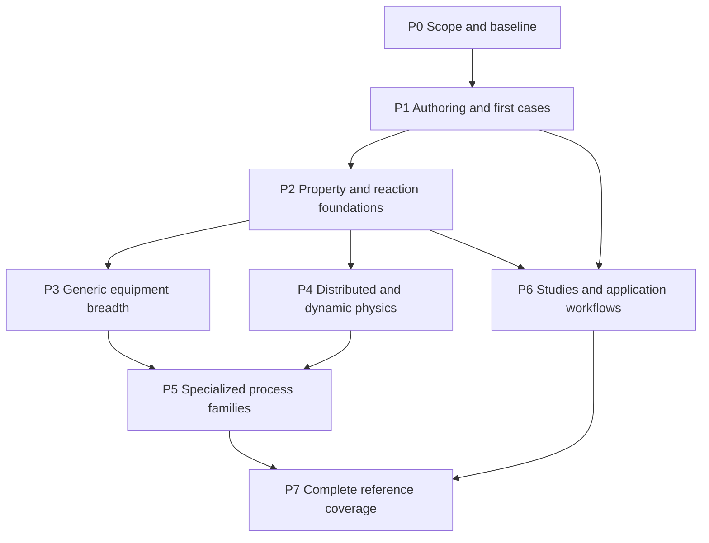

# Implementation sequence and first delivery

Source: [Notion](https://app.notion.com/p/40b141b583698136affccff909bce34a). Imported 2026-11-02.

[Implementation design and IDAES equivalence plan](index.md)

**Adopted high-level implementation sequence** · 2026-11-01. Phases name verifiable outcomes and dependencies. They do not assign dates, staffing, new repository plan numbers or implementation-complete status.

## 1. Organize around complete engineering cases

Each increment should deliver the smallest coherent path through authored science, admission, case selection, native execution, physical assessment and usable results. A library family is ready for its declared scope when a real consumer and independent comparison exercise it. Representative cases establish mechanisms; the reference inventory determines the remaining breadth.

The accepted domain model supplies the target concepts. The repository's current architecture, registry, scientific packages and runtime remain implementation owners. Source-level review establishes the starting point; selected native/reference qualification must establish the delivered behavior.

Scientific definitions remain authored once in the existing packages. Process-facing views and editing operations use their declaration, instance and semantic-member identities; they do not introduce a second equipment/stream object graph. Extend an existing package contract before adding generic machinery. A demonstrated language, physical-type or operation gap is implemented once at its current owner, with generated boundary contracts where applicable, then exercised by the scientific consumer. [Model and composition owner](https://github.com/paul-heyse/pse-arrow/blob/19e7b49a67df24c1bf73005a6186e145e930d53a/docs/authoritative_design/sections/models-and-composition.md).

For each adopted packet, settle the engineering outcome, allowed change owners, source/reference baseline, scientific assumptions and data, physical conventions, intended effects, requested outputs, discriminating evidence and any consequential unresolved choice. Delegate internal module/function organization, suitable helpers, batching, preparation reuse and ordinary local repairs to the coding agent. The [Coding-agent implementation brief](coding-agent-brief.md) supplies the concrete seams and scenarios. Resolve a stop condition when the proposed approach would change accepted meaning or lose evidence; it is not a recurring permission request. Use existing ADR/design routes only when their triggers apply. Compare complete edit/re-solve work and preserve native-library ownership; no extra agent ledger, generic scheduler, capability registry or mandatory broad audit follows.

## 2. Dependency overview

This is a dependency map, not a demand that all scientific work wait for an entire preceding phase. Steam properties can unlock power equipment while electrolyte/transport work unlocks capture columns. Studies can consume an already accepted steady model before every advanced unit is available. Existing Plan 53, 58h and other retained qualification obligations keep their own execution, status and acceptance owners; this roadmap references their prerequisites and evidence without creating a second ledger or claiming their completion. [Current work](https://github.com/paul-heyse/pse-arrow/blob/19e7b49a67df24c1bf73005a6186e145e930d53a/docs/plans/README.md).

## P0 — Fix the target population and reconcile the baseline

Adopt a versioned scope covering IDAES 2.13.0's process capabilities, meaningful configurations and published process examples. Pin the modern examples and compatibility repositories independently. Review the accompanying 55-family documented-notebook register and crosswalk it to executable scientific cases. A notebook path is evidence of a reference workflow, not an automatically unique numerical problem.

Resolve the current contradiction in `docs/relationship-to-idaes.md`, which still excludes examples, apps and specialized libraries and names the retired Python parity path. Update the owning architecture/scope documents through the existing change route when this implementation program is adopted. Preserve clean-room behavior-based reimplementation and isolated references. Do not revive retired plans by number or reopen settled numerical/storage decisions merely to adopt this roadmap. A concrete capability gap that requires a consequential architectural change uses the existing decision route.

For each capability family, separate current executable source, accepted historical evidence, pending current qualification and genuinely missing science. Use existing conformance/reference outcomes to establish a focused starting baseline. Unexecuted work remains unexecuted. [Scope owner](https://github.com/paul-heyse/pse-arrow/blob/19e7b49a67df24c1bf73005a6186e145e930d53a/docs/relationship-to-idaes.md); [qualification owner](https://github.com/paul-heyse/pse-arrow/blob/19e7b49a67df24c1bf73005a6186e145e930d53a/docs/authoritative_design/sections/operations-and-validation.md#section-24-2).

**Completion:** a finite reference population, supported claim boundaries, source/evidence crosswalk and agreed change owners. No additional universal readiness framework is required.

## P1 — Make the domain usable through the existing authoring path

Expose process-relevant definitions, instances, material/state requirements, ports, connections, balance regions and case roles as checked projections over the current model. Support create/compose/connect/specify/inspect/edit/prepare/run/result operations through existing native revision and workflow services, with an explicit text-versus-declaration editing policy. Preserve authored identity under a presentation rename; changing a contractual state-slot role is a semantic edit. Rebind already admitted numeric demands without treating a new path, fixed/free layout, topology or scientific-data selection as value-only. Source inspection and selected instantiated inspection state their scope and retain parallel connections and isolated units. Drafts remain inspectable with diagnostics; executable admission and local-versus-recorded effects remain explicit. [Source and topology APIs](https://github.com/paul-heyse/pse-arrow/blob/19e7b49a67df24c1bf73005a6186e145e930d53a/crates/pse-runtime/src/workflow/modeling.rs); [Declared demand/procedure APIs](https://github.com/paul-heyse/pse-arrow/blob/19e7b49a67df24c1bf73005a6186e145e930d53a/crates/pse-runtime/src/workflow/modeling/declared.rs).

Use three existing fixtures for the first complete delivery:

| Fixture | Why it is useful | Added equivalence obligation |
| --- | --- | --- |
| `recycle_flash_converges_from_defaults` | Four feed cases, material connections, equilibrium split, declared tear strategy, phase/flow outputs and overall component closure | Reconstruct matched IDAES cases and compare complete mapped physical outputs |
| `recycle_flash_failure_restores_specification` | Failure during initialization must preserve the user's original problem | Exercise the public native path and establish restoration and attributable failure behavior |
| `hx_costing_solved_area` | Thermal coupling, target outlet temperature, solved area, costing and currency conversion | Compare matched exchanger/costing quantities while retaining independent hand-derived expectations |

Sources: [Recycle campaign](https://github.com/paul-heyse/pse-arrow/blob/19e7b49a67df24c1bf73005a6186e145e930d53a/packages/reference/campaign/models/recycle-flash.pse); [exchanger campaign](https://github.com/paul-heyse/pse-arrow/blob/19e7b49a67df24c1bf73005a6186e145e930d53a/packages/reference/campaign/models/exchanger-costing.pse).

These cases exercise existing physics. The new work is the coherent authoring/inspection surface and complete matched-case/reference path. Preserve existing analytic checks and source-specific applicability permissions. Include a rating variant only with its own explicit fixed/free specification correspondence.

Treat the fixtures as scoped scientific and lifecycle witnesses. Their fixture-only parameter provenance does not automatically admit them through ordinary authoring: demonstrate that route with admissible inputs using the same definitions, and retain fixture/reference permissions in their owning conformance route. Do not relabel oracle-only data to make an ordinary run pass. The exchanger explicitly permits unknown area support and pressure extrapolation; it establishes matched thermal/costing arithmetic under those permissions, not a qualified equipment purchase price. Initialization failure must preserve the original immutable problem through the existing overlay lifecycle, without introducing a second rollback mechanism.

### P1 delivery packets A–D

These packets implement the existing first delivery. Their status and observations stay with its owning work; the table adds no new qualification authority.

| Packet | Deliverable | Evidence and condition requiring resolution |
| --- | --- | --- |
| A — Ordinary inputs | Admit ordinary source/data/cases for the existing recycle and exchanger definitions; retain original fixture/reference permissions separately. Fix editing representation and exact data/provenance correspondence. | Check selected identities, dependencies and eligibility. Resolve missing ordinary records, datum ambiguity or mismatched reference assumptions; never relabel oracle data or weaken admission. |
| B — Inspection and edits | Expose selected units, state/port contracts, connection occurrences, scientific configuration, case roles and diagnostics; perform a label rename, numeric edit and topology edit through existing owners. | Preserve semantic identity, component-order independence, parallel edges and isolates; compare admitted meaning after incremental and clean preparation. Resolve an independently mutable physics view, ordinal identity or changed public case meaning instead of adding a second graph. |
| C — Complete native journeys | Execute default recycle initialization/solve, its intentional failure, and the exchanger design solve; use `initialize_declared` for the full failure report. Exercise explicit local execution and the selected retained-result path. | Establish structural admission, original residual/bounds/domain checks, independent balances, restored specifications and semantic readback. The expected failure must reach its intended stage; no candidate means unavailable assessments, not zero answers or physical infeasibility. Resolve hidden retries or leaked temporary values. |
| D — Matched reference and P1 closeout | Add isolated IDAES counterparts for the selected positive cases with complete mapped outputs and relevant diagnostic assertions; preserve analytic recycle and hand-derived exchanger expectations. | Match exact physics/data, pins, units and dimensional allowances; check finite complete outputs and meaningful wrong/missing-output controls. Missing prerequisites in a required live invocation fail; unrun scope remains unattempted. No skip, tolerance inflation or denominator reduction can satisfy closeout. |

A establishes the ordinary-input contract; B and C integrate the authoring and execution journeys. Independent reference construction in D can proceed once the selected scientific inputs and correspondence are settled, with closeout after integration. A rating variant still requires its own explicit fixed/free specification. Existing targeted checks and P1 scope-end qualification apply; the four current live parity routes and broader Plan 53/58h and thermodynamic campaigns keep their own populations and owners. [Coding-agent implementation brief](coding-agent-brief.md); [Existing parity command](https://github.com/paul-heyse/pse-arrow/blob/19e7b49a67df24c1bf73005a6186e145e930d53a/justfile); [Conformance outcome owner](https://github.com/paul-heyse/pse-arrow/blob/19e7b49a67df24c1bf73005a6186e145e930d53a/crates/pse-runtime/src/workflow/modeling/conformance.rs).

**Completion:** ordinary authored inputs reach usable native results through the intended process interface; edits, failures, original physical checks and retained semantic readback work; selected IDAES comparisons are complete. Passing these cases establishes this delivery, not the entire equivalence program.

## P2 — Complete the scientific foundations needed by the case portfolio

Deliver property/state/reaction packages in consumer-driven groups:

- Express the state families required by upstream cases through the existing state-coordinate contracts, including phase/component flow representations and enthalpy-based states; extend the generic contract only where a specific family cannot be represented faithfully.
- Expand pure-component methods, ideal/cubic/activity formulations, phase equilibrium and parameter coverage while preserving existing SRK/NRTL work.
- Supply steam and supercritical-fluid property capabilities early enough to unlock pump/turbine, heat-exchanger and power examples.
- Add equilibrium/stoichiometric chemistry and consistent reaction energy/extent conventions.
- Add transport properties and electrolyte/true-apparent species packages before claiming rate-based capture or electrolyte equivalence.

For each group, deliver data selection, applicability, required derivatives, a concrete consumer and independent property/physical checks. A declared provider or coefficient table without the executable science does not complete the group. [Current physical semantics](https://github.com/paul-heyse/pse-arrow/blob/19e7b49a67df24c1bf73005a6186e145e930d53a/docs/authoritative_design/sections/physical-semantics.md).

**Completion:** the selected packages support their consuming cases over declared conditions, including original physical conventions, derivative requirements and diagnosed unsupported combinations.

## P3 — Complete generic equipment and integrated steady workflows

Expand the existing unit library by configuration and physical behavior: feeds/feed flashes, state junctions and stream scalers, explicit translators, mixer/separator choices, pressure-change modes, valves/pipes, flash, stoichiometric/equilibrium/Gibbs reactors, CSTR/PFR, solid-liquid separators/thickeners, multi-stream contactors and the required exchanger families. Add tray/column composition and custom-unit authoring wherever the published examples require them. Units continue to compose optional balance regions, states, closures and child definitions. Distributed variants depend on P4 where their requested physics requires it.

Use the HDA simulation/optimization/costing and methanol-synthesis workflows as integration milestones, alongside the unit-model tutorials. Check actual property assumptions, pressure closure, recycle and degrees of freedom. Gibbs stationarity remains distinct from demonstrated stable equilibrium.

**Completion:** every selected generic-unit configuration and integrated steady example has a native formulation and accepted result correspondence. Source records identify configurations still outside coverage; one passing heater does not qualify the unit library.

## P4 — Add the missing inventory and distributed physics

Extend the authored inventory library beyond current single-phase stored component projections. Supply explicit multiphase inventory allocation and the missing element/total storage projections where needed. Add temporal accumulation to distributed balances, verify original conservation identities with consistent discrete accounting, and establish spatial/temporal discretization-error evidence for the requested outputs.

Exercise dynamic CSTR/vessel, PETSc chemical/steam-control references, distributed reactors/contactors and cyclic operation. For selected batch/cyclic cases, retain physical inventories and declared transfers across operating steps; a procedure or campaign is distinct from an independent Study scenario. Declare initial/terminal conditions, collection intervals and cycle closure, and keep prescribed schedule execution, conflict checking and schedule optimization as separate capabilities. Reuse existing native ODE/index-1 and simultaneous routes where their admitted contracts fit. For cases demanding higher-index/general implicit DAEs, changing layouts, hybrid sensitivities or simultaneous events, identify the exact gap against current admitted capabilities before proposing additional work; support is not inferred from an integrator name.

**Completion:** matched transient/periodic cases have consistent initialization, complete requested coverage, conserved inventories, event semantics and declared discretization-error evidence. The current explicit CV1D refusal is removed only with the missing accumulation physics and its consumer evidence.

## P5 — Deliver specialized process families as parallel scientific packages

| Track | Dependencies | Integration witnesses |
| --- | --- | --- |
| Power and steam systems | Pure-fluid thermodynamics, distributed heat transfer, pressure-change and costing contracts | Steam cycles, supercritical plant, NGCC and associated turndown/operating cases |
| Gas-solid and chemical looping | Separate gas/solid states, heterogeneous reaction basis, transfer, inventory and distributed balances | Fixed/moving/bubbling beds and the released oxidation/reduction chemistry configurations |
| Carbon capture and separation | Electrolyte/speciation, phase and transport models, rate-based transfer, columns and membrane laws | MEA absorber/stripper, membrane and relevant integrated capture cases |
| Adsorption and electrochemistry | Physical operating steps, retained inventory, heat/mass/charge transfer, detailed local domains | TSA cycle and solid oxide cell/PID workflows |
| Gas distribution | Gas properties, compressor/node/pipeline contracts, pressure-flow coupling and distributed inventory | Released network cases, steady transport and transient linepack where supported upstream |

These tracks may add authored models of substantial complexity. Detailed local two-dimensional physics is compatible with a process-facing equipment boundary. A unit's outlet contract does not imply that all detailed and reduced implementations share internal observables or derivative capabilities.

**Completion:** release-tree configuration coverage and selected official workflow results are accepted for each family, including the scientific dependencies that family actually consumes.

## P6 — Complete engineering analysis and application workflows

Extend existing case/study/analysis owners for the remaining reference workflows: parameter estimation and reconciliation, uncertainty/sampling, costing and utility targeting, optimization, dynamic control, multiperiod studies, grid integration and surrogate embedding/training where required. Separate physical-time operating steps from computational study nodes.

Many native operations already exist. Work is driven by missing case semantics, scientific models, external format/import contracts and accepted reference coverage. Preserve joint shared-parameter inference rather than turning multiple experiments into independent fits. Keep imported surrogate artifact evaluation/embedding distinct from reproducing a particular external training algorithm. Grid unit commitment and some ReLU equation embeddings require discrete optimization capability; verify that the selected native route supports the mathematical problem before treating them as frontend work.

For a selected external or procedural model, establish whether the consumed operation exposes residuals, evaluates outputs or advances state in time. Time advance additionally requires explicit physical-interval, state custody, restart/restore capability, event and coupling contracts. Residual/evaluation bindings still declare their actual effects, mutable attempt state and repeatability requirements; these do not imply physical time advance. A declared capability may state that restore is unsupported when the selected coupling does not require it. No capability is inferred from a provider name. For costing, environmental or data-driven analyses, retain assessment boundaries, period/annualization, factor provenance and observation/error assumptions at existing science/case/result owners. The contracts in [Architecture and process authoring](architecture-and-process-authoring.md) and [Scientific packages and equipment delivery](scientific-packages-and-equipment.md) govern these extensions. Implement only the capabilities needed by the selected consumer, without making universal co-simulation, a historian or a life-cycle database a prerequisite for P1.

Deliver native inspection, stream/result tables, diagnostic attribution and flowsheet visualization for the useful workflows demonstrated by the modern visualizer tutorial. Reuse the same process projections, semantic identities and typed edit contracts from P1. A graphical editor is not a prerequisite for the first scientific delivery; useful visualization and reusable reporting remain part of the final native workflow target. Reproducing a Python UI implementation is not required.

Map Caprese control behavior to the native horizon workflows without requiring its Python API. Released IDAES 2.13 does not provide a completed MHE implementation; native MHE is an extension with its own evidence, not a fabricated upstream parity target. MatOpt belongs to the broader optimization/material-design track, with its own domain contracts over the generic mathematical core. A literal whole-distribution equivalence claim must close that track too.

**Completion:** each selected engineering workflow can be authored and executed with explicit case coupling, supported products and task-appropriate qualification. Optional external dependencies remain visible and unqualified until their selected cases execute.

## P7 — Close the reference population and establish the release claim

Finish the required configurations and cases identified by the release-tree inventory, modern examples and compatibility regressions. Establish native authoring extensibility through custom-property, custom-reaction and custom-unit examples, not only prebuilt equipment. Preserve the documented held/archive/optional boundaries in the case register.

Run the relevant assembled native/reference and operational qualification through existing owners, once the selected functional scope is integrated. Include the applicable Plan 53/58h obligations and retained thermodynamic campaign when their claimed scope requires them. Scope-end checks follow repository workflow; large campaigns do not recur after every package edit.

Measure the agreed performance questions under matched quality conditions: first preparation, value-only edit/re-solve, recycle robustness, large coupled models, studies and trajectories. Publish capabilities, evidence and unresolved limitations from actual results. Retire replaced paths with their callers after their replacements are established; historical code belongs in Git.

**Completion:** every mandatory row has accepted evidence, zero failures remain in the selected acceptance population, all claimed output coverage is complete and the public scope statement matches the actual result. Broader unimplemented or unavailable work cannot be counted as equivalent.

## 3. Risks that determine sequencing

The largest effort drivers are scientific breadth and its validation: electrolyte/speciation/transport coupling, steam and multiparameter properties, heterogeneous reaction packages, distributed inventory physics and full-plant integration. The existing numerical infrastructure reduces the amount of new generic machinery, but it does not eliminate these scientific obligations.

Three practical risks should shape each delivery: different parameter/reference conventions can masquerade as solver error; configuration cross-products can exceed what a single demonstration exercises; and a local source-level success can be mistaken for assembled qualification. Explicit contracts, a finite reviewed case population and retained original-space evidence address these risks within the current architecture.

This plan deliberately makes no staffing or calendar estimate. Size the scientific packages after P0 resolves the actual reference/configuration population and P1 establishes the complete authoring-to-evidence path.

## Adopted implementation detailing and expansion direction

[Coding-agent implementation brief](coding-agent-brief.md) details four bounded packets within the existing first delivery: ordinary inputs, inspection/edits, complete native journeys and matched reference closeout. It identifies the current code seams, preserved invariants, delegated choices and scientific questions to resolve. [Plan detailing and industry coverage assessment](../rationale/plan-detailing-assessment.md) adds the broader domain/industry perspective. The coding contracts and A–D packets are incorporated in this roadmap. Cross-industry semantic direction is adopted; additional industry cases remain candidates for finite selection at this plan owner. Documentation adoption does not report implementation progress or replace P0–P7.
